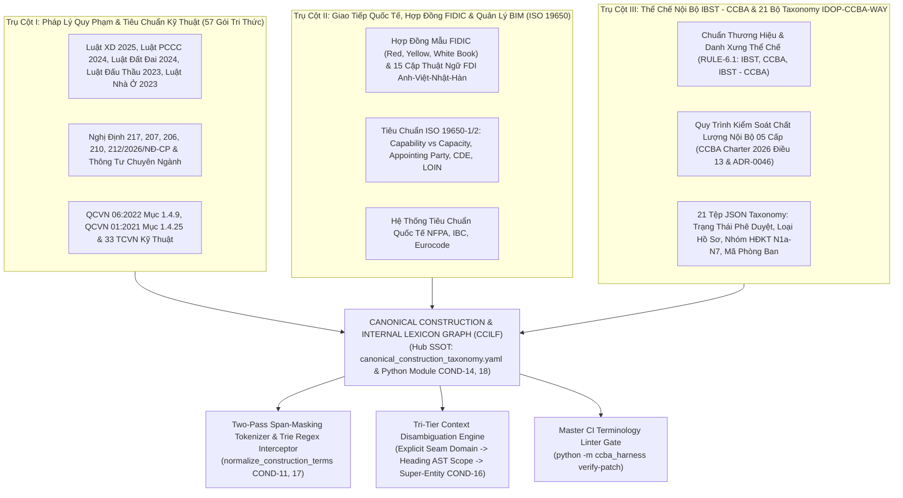

# RFC Proposal: Khung Quản Trị & Đồ Thị Tri Thức Thuật Ngữ Chuẩn Ngành Xây Dựng, Pháp Lý Quy Phạm & Quy Chế Nội Bộ (CCILF)

- **Tên sáng kiến:** Canonical Construction, Statutory & Internal Governance Lexicon Framework (CCILF)
- **Tác giả đề xuất:** Antigravity (Pair Architect & Builder) & Kỹ sư Vũ Văn Chủ (Giám đốc Trung tâm CCBA - IBST)
- **Ngày lập:** 2026-10-23
- **Trạng thái:** Đã hợp nhất (Merged) — PR [#561](https://github.com/vvChu/ccba-agent-platform/pull/561) (Commit `818055bc`) — Đã đạt phán quyết `APPROVE_WITH_CONDITIONS` từ Grok 4.7 xhigh (`req-discuss-canonical-lexicon-architecture-001`)
- **Căn cứ pháp lý & thể chế nền tảng:**
  - [ADR-0045](../../docs/adr/0045-hub-proposal-ingestion-governance.md) (Hub Proposal Ingestion Governance)
  - [ADR-0046](../../docs/adr/0046-personal-sandbox-lifecycle-and-charter-2026-alignment.md) (Personal Sandbox Lifecycle & Charter 2026 Alignment)
  - [ADR-0058](../../docs/adr/0058-archetype-routing-and-deterministic-completion-lock.md) (Deterministic Completion Lock)
  - [ADR-0059](../../docs/adr/0059-legal-verbatim-grounding-and-mandatory-acquisition-invariant.md) (Legal Verbatim Grounding & Provenance Stamping)
  - [ADR-0061](../../docs/adr/0061-platform-aware-kiss-v2-and-quarantine-governance.md) (Platform-Aware KISS v2.0 & Quarantine Governance)
  - [ADR-0063](../../docs/adr/0063-level-2-peer-delegation-protocol-and-cost-guardrails.md) (Level-2 Peer Delegation Protocol & Cost Guardrails)
  - Luật Xây dựng 2025 (Số 135/2025/QH15 - Điều 3, Điều 9, Điều 36, Điều 38, Điều 88)
  - Luật Phòng cháy, chữa cháy và cứu nạn, cứu hộ 2024 (Số 55/2024/QH15 - Điều 2, Điều 17)
  - Luật Đất đai 2024 (Số 31/2024/QH15 - Điều 3) & Luật Nhà ở 2023 (Số 27/2023/QH15 - Điều 2) & Luật Đấu thầu 2023 (Số 22/2023/QH15 - Điều 4)
  - Nghị định 217/2026/NĐ-CP, Nghị định 207/2026/NĐ-CP, Nghị định 206/2026/NĐ-CP, Nghị định 210/2026/NĐ-CP, Nghị định 212/2026/NĐ-CP
  - Quy chuẩn QCVN 06:2022/BXD Mục 1.4.9 ($H_{PCCC}$) & QCVN 01:2021/BXD Mục 1.4.25 (Chiều cao công trình, Lines 397-405)
  - Tiêu chuẩn ISO 19650-1/2 (TCVN ISO 19650:2021 & TCVN 14177:2024) & Hợp đồng Mẫu FIDIC (Red/Yellow/White Book)
  - Điều 13 CCBA Charter 2026 (Hệ thống Kiểm soát 05 Cấp), Quy chuẩn thương hiệu RULE-6.1, và 21 bộ Taxonomy `IDOP-CCBA-WAY`

---

## 1. Bối cảnh & Động lực Thực tiễn (Context & Motivation)

Trong quá trình phát triển các Agent tự hành phục vụ tư vấn pháp lý, thẩm tra thiết kế, lập hồ sơ hoàn thành công trình và quản lý dự án FDI (như Terumo Bến Cát, Panasonic PAPVN), nền tảng CCBA phát hiện một lỗ hổng nghiêm trọng mang tính hệ thống của các mô hình AI: **Hiện tượng Trôi lệch Thuật ngữ & Dịch Thô Máy Móc (Literal Translation Drift)**.

### Nỗi đau thực tế (Core Pain Points):
1. **Dịch thô ngô nghê, phản cảm với thông lệ chuyên môn:**
   - AI dịch *"Concept Design"* thành *"Thiết kế Khái niệm"* (trong khi 100% ngành kiến trúc xây dựng Việt Nam và hợp đồng tư vấn gọi là **"Thiết kế ý tưởng"**).
   - AI dịch *"Project Coordinator"* thành *"Kỹ sư Điều phối Dự án"* (trong khi chuẩn vai trò quản trị dự án là **"Điều phối dự án (PIC)"**).
   - AI dịch *"As-built drawings"* thành *"Bản vẽ như xây dựng"* (thay vì **"Bản vẽ hoàn công"**).
   - AI dịch *"Grandfathering clause"* thành *"Điều khoản ông nội"* thay vì **"Nguyên tắc bảo lưu công trình hiện hữu / Không áp dụng hồi tố"**.
2. **Sai lệch bản chất pháp lý & Trôi lệch thẩm quyền nguy hiểm:**
   - AI nhầm lẫn giữa *"Thẩm tra"* (dịch vụ tư vấn độc lập của Viện IBST/CCBA theo Luật XD 2025 Điều 3 Khoản 15, Điều 36) và *"Thẩm định"* (thẩm quyền quản lý nhà nước của Sở XD/Bộ XD hoặc Chủ đầu tư theo Điều 3 Khoản 16, Điều 38) và *"Thẩm định thiết kế về phòng cháy và chữa cháy"* (thẩm quyền kép của CQ Chuyên môn Xây dựng và CQ Công an theo Luật PCCC 2024 Điều 2 Khoản 17).
   - AI lẫn lộn giữa *"Chiều cao công trình"* theo quy hoạch đô thị (QCVN 01:2021/BXD Mục 1.4.25 Lines 397-405) và *"Chiều cao PCCC"* ($H_{PCCC}$ đo đến mép dưới cửa sổ tầng trên cùng theo QCVN 06:2022/BXD Mục 1.4.9).
   - AI nhầm lẫn tính đa nghĩa liên luật của thuật ngữ *"Chủ đầu tư"* giữa Luật Xây dựng (Điều 9 chia 4 nhóm), Luật Đấu thầu (Điều 4 Khoản 2), Luật Đất đai (Điều 3 Khoản 10) và Luật Nhà ở (Điều 2 Khoản 14).
   - AI nhầm lẫn thứ bậc quản lý chi phí NĐ 206/2026/NĐ-CP (Sơ bộ TMĐT $\to$ TMĐT $\to$ Dự toán xây dựng CT $\to$ Dự toán gói thầu $\to$ Giá gói thầu).
   - AI tự ý bịa đặt yêu cầu chứng chỉ hành nghề (CCHN) cho các chức danh đã bãi bỏ hoặc miễn theo Luật XD 2025 Điều 88 và NĐ 212/2026 (Giám đốc QLDA, Quản lý chi phí, Chỉ huy trưởng công trường).
3. **Vi phạm Quy chế Thể chế & Phân cấp Thẩm quyền Nội bộ Đơn vị:**
   - AI tự ý dùng danh xưng lỗi thời hoặc trùng lặp (*"Viện IBST"*, *"Trung tâm CCBA"* thay vì chuẩn thương hiệu: Viện `IBST`, Trung tâm `CCBA`, Header phát hành dự án: `IBST - CCBA` — nghiêm cấm `IBST / CCBA`).
   - Nhầm lẫn cấp thẩm quyền phê duyệt nội bộ, vi phạm **Quy trình Kiểm soát Chất lượng 05 Cấp** quy định tại Điều 13 CCBA Charter 2026 và ADR-0046.

---

## 2. Kiến Trúc 3 Trụ Cột Tri Thức Thuật Ngữ (The 3-Pillar Knowledge Architecture)

Nền tảng thiết lập Hệ thống Từ điển & Đồ thị Tri thức 3 Trụ cột hoàn chỉnh:



---

### Trụ Cột I: Thuật Ngữ Quy Phạm Pháp Luật & Tiêu Chuẩn Kỹ Thuật (Statutory & Codes)
- **Quy mô khảo sát thực chứng:** 57 gói văn bản quy phạm trong kho `ccba-legal-knowledge` chứa trên 550 mục từ định nghĩa nguyên văn.
- **Ranh giới pháp lý Tam phân (Thẩm tra vs Thẩm định vs Thẩm định thiết kế PCCC):**
  * `Thẩm tra` (*Design Verification* — Luật XD 2025 Điều 3 Khoản 15, Điều 36): Dịch vụ tư vấn độc lập do tổ chức tư vấn đủ điều kiện năng lực thực hiện theo hợp đồng.
  * `Thẩm định` (*Appraisal* — Luật XD 2025 Điều 3 Khoản 16, Điều 38): Thẩm quyền quản lý nhà nước của Cơ quan chuyên môn về xây dựng (Bộ/Sở XD) hoặc Chủ đầu tư xem xét để phê duyệt dự án/thiết kế.
  * `Thẩm định thiết kế về phòng cháy và chữa cháy` (Luật PCCC 2024 Điều 2 Khoản 17, Điều 17): Thẩm quyền quản lý chuyên ngành được phân tách kép: Cơ quan chuyên môn XD thẩm định giải pháp kiến trúc/ngăn cháy/thoát nạn; Cơ quan Công an thẩm định hệ thống kỹ thuật PCCC. Thuật ngữ cũ *"Thẩm duyệt"* chỉ còn giá trị lịch sử chuyển tiếp (Grandfathering).
- **Phân định định lượng Chiều cao PCCC ($H_{PCCC}$) vs Chiều cao Công trình:**
  * $H_{PCCC}$ (QCVN 06:2022 Mục 1.4.9): Đo từ mặt đường xe chữa cháy tiếp cận đến **mép dưới lỗ cửa sổ tầng trên cùng** $\to$ khống chế giải pháp an toàn thoát nạn, thang bộ N1/N2/N3, buồng lánh nạn.
  * Chiều cao công trình (QCVN 01:2021 Mục 1.4.25 Lines 397-405): Đo từ cao độ mặt đất quy hoạch đến **điểm cao nhất của công trình** (kể cả mái tum) $\to$ khống chế chỉ tiêu quy hoạch kiến trúc, mật độ, khoảng lùi, tĩnh không sân bay.
- **08 Nhóm Thuật Ngữ Pháp Lý Hiện Hành Được Chuẩn Hóa:**
  1. *Chủ thể & Thẩm quyền:* Người quyết định đầu tư vs Chủ đầu tư (đa nghĩa 4 luật), Cơ quan chuẩn bị dự án, Chủ sở hữu vs Chủ quản lý sử dụng.
  2. *Đối tượng & Phân cấp:* Dự án ĐTXD vs Công trình XD; Loại công trình (Phụ lục I NĐ 207/2026) vs Cấp công trình (TT 06/2021/TT-BXD).
  3. *Quy hoạch:* Quy hoạch chung $\to$ Phân khu $\to$ Chi tiết 1/500; Chỉ tiêu sử dụng đất quy hoạch.
  4. *Đất đai & Nhà ở:* Chuyển quyền vs Chuyển mục đích; Lấn đất vs Chiếm đất; Nhà ở có sẵn vs Nhà ở hình thành trong tương lai.
  5. *Đấu thầu:* Hồ sơ mời thầu (Đấu thầu rộng rãi/hạn chế) vs Hồ sơ yêu cầu (Chỉ định thầu); Gói thầu vs Chỉ định thầu.
  6. *Chất lượng & Bảo trì:* Bảo hành (nhà thầu, 12-24 tháng) vs Bảo trì (chủ quản lý, suốt niên hạn); Kiểm định vs Giám định tư pháp; Sự cố công trình xây dựng (vượt giới hạn an toàn) vs Hư hỏng thông thường.
  7. *PCCC:* Thẩm định thiết kế PCCC; Nghiệm thu PCCC (Chủ đầu tư) vs Kiểm tra công tác nghiệm thu PCCC (Công an).
  8. *Quản lý chi phí 5 cấp (NĐ 206/2026):* Sơ bộ TMĐT $\to$ TMĐT (7 khoản mục) $\to$ Dự toán xây dựng CT $\to$ Dự toán gói thầu $\to$ Giá gói thầu.

---

### Trụ Cột II: Giao Tiếp Quốc Tế, Hợp Đồng FIDIC & Quản Lý BIM (International & BIM)
- **Chuẩn Quản lý Thông tin ISO 19650 (TCVN ISO 19650:2021 & TCVN 14177:2024):**
  * `Capability` $\iff$ **Năng lực** (kỹ năng, chuyên môn nhân sự); `Capacity` $\iff$ **Khả năng** (phương tiện, thời gian sẵn có).
  * `Appointing Party` $\iff$ **Bên đặt hàng** *(Cấm: Bên bổ nhiệm)*; `Appointed Party` $\iff$ **Bên thực hiện**; `Lead Appointed Party` $\iff$ **Bên thực hiện chính**; `Delivery Team` $\iff$ **Nhóm chuyển giao**; `Task Team` $\iff$ **Nhóm triển khai**.
  * `BEP` $\iff$ **Kế hoạch thực hiện BIM**; `CDE` $\iff$ **Môi trường dữ liệu chung**; `LOIN` $\iff$ **Mức độ nhu cầu thông tin**.
- **Bảng Đối Chiếu 15 Thuật Ngữ Đa Ngôn Ngữ Dự Án FDI (Anh - Việt - Nhật JIS - Hàn KCS) [COND-12]:**

| Thuật ngữ Tiếng Anh | Chuẩn Tiếng Việt (`vi_canonical`) | Chuẩn Tiếng Nhật (`ja` - MLIT/JIS) | Chuẩn Tiếng Hàn (`ko` - MOLIT/KCS) | Thuật ngữ Cấm / Dịch sai (`vi_forbidden`) |
| :--- | :--- | :--- | :--- | :--- |
| **Concept Design** | **Thiết kế ý tưởng** | 構想設計 / 企画設計 | 기본구상 / 기획설계 | Thiết kế khái niệm, Khái niệm thiết kế |
| **Schematic Design** | **Thiết kế sơ bộ / Phương án** | 基本計画 / 概略設計 | 계획설계 | Thiết kế sơ đồ, Thiết kế lược đồ |
| **Basic Design** | **Thiết kế cơ sở** | 基本設計 | 기본설계 | Thiết kế căn bản, Thiết kế nền tảng |
| **FEED** | **Thiết kế kỹ thuật tổng thể (FEED)** | 基本設計フロントエンド | 초기 엔지니어링 설계 (FEED) | Thiết kế đầu vào, Kỹ thuật mặt trước |
| **Detailed Design** | **Thiết kế bản vẽ thi công (TKBVTC)** | 実施設計 / 施工図面 | 실시설계 / 시공도면 | Thiết kế chi tiết, Bản vẽ xây dựng |
| **Shop Drawings** | **Bản vẽ chi tiết thi công / Shop drawing** | 施工図 / 工作図 | 시공상세도 / 샵드로잉 | Bản vẽ cửa hàng, Bản vẽ tiệm |
| **As-Built Drawings** | **Bản vẽ hoàn công** | 竣工図 / 完成図 | 준공도면 | Bản vẽ như xây dựng, Bản vẽ như đã xây |
| **BOQ** | **Bảng tiên lượng / Bảng khối lượng mời thầu**| 内訳明細書 / 数量内訳書 | 공사내역서 / 물량내역서 | Hóa đơn số lượng, Hóa đơn khối lượng |
| **RFI** | **Phiếu yêu cầu làm rõ thông tin kỹ thuật** | 質疑書 / 照会書 | 기술질의서 (RFI) | Đòi hỏi thông tin, Yêu cầu tin tức |
| **Variation Order (VO)** | **Lệnh thay đổi / Điều chỉnh phát sinh**| 設計変更指示書 | 설계변경명령서 (VO) | Thứ tự biến thể, Đơn hàng biến đổi |
| **Taking-Over (TOC)** | **Biên bản bàn giao đưa vào sử dụng** | 引渡証明書 / 竣工引渡書 | 준공인수증 | Giấy chứng nhận tiếp quản, Chiếm hữu |
| **Defects Notification (DNP)**| **Thời hạn thông báo sai sót / Bảo hành**| 瑕疵担保期間 / 瑕疵修補期間 | 하자담보책임기간 | Thời kỳ thông báo khiếm khuyết |
| **Punch List** | **Danh mục tồn tại cần khắc phục trước bàn giao**| 指摘事項リスト / 手直しリスト | 펀치리스트 / 미결사항목록 | Danh sách đấm, Danh sách cú đấm |
| **Grandfathering Clause** | **Nguyên tắc bảo lưu công trình hiện hữu** | 既存不適格条項 / 祖父条項 | 기득권 보호 조항 | Điều khoản ông nội, Khoản mục ông cố |
| **Value Engineering (VE)** | **Kỹ thuật giá trị / Tối ưu hóa giá trị công trình**| バリューエンジニアリング | 가치공학 (VE) | Kỹ thuật giá trị gia tăng |

---

### Trụ Cột III: Thể Chế Nội Bộ IBST - CCBA & 21 Bộ Taxonomy `IDOP-CCBA-WAY`
- **Chuẩn hóa danh xưng thương hiệu thể chế (RULE-6.1):**
  * Cấp Viện: `Viện`, `Viện KHCN`, `IBST` *(Nghiêm cấm: "Viện IBST")*.
  * Cấp Trung tâm: `Trung tâm`, `Trung tâm BIM`, `CCBA` *(Nghiêm cấm: "Trung tâm CCBA")*.
  * Đơn vị gửi trong hồ sơ kỹ thuật/dự án/RFI: `IBST - CCBA` *(Nghiêm cấm dùng dấu gạch chéo "IBST / CCBA" để tránh hiểu lầm là liên danh hai pháp nhân độc lập)*.
- **Hệ thống Kiểm soát Chất lượng Nội bộ 05 Cấp Chuẩn (Điều 13 CCBA Charter 2026 & ADR-0046):**
  * **Cấp 1 (`LEVEL_1_TECHNICAL_CHECK`):** Tác giả tự rà soát; Chủ trì bộ môn kiểm tra tính toán chuyên môn sâu (Kết cấu, MEP, PCCC); Chủ trì kỹ thuật (Chủ nhiệm dự án) khớp nối đồng bộ đa bộ môn.
  * **Cấp 2 (`LEVEL_2_MANAGEMENT_APPROVAL`):** Chủ trì hợp đồng (CTHĐ) đối soát phạm vi, cam kết và tiến độ; hoặc Trưởng phòng chuyên môn đối với mô hình quản lý tập trung (TVGS/QLDA/Thi công).
  * **Cấp 3 (`LEVEL_3_DEPARTMENT_REVIEW`):** Lãnh đạo Phòng chuyên môn kiểm soát chất lượng bàn giao chuyên môn.
  * **Cấp 4 (`LEVEL_4_COMPLIANCE_QA`):** Ban Cố vấn Pháp lý, Tiêu chuẩn & Đảm bảo Chất lượng ("Người gác cổng" ISO 9001, thể thức, quy chuẩn).
  * **Cấp 5 (`LEVEL_5_FINAL_APPROVAL`):** Giám đốc/Phó Giám đốc CCBA ký phát hành (đóng dấu Trung tâm) hoặc Giám đốc CCBA duyệt trình Lãnh đạo Viện IBST ký (đối với HĐ ký cấp Viện).
- **Khai phá & tích hợp toàn vẹn 21 bộ Taxonomy `IDOP-CCBA-WAY`:**
  * 5 Trạng thái phê duyệt bất biến: `Nháp` $\to$ `Đệ trình` $\to$ `Yêu cầu bổ sung` $\to$ `Phê duyệt` $\to$ `Từ chối` (`CCBA_TrangThaiPheDuyet.json`).
  * 5 Nhóm tài liệu chuẩn: `Hồ sơ Dự án`, `Hồ sơ Hợp đồng`, `Hồ sơ Kỹ thuật`, `Hồ sơ Tài chính`, `Văn bản Nội bộ/Pháp quy` (`CCBA_LoaiTaiLieu.json`).
  * 10 Nhóm hợp đồng kinh tế theo Quy chế QCCTNB 3209: `N1a` đến `N7` (`CCBA_NhomHopDongKT.json`).
  * Hệ thống mã phòng ban CCBA (101 đến 303) và Viện IBST (00 đến 03) (`CCBA_DonViPhongBan.json`).
  * Phân nhóm chức danh BIM: Dynamo/Python Specialist; BIM Director/Manager/Coordinator; BIM Modeler (`CCBA_ChucDanhBIM.json`).

---

## 3. Thiết Kế Kỹ Thuật & Tích Hợp Nền Tảng Hub Monorepo

### 1. Cơ Sở Dữ Liệu Thuật Ngữ Chuẩn (Hub SSOT IR) [COND-14]:
- Đặt tại Hub monorepo: `packages/ccba-legal-intel/resources/canonical_construction_taxonomy.yaml`.
- Mô hình hóa **Thực thể Đa diện (Faceted Super-Entity)** xử lý đa nghĩa liên luật [COND-16]:
  ```yaml
  terms:
    chu_dau_tu:
      canonical_id: "STAT-CDT-001"
      term_lemma: "Chủ đầu tư"
      domain: "governance"
      is_faceted: true
      translations:
        en: "Employer / Project Owner"
        ja: "発注者 / 事業主"
        ko: "발주처 / 사업시행자"
      vi_forbidden: ["Người sử dụng lao động", "Bên thuê", "Chủ tiền"]
      facets:
        xay_dung:
          legal_basis: "Điều 9 Luật Xây dựng số 135/2025/QH15"
          clause_anchor: "dieu-9"
          verbatim_sha256: "e3b0c44298fc1c149afbf4c8996fb92427ae41e4649b934ca495991b7852b855"
          effective_from: "2026-07-01"
        dau_thau:
          legal_basis: "Khoản 2 Điều 4 Luật Đấu thầu số 22/2023/QH15"
          clause_anchor: "dieu-4-khoan-2"
          verbatim_sha256: "d576a928b584d436a7ebc40ef4cfd34208a0d0a52df71fcbfe4d6507c8e9b01c"
          effective_from: "2024-01-01"
        dat_dai:
          legal_basis: "Khoản 10 Điều 3 Luật Đất đai số 31/2024/QH15"
          clause_anchor: "dieu-3-khoan-10"
          term_alias: "Chủ đầu tư dự án đầu tư có sử dụng đất"
          verbatim_sha256: "ca978112ca1bbdcafac231b39a23dc4da786eff8147c4e72b9807785afee48bb"
          effective_from: "2024-08-01"
  ```

### 2. Bộ Lọc Mặt Nạ Hai Pha & Regex Trie Normalizer [COND-11, COND-17]:
- Triển khai trong package `packages/ccba-legal-intel` (module `ccba_legal.lexicon`):
  * **Pha 1 (Span Masking):** Lớp `ImmutableSpanMasker` nhận diện và thay thế toàn bộ các phân vùng bất biến (Markdown Blockquote, Inline Code, Code Block, chuỗi trong ngoặc kép, mã số văn bản cũ, URL, Anchor Tags) bằng token `__CCBA_MASK_000001__`.
  * **Pha 2 (Trie Regex Normalization):** Kích hoạt compiled Trie Regex với ranh giới từ `\b` trên phần văn bản khả biến. Tốc độ xử lý $< 50\text{ms}$ cho 100 trang văn bản.
  * **Pha 3 (Unmasking):** Hoàn trả $100\%$ nội dung nguyên văn ban đầu về đúng vị trí (Zero False-Positives).
- Entry point công khai:
  ```python
  from ccba_legal.lexicon import normalize_construction_terms
  
  clean_text = normalize_construction_terms(raw_text, context_domain="xay_dung")
  ```

### 3. Động Cơ Khử Nhập Nhằng Ngữ Cảnh Ba Tầng (Tri-Tier Disambiguation) [COND-16]:
- **Cấp 1 (Ghi đè tường minh):** Truyền trực tiếp `context_domain="dau_thau"` vào Seam call.
- **Cấp 2 (AST Heading Scoping Heuristics):** Phân tích tiêu đề mục Markdown H1/H2 gần nhất (`Đất đai` $\to$ domain `dat_dai`; `Đấu thầu` $\to$ domain `dau_thau`; `Thiết kế/Thi công` $\to$ domain `xay_dung`).
- **Cấp 3 (Faceted Annotation):** Tại đoạn văn bản tổng hợp, xuất chú thích đa chiều: `Chủ đầu tư [Xây dựng: Đ9 L.XD 2025 | Đấu thầu: Đ4.2 L.ĐT 2023 | Đất đai: Đ3.10 L.ĐĐ 2024]`.

### 4. Quy Trình Phân Phối Song Hành Phục Vụ Spoke Offline-First [COND-18]:
- Hub SSOT YAML tại `packages/ccba-legal-intel/resources/canonical_construction_taxonomy.yaml`.
- Build harness tự động biên dịch YAML thành `_generated_taxonomy.py` (chứa dictionary $O(1)$ và Pydantic static types).
- Đóng gói hoàn chỉnh vào **Wheel `.whl`** của `ccba-legal-intel`: Spoke hoạt động offline chỉ cần cài package là có toàn bộ từ điển chuẩn mà không cần kết nối mạng.
- Kịch bản `sync_spoke.py` phân phối bản sao cache YAML về `.agents/resources/taxonomy/cache/` làm fallback.

### 5. Cổng Kiểm Định Tự Động Master CI (Terminology Linter Gate):
- Tích hợp `scripts/lint_construction_terminology.py` vào `python -m ccba_harness verify-patch`.
- Tự động quét toàn bộ PR/commit; chặn ngay lập tức nếu phát hiện vi phạm thuật ngữ cấm (`vi_forbidden`) hoặc danh xưng sai quy chuẩn RULE-6.1.

---

## 4. Kế Hoạch Triển Khai 4 Giai Đoạn & 8 Điều Kiện Phong Tỏa Grok 4.7

| Giai đoạn | Nhiệm vụ kỹ thuật chính | Sản phẩm bàn giao | Tiêu chí hoàn thành |
| :--- | :--- | :--- | :--- |
| **Pha 1** | Vá regex Ingestion `khoan_pattern`, re-index 57 gói VBPL, crawl Luật Kinh doanh BĐS 2023, nạp NĐ 15, 06, 35 | Tệp `profiles.py` vá regex chuẩn; bộ snapshot test `test_legal_clause_regex_snapshot.py` | 100% snapshot test đạt chuẩn (`COND-15`); phục hồi đủ 33 khoản Luật Đấu thầu và 6 khoản Luật Kiến trúc |
| **Pha 2** | Xây dựng Seam `LexiconHarvester`, bóc tách 57 gói VBPL & 21 Taxonomy JSON, đóng dấu SHA-256 | Module `harvester.py`; Hub SSOT `canonical_construction_taxonomy.yaml` | 100% mục từ có mỏ neo dòng thực tế và băm SHA-256 Verbatim Stamp (`COND-13`, `COND-14`) |
| **Pha 3** | Hiện thực hóa `ImmutableSpanMasker`, `FacetedDisambiguationEngine`, biên dịch `_generated_taxonomy.py` | Module `span_masker.py`, `disambiguation.py`, `_generated_taxonomy.py` | Xử lý $< 50\text{ms}$/100 trang; 0% false positives trên blockquote/code/quotes (`COND-16`, `COND-17`, `COND-18`) |
| **Pha 4** | Tích hợp vào `ccba-ooxml`, `ccba-qc-core` và thiết lập Master CI Terminology Linter Gate | Script `lint_construction_terminology.py` tích hợp `verify-patch` | $100\%$ checks CI xanh; chặn đứng mọi vi phạm thuật ngữ trên Hub và Spoke |

### Hệ Thống 08 Điều Kiện Phong Tỏa Kỹ Thuật từ Grok 4.7 xhigh (COND-11 đến COND-18):
1. **`COND-11 (Context-Aware Boundary & Verbatim Guard)`**: Thay thế tự động bắt buộc dùng ranh giới từ `\b` và tuyệt đối không thay thế trong trích dẫn nguyên văn lịch sử, mã định danh, URL.
2. **`COND-12 (Modular Multilingual Schema)`**: Cấu trúc mở rộng `translations: {en: "...", ja: "...", ko: "..."}` phục vụ trực tiếp các dự án FDI Nhật/Hàn.
3. **`COND-13 (Temporal Validity Stamping)`**: Gắn mốc thời gian hiệu lực (`effective_from`, `superseded_by`) phục vụ đối soát công trình cải tạo lịch sử (Grandfathering).
4. **`COND-14 (Single Source of Truth Placement)`**: Lưu trữ từ điển chuẩn duy nhất tại Hub monorepo (`packages/ccba-legal-intel/resources/canonical_construction_taxonomy.yaml`), Spoke tiêu thụ read-only qua Seam hoặc wheel.
5. **`COND-15 (Robust Parser Regex & Multi-Dialect Snapshot Suite)`**: Chuẩn hóa regex bóc tách khoản mục `r"^\s*(?:\*{0,2}_*(\d+)[\.\*\_]{1,3}\*{0,2}_*)\s+(.+)$"`, bảo đảm bộ snapshot test trên 57 gói VBPL đạt $100\%$ không mất khoản.
6. **`COND-16 (Faceted Super-Entity & Tri-Tier Disambiguation Engine)`**: Mô hình hóa thuật ngữ liên luật thành Thực thể Đa diện; phân giải 3 cấp: Tham số Seam $\to$ AST Heading Scope $\to$ Super-Entity Annotation.
7. **`COND-17 (Two-Pass Span-Masking Tokenizer for Verbatim Guard)`**: Che chắn toàn bộ vùng bất biến bằng token trước khi kích hoạt Compiled Trie Regex Normalizer, sau đó giải phóng token về nguyên trạng.
8. **`COND-18 (Dual-Artifact Distribution Pipeline)`**: Duy trì SSOT YAML tại Hub, tự động biên dịch sang Python Module tối ưu hóa đóng gói sẵn trong wheel `ccba-legal-intel` phục vụ môi trường Spoke offline.

---

### Đánh Giá Giá Trị × Rủi Ro × KISS
- **Giá trị (Value):** Rất cao. Chuẩn hóa triệt để ngôn ngữ kỹ thuật, pháp lý và thể chế nội bộ cho toàn bộ mạng lưới Spoke; loại bỏ hoàn toàn hiện tượng trôi lệch thuật ngữ và rủi ro pháp lý khi AI tư vấn/thẩm tra.
- **Rủi ro (Risk):** `2.2 / 10` (Rủi ro Thấp). Đã được kiểm chứng đối kháng 2 vòng (Second-Pass Adversarial Audit) và đạt phán quyết `APPROVE_WITH_CONDITIONS` từ Grok 4.7 xhigh.
- **Tính Tinh Gọn (KISS):** Rất cao. Tận dụng cấu trúc dữ liệu tĩnh YAML và thuật toán Regex Trie/Aho-Corasick hiệu năng cao, không phát sinh daemon nền mới, không tốn tài nguyên GPU inference.
