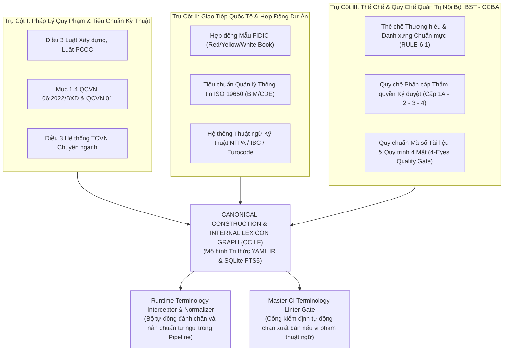

# RFC Proposal: Khung Quản Trị & Đồ Thị Tri Thức Thuật Ngữ Chuẩn Ngành Xây Dựng, Pháp Lý Quy Phạm & Quy Chế Nội Bộ (CCILF)

- **Tên sáng kiến:** Canonical Construction, Statutory & Internal Governance Lexicon Framework (CCILF)
- **Tác giả đề xuất:** Antigravity (Pair Architect & Builder) & Kỹ sư Vũ Văn Chủ (Giám đốc Trung tâm CCBA - IBST)
- **Ngày lập:** 2026-10-23
- **Trạng thái:** Đang đề xuất (Proposed)
- **Căn cứ pháp lý & thể chế nền tảng:**
  - [ADR-0045](../../docs/adr/0045-hub-proposal-ingestion-governance.md) (Hub Proposal Ingestion Governance)
  - [ADR-0061](../../docs/adr/0061-platform-aware-kiss-seam-contracts.md) (Platform-Aware KISS & Seam Contracts)
  - Luật Xây dựng (Luật 50/2014/QH13 & Luật 62/2020/QH14)
  - Nghị định 15/2021/NĐ-CP & Nghị định 50/2024/NĐ-CP
  - Quy chuẩn QCVN 06:2022/BXD (Sửa đổi 1:2023) & Hệ thống TCVN
  - Tiêu chuẩn ISO 19650 (BIM) & Hợp đồng Mẫu FIDIC
  - Quy chế Tổ chức và Hoạt động nội bộ của Viện IBST và Trung tâm CCBA (Quy chế Phân cấp Ký duyệt & Thương hiệu RULE-6.1)

---

## 1. Bối cảnh & Động lực Thực tiễn (Context & Motivation)

Trong quá trình phát triển các Agent tự hành phục vụ tư vấn pháp lý, thẩm tra thiết kế, lập hồ sơ hoàn thành công trình và quản lý dự án FDI (như Terumo Bến Cát, Panasonic PAPVN), nền tảng CCBA phát hiện một lỗ hổng nghiêm trọng mang tính hệ thống của các mô hình AI: **Hiện tượng Trôi lệch Thuật ngữ & Dịch Thô Máy Móc (Literal Translation Drift)**.

### Nỗi đau thực tế (Core Pain Points):
1. **Dịch thô ngô nghê, phản cảm với thông lệ chuyên môn:**
   - AI dịch *"Concept Design"* thành *"Thiết kế Khái niệm"* (trong khi 100% ngành kiến trúc xây dựng Việt Nam và hợp đồng tư vấn gọi là **"Thiết kế ý tưởng"**).
   - AI dịch *"Project Coordinator"* thành *"Kỹ sư Điều phối Dự án"* (trong khi chuẩn vai trò quản trị dự án là **"Điều phối dự án (PIC)"**).
   - AI dịch *"As-built drawings"* thành *"Bản vẽ như xây dựng"* (thay vì **"Bản vẽ hoàn công"**).
2. **Sai lệch bản chất pháp lý nguy hiểm:**
   - AI nhầm lẫn giữa *"Thẩm tra"* (nhiệm vụ tư vấn độc lập) và *"Thẩm duyệt"* (thẩm quyền quản lý nhà nước của Cảnh sát PCCC theo Nghị định 50/2024).
   - AI lẫn lộn giữa *"Chiều cao công trình"* theo quy hoạch đô thị (QCVN 01:2021/BXD) và *"Chiều cao PCCC"* (HPCCC đo đến mép dưới cửa sổ tầng trên cùng theo QCVN 06:2022/BXD).
   - AI dịch *"Grandfathering clause"* thành *"Điều khoản ông nội"* thay vì **"Nguyên tắc bảo lưu công trình hiện hữu / Không áp dụng hồi tố"**.
3. **Vi phạm Quy chế Thể chế & Phân cấp Thẩm quyền Nội bộ Đơn vị:**
   - AI tự ý dùng danh xưng lỗi thời hoặc trùng lặp (*"Viện IBST"*, *"Trung tâm CCBA"* thay vì chuẩn thương hiệu: Viện `IBST`, Trung tâm `CCBA`, Metadata: `IBST - CCBA`).
   - Nhầm lẫn cấp thẩm quyền ký duyệt giữa Kỹ sư thực hiện (Cấp 1A), Chủ trì kỹ thuật / Lãnh đạo Phòng (Cấp 2-3) và Giám đốc Trung tâm / Lãnh đạo Viện (Cấp 4).

---

## 2. Kiến Trúc 3 Trụ Cột Tri Thức Thuật Ngữ (The 3-Pillar Knowledge Architecture)

Để giải quyết triệt để, nền tảng thiết lập Hệ thống Từ điển & Đồ thị Tri thức 3 Trụ cột:



### Trụ Cột I: Thuật Ngữ Quy Phạm Pháp Luật & Tiêu Chuẩn Kỹ Thuật (Statutory & Codes)
- **Nguồn trích xuất:** $100\%$ các điều khoản *"Giải thích từ ngữ"* của các Luật, Nghị định, Thông tư và Mục 1.4 của các Quy chuẩn QCVN, Điều 3 TCVN trong kho tri thức `ccba-legal-knowledge`.
- **Cơ chế:** Khóa cứng định nghĩa nguyên văn (*Verbatim Legal Definition*), gắn mỏ neo điều khoản và tình trạng hiệu lực. Bất kỳ suy diễn hay diễn đạt lại làm sai lệch bản chất pháp lý đều bị chặn.

### Trụ Cột II: Thuật Ngữ Giao Tiếp Dự Án Quốc Tế & Hợp Đồng Tư Vấn (International & FIDIC)
- Chuẩn hóa các cặp đối chiếu Song ngữ Anh - Việt cho các giai đoạn thiết kế và hồ sơ giao nộp:
  * `Concept Design` $\iff$ **Thiết kế ý tưởng**
  * `Basic Design` $\iff$ **Thiết kế cơ sở**
  * `Detailed Design / Construction Drawings` $\iff$ **Thiết kế bản vẽ thi công (TKBVTC)**
  * `As-Built Drawings` $\iff$ **Bản vẽ hoàn công**
  * `Shop Drawings` $\iff$ **Bản vẽ chi tiết chế tạo và lắp đặt (Shop drawing)**
  * `Project Coordinator (PIC)` $\iff$ **Điều phối dự án (PIC)**
  * `Request for Information (RFI)` $\iff$ **Phiếu yêu cầu cung cấp thông tin kỹ thuật**

### Trụ Cột III: Thể Chế & Quy Chế Quản Trị Nội Bộ IBST - CCBA (Internal Governance)
- **Chuẩn hóa danh xưng tổ chức (RULE-6.1):**
  * Cấp Viện: `Viện`, `Viện KHCN`, `IBST` *(Nghiêm cấm: "Viện IBST")*.
  * Cấp Trung tâm: `Trung tâm`, `Trung tâm BIM`, `CCBA` *(Nghiêm cấm: "Trung tâm CCBA")*.
  * Đơn vị gửi trong giao tiếp dự án: `IBST - CCBA` *(Nghiêm cấm dùng dấu gạch chéo "IBST / CCBA" để tránh hiểu lầm là liên danh hai pháp nhân độc lập)*.
- **Phân cấp chức danh & thẩm quyền phê duyệt:**
  * **Cấp 1A (Author):** Người lập phiếu / Kỹ sư điều phối / Chuyên viên chuyên môn.
  * **Cấp 2-3 (Lead):** Chủ trì bộ môn / Lãnh đạo Phòng chuyên môn.
  * **Cấp 4 (Director):** Giám đốc Trung tâm / Lãnh đạo Viện ký phát hành chính thức.
- **Quy chuẩn mã hiệu hồ sơ:** `[MÃ_ĐƠN_VỊ]-[LOẠI_VB]-[DỰ_ÁN]-[SỐ_HIỆU]` (Ví dụ: `CCBA-RFI-PCCC-RETROFIT-01`).

---

## 3. Thiết Kế Kỹ Thuật & Tích Hợp Vào Nền Tảng (Technical Architecture)

### 1. Cơ Sở Dữ Liệu Thuật Ngữ Chuẩn (Canonical Lexicon IR):
- Đặt tại Hub monorepo: `packages/ccba-legal-intel/resources/canonical_construction_taxonomy.yaml`.
- Mỗi mục từ được cấu trúc hóa:
  ```yaml
  concept_design:
    en_canonical: "Concept Design"
    vi_canonical: "Thiết kế ý tưởng"
    vi_forbidden: ["Thiết kế khái niệm", "Khái niệm thiết kế", "Bản vẽ ý niệm"]
    domain: "design_stages"
    source_ref: "Thông lệ tư vấn quốc tế / FIDIC White Book"
    context_notes: "Giai đoạn hình thành ý tưởng quy hoạch và phân khu chức năng sơ khởi."
  ```

### 2. Bộ Tự Động Đánh Chặn Khi Dựng Tài Liệu (Runtime Interceptor Seam):
- Trong package `packages/ccba-ooxml` và `packages/ccba-legal-intel`:
  ```python
  from ccba_legal_intel.lexicon import normalize_construction_terms
  
  clean_text = normalize_construction_terms(raw_text)
  ```
- Bộ lọc tự động nhận diện và thay thế toàn bộ từ cấm (`vi_forbidden`) thành từ chuẩn (`vi_canonical`) trước khi đưa vào renderer OpenXML, Word, PDF hoặc email.

### 3. Cổng Kiểm Định Tự Động Master CI (Terminology Linter Gate):
- Tích hợp script `scripts/lint_construction_terminology.py` vào Master CI Gate của cả Hub và Spoke:
- Tự động quét toàn bộ file Markdown, YAML và code; phát hiện và chặn commit nếu vi phạm thuật ngữ chuyên môn hoặc danh xưng nội bộ.

---

## 4. Kế Hoạch Triển Khai & Đánh Giá Rủi Ro

| Giai đoạn | Nhiệm vụ chính | Sản phẩm bàn giao |
| :--- | :--- | :--- |
| **Giai đoạn 1** | Xây dựng bộ từ điển chuẩn cốt lõi (Core Taxonomy) | Tệp `canonical_construction_taxonomy.yaml` với 200+ thuật ngữ chuẩn |
| **Giai đoạn 2** | Thẩm định Peer Exchange với Grok 4.7 xhigh | Báo cáo phản biện kiến trúc và phán quyết từ Grok |
| **Giai đoạn 3** | Hiện thực hóa Seam Normalizer trong `ccba-legal-intel` | Module `lexicon_normalizer.py` và bài test unit tests |
| **Giai đoạn 4** | Thiết lập Cổng CI Linter trên Hub và Spoke | Bài test `lint_construction_terminology.py` tích hợp vào GitHub Actions |

- **Đánh giá Giá trị × Rủi ro × KISS:**
  * **Giá trị (Value):** Rất cao. Chuẩn hóa triệt để ngôn ngữ kỹ thuật, pháp lý và thể chế nội bộ cho toàn bộ mạng lưới Spoke.
  * **Độ phức tạp (Complexity):** Thấp (KISS). Sử dụng bảng ánh xạ YAML tĩnh kết hợp hàm Regex replace tối ưu, không tốn thêm tài nguyên inference hay tạo daemon mới.
  * **Rủi ro (Risk):** 0%. Không ảnh hưởng đến dữ liệu nghiệp vụ, chỉ nâng cao chất lượng từ ngữ xuất bản.
