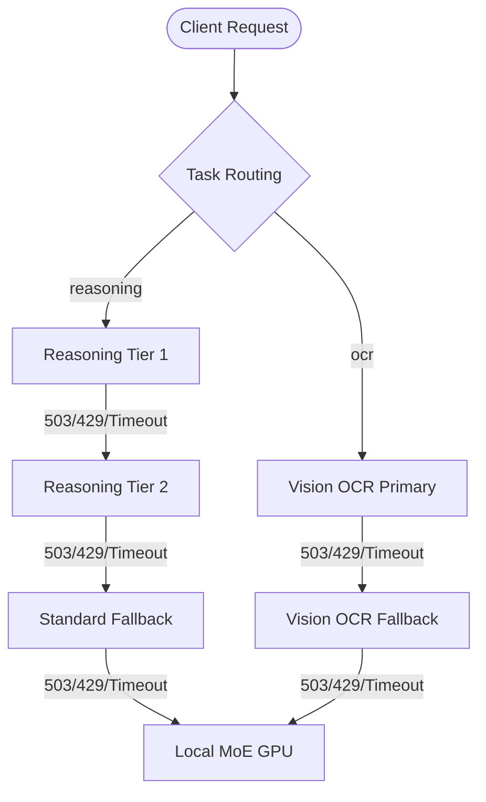

# AI Gateway SDK

Kết nối **AI Gateway** (LiteLLM) trên **Server Spark** (DGX). Một endpoint duy nhất cung cấp đa dạng mô hình thời gian thực qua `ai.models()` — từ Qwen 3.6 35B chạy local GPU đến Claude, Gemini trên cloud.

---

## Kiến trúc

```
┌──────────────────────────────────────────────────────────────┐
│  MÁY CLIENT (PC/Laptop/Server khác)                         │
│                                                              │
│  from ccba_ai import ai                                      │
│  ai.chat("...")  ──► http://${CCBA_AI_GATEWAY_HOST}:8090/v1   │
│                         ▲                                    │
│                    .env (API_KEY)                             │
└────────────────────┬─────────────────────────────────────────┘
                     │ Tailscale VPN / LAN / SSH Tunnel
┌────────────────────▼─────────────────────────────────────────┐
│  SERVER DGX SPARK                                            │
│                                                              │
│  :8090 ─► AI Gateway (LiteLLM)                               │
│              ├── qwen-local-primary    ← vLLM, local GPU    │
│              ├── reasoning-gemma       ← Google API, fallback│
│              ├── Claude Reasoning      ← Anthropic API      │
│              ├── Gemini Standard/Flash ← Google API         │
│              ├── ocr-primary / tier3   ← Vision APIs        │
│              └── Auto-fallback + Redis cache                 │
└──────────────────────────────────────────────────────────────┘
```

---

## Kết nối

| Phương thức | Server Host | Ghi chú |
|---|---|---|
| **Tailscale VPN** ⭐ | `${CCBA_AI_GATEWAY_HOST}` | Khuyến nghị — an toàn, xuyên NAT |
| LAN (cùng mạng) | `<LAN_IP>` | Hỏi admin |
| SSH Tunnel | `localhost` | `ssh -N -L 8090:localhost:8090 vvc@<IP>` |

- **Gateway URL**: `http://${CCBA_AI_GATEWAY_HOST}:8090/v1`
- **API Key**: `<YOUR_AI_GATEWAY_KEY>`

---

## 🏛️ 4 Model Archetypes (Vai trò Nghiệp vụ Chuẩn)

Khi tích hợp từ phía client (Hub/Spoke/Web/CLI), luôn định tuyến model theo đúng 4 Archetypes chuẩn qua Seam `model_routing.v1`:

| Archetype | Task Key (`choose_model`) | Enum Archetype / Model Aliases | Khi nào sử dụng? |
| :--- | :--- | :--- | :--- |
| **1. OCR & Vision** | `"ocr"` | `ModelArchetype.OCR` (`tier-ocr` / `ocr-primary`) | Xử lý OCR tài liệu PDF, bản vẽ, hình ảnh, trích xuất text bảng biểu. |
| **2. Standard / Coding** | `"general"`, `"coding"` | `ModelArchetype.STANDARD` (`tier-fast` / `gemini-3.8-flash` / `gemini-4-argon` / `gpt-oss-120b`) | Chat tổng quát, code sinh tự động, tóm tắt bài viết, đàm thoại agent. |
| **3. Deep Reasoning** | `"reasoning"`, `"audit"` | `ModelArchetype.REASONING` (`tier-reasoning` / `claude-sonnet-4-6` / `claude-opus-5-5-high` / `claude-sonnet-5-5-high` / `gemini-4-argon-high`) | Phân tích điều khoản hợp đồng phức tạp, đối soát pháp lý, suy luận đa bước (1M context). |
| **4. Local Private** | `"private"`, `"rag"` | `ModelArchetype.LOCAL`, `ModelArchetype.RAG` (`tier-local` / `local-coder` / `rag-core`) | Chạy offline, dữ liệu tuyệt mật nội bộ, fallback chốt chặn khi mất Internet. |

---

## ⚙️ Quy tắc Hợp đồng Tích hợp (Client Contract Rules)

### 1. Quy tắc HTTP Timeout (Bắt buộc: 30s – 90s, Mặc định: 90s)
- **Lý do**: AI Gateway triển khai cơ chế **Fallback Cascade** đa tầng (tự động xoay vòng 10 API keys và giáng cấp model khi upstream gặp lỗi 503/429).
- **Quy chuẩn**: Phía client **PHẢI** cấu hình `timeout >= 30.0s` (mặc định trong SDK: `90.0s`). Tuyệt đối không cấu hình timeout quá ngắn (<15s) tránh cắt đứt luồng failover ngầm.

### 2. Zero-Config Thinking Parameters
- Phía client **KHÔNG CẦN** tự tạo cấu trúc Google-specific như `generationConfig.thinking_config` hay `thinking_budget`.
- AI Gateway tích hợp sẵn middleware `custom_callbacks.gemini_corrector` tự động chuẩn hóa, chèn và lọc tham số suy luận theo từng model (`-low`, `-medium`, `-high`).

---

## 🛡️ Sơ đồ Chuyển vùng Dự phòng (Fallback Cascade)



### 🛡️ Cơ chế Kháng Lỗi Ngân sách LiteLLM & 5-Tier Failover Router (RULE-2.12)
`ccba-ai` tích hợp sẵn bộ định tuyến chuyển vùng dự phòng tự động 5 tầng:
- **Tier 1 (Gateway)**: LiteLLM trên Server Spark (:8090).
- **Tier 2 (Cloud Direct)**: Gọi trực tiếp Google AI Studio / Groq / OpenAI qua API keys cục bộ.
- **Tier 3 (Dual-CLI)**: Trực tiếp qua Antigravity CLI / GitHub Copilot CLI.
- **Tier 4 (Local Offline)**: Ollama hoặc local vLLM Qwen 3.6 35B trên DGX Spark.
- **Tier 5 (Mock)**: Giả lập kết quả cho testing không tốn token.

**Kháng lỗi Ngân sách (`BudgetExceededError`)**:
Khi LiteLLM Gateway hết quota hoặc vượt ngưỡng chi phí, lỗi trả về đa dạng (JSON structured hoặc plain text). Router tự động nhận diện mẫu lỗi:
```python
is_budget_exceeded = "budget" in str(exc).lower() and "exceeded" in str(exc).lower()
```
Khi kích hoạt, hệ thống lập tức chuyển thẳng sang Tier 2 hoặc Tier 4 (Local Ollama/Qwen), ngăn chặn triệt để vòng lặp thử lại vô hạn (infinite retry loop) và bảo đảm tác vụ không bị đình trệ.

---

## Cách dùng & Model Routing Contract (ADR-0061)

```bash
pip install -e "$CCBA_HUB_PATH/packages/ccba-ai"
```

```python
from ccba_ai import ModelArchetype, ai, choose_model, resolve_max_tokens

# SSOT routing tại packages/ccba-ai/src/ccba_ai/routing.py (Seam model_routing.v1)
model_name = choose_model("reasoning")
max_tok = resolve_max_tokens(model_name, 1024)  # Tự nâng lên 16384 cho reasoning models
reply = ai.chat("Tóm tắt điều khoản...", model=ModelArchetype.STANDARD)
```

- **Prompting & Resilience:** Dùng `xml_envelope`, `parse_xml_tags`, `evaluator_optimizer_loop`, `ai.chat_with_metadata`, và `CircuitBreaker` (3 trạng thái `CLOSED`/`OPEN`/`HALF_OPEN`, mặc định 3 lỗi -> fast-fail).
- **Reasoning Models & Output Cleaning:** Mặc định `strip_thinking=True` và auto `max_tokens=16384`. Mọi raw LLM output trước khi lưu/parse phải qua `strip_think_tags`, `extract_json`, `is_valid_output`, `is_garbage_fetch`, `remove_ocr_artifacts` (xem chi tiết tại `references/sdk_recipes.md`).

---

## Cấu hình (`.env`), Quick Test & Xử lý sự cố

Copy `.agents/skills/ccba-ai-gateway-sdk/.env.ai-gateway` sang `.env` project (thêm `.env` vào `.gitignore`, không commit API key):

```env
AI_GATEWAY_URL=http://${CCBA_AI_GATEWAY_HOST}:8090/v1
AI_GATEWAY_KEY=<YOUR_AI_GATEWAY_KEY>
AI_MODEL=general
```

| Vấn đề | Giải pháp |
|--------|-----------|
| `Connection refused` | Kiểm tra Tailscale/VPN hoặc SSH tunnel |
| `401 Unauthorized` | Kiểm tra `AI_GATEWAY_KEY` trong `.env` |
| `Model not found` | Kiểm tra danh sách qua `/v1/models` |
| `504 Gateway Timeout` | Chờ 2-3 phút khi model đang load |
| Qwen 3.6 35B chậm | Giảm `max_tokens` hoặc dùng `rag-light` (9B AWQ) |

- **Package & Docs:** `packages/ccba-ai/`, template `.agents/skills/ccba-ai-gateway-sdk/.env.ai-gateway`, server docs tại `AI_Gateway/playbooks/` (archived).

---

## Tiêu chí hoàn thành

- [ ] **Completion Criterion:** Đã kết nối và xác thực thành công các Capability Seams (`ai_chat.v1`, `ai_embedding.v1`, `ai_transcribe.v1`, `model_routing.v1`) qua package `ccba_ai`, tuân thủ định tuyến mô hình chuẩn qua `choose_model()`.

## Progressive Disclosure & Reference Index (Level 3)

| Tệp Tham Chiếu | Ngữ Cảnh Triệu Hồi & Mục Đích Sử Dụng |
| :--- | :--- |
| `references/sdk_recipes.md` | Code mẫu Python (`chat_with_metadata`, `xml_envelope`, `evaluator_optimizer_loop`, `CircuitBreaker`), Quick Test `curl` và 5 hàm làm sạch LLM output |
