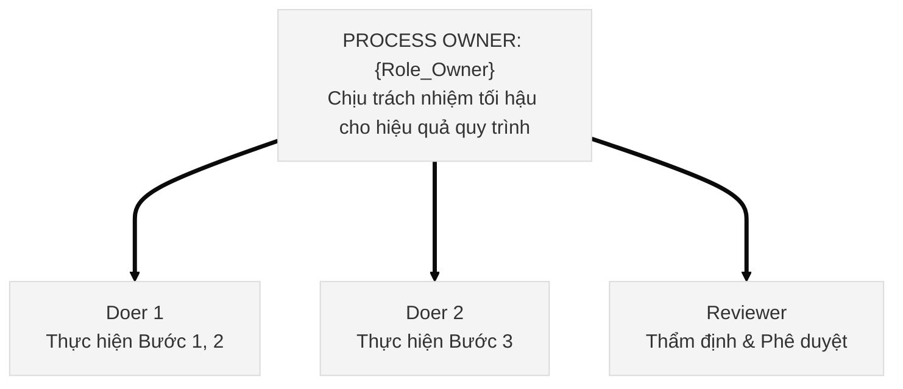

# Bản Mẫu Bộ Công Cụ Thực Chiến 20/80 (FBA Toolkit)

````markdown
---
title: "Bộ Công Cụ Thực Chiến: Quy Trình {Workflow_Name} ({Framework_Name} Flow)"
aliases:
  - "Bộ công cụ thực chiến {Workflow_Name}"
tags:
  - knowledge
  - domain/{domain}
  - type/topic
type: topic
origin: book
date_created: {date}
date_modified: {date}
source: "{source_note_name}.md"
source_type: compiled
summary: "Bộ công cụ thực chiến ứng dụng phương pháp {Method_Name} vào quy trình {Workflow_Name}, chuẩn hóa các biểu mẫu, ma trận trách nhiệm và scorecard đo lường."
people:
  - "{author}"
companies:
  - "CCBA"
status: evergreen
confidence: high
related:
  - "[[{master_topic_slug}]]"
  - "[[{source_note_slug}]]"
---

# Bộ Công Cụ Thực Chiến: Quy Trình {Workflow_Name}

> *"{quote}"*  
> — **{author}**

Tài liệu này chuyển hóa các nguyên lý từ [[{source_note_slug}|{book_title}]] thành 4 công cụ hành động trực tiếp cho doanh nghiệp:

---

## 🛠️ Công Cụ 1: Bộ Lọc Sàng Lọc / Ma Trận Ra Quyết Định

[Mô tả mục đích và điều kiện kích hoạt]

| Tiêu Chí Đánh Giá | Điều Kiện Đạt (Pass) | Rủi Ro / Cảnh Báo (Fail) | Hành Động Xử Lý |
| :--- | :--- | :--- | :--- |
| **Tiêu chí 1** | Đầy đủ dữ liệu đầu vào | Thiếu thông tin cốt lõi | Yêu cầu bổ sung trong 24h |
| **Tiêu chí 2** | Thẩm quyền phê duyệt hợp lệ | Vượt ngân sách quy định | Chuyển cấp có thẩm quyền cao hơn |

---

## ✅ Công Cụ 2: Checklist Tuân Thủ (FBA Compliance Checklist)

Quy tắc: Checklist chỉ lưu hành nội dung cốt lõi 20/80 ($\le 10$ bước).

- [ ] **Bước 1: {Buoc_1}** — *Mô tả thao tác và sản phẩm bàn giao (Deliverable)*.
- [ ] **Bước 2: {Buoc_2}** — *Mô tả thao tác và điểm kiểm soát chất lượng (Quality Gate)*.
- [ ] **Bước 3: {Buoc_3}** — *Lưu trữ dữ liệu vào thư mục chuẩn*.

---

## 👤 Công Cụ 3: Bảng Phân Quyền & Quyền Sở Hữu (Process Ownership)



---

## 📊 Công Cụ 4: Bảng Điểm Scorecard Đo Lường Hàng Tuần

| Tầng Đo Lường | Chỉ Số Theo Dõi (Metrics) | Mục Tiêu Chuẩn | Ngưỡng Cảnh Báo (Cần Thảo Luận) |
| :--- | :--- | :--- | :--- |
| **1. Compliance**<br/>*(Làm đúng quy trình)* | • Tỷ lệ hoàn thành đúng checklist | 100% | $< 100\%$ |
| **2. Frequency**<br/>*(Làm đủ số lần)* | • Tần suất thực thi định kỳ | Đạt chỉ tiêu | Dưới mức sàn |
| **3. Outcomes**<br/>*(Đạt kết quả thực tế)* | • Kết quả kinh doanh / tiến độ | Đúng tiến độ | Trễ hạn |

---

## References

- [[{source_note_slug}|{book_title} (Source Note)]]
- [[{master_topic_slug}|{master_topic_title}]]
````
