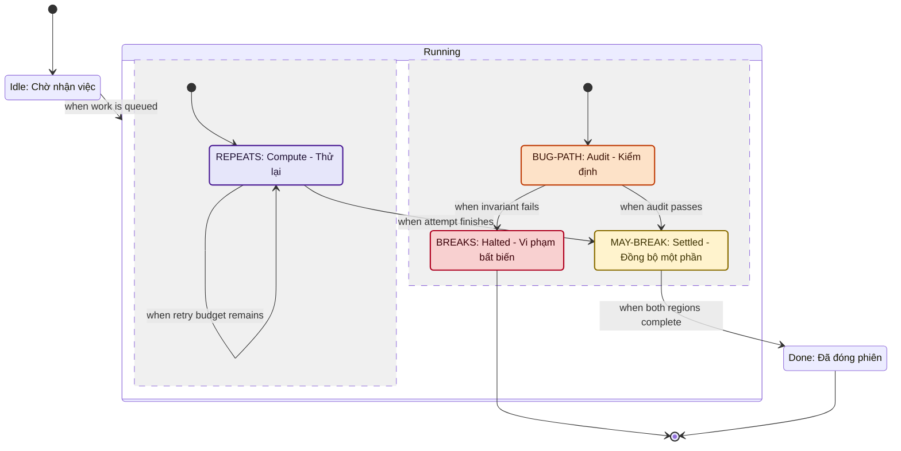

# Quy Chuẩn Biểu Diễn Máy Trạng Thái & Đường Dẫn Phản Chứng (`stateDiagram-v2` — Pstack `statechart` v0.15.36)

> **Mục đích & Ngữ cảnh sử dụng:** Hướng dẫn thiết kế sơ đồ máy trạng thái (`stateDiagram-v2`), phân vùng song song trực giao (`--`), quy tắc chống sơ đồ nói dối (Anti-Lie Pruning), và định dạng bàn giao đường dẫn lỗi (`bug_path`) đã được kiểm chứng hiển thị trên Antigravity IDE (và tuân thủ đặc tả trình phân tích cú pháp Mermaid $\ge 10.2$ của GitHub Markdown / Obsidian).

---

## 1. Hợp Đồng Cú Pháp An Toàn Đa Trình Xem (`COND-02`)

Khi sử dụng `stateDiagram-v2` để biểu diễn luồng trạng thái (ví dụ: giao thức phối hợp đa tác nhân, khóa nhận việc đồng thời, chu trình ISO 19650 CDE, hoặc quy trình phê duyệt 5 pha), Agent bắt buộc tuân thủ các ràng buộc tương thích sau:

| Thành phần cú pháp | Hợp đồng biểu diễn an toàn |
| :--- | :--- |
| **`classDef` & `class`** | Chỉ gán trên **trạng thái lá (leaf states)**. Không gán `class` lên trạng thái cha (composite state) hoặc xuyên qua vùng `--` để tránh lệch hiển thị giữa Mermaid $\ge 10.2$, GitHub (sanitizer lọc CSS) và Obsidian. |
| **Tiền tố nhãn nhìn thấy (Semantic Prefix)** | Màu sắc chỉ là lớp phụ trợ. Mọi trạng thái mang ngữ nghĩa kiểm định bắt buộc đặt tiền tố trực tiếp trong nhãn hiển thị qua cú pháp alias `state "PREFIX: Nhãn nghiệp vụ" as id`: **BREAKS:**, **MAY-BREAK:**, **BUG-PATH:**, hoặc **REPEATS:**. |
| **Vùng song song (`--`)** | Chỉ được dùng làm dấu phân cách **bên trong** một trạng thái hợp thành (`state running_group { ... }`). Tuyệt đối không đặt `--` ở cấp độ gốc (root level). Mỗi vùng song song phải có điểm khởi đầu `[*]` riêng biệt và kiểm tra tính liên thông theo từng vùng. |
| **Nhãn chuyển tiếp (`when ...`)** | Điều kiện chuyển trạng thái viết sau dấu hai chấm `:`, ưu tiên dùng từ khóa `when ...` bằng ngôn ngữ tự nhiên (ví dụ: `Idle --> Running: when work is queued`). Tránh dùng ngoặc vuông `[...]` hoặc ngoặc nhọn `{...}` trên nhãn cạnh của `stateDiagram-v2` để không bị bộ phân tích cú pháp cắt nhầm. |
| **Đường dẫn lỗi (`bug_path`)** | Do `classDef` không tô màu được cho cạnh (mũi tên) và `linkStyle` chỉ thuộc về `flowchart`, nguồn chân lý (SSOT) của đường đi ngắn nhất dẫn tới lỗi là khối danh sách có thứ tự `bug_path: [{from, to, when}]` đi kèm dưới sơ đồ. |

---

## 2. Bốn Lớp Đánh Dấu Kiểm Định & Bảng Màu Tương Thích

1. **`breaks` (tiền tố BREAKS:):** Mọi trạng thái hệ thống nằm dưới nhãn này đều vi phạm bất biến (invariant violation).
2. **`mayBreak` (tiền tố MAY-BREAK:):** Chỉ một số tổ hợp biến ẩn nằm dưới nhãn này vi phạm bất biến.
3. **`bugPath` (tiền tố BUG-PATH:):** Trạng thái trung gian nằm trên đường đi ngắn nhất (*shortest counterexample trace*) dẫn từ `[*]` tới trạng thái `breaks`.
4. **`repeats` (tiền tố REPEATS:):** Trạng thái nằm trên chu trình tự lặp hoặc vòng lặp vô tận (liveness / stuttering violation).

---

## 3. Ngân Sách Nhận Thức ($\le 20$ Cạnh) & 4 Quy Tắc Chống "Sơ Đồ Nói Dối" (Anti-Lie Pruning)

Một sơ đồ trạng thái vượt quá **20 mũi tên (cạnh)** sẽ gây quá tải nhận thức cho người duyệt. Khi lược giản hoặc gom nhóm trạng thái, Agent bắt buộc tuân thủ **4 bất biến Anti-Lie**:

1. **Cấm gộp làm mờ lỗi:** Tuyệt đối không gộp một trạng thái `breaks` (luôn lỗi) với trạng thái bình thường làm biến nó thành `mayBreak`, và không gộp hai trạng thái vi phạm hai quy tắc khác nhau vào cùng một nút. Nếu vượt ngân sách 20 cạnh, bắt buộc **tách thành các sơ đồ riêng** (ví dụ: sơ đồ luồng chuẩn *happy-path* và sơ đồ luồng phản chứng *bug-path* hoặc tách theo từng vùng), giữ nguyên vẹn các nút `breaks`.
2. **Bảo toàn tính liên thông theo vùng:** Mọi trạng thái xuất hiện trên sơ đồ phải có đường đi hợp lệ từ điểm khởi đầu `[*]` của vùng chứa nó.
3. **Cấm tạo Deadlock giả (hoặc cạnh giả):** Mọi trạng thái không phải trạng thái kết thúc phải giữ lại ít nhất 1 mũi tên đi ra nếu trong thực tế nó còn lối thoát. Ngược lại, **trạng thái kết thúc hợp lệ (terminal state)** chỉ được phép có cạnh đi tới `[*]` (hoặc không có cạnh ra), tuyệt đối không vẽ thêm cạnh giả.
4. **Minh bạch các bước đã ẩn:** Nếu ẩn các bước chuyển phụ (như `reset` hoặc `heartbeat` xuất hiện ở mọi trạng thái), bắt buộc liệt kê rõ danh sách các bước đã ẩn ngay bên dưới sơ đồ. Với trạng thái `repeats` có cạnh tự lặp (`Compute --> Compute`), phải giữ cạnh thoát hoặc ghi rõ cạnh thoát nằm trong danh sách bước ẩn.

---

## 4. Mẫu Thực Hành Chuẩn (Canonical Statechart & `bug_path` Fixture)

> **Biên bản kiểm chứng hiển thị (`COND-05`):** Fixture dưới đây gán đủ cả 4 lớp (`breaks`, `mayBreak`, `bugPath`, `repeats`) trên 4 trạng thái lá (`Halted`, `Settled`, `Audit`, `Compute`) và đã được kiểm chứng kết xuất trực tiếp trên **Antigravity IDE Artifact Renderer**. Trên môi trường máy trạm Linux CLI headless hiện tại không mở trực tiếp ứng dụng desktop **Obsidian** hay trình duyệt **GitHub Web UI**; tương thích cho hai trình xem này được đảm bảo thông qua việc chỉ dùng cú pháp chuẩn `stateDiagram-v2` (Mermaid $\ge 10.2$) và tiền tố nhãn văn bản (`BREAKS:`, `MAY-BREAK:`, `BUG-PATH:`, `REPEATS:`) độc lập với sanitizer CSS.



**Danh sách đường dẫn phản chứng (`bug_path`) bàn giao kèm sơ đồ để replay kiểm thử:**
```yaml
bug_path:
  - {from: Idle, to: Running, when: "work is queued"}
  - {from: Audit, to: Halted, when: "invariant fails"}
hidden_steps:
  - "CancelFromAnyState -> Idle (đã lược bỏ để giữ ngân sách <= 20 cạnh)"
```
