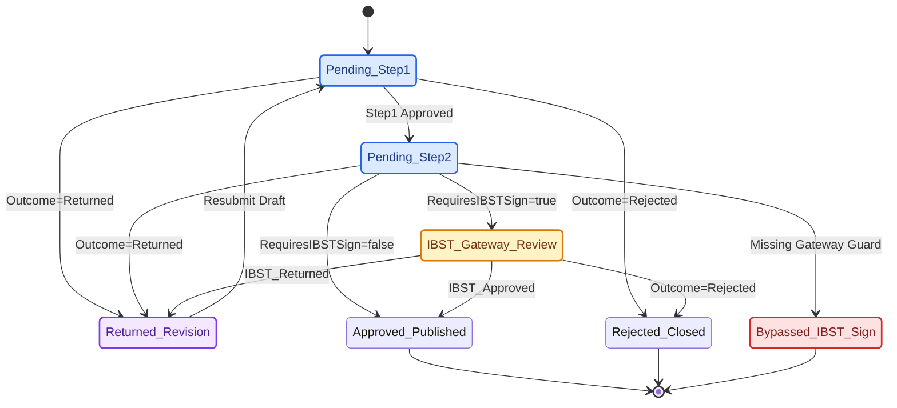

# Kỹ Năng: SharePoint, Power Apps, Power Automate & M365 IaC (`sharepoint-iac`)

Kỹ năng này hướng dẫn AI Agent thiết kế, kiểm định ngữ nghĩa và triển khai hạ tầng dữ liệu, giao diện 3 tầng bản địa và luồng tự động hóa trên **SharePoint Online, Power Apps (Canvas `.pa.yaml` & Code Apps), Power Automate và Microsoft 365** bằng phương pháp **Infrastructure-as-Code (IaC)** chuẩn hóa của CCBA Platform (áp dụng điển hình tại Spoke `IDOP-CCBA-WAY`).

## 🎯 1. Bốn Trụ Cột Thiết Kế & Kiểm Định Cốt Lõi (Core Invariants)

1. **Metadata-First (`<5GB`), `Core (62 Lists) × Satellite Modules` & Storage Offloading (`5TB`):**
   - **Tầng Lõi (`datamodel/sharepoint/lists/<domain>/*.json`):** Khóa `62` Lists (`710` Columns, `82` Views, `21` Term Sets); chỉ lưu metadata, cấm đính kèm binary (bảo vệ 2TB Tenant Quota). Mọi tệp mở rộng (`satellites/<module>/*.json`) đăng ký vào `module_manifest.json` và liên kết về Core qua `Lookup`/`ManagedMetadata` không đổi `active_list_count: 62`.
   - **OneDrive (`ccba-storage` 5TB) & RBAC Hai Mặt Phẳng (`Slice P8.17`):** Phân tách `Documents/iOPS/` và `Documents/iCDE/` (ISO 19650 `S0 -> S1 -> S2 -> S3 -> A1`; `WorkPackages.DeliverableFolderPath` chỉ trỏ `iCDE/`). Tách `idop_client` vs `mysite_client`, giữ quyền kế thừa (`if perm.get("inheritedFrom") is not None: continue` — tránh lỗi `HTTP 400` trên `{}` — xem chi tiết tại `references/sharepoint_contracts_schema.md`).
2. **Bảo Mật Đa Phân Vùng (Zone 1, `/sites/iCDE`, Zone 2, App Catalog):**
   - Định danh 4 Canonical Site Collections trong `tools.auth.site_preflight` (UUID & cổng chi tiết tại `references/sharepoint_contracts_schema.md`): Zone 1 (`CCBA_VCNLD_All` đọc, gỡ `'Everyone except external users'`, 0 List WebParts `controlType=3`); `/sites/iCDE` (khóa Read-Only 3 thư viện lịch sử, qua `_assert_safe_portal_canvas()`); Zone 2 (`/sites/idop` bảo vệ `62` Lists, khóa `IDOP Members` `Read`, cấm `CCBA_VCNLD_All`, đồng bộ `Employees.SystemRoles`); App Catalog (`idop-cockpit-spfx.sppkg`, truy vấn `ClientComponentManifest`, SHA-256 trên `'Client Side Assets'`).
3. **Rào Chắn Cột, Chỉ Mục (`<= 20`) & Lookup trên View (`<= 8`):**
   - `InternalName` PascalCase không dấu; `DisplayName <= 50` ký tự; tối đa `20` cột `"Indexed": true` / List và `8` Lookup/User/Taxonomy / View (`NON_INDEXABLE_COLUMN_TYPES`: `ManagedMetadata`, `Taxonomy`, `Note`, `MultiChoice`, `URL`, `Hyperlink`, multi-`Lookup`/`User`).
   - Toàn vẹn `Lookup.List` & `TermSet.Name`; nạp hidden Note map (`resolve_list_hidden_note_map_async` + `apply_complex_fields_via_sp_rest_async`) trước khi ghi cột phức hợp và chạy `scan_required_column_null_blockers` trước khi bật `Required=True`.
4. **Kiểm Chứng Máy Trạng Thái Phê Duyệt Đa Cấp (`Submissions` & `ApprovalNodes`):**
   - Khi `RequiresIBSTSign = true`, mọi đường dẫn tới `Approved_Published` bắt buộc đi qua `IBST_Gateway_Review` (`ROLE_HEAD_ADMIN`).



```yaml
bug_path:
  invariant: "RequiresIBSTSign=true => Mandatory IBST_Gateway_Review (ROLE_HEAD_ADMIN)"
  trigger: "Pending_Step2 transitions directly to Approved_Published when RequiresIBSTSign=true"
  trace:
    - "Pending_Step1"
    - "Pending_Step2"
    - "Bypassed_IBST_Sign"
  remediation: "Enforce evaluate_approval_nodes sequential guard and verify_ibst_gateway_invariant BFS gate"
```

---

## 📋 2. Cấu Trúc JSON Schema Chuẩn Cho SharePoint List

Mỗi List lưu trong `datamodel/sharepoint/lists/<domain>/<list_name>.json` theo lược đồ `sp-list.schema.json` (gồm `ListName`, `Description`, `Columns` với `Name` PascalCase, `Type`, `Required`, `Indexed`, `Lookup` behavior `restrict`/`cascade`, `ManagedMetadata` trỏ đúng `TermSet.Name`, `Choice`, `DisplayName` <= 50 ký tự). Xem JSON mẫu `Contracts` và chi tiết `Slice P8.17` / 4 Canonical Site IDs / `W8-DLQ-MATCH-01` tại `references/sharepoint_contracts_schema.md`.

---

## 🛠️ 3. Quy Trình Kiểm Định Đa Nền Tảng & Triển Khai (Verification & Deployment Workflow)

Khi làm việc trên Spoke (`IDOP-CCBA-WAY`) hoặc đối soát hợp đồng từ Hub:

1. **Bước 1: Kiểm Định Ngữ Nghĩa Schema & Hợp Đồng Liên Repo (Linux/WSL/Windows):**
   ```bash
   python tools/validator/schema_validator.py --verbose
   pytest scripts/tests/test_idop_schema_compatibility.py -v
   ```
   * **Tiêu chí hoàn thành:** Toàn bộ SharePoint Lists và kiểm chứng BFS Liveness/Safety đạt 100% pass (`exit code 0`), không có cột vượt trần 20 chỉ mục hoặc đứt gãy khóa ngoại.

2. **Bước 2: Kiểm Toán Sức Khỏe Hạ Tầng Thực Tế & Phân Vùng Bảo Mật (Live Graph Audit):**
   ```powershell
   .\idop.ps1 validate datamodel
   python tools/governance/system_health_auditor.py
   ```
   * Phân hạng drift 3 bậc (*RBAC Isolation -> Schema/State -> Content/Navigation*), kiểm chứng `Pre-Deploy Role Verification` và áp dụng quy tắc tự phục hồi DLQ 5 cổng (`W8-DLQ-MATCH-01`, `PRAGMA busy_timeout = 5000`, cấm `--dlq-replay`).
   * **Tiêu chí hoàn thành:** Xác nhận toàn bộ Lists đã khởi tạo trên SharePoint Online khớp Schema, phân vùng `Zone 2` khóa `IDOP Members` ở mức `Read`, không rò rỉ quyền `CCBA_VCNLD_All`, và cấu trúc thư mục `Documents/iOPS/` + `Documents/iCDE/` nguyên vẹn.

3. **Bước 3: Triển Khai Thử Nghiệm (`DryRun`) & Triển Khai Thật (`Full Deployment`):**
   ```powershell
   .\idop.ps1 deploy lists -Environment IDOP -DryRun
   .\idop.ps1 deploy lists -Environment IDOP -Full
   ```
   * **Tiêu chí hoàn thành:** Toàn bộ SharePoint Lists và Managed Metadata được provisioning thành công trên SharePoint Online mà không phát sinh lỗi throttling hay quyền truy cập.

4. **Bước 4: Khóa Hoàn Tất Tự Động (`Hard Completion Lock`):**
   ```bash
   python -m ccba_harness verify-patch --preset skill
   ```
   * **Tiêu chí hoàn thành:** Cổng kiểm định `verify-patch` và `validate_skills.py --enforce-gpi` trả về `exit code 0`.

---

## 🧩 4. Kiến Trúc 3 Tầng Bản Địa M365 & 🔍 5. Checklist Rà Soát Chất Lượng

Áp dụng triết lý **3-Tier Progression of Attention** (chi tiết đặc tả kỹ thuật nằm ở 2 tệp M365 Level 3 bên dưới):
- **SharePoint List Formatting:** `commandBarProps` ẩn nút nhiễu, `customCardProps` mở proximity card, `customRowAction` chạy Flow (`executeFlow`).
- **Power Apps Canvas (`.pa.yaml`) & Code Apps:** Standard connectors bảo vệ quota `40.000 PPR/24h`; chỉ dùng hàm delegable (`Filter`/`StartsWith`/`Sort`) trên cột `"Indexed": true` (<= 20/bảng), cấm `Search`/`Lower` trong `Filter`.
- **Power Automate & Adaptive Cards:** Dùng `"type": "OpenApiConnection"` qua Connection References (cấm `ApiConnection`/`Invoker` — `SLOP-09`); tối đa 5 trường Tier 1, ẩn bảng chi tiết qua `Action.ToggleVisibility`.
- **Viva Connections ACEs, SPFx, Purview & Modern Search:** Đóng gói zero-Node (`WebPart`), `Purview Retention Label` cho `A1 - Published`, và Modern Search v4 vượt ngưỡng 5.000 items.

**Quality Gate Checklist:**
- [ ] `ListName` và cột khớp hợp đồng Hub (`CORE_REQUIRED_FIELDS`, `CdeDocumentSyncService`, `m365_bridge_worker.py`).
- [ ] Số cột `"Indexed": true` <= 20/bảng, không lập chỉ mục `NON_INDEXABLE_COLUMN_TYPES`, `TermSet.Name` tồn tại trong `taxonomy/`.
- [ ] Không có Attachment/Binary hay `FORBIDDEN_SHARING_MARKERS` (`10` markers — `SLOP-09`); tệp trỏ về `Documents/iOPS/` hoặc `Documents/iCDE/` qua `driveId` + `itemId`.
- [ ] `Submissions`/`ApprovalNodes` pass BFS Liveness + `IBST_Gateway_Review`; Power Fx delegable 100%; Flow dùng `OpenApiConnection` + Trigger Condition; OneDrive & App Catalog (`ClientComponentManifest`, SHA-256) pass kiểm toán 2 mặt phẳng.

---

## 🔗 6. Tích Hợp Hệ Sinh Thái Kỹ Năng & Progressive Disclosure (Level 3)

- **Thượng nguồn:** `/ccba-domain-modeling` + `/ccba-to-spec` + `/ccba-design` (`STK-07`, `STK-08`, chống `SLOP-09`).
- **Mã nguồn Python IaC:** Phối hợp `/ccba-codebase-design` (DAG + PEP 562 `__getattr__`).
- **Hạ nguồn:** `/ccba-web-testing` + `/ccba-session-retrospective`.

| Tệp Tham Chiếu | Ngữ Cảnh Triệu Hồi & Mục Đích Sử Dụng |
| :--- | :--- |
| `references/sharepoint_contracts_schema.md` | JSON Schema mẫu `Contracts`, Storage `iOPS`/`iCDE`, OneDrive 2 mặt phẳng (`Slice P8.17`), 4 Canonical Site IDs và `W8-DLQ-MATCH-01` |
| `references/m365-3tier-list-formatting-and-adaptive-cards.md` | Kiến trúc 3 tầng bản địa cho SharePoint List/View/Form JSON Formatting (`pnp/List-Formatting`: `commandBarProps`, `customCardProps`, `executeFlow`) và Teams Adaptive Cards (`Action.ToggleVisibility`) |
| `references/powerapps-canvas-codeapps-and-power-automate.md` | Kiến trúc Power Apps Canvas (`.pa.yaml` / Power Fx SharePoint Delegation), Power Apps Code Apps (`@microsoft/power-apps`), Power Automate (`OpenApiConnection`, `pa_solution_packager.py`) và bảo vệ hạn mức `40.000 PPR/24h` |
