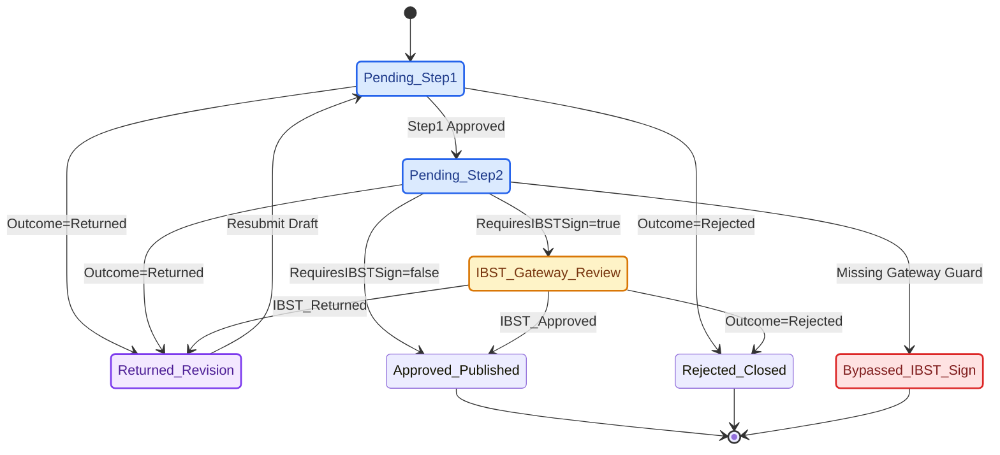

# Kỹ Năng: SharePoint & M365 Infrastructure-as-Code (`sharepoint-iac`)

Kỹ năng này hướng dẫn AI Agent thiết kế, kiểm định ngữ nghĩa và triển khai hạ tầng dữ liệu trên SharePoint Online (Microsoft 365) bằng phương pháp **Infrastructure-as-Code (IaC)** chuẩn hóa của CCBA Platform (áp dụng điển hình tại Spoke `IDOP-CCBA-WAY`).

## 🏛️ Platform-Aware Architecture Posture

- **Phân loại**: Kỹ năng quản trị hạ tầng dạng mã nguồn (seam-exempt kernel skill).
- **Lý do miễn trừ seam**: SOP hướng dẫn thiết kế JSON schema, kiểm định quan hệ Lookups/Taxonomy/Index, kiểm chứng máy trạng thái phê duyệt đa cấp và vận hành kịch bản Python Validator + PnP PowerShell cho hạ tầng đám mây M365.
- **Đặc tính quản trị**: Cưỡng chế kiến trúc Metadata-First (`<5GB` list quota), phân tách Master Storage (`Documents/iOPS/` vs `Documents/iCDE/`), bảo mật Dual-Zone (`Zone 1` vs `Zone 2`), giới hạn tối đa 20 cột lập chỉ mục mỗi bảng (`MAX_INDEXED_COLUMNS_PER_LIST = 20`) và kiểm chứng đồ thị phê duyệt BFS chống vượt cổng `ROLE_HEAD_ADMIN`.
- **Chỉ số năng lực quản trị (GPI)**: Đạt mức điểm chuẩn hóa (`s=3.0, k=2.0, a=1.0, p=1.0`) $\to$ `GPI = 12.0` (Tier 2B kernel), tuân thủ phân lớp governance và năng lực tự động hóa hạ tầng.

---

## 🎯 1. Bốn Trụ Cột Thiết Kế & Kiểm Định Cốt Lõi (Core Invariants)

1. **Metadata-First & Master Storage Offloading (`<5GB` List Quota)**:
   - Các SharePoint Lists chỉ lưu trữ siêu dữ liệu (`Text`, `Number`, `DateTime`, `Lookup`, `ManagedMetadata`, `Choice`, `Hyperlink`/`URL`, `User`, `YesNo`).
   - Tuyệt đối không đính kèm tệp binary trực tiếp vào List Items để bảo vệ 2TB Tenant Quota. Toàn bộ tệp PDF/CAD/BIM/Scan phải được offload sang 5TB Master Storage (`ccba-storage`) theo 2 phân vùng:
     - `Documents/iOPS/` (`01_Bids_CRM/`, `02_Contracts/`, `05_Projects/`): Hồ sơ pháp lý, đấu thầu, hợp đồng và phiếu giao việc (PGV).
     - `Documents/iCDE/` (`tvgs_qlda/`, `thiet_ke_BIM/`, `tham_tra_TK/`, `kiem_dinh_CL/`, `khao_sat_TN/`, `bim_data/`): Hồ sơ kỹ thuật dự án theo chuẩn ISO 19650 (`S0` $\to$ `S1` $\to$ `S2` $\to$ `S3` $\to$ `A1`).
2. **Kiến Trúc Bảo Mật Hai Phân Vùng (Dual-Zone Security Architecture)**:
   - **Zone 1 (Public Intranet)**: Cho phép nhóm toàn viện/trung tâm (`CCBA_VCNLD_All`) quyền đọc tin tức, thông báo chung.
   - **Zone 2 (Confidential Operations Engine — `sites/IDOP`)**: Hạ quyền nhóm `IDOP Members` xuống `Read` tại gốc Site; **cấm tuyệt đối** gán `CCBA_VCNLD_All` vào các bảng nghiệp vụ nhạy cảm (`Contracts`, `Invoices`, `PayrollRecords`, `SalaryStructures`, `EmployeeIncomes`, `Opportunities`, `Submissions`, `ApprovalNodes`); bắt buộc ngắt thừa kế quyền (`BreakRoleInheritance`) theo từng bảng/thư mục dự án.
3. **Rào Chắn Ngữ Nghĩa Cột & Chỉ Mục (`MAX_INDEXED_COLUMNS_PER_LIST = 20`)**:
   - `InternalName`: Bắt buộc dùng **PascalCase** không dấu, không khoảng trắng (`ContractCode`, `RequiresIBSTSign`, `ApprovalStatus`).
   - **Giới hạn 20 chỉ mục**: Mỗi SharePoint List không được khai báo quá `20` cột có `"Indexed": true`.
   - **Cấm lập chỉ mục trên kiểu không hỗ trợ (`NON_INDEXABLE_COLUMN_TYPES`)**: Không đặt `"Indexed": true` cho các cột kiểu `"ManagedMetadata"`, `"Taxonomy"`, `"Note"`, `"MultiChoice"`, `"URL"`, `"Hyperlink"`, hoặc cột đa giá trị `"Lookup"`/`"User"` (`"AllowMultiple": true`).
   - **Toàn vẹn tham chiếu**: Mọi cột `"Lookup"` phải khai báo `Lookup.List` tồn tại và `Behavior: "restrict"` (hoặc `"cascade"` cho bảng phụ thuộc); mọi cột `"ManagedMetadata"` phải trỏ tới `TermSet.Name` có thực trong `datamodel/sharepoint/taxonomy/*.json`.
4. **Kiểm Chứng Máy Trạng Thái Phê Duyệt Đa Cấp (`Submissions` & `ApprovalNodes`)**:
   - Luồng phê duyệt đa cấp hỗ trợ 4 kết quả nút (`Pending`, `Approved`, `Rejected`, `Returned`). Khi hợp đồng/hồ sơ có cờ `RequiresIBSTSign = true`, mọi đường đi dẫn tới `Approved_Published` bắt buộc phải đi qua cổng đầu mối Phòng Tổng Hợp (`IBST_Gateway_Review` — `ROLE_HEAD_ADMIN`).



```yaml
bug_path:
  invariant: "RequiresIBSTSign=true => Mandatory IBST_Gateway_Review (ROLE_HEAD_ADMIN)"
  trigger: "Pending_Step2 transitions directly to Approved_Published when RequiresIBSTSign=true"
  trace:
    - "Pending_Step1"
    - "Pending_Step2"
    - "Bypassed_IBST_Sign"
  remediation: "Enforce evaluate_approval_nodes sequential guard and verify_ibst_gateway_invariant BFS gate"
```

---

## 📋 2. Cấu Trúc JSON Schema Chuẩn Cho SharePoint List

Mỗi List được lưu thành một tệp JSON trong `datamodel/sharepoint/lists/<domain>/<list_name>.json`:

```json
{
  "$schema": "datamodel/sharepoint/schemas/sp-list.schema.json",
  "ListName": "Contracts",
  "Description": "Quản lý Hợp đồng Kinh tế CCBA / IBST",
  "Columns": [
    {
      "Name": "ContractCode",
      "Type": "Text",
      "Required": true,
      "Indexed": true,
      "DisplayName": "Số hợp đồng"
    },
    {
      "Name": "CustomerId",
      "Type": "Lookup",
      "Indexed": true,
      "Lookup": {
        "List": "Customers",
        "Field": "Title",
        "Behavior": "restrict"
      },
      "DisplayName": "Khách hàng (Bên A)"
    },
    {
      "Name": "PrimaryContractGroup",
      "Type": "ManagedMetadata",
      "TermSet": {
        "Group": "CCBA Taxonomy",
        "Name": "CCBA_NhomHopDongKT"
      },
      "DisplayName": "Nhóm HĐKT chính (Phụ lục 7)"
    },
    {
      "Name": "RequiresIBSTSign",
      "Type": "YesNo",
      "DisplayName": "Yêu cầu trình Viện IBST ký"
    },
    {
      "Name": "IBSTSubmissionStatus",
      "Type": "Choice",
      "Choices": [
        "Not_Required",
        "Pending_Internal",
        "Submitted_to_IBST",
        "IBST_Approved",
        "IBST_Returned"
      ],
      "DisplayName": "Trạng thái trình Viện IBST (Gateway)"
    }
  ]
}
```

---

## 🛠️ 3. Quy Trình Kiểm Định Đa Nền Tảng & Triển Khai (Verification & Deployment Workflow)

Khi làm việc trên Spoke có SharePoint IaC (như `IDOP-CCBA-WAY`) hoặc đối soát hợp đồng từ Hub:

1. **Bước 1: Kiểm Định Ngữ Nghĩa Schema & Hợp Đồng Liên Repo (Linux/WSL/Windows)**:
   ```bash
   # Tại Spoke IDOP-CCBA-WAY: Kiểm định Draft-07, trần 20 chỉ mục, Lookup & Taxonomy
   python tools/validator/schema_validator.py --verbose

   # Tại Hub ccba-agent-platform: Kiểm định Golden Snapshot, Live 60 Lists & BFS Statechart
   pytest scripts/tests/test_idop_schema_compatibility.py -v
   ```
   * **Tiêu chí hoàn thành:** Toàn bộ SharePoint Lists và kiểm chứng BFS Liveness/Safety đạt 100% pass (`exit code 0`), không có cột vượt trần 20 chỉ mục hoặc đứt gãy khóa ngoại.

2. **Bước 2: Kiểm Toán Sức Khỏe Hạ Tầng Thực Tế & Phân Vùng Bảo Mật (Live Graph Audit)**:
   ```powershell
   # Kiểm tra đồng bộ JSON Schema tại Spoke bằng CLI PowerShell hoặc Python Health Auditor
   .\idop.ps1 validate datamodel
   python tools/governance/system_health_auditor.py
   ```
   * **Tiêu chí hoàn thành:** Xác nhận 59+ Lists trên SharePoint Online khớp Schema, phân vùng `Zone 2` khóa `IDOP Members` ở mức `Read`, không rò rỉ quyền `CCBA_VCNLD_All`, và cấu trúc thư mục `Documents/iOPS/` + `Documents/iCDE/` nguyên vẹn.

3. **Bước 3: Triển Khai Thử Nghiệm (`DryRun`) & Triển Khai Thật (`Full Deployment`)**:
   ```powershell
   # Quét sự khác biệt (diff) giữa JSON Schema và SharePoint Online thật
   .\idop.ps1 deploy lists -Environment IDOP -DryRun

   # Đồng bộ cấu trúc vào môi trường production sau khi báo cáo DryRun hợp lệ
   .\idop.ps1 deploy lists -Environment IDOP -Full
   ```
   * **Tiêu chí hoàn thành:** Toàn bộ SharePoint Lists và Managed Metadata được provisioning thành công trên SharePoint Online mà không phát sinh lỗi throttling hay quyền truy cập.

4. **Bước 4: Khóa Hoàn Tất Tự Động (`Hard Completion Lock`)**:
   ```bash
   python -m ccba_harness verify-patch --preset skill
   ```
   * **Tiêu chí hoàn thành:** Cổng kiểm định `verify-patch` và `validate_skills.py --enforce-gpi` trả về `exit code 0`.

---

## 🔍 4. Checklist Rà Soát Chất Lượng (Quality Gate)

- [ ] Tên bảng `ListName` và các cột cốt lõi khớp với hợp đồng `CORE_REQUIRED_FIELDS` và `CdeDocumentSyncService`.
- [ ] Số lượng cột `"Indexed": true` trên mỗi bảng $\le 20$ và không gắn chỉ mục vào kiểu `NON_INDEXABLE_COLUMN_TYPES`.
- [ ] Mọi trường `ManagedMetadata` đều có `TermSet.Name` tồn tại trong `datamodel/sharepoint/taxonomy/`.
- [ ] Không có trường nhị phân (Attachment/Binary) trong schema list; mọi liên kết tệp trỏ về `Documents/iOPS/` hoặc `Documents/iCDE/`.
- [ ] Sơ đồ luồng phê duyệt `Submissions`/`ApprovalNodes` vượt qua kiểm chứng BFS Liveness và cổng `IBST_Gateway_Review`.
