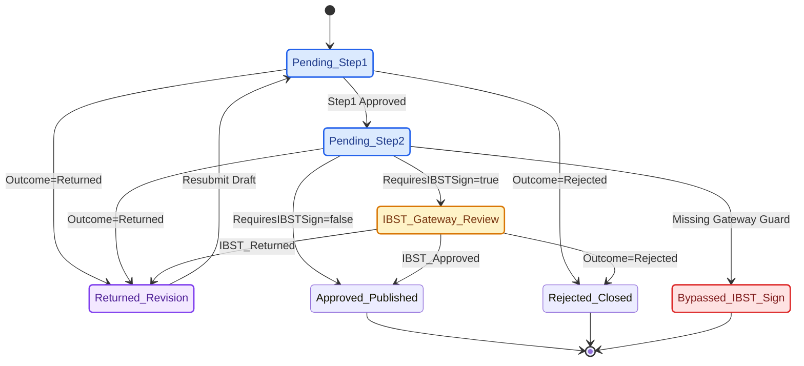

# Kỹ Năng: SharePoint, Power Apps, Power Automate & M365 IaC (`sharepoint-iac`)

Kỹ năng này hướng dẫn AI Agent thiết kế, kiểm định ngữ nghĩa và triển khai hạ tầng dữ liệu, giao diện 3 tầng bản địa và luồng tự động hóa trên **SharePoint Online, Power Apps (Canvas `.pa.yaml` & Code Apps), Power Automate và Microsoft 365** bằng phương pháp **Infrastructure-as-Code (IaC)** chuẩn hóa của CCBA Platform (áp dụng điển hình tại Spoke `IDOP-CCBA-WAY`).

## 🏛️ Platform-Aware Architecture Posture

- **Phân loại**: Kỹ năng quản trị hạ tầng dạng mã nguồn (seam-exempt kernel skill).
- **Lý do miễn trừ seam**: SOP hướng dẫn thiết kế JSON schema, kiểm định quan hệ Lookups/Taxonomy/Index, kiểm chứng máy trạng thái phê duyệt đa cấp và vận hành kịch bản Python Validator + PnP PowerShell cho hạ tầng đám mây M365.
- **Đặc tính quản trị**: Cưỡng chế kiến trúc Metadata-First (`<5GB` list quota), phân tách Master Storage (`Documents/iOPS/` vs `Documents/iCDE/`), bảo mật Dual-Zone (`Zone 1` vs `Zone 2`), giới hạn tối đa 20 cột lập chỉ mục mỗi bảng (`MAX_INDEXED_COLUMNS_PER_LIST = 20`) và kiểm chứng đồ thị phê duyệt BFS chống vượt cổng `ROLE_HEAD_ADMIN`.
- **Chỉ số năng lực quản trị (GPI)**: Đạt mức điểm chuẩn hóa (`s=3.0, k=2.0, a=1.0, p=1.0`) $\to$ `GPI = 12.0` (Tier 2B kernel), tuân thủ phân lớp governance và năng lực tự động hóa hạ tầng.

---

## 🎯 1. Bốn Trụ Cột Thiết Kế & Kiểm Định Cốt Lõi (Core Invariants)

1. **Metadata-First (`<5GB`), Kiến Trúc `Core (62 Lists) × Satellite Modules` & Master Storage Offloading (`ccba-storage` 5TB)**:
   - **Tầng Lõi (`idop-core` — `datamodel/sharepoint/lists/<domain>/*.json`)**: Khóa cứng `62` SharePoint Lists (`710` Columns, `82` SPO Views, `21` Term Sets). Chỉ lưu trữ siêu dữ liệu (`Text`, `Number`, `DateTime`, `Lookup`, `ManagedMetadata`, `Choice`, `Hyperlink`/`URL`, `User`, `YesNo`, `Boolean`).
   - **Tầng Vệ Tinh (`satellite_modules` — `datamodel/sharepoint/satellites/<module>/*.json`)**: Khi mở rộng các tính năng mới (như `satellites/knowledge_viva`), khai báo JSON schema ngoài thư mục `lists/`, đăng ký vào `datamodel/sharepoint/module_manifest.json` (`"satellite_modules"`), và kết nối khóa ngoại ngữ nghĩa (`Lookup`, `ManagedMetadata`) về `62` Lists Lõi mà không làm biến đổi `active_list_count: 62` của Vùng 2.
   - Tuyệt đối không đính kèm tệp binary trực tiếp vào List Items để bảo vệ 2TB SharePoint Tenant Quota. Toàn bộ tệp PDF/CAD/BIM/Video MP4 phải được offload sang Master OneDrive Storage (`ccba-storage` — `5TB`) theo 2 phân nhánh:
     - `Documents/iOPS/` (`01_Bidding/`, `02_Contracts/`, `03_Finance/`, `04_HR_Assets/`, `05_Projects/`): Hồ sơ pháp lý, đấu thầu, hợp đồng, tài chính, nhân sự (cách ly quyền thư mục con `00_CCBA_Onboarding_SOPs/`) và quyết toán A-B đóng băng.
     - `Documents/iCDE/` (`thiet_ke_BIM/`, `tvgs_qlda/`, `tham_tra/`, `kiemdinh_khaosat/`, `other/`): Hồ sơ kỹ thuật dự án theo chuẩn ISO 19650 (`S0` $\to$ `S1` $\to$ `S2` $\to$ `S3` $\to$ `A1`) và học liệu đào tạo Stream (`other/00_CCBA_Academy_Learning/`). `WorkPackages.DeliverableFolderPath` chỉ được phép trỏ vào `iCDE/`.
2. **Kiến Trúc Bảo Mật Đa Phân Vùng (Dual-Zone + `/sites/iCDE` & 4 Canonical Site IDs)**:
   - Định danh 4 Site Collections chuẩn trong `tools.auth.site_preflight`:
     - **Zone 1 (Public Intranet — `https://ibstbim.sharepoint.com`, `925e6eaa-8908-4094-8d1a-75c46c7901c9`)**: Cấp quyền đọc cho `CCBA_VCNLD_All` (`69` VCNLĐ) sau khi gỡ `'Everyone except external users'` (`ZONE1-ORDER`), `0` List WebParts (`controlType=3`).
     - **Cổng Kỹ Thuật Độc Lập (`/sites/iCDE` — `186131e8-e45d-4d8a-b05a-0d46530cae43`)**: Hợp nhất và thay thế trang cũ `/SitePages/TVGS-CDE.aspx`; khóa `Read-Only` (`1073741826`) 3 thư viện lịch sử, nhúng 5 CoPs Kỹ thuật Viva Engage và lộ trình học tập Tier 2. Mọi thay đổi Canvas trên Zone 1 và `/sites/iCDE` phải qua `_assert_safe_portal_canvas()` (chặn sharing tokens, chặn List WebPart `controlType=3`, và chặn deep-link vào `Lists/LessonsLearned` hay các bảng tài chính Zone 2).
     - **Zone 2 (Confidential Operations Engine — `/sites/idop`, `812726c1-098f-4755-8cd1-65a5a9eb37f2`)**: Bảo vệ `62` Core Lists; hạ quyền nhóm `IDOP Members` (`PrincipalId=5`) xuống `Read` (`1073741826`) tại gốc Site; **cấm tuyệt đối** gán `CCBA_VCNLD_All` vào Vùng 2; đồng bộ RBAC 1-Stop-Shop từ cột MultiChoice `Employees.SystemRoles`; giữ 3 trang điều hành (`Home.aspx`, `L10-Traction-Room.aspx`, `IDOP-Cockpit.aspx`) sạch 100% không nhúng feed mạng xã hội.
     - **Tenant App Catalog (`/sites/appcatalog`)**: Triển khai gói 4 thành phần `idop-cockpit-spfx.sppkg` (`SPFX_VERSION` trong `sp_spfx_cockpit_deployer.py`, đóng gói zero-Node 4 chế độ `WebPart`-shaped).
3. **Rào Chắn Ngữ Nghĩa Cột, Chỉ Mục, View Lookup & Bộ Đệm Ẩn ManagedMetadata**:
   - `InternalName`: Bắt buộc dùng **PascalCase** không dấu, không khoảng trắng (`ContractCode`, `RequiresIBSTSign`, `ApprovalStatus`); `DisplayName` tiếng Việt có dấu $\le 50$ ký tự.
   - **Giới hạn 20 chỉ mục Cột (`MAX_INDEXED_COLUMNS_PER_LIST = 20`) & 8 Lookup trên View (`MAX_VIEW_LOOKUP_COLUMNS = 8`)**: Mỗi SharePoint List không quá `20` cột `"Indexed": true`; mỗi SPO View (trong tổng số `82` Views) không quá `8` cột kiểu Lookup/User/Taxonomy (`count_view_lookup_columns`).
   - **Cấm lập chỉ mục trên kiểu không hỗ trợ (`NON_INDEXABLE_COLUMN_TYPES`)**: Không đặt `"Indexed": true` cho các cột kiểu `"ManagedMetadata"`, `"Taxonomy"`, `"Note"`, `"MultiChoice"`, `"URL"`, `"Hyperlink"`, hoặc cột đa giá trị `"Lookup"`/`"User"` (`"AllowMultiple": true`).
   - **Toàn vẹn tham chiếu & Ghi cột phức hợp REST**: Mọi cột `"Lookup"` phải khai báo `Lookup.List` tồn tại trong `62 Core Lists ∪ declared Satellites` và `Behavior: "restrict"` (hoặc `"cascade"`); mọi cột `"ManagedMetadata"` phải trỏ tới `TermSet.Name` có thực trong `21` Term Sets (`datamodel/sharepoint/taxonomy/*.json`). Khi ghi cột Taxonomy/Hyperlink qua SharePoint REST, bắt buộc nạp bộ đệm trường Note ẩn 1 lượt (`&$top=500` + `@odata.nextLink`) qua `resolve_list_hidden_note_map_async` và `apply_complex_fields_via_sp_rest_async`. Trước khi bật `Required=True` trên cột hiện hữu, phải chạy `scan_required_column_null_blockers`.
4. **Kiểm Chứng Máy Trạng Thái Phê Duyệt Đa Cấp (`Submissions` & `ApprovalNodes`)**:
   - Luồng phê duyệt đa cấp hỗ trợ 4 kết quả nút (`Pending`, `Approved`, `Rejected`, `Returned`). Khi hợp đồng/hồ sơ có cờ `RequiresIBSTSign = true`, mọi đường đi dẫn tới `Approved_Published` bắt buộc phải đi qua cổng đầu mối Phòng Tổng Hợp (`IBST_Gateway_Review` — `ROLE_HEAD_ADMIN`).



```yaml
bug_path:
  invariant: "RequiresIBSTSign=true => Mandatory IBST_Gateway_Review (ROLE_HEAD_ADMIN)"
  trigger: "Pending_Step2 transitions directly to Approved_Published when RequiresIBSTSign=true"
  trace:
    - "Pending_Step1"
    - "Pending_Step2"
    - "Bypassed_IBST_Sign"
  remediation: "Enforce evaluate_approval_nodes sequential guard and verify_ibst_gateway_invariant BFS gate"
```

---

## 📋 2. Cấu Trúc JSON Schema Chuẩn Cho SharePoint List

Mỗi List được lưu thành một tệp JSON trong `datamodel/sharepoint/lists/<domain>/<list_name>.json`:

```json
{
  "$schema": "datamodel/sharepoint/schemas/sp-list.schema.json",
  "ListName": "Contracts",
  "Description": "Quản lý Hợp đồng Kinh tế CCBA / IBST",
  "Columns": [
    {
      "Name": "ContractCode",
      "Type": "Text",
      "Required": true,
      "Indexed": true,
      "DisplayName": "Số hợp đồng"
    },
    {
      "Name": "CustomerId",
      "Type": "Lookup",
      "Indexed": true,
      "Lookup": {
        "List": "Customers",
        "Field": "Title",
        "Behavior": "restrict"
      },
      "DisplayName": "Khách hàng (Bên A)"
    },
    {
      "Name": "PrimaryContractGroup",
      "Type": "ManagedMetadata",
      "TermSet": {
        "Group": "CCBA Taxonomy",
        "Name": "CCBA_NhomHopDongKT"
      },
      "DisplayName": "Nhóm HĐKT chính (Phụ lục 7)"
    },
    {
      "Name": "RequiresIBSTSign",
      "Type": "YesNo",
      "DisplayName": "Yêu cầu trình Viện ký"
    },
    {
      "Name": "IBSTSubmissionStatus",
      "Type": "Choice",
      "Choices": [
        "Not_Required",
        "Pending_Internal",
        "Submitted_to_IBST",
        "IBST_Approved",
        "IBST_Returned"
      ],
      "DisplayName": "Trạng thái trình Viện (Gateway)"
    }
  ]
}
```

---

## 🛠️ 3. Quy Trình Kiểm Định Đa Nền Tảng & Triển Khai (Verification & Deployment Workflow)

Khi làm việc trên Spoke có SharePoint IaC (như `IDOP-CCBA-WAY`) hoặc đối soát hợp đồng từ Hub:

1. **Bước 1: Kiểm Định Ngữ Nghĩa Schema & Hợp Đồng Liên Repo (Linux/WSL/Windows)**:
   ```bash
   # Tại Spoke IDOP-CCBA-WAY: Kiểm định Draft-07, trần 20 chỉ mục, Lookup & Taxonomy
   python tools/validator/schema_validator.py --verbose

   # Tại Hub ccba-agent-platform: Kiểm định Golden Snapshot, Live Lists & BFS Statechart
   pytest scripts/tests/test_idop_schema_compatibility.py -v
   ```
   * **Tiêu chí hoàn thành:** Toàn bộ SharePoint Lists và kiểm chứng BFS Liveness/Safety đạt 100% pass (`exit code 0`), không có cột vượt trần 20 chỉ mục hoặc đứt gãy khóa ngoại.

2. **Bước 2: Kiểm Toán Sức Khỏe Hạ Tầng Thực Tế & Phân Vùng Bảo Mật (Live Graph Audit)**:
   ```powershell
   # Kiểm tra đồng bộ JSON Schema tại Spoke bằng CLI PowerShell hoặc Python Health Auditor
   .\idop.ps1 validate datamodel
   python tools/governance/system_health_auditor.py
   ```
   * **Tiêu chí hoàn thành:** Xác nhận toàn bộ Lists đã khởi tạo trên SharePoint Online khớp Schema, phân vùng `Zone 2` khóa `IDOP Members` ở mức `Read`, không rò rỉ quyền `CCBA_VCNLD_All`, và cấu trúc thư mục `Documents/iOPS/` + `Documents/iCDE/` nguyên vẹn.

3. **Bước 3: Triển Khai Thử Nghiệm (`DryRun`) & Triển Khai Thật (`Full Deployment`)**:
   ```powershell
   # Quét sự khác biệt (diff) giữa JSON Schema và SharePoint Online thật
   .\idop.ps1 deploy lists -Environment IDOP -DryRun

   # Đồng bộ cấu trúc vào môi trường production sau khi báo cáo DryRun hợp lệ
   .\idop.ps1 deploy lists -Environment IDOP -Full
   ```
   * **Tiêu chí hoàn thành:** Toàn bộ SharePoint Lists và Managed Metadata được provisioning thành công trên SharePoint Online mà không phát sinh lỗi throttling hay quyền truy cập.

4. **Bước 4: Khóa Hoàn Tất Tự Động (`Hard Completion Lock`)**:
   ```bash
   python -m ccba_harness verify-patch --preset skill
   ```
   * **Tiêu chí hoàn thành:** Cổng kiểm định `verify-patch` và `validate_skills.py --enforce-gpi` trả về `exit code 0`.

---

## 🧩 4. Kiến Trúc 3 Tầng Bản Địa M365: List Formatting, Power Apps & Power Automate

Khi triển khai giao diện và luồng nghiệp vụ trên nền tảng Microsoft 365 (SharePoint Lists, Power Apps, Power Automate, Teams), áp dụng triết lý **"Tối giản & Hé lộ dần" (3-Tier Progression of Attention)**:

1. **SharePoint List / View / Form JSON Formatting (`pnp/List-Formatting`)**:
   - **Tier 1 (Zero-Noise Command Bar & Status Pills):** Dùng `commandBarProps` ẩn các nút mặc định gây nhiễu (`automate`, `integrate`, `editInGridView`) và hiển thị trạng thái đa phương thức (`[Icon] + [Text] + [Color]`) qua `status-format.json` / `choice-format.json`.
   - **Tier 2 (Native Proximity Card):** Dùng `customCardProps` (`openOnEvent: "click"`) để mở thẻ tóm tắt nhanh (Proximity Callout Drawer) ngay trên dòng dữ liệu mà không phải chuyển trang.
   - **Tier 3 (Flow Action & Form Layout):** Dùng `customRowAction` (`action: "executeFlow"`) kích hoạt luồng Power Automate và chia Form JSON (`bodyJSON`) thành các nhóm thu gọn theo quy trình.
2. **Power Apps Canvas Apps (`.pa.yaml` / Power Fx) & Code Apps (`@microsoft/power-apps`)**:
   - **Tối ưu Bản quyền & Quota:** Phục vụ đại trà qua SharePoint Standard Connectors (`shared_sharepointonline`, `shared_office365users`, `shared_onedriveforbusiness`, `shared_teams`); bảo vệ nghiêm ngặt hạn mức `40.000 PPR/24h` của tài khoản dịch vụ `POWERAPPS_PER_USER` (chuyển các tác vụ batch ETL sang Python App-Only Certificate).
   - **Rào chắn Power Fx SharePoint Delegation:** Chỉ dùng các hàm ủy thác được (`Filter()`, `StartsWith()`, `Sort()`) trên các cột đã đánh chỉ mục (`"Indexed": true`, $\le 20$ cột/bảng); **cấm tuyệt đối** dùng `Search()` hoặc `Lower()` bên trong `Filter()` trên các bảng lớn gây cắt cụt dữ liệu ở ngưỡng `500/2000` dòng. Dùng `DisplayMode.Disabled` khai báo thay vì vòng lặp chặn input.
3. **Power Automate (`OpenApiConnection`) & Teams Adaptive Cards (`microsoft/AdaptiveCards`)**:
   - Mọi hành động kết nối trong `workflow.json` bắt buộc dùng `"type": "OpenApiConnection"` qua **Connection References** và **Environment Variables** (cấm dùng `ApiConnection` hoặc `Invoker` cũ — `SLOP-09`).
   - Thẻ phê duyệt Adaptive Cards trong `Team IDOP` hiển thị tối đa 5 trường cốt lõi ở Tier 1 và bọc bảng phân bổ/lịch sử `ApprovalNodes` trong khối `Action.ToggleVisibility` (`isVisible: false` mặc định).
4. **Viva Connections ACEs (`pnp/sp-dev-fx-aces`), SPFx Application Customizers (`pnp/sp-dev-fx-extensions`), Purview & PnP Modern Search**:
   - **Viva Connections ACEs:** Thiết kế theo 2 tầng `Card View` (Tier 1 "To Know" — tối đa 1–2 chỉ số theo `ROLE_ID` kèm trạng thái Empty State chuẩn) và `Quick View` (Tier 2/3 "To Do" — biểu mẫu Adaptive Card v1.4 JSON nhập KPI hoặc phê duyệt 1-click qua Delegated User OBO token). Tại Spoke `IDOP-CCBA-WAY`, `IdopWeeklyPulseAce` được đóng gói zero-Node dưới dạng `componentType: "WebPart"` (`properties.spfxRole = "AdaptiveCardExtension"` trong `sp_spfx_cockpit_deployer.py`) để nhúng đồng nhất trên Site Pages & Teams Tabs.
   - **SPFx Application Customizer:** Kiến trúc đích gắn thanh điều hướng toàn cục tại `Top Placeholder` và ngăn kéo trượt phải (`CcbaMindApplicationCustomizer`) hiển thị **Interactive Decision Cards** (`requires_human_confirmation: true`); tại `IDOP-CCBA-WAY`, thành phần này hiện được đóng gói zero-Node dưới dạng `componentType: "WebPart"` (`properties.spfxRole = "ApplicationCustomizer"`).
   - **Microsoft Purview & PnP Modern Search v4:** Khóa bản ghi bất biến (`Purview Retention Label`) khi hồ sơ CDE đạt trạng thái `A1 - Published`, dùng **PnP Modern Search v4** (chỉ mục Graph Search + bộ lọc Taxonomy `TermSet` + Microsoft Search Bookmarks/Acronyms) để tìm kiếm xuyên danh mục vượt ngưỡng 5.000 items; `Purview Sensitivity Labels` và `Code Apps (@microsoft/power-apps)` đóng vai trò kiến trúc mở rộng tham chiếu khi nâng cấp vượt gói Standard nền tảng.

---

## 🔍 5. Checklist Rà Soát Chất Lượng (Quality Gate)

- [ ] Tên bảng `ListName` và các cột cốt lõi khớp với hợp đồng đối soát Hub (`CORE_REQUIRED_FIELDS`, `CdeDocumentSyncService` trong `test_idop_schema_compatibility.py` / `ccba_m365_bridge.py`) và daemon thực thi Spoke (`tools/bridge/m365_bridge_worker.py`).
- [ ] Số lượng cột `"Indexed": true` trên mỗi bảng $\le 20$ và không gắn chỉ mục vào kiểu `NON_INDEXABLE_COLUMN_TYPES`.
- [ ] Mọi trường `ManagedMetadata` đều có `TermSet.Name` tồn tại trong `datamodel/sharepoint/taxonomy/`.
- [ ] Không có trường nhị phân (Attachment/Binary) hoặc dấu hiệu liên kết chia sẻ tạm thời thuộc `FORBIDDEN_SHARING_MARKERS` (`10` markers: `/:[fbwxuvpo]:/g/`, `guestaccess.aspx`, `share=` — `SLOP-09`); mọi liên kết tệp trỏ về `Documents/iOPS/` hoặc `Documents/iCDE/` qua canonical `driveId` + `itemId`.
- [ ] Sơ đồ luồng phê duyệt `Submissions`/`ApprovalNodes` vượt qua kiểm chứng BFS Liveness và cổng `IBST_Gateway_Review`.
- [ ] Công thức Power Fx (`App.pa.yaml`) tuân thủ 100% SharePoint Delegation và định nghĩa Power Automate Flow dùng chuẩn `OpenApiConnection` có Trigger Condition chống lặp vô hạn.

---

## Progressive Disclosure & Reference Index (Level 3)

Khi thực thi các tác vụ chuyên sâu về SharePoint List Formatting, Adaptive Cards, Power Apps hoặc Power Automate, Agent sử dụng công cụ `view_file` để nạp hướng dẫn chi tiết theo nhu cầu:

| Tệp Tham Chiếu | Ngữ Cảnh Triệu Hồi & Mục Đích Sử Dụng |
| :--- | :--- |
| `references/m365-3tier-list-formatting-and-adaptive-cards.md` | Kiến trúc 3 tầng bản địa cho SharePoint List/View/Form JSON Formatting (`pnp/List-Formatting`: `commandBarProps`, `customCardProps`, `executeFlow`) và Teams Adaptive Cards (`Action.ToggleVisibility`) |
| `references/powerapps-canvas-codeapps-and-power-automate.md` | Kiến trúc Power Apps Canvas (`.pa.yaml` / Power Fx SharePoint Delegation), Power Apps Code Apps (`@microsoft/power-apps`), Power Automate (`OpenApiConnection`, `pa_solution_packager.py`) và bảo vệ hạn mức `40.000 PPR/24h` |
