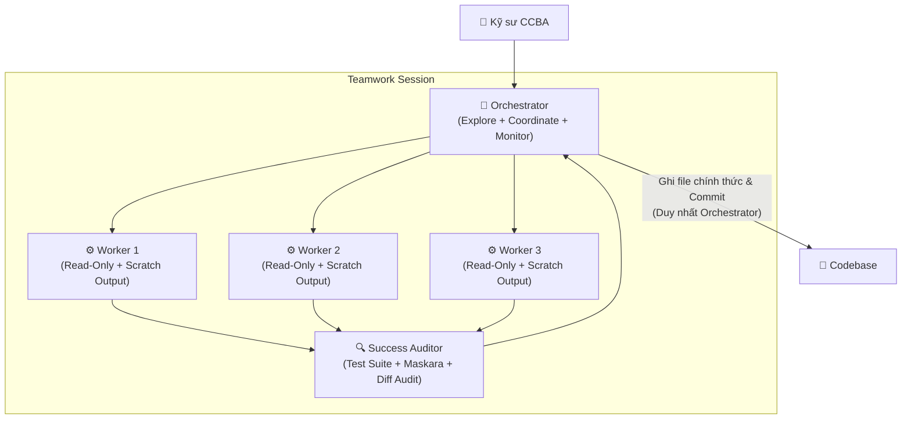

# 👥 Kỹ năng: ccba-teamwork (Điều Phối Đa Tác Nhân Dài Hạn)

Kỹ năng này hướng dẫn Agent đóng vai trò **Project Orchestrator** để điều phối các tác vụ kỹ thuật và dự án quy mô lớn (Monorepo refactoring, thẩm tra thiết kế 4 bộ môn, nạp kho pháp điển hàng loạt) theo **Teamwork Multi-Agent Framework** (lấy cảm hứng từ `/ccba-teamwork` và ADR 0053).

Khung làm việc này đảm bảo loại bỏ triệt để hiện tượng xung đột mã nguồn (merge conflicts), bảo vệ ngân sách ngữ cảnh (context budget) và duy trì sự phân tách rõ ràng giữa thẩm quyền con người (Accountability) và năng lực AI (Worker Assignments).

## 🏛️ Platform-Aware Architecture Posture

- **Seam Capability Posture**: `seam-exempt`. Kỹ năng này là SOP orchestrator bốn giai đoạn và ba vai trò (Orchestrator, Workers, Auditor) với Worker Cap 3. Khái niệm seam trong kỹ năng này là Exclusive Seam Ownership theo phân vùng tệp; Single-Writer hợp nhất thay đổi qua `scripts/governance/apply_worker_patch.py`; lệnh `verify-patch --preset code` là caller của `harness_verify.v1`, và bước auditor gọi `scripts/governance/check_spoke_leakage.py`. 16 card Seam chuẩn hóa đứng yên, kỹ năng giữ vai trò điều phối đa tác nhân độc lập.
- **Governance Compliance**: Giữ vững phân tầng Tier 3 Composite Orchestrator (`tier: orchestrator`, `is-orchestrated: true`), short-circuit qua Cổng 1 Stage 2. Kỹ năng chưa có thư mục `references/` phụ trợ và đã được trang bị tài nguyên mẫu tại `resources/team_sheet_template.md`.

---

## 🏛️ Mô Hình 3 Vai Trò Tối Giản (KISS Hierarchy)



1. **🎯 Orchestrator (Nhạc Trưởng — Agent Chính):**
   - Phỏng vấn người dùng, xác định mục tiêu và ranh giới Non-Goals.
   - Biên soạn `team_sheet.md` và thực hiện File-path Pre-Check.
   - Điều phối workers theo batch (tối đa 3 workers/batch).
   - **Giao thức Tác tử Ghi Duy nhất (Single-Writer Protocol — ADR-0053):** Duy nhất Orchestrator có quyền nạp các patch files từ sandbox của workers, thẩm định va chạm dòng (`--check-conflicts`), chạy dry-run mô phỏng, ghi đĩa nguyên tử kèm snapshot và tự động rollback nếu kiểm định thất bại bằng `scripts/governance/apply_worker_patch.py`.
2. **⚙️ Workers (Tác Nhân Thực Thi — Subagents):**
   - Thực thi độc lập và song song dưới nền.
   - **Nguyên tắc Không Can Thiệp Trước (No Pre-mutation Principle — SPEC-2026-TEAMWORK-DIFF-001):** Tuyệt đối không gọi các công cụ sửa file trực tiếp trên cây mã nguồn chính. Mọi đề xuất thay đổi bắt buộc đóng gói thành tệp patch định dạng **Search-Replace Block** hoặc **JSON Manifest** xuất vào sandbox: `.system_generated/scratch/teamwork/{project}/worker_{N}/patch_{seam}.txt`.
3. **🔍 Success Auditor (Kiểm Định Nghiệm Thu):**
   - Độc lập chạy scoped test suite (runtime < 2.0s).
   - Quét rò rỉ secrets và Spoke artifacts bằng Maskara.
   - Thực hiện **Post-Merge Diff Audit** đối chiếu `git diff --name-only` với phạm vi file scope được cấp.

---

## 📋 Tiêu Chí Hoàn Thành (Completion Criteria)

Kỹ năng hoàn thành khi:
1. Đã hoàn tất nghĩa vụ phỏng vấn (bằng vòng hỏi trực tiếp hoặc **Spec-Ready Intake**) và tạo tệp `.agents/teams/[project]_team_sheet.md` đầy đủ 2 lớp: **Accountability Mapping** (11 Ghế CCBA Charter 2026) và **Worker Assignments** (AI Subagents).
2. Toàn bộ Workers được dispatch tuân thủ **Worker Cap** (tối đa 3 workers đồng thời) và **Exclusive Seam Ownership** (chỉ đọc files trong scope).
3. Các tệp trung gian của Workers được lưu gọn trong `.system_generated/scratch/teamwork/{project}/worker_{N}/`, không vứt rải rác ngoài root.
4. Orchestrator hoàn thành việc ghép patch nguyên tử bằng Single-Writer Engine, ghi file chính thức và vượt qua **Success Auditor Gate**:
   - 100% Scoped Unit Tests pass.
   - Spoke Leakage Guard & Maskara exit code 0.
   - Post-Merge Diff Audit xác nhận không có file ngoài phạm vi seam bị can thiệp.
   - Catalog SSOT được biên dịch lại đồng bộ (`compile_catalog.py`).
5. **Deterministic Hard Completion Lock (ADR-0058):** Mọi lệnh kiểm thử và hợp nhất patch bắt buộc trả về Exit Code 0. Cấm Orchestrator tự nhận hoàn thành hoặc yêu cầu người dùng nghiệm thu nếu Exit Code $\ne 0$.

---

## 🛠️ Quy Trình Thực Hiện 4 Giai Đoạn

### Giai Đoạn 1: Phỏng Vấn Mục Tiêu & Cấu Trúc Đội Ngũ (Structured Interview)
Orchestrator làm rõ yêu cầu với kỹ sư:
1. **Mục tiêu cốt lõi:** Đầu ra cụ thể cần đạt là gì?
2. **Ranh giới Non-Goals:** Những phần nào dứt khoát không chạm vào trong đợt này?
3. **Phân rã Seams:** Có bao nhiêu luồng công việc / modules độc lập?
4. **Phân quyền Phê duyệt (Accountability Mapping):** Lựa chọn các Ghế trong 11 Ghế CCBA Charter 2026 chịu trách nhiệm nghiệm thu các mốc bàn giao:
   - `TRUONG_PHONG_RD_HTQT` / `TRUONG_PHONG_BIM_THIET_KE` / `TRUONG_PHONG_BIM_DU_AN`
   - `CHU_TRI_HOP_DONG_PM` / `CHU_TRI_BO_MON` / `KY_SU_THUC_THI`
   - `CO_VAN_PHAP_LY_QA` / `IDOP_LEAD` / `GIAM_DOC`
5. **Chế độ Spec-Ready Fast-Track (`[skip-interview]`):**
   - Kích hoạt khi hội đủ **cả 2 điều kiện**: (a) yêu cầu bắt đầu bằng token `[skip-interview]` và (b) có tệp đọc được trên đĩa (`implementation_plan.md`, `spec.md`, hoặc `team_sheet` sẵn có) nêu đủ Mục tiêu, Non-Goals và danh sách Seam/file.
   - Nếu thân yêu cầu rỗng sau token `[skip-interview]`, Orchestrator hỏi việc cần làm; nếu thiếu Mục tiêu/Non-Goals/Seam, thiếu phân quyền 11 Ghế CCBA Charter 2026, hoặc seam còn quyết định thiết kế mở, Orchestrator **chỉ hỏi bù đúng phần khuyết** trước khi sang Giai đoạn 3.
   - Khi chạy Spec-Ready Intake, Orchestrator ghi `Interview Mode: spec-ready (source: <path>)` vào nhật ký tiến độ và vẫn phải lập đủ cả 2 lớp trong `team_sheet.md`.
6. **Phản biện Kiến trúc Ngang hàng Grok CLI (Peer Architecture Audit — ADR-0063..0067):**
   - Đối với các chiến dịch quy mô lớn hoặc tác động rộng, trước khi sinh team sheet, Orchestrator có thể dispatch Grok CLI để thẩm định tính khả thi của việc phân rã seam và ranh giới Non-Goals.
   - Soạn thảo `.md/peer_exchange/prompt_grok_plan_<project>.md` (kèm `conversation_id`, `task_id`, `spoke_name`, `tags`, `request_type: "plan"`, `profile: "arch_audit"`).
   - Chạy lệnh CLI thực tế: `ccba-harness peer-dispatch --prompt-file .md/peer_exchange/prompt_grok_plan_<project>.md --profile arch_audit`.

---

**Tiêu chí hoàn thành:** Xác định rõ mục tiêu, non-goals và phân quyền phê duyệt.

---

### Giai Đoạn 2: Khởi Tạo Team Sheet (Team Sheet Generation)
1. Đọc template mẫu tại [team_sheet_template.md](resources/team_sheet_template.md).
2. Tạo tệp `.agents/teams/[project_slug]_team_sheet.md`.
3. **File-path Pre-Check:** Orchestrator liệt kê danh sách tệp tin cụ thể cho từng Worker trong Lớp 2 (Worker Assignments).
4. Phân chia các batches nếu tổng số workers $> 3$.

---

**Tiêu chí hoàn thành:** Tệp team_sheet.md được tạo với đầy đủ phân công worker.

---

### Giai Đoạn 3: Thực Thi Song Song Độc Quyền (Parallel Milestone Execution)
1. **Dispatch Batch & Chốt Chặn First-Unit Canary (`COND-03`):**
   - Đối với chiến dịch gồm nhiều đơn vị công việc đồng dạng (dùng chung một mẫu kickoff template), trước khi fan-out các batches song song, Orchestrator bắt buộc chạy thử **1 đơn vị thật (Canary Unit)** đi trọn vòng `Kickoff -> Worker -> Single-Writer Patch -> Success Auditor -> verify-patch exit 0` và xác thực `canary_verdict` (`head_sha` + `kickoff_sha256`) theo đúng bản chuẩn tại Mục 10 [`docs/rules/execution_coordination_guardrails.md`](../../../docs/rules/execution_coordination_guardrails.md#10-teamwork-orchestration-protocol-quy-chuẩn-điều-phối-đa-tác-nhân-dài-hạn).
   - Khởi chạy các Worker subagents (tối đa 3 workers/batch) qua `invoke_subagent` hoặc công cụ điều phối nền tảng.
   - Prompt của từng Worker **bắt buộc** chứa:
     - Danh sách file được phép đọc (Exclusive File Scope), kèm đường dẫn tài liệu/issue gốc (nếu có) để Worker đọc đối chiếu nguyên bản (**Original-Source-First** — tránh chỉ truyền bản tóm tắt tam sao thất bản).
     - **Routing Note & Quoted User Constraint:** Tách bạch hai khối: (a) **Routing Note** là lời dẫn của Orchestrator, trần $\le 30$ token (đếm theo regex `\S+` sau strip; bỏ khối nếu rỗng); (b) **Quoted User Constraint** trích nguyên văn phần yêu cầu của người dùng trong phiên chat hiện tại khi đang được viện dẫn mà chưa nằm trong file thuộc `Exclusive File Scope` hoặc nguồn `Original-Source-First` (tối đa 3 đoạn, mỗi đoạn $\le 500$ ký tự, tổng $\le 1200$ ký tự; phần dài hơn phải ghi thành file trong phạm vi đọc của Worker và truyền path). Phần trích đứng ngoài trần 30 token của Routing Note và giữ nguyên `Exclusive File Scope` (nếu đòi sửa file ngoài scope, Worker vẫn báo `HANDBACK` $\le 300$ ký tự).
     - **Chỉ thị No Pre-mutation:** Worker tuyệt đối không ghi file trực tiếp. Bắt buộc xuất bản vá định dạng Search-Replace vào `.system_generated/scratch/teamwork/{project}/worker_{N}/patch_{seam}.txt`:
       ```text
       FILE: <relative_path>
       <<<<<<< SEARCH
       <old_code>
       =======
       <new_code>
       >>>>>>> REPLACE
       ```
     - Tiêu chí nghiệm thu cụ thể (Acceptance Criteria).
2. **Xử Lý Báo Cáo Trạng Thái Worker (`DROPPED` / `HANDBACK`) & Timeout (10 Phút):**
   - **`DROPPED` (Không cần tạo bản vá):** Khi Worker kiểm tra thực tế các file trong `Exclusive File Scope` và xác nhận lỗi không tồn tại hoặc đã tuân thủ chuẩn, Worker báo `DROPPED` (kèm lý do $\le 300$ ký tự và danh sách file đã kiểm tra), không sinh file `patch_{seam}.txt` rỗng; Orchestrator ghi nhận `DROPPED` vào `team_sheet.md`.
   - **`HANDBACK` (Vượt phạm vi Seam được giao):** Khi Worker phát hiện tác vụ bắt buộc phải sửa đổi thêm file nằm ngoài `Exclusive File Scope` (kể cả khi phần trong scope không còn lỗi), Worker không tự ý sửa vượt rào mà báo `HANDBACK` (kèm lý do $\le 300$ ký tự và danh sách file ngoài scope cần mở rộng) để Orchestrator tái phân bổ ở batch tiếp theo.
   - **Timeout & Fallback (10 Phút):** Nếu Worker không hoàn thành sau 10 phút hoặc cạn ngân sách token:
     - Đánh dấu milestone là `INCOMPLETE`.
     - Trích xuất log trung gian từ scratch.
     - Quyết định: Dispatch Worker mới với prompt hẹp hơn HOẶC nếu lỗi logic sâu $\rightarrow$ đóng gói Deep Problem Brief và kích hoạt `/boost` (Escalation UP).
3. **Hợp Nhất Nguyên Tử Bởi Orchestrator (Single-Writer Engine):**
   - Sau khi các workers trong batch hoàn tất xuất patch, Orchestrator nạp và áp dụng nguyên tử:
     ```powershell
     python scripts/governance/apply_worker_patch.py --patch-dir .system_generated/scratch/teamwork/{project}/ --check-conflicts --apply --verify -c "python -m pytest [target_tests] -q" "python -m ruff check [target_paths]"
     ```
   - Nếu phát hiện **Line Collision**: Orchestrator từ chối batch, yêu cầu worker nộp lại patch sau khi rebase.
   - Nếu phát hiện **Semantic Conflict** (verification thất bại): Engine tự động rollback 100% snapshot, Orchestrator điều chỉnh logic xung đột.
   - Khi hoàn tất thành công, thực hiện commit Git theo từng logical unit: `feat(scope): ...` hoặc `refactor(scope): ...`.

#### Ranh giới Model Tiering, Read-Only Recon & Khóa Ghi Sandbox Canonical
- **Carve-out `ADR-0035` cho Patch Workers:** Quy tắc *"không ghi/sửa file"* của `ADR-0035` áp dụng nghiêm ngặt cho tác nhân `research` (read-only); toàn bộ Patch Workers sinh bản vá **bắt buộc dùng `invoke_subagent`** (không chạy qua `run_workflow`), giữ nguyên `Model="inherit"`, vẫn **cấm tuyệt đối sửa cây mã nguồn chính và cấm gọi Git**, và **chỉ được phép ghi duy nhất tệp sandbox canonical `.system_generated/scratch/teamwork/{project}/worker_{N}/patch_{seam}.txt`**. Orchestrator tiếp tục hợp nhất qua `python scripts/governance/apply_worker_patch.py --patch-dir .system_generated/scratch/teamwork/{project}/` (không trỏ `--patch-dir` sang `.md/scratch/` vì `load_patches_from_directory` quét đệ quy mọi `*.diff`, `*.patch`, `*.txt`, `*.json`).
- **Khảo sát đọc tiền thực thi (`run_workflow`):** Khi cần rà $> 3$ tệp trước khi phân seam bằng `run_workflow`, bắt buộc truyền tường minh `type_name="research"` ngay tại constructor `agent()` (cấm để mặc định `type_name="self"`) và `workspace="inherit"`, khóa công cụ thành đúng **3 công cụ đọc (`view_file`, `grep_search`, `read_resource`)** — không cấp `run_command`, không ghi/sửa file, không gọi Git, `depth limit = 1`, chia lô `parallel <= 3` bọc trong `pipeline` với mỗi nhánh gọi `finish`, và chỉ cho phép gán `model="flash"` ở bước đọc này; **cấm dùng `workspace="branch"`** để thay thế Single-Writer `apply_worker_patch.py`.

#### Chuẩn hóa Phong Bì Bàn Giao Cấu Trúc Worker (PATCHED | DROPPED | HANDBACK)
Chuẩn hóa đầu ra kết thúc chủ động của mọi Worker theo 3 trạng thái `PATCHED | DROPPED | HANDBACK` (giữ `INCOMPLETE` khi chạm timeout 10 phút) với **5 khóa chuẩn** cho cả báo cáo văn bản lẫn JSON `schema`: `status`, `checked_files`, `out_of_scope_files`, `patch_path`, và `reason` ($\le 300$ ký tự).

---

**Tiêu chí hoàn thành:** Các worker hoàn thành nhiệm vụ song song và orchestrator tổng hợp code nguyên tử không xung đột.

---

### Giai Đoạn 4: Cổng Kiểm Định Nghiệm Thu (Success Auditor Gate)
Auditor hoặc Orchestrator thực hiện chuỗi kiểm định tự động:
1. **Kiểm tra Verification Gate & Code Health:**
   ```powershell
   python -m ccba_harness verify-patch --preset code
   ```
2. **Kiểm tra An toàn Maskara & Rò rỉ Spoke:**
   ```powershell
   python scripts/governance/check_spoke_leakage.py
   ```
3. **Post-Merge Diff Audit:**
   ```powershell
   git diff --name-only HEAD~1
   ```
   *Đối chiếu danh sách file bị sửa đổi với file scope trong `team_sheet.md`.*
4. **Biên dịch Catalog SSOT:**
   ```powershell
   python scripts/governance/compile_catalog.py
   ```
5. **Thẩm Định Độc Lập Hậu Hợp Nhất qua Grok CLI (Tùy chọn cho Epic/Migration lớn):**
   - Khi chiến dịch có tác động diện rộng (Monorepo-wide hoặc Spoke-affecting), Orchestrator dispatch Grok CLI để kiểm toán lần cuối:
     ```bash
     ccba-harness peer-dispatch --prompt-file .md/peer_exchange/prompt_grok_audit_<project>.md --profile arch_audit
     ccba-harness peer-watch --once --dir .md/peer_exchange
     ```
   - Áp dụng Ma Trận Phân Loại 3 Nhãn (§20.3): `[ADOPT_AS_IS]`, `[ADOPT_ADAPTED]`, `[REBUT_WITH_EVIDENCE]` trước khi chuyển sang bước nghiệm thu.
6. **Cập nhật trạng thái:** Cập nhật `team_sheet.md` sang `COMPLETED` và tóm tắt nghiệm thu cho người dùng.

#### Tái Kiểm Ngữ Nghĩa Giữ Ngữ Cảnh Cho Success Auditor (Stateful Auditor Re-Verify)
`Success Auditor` bắt buộc giữ `Model="inherit"` và `workspace="inherit"`, chỉ kiểm định đọc và chạy kiểm thử cô lập theo `ADR-0035` (**tuyệt đối không tự áp dụng patch**, không sửa mã nguồn và không gọi Git đột biến). Khi xác minh bản vá sửa lỗi sau vòng 1, được phép tái sử dụng đúng phiên hội thoại hiện có của `Success Auditor` qua `send_message` tối đa **1 lượt tái kiểm ngữ nghĩa**.

> [!CAUTION]
> **Deterministic Hard Completion Lock (ADR-0058)**: Cấm Orchestrator tự nhận hoàn thành nếu bất kỳ bước kiểm định nào ở trên có Exit Code $\ne 0$.

**Tiêu chí hoàn thành:** Cả 4 bước kiểm định (verify-patch, maskara, diff audit, catalog) đều vượt qua thành công với Exit Code 0.

---

## ⚠️ Rào Chắn An Toàn Bắt Buộc

1. **Cấm Subagent Ghi File:** Tuyệt đối không cấp quyền chỉnh sửa file hoặc lệnh Git cho Worker subagents. Chỉ xuất ra scratch.
2. **Không Vượt Quá Worker Cap (Max 3):** Luôn chia batch nếu $> 3$ workers để chống cạn kiệt CPU/RAM và context window.
3. **Phân Biệt Rõ `/boost` vs `/ccba-teamwork`:**
   - Dùng `/boost` khi gặp bài toán bế tắc kỹ thuật đơn lẻ (suy luận sâu).
   - Dùng `/ccba-teamwork` khi dự án cần phân rã nhiều việc độc lập (điều phối rộng).
