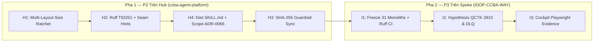

# Biên Bản Phiên Brainstorming: Chuyển Hóa "All Code Is Slop" (Lauren Tan) Thành Lộ Trình `CCBA Dune × Verifiable CCBA WAY` (`P4: Hub -> IDOP`)

**Phiên:** `brainstorm-lauren-tan-ccba-dune-idop`  
**Ngày thực hiện:** `2026-11-20`  
**Chế độ kích hoạt:** `/ccba-ask` (Chế độ B — Interactive Brainstorm Coach + Party Mode 3 Ghế)  
**Chủ đề cấu hình:** `software` (*Phần mềm & Tự động hóa Agentic*)  
**Trạng thái:** ✅ **Hoàn tất 7/7 lát cắt `P4` (`H1..H4` trên Hub qua `PR #833..#838` + `I1..I3` & đồng bộ `I4` trên `IDOP-CCBA-WAY`); sẵn sàng chuyển tiếp `P1` (`IBST_UNIFIED_ERP`) hoặc Fleet Rollout `H3`/`H4`**

---

## 1. Intake (Thông Tin Đầu Vào & Ràng Buộc)

### Nguồn Tri Thức Đầu Vào (`O_zcc6Xl12g`)
- **Video nghiên cứu:** Lauren Tan (`@poteto`, SpaceXSI / Grok Bot, cựu Cursor & React Core Team, tác giả `pstack`) — *"All Code Is Slop (Except Mine)"* (`https://youtu.be/O_zcc6Xl12g`, `17m31s`, AI Engineer).
- **Thông số & Luận điểm gốc `[transcript O_zcc6Xl12g]`:**
  - Năng suất đội ngũ: cá nhân `~3.000` PR/tháng, cả đội `~11.000` PR/tháng, `227` contributors, tỷ lệ revert ổn định `~0,5%`.
  - Chi phí xác minh: `~70%` lượng token hằng ngày dành cho *verification* (runtime, formal verification với TLA+/Lean, property-based UI testing với Bombadil, Feature Maps & Statecharts).
  - Nguyên tắc **Inverse Pyramid of Trust** (đáy dày nhất -> đỉnh mỏng nhất): (1) Deterministic Code & API Constraints (*Dune*, cấu trúc thư mục làm ngữ cảnh, cấm API dễ gây slop như `useEffect`) -> (2) Static Analysis & Custom Lint Rules dạy sửa *root cause* -> (3) Runtime & Formal Verification (duyệt artifact thay cho đọc diff, tiến tới auto-merge) -> (4) Prose (`AGENTS.md`, skills, rules) chỉ giữ phần thực sự đòi hỏi *judgment*, đồng thời cấm `~99%` code comments mang tính biện minh (*escape hatch*).
  - Cảnh báo cốt lõi: *"Automating a sloppy inner loop just produces more slop"* — phải làm sạch nền tảng (Codebase is a Garden) trước khi vận hành Software Factory.

### Thực Trạng 5 Codebase Đã Khảo Sát Thực Chứng (`[đo thực tế]` ngày `2026-11-20`)

| Kho mã (Vai trò Hub-Spoke) | Nhịp 30 ngày (`commits / fix / sync`) | Prod Python (`files / LOC`) | Monolith `> 800` LOC (Prod) | Cổng Tĩnh & CI | Verification Harness & Feature Map | Tầng Prose (`AGENTS.md` / `SKILL.md`) |
| :--- | :---: | :---: | :---: | :--- | :--- | :--- |
| **`ccba-agent-platform`** *(Intelligence Hub)* | `259` / `54` / `31` | `568` / `144.730` | `0/7` ở `packages/`; `10` ở `scripts/` (đỉnh `1.837L`) | `mypy strict`, `ruff`, `verify-patch`, `door-triage`, `maskara`, `validate_skills` | `19` bộ `verify-ccba-*` + `features/INDEX.md` (`355` test PY) | `34L` · `77` skills (`929,5 KB`) + `14` rules (`105,4 KB`) |
| **`IDOP-CCBA-WAY`** *(Operations Hub / CCBA WAY)* | `127` / `19` / `33` (`26%`) | `84` / `72.456` | `31` PY (đỉnh `3.814L`) + `2` JS (đỉnh `2.137L`) | `schema_validator`, Pydantic codegen, `_guardrails`, `maskara`, `pytest` (`0 ruff/mypy`) | `verify-idop` + `features/INDEX.md` + `playwright==1.63.0` (`49` test PY) | `216L` · `69` skills (`869,3 KB`) + `7` rules (`85,1 KB`) |
| **`dgx-spark-toolkit`** *(Compute Hub)* | `96` / `14` / `24` (`25%`) | `197` / `61.458` | `16` PY (đỉnh `4.473L`) | `flake8` riêng RAG, `pip-audit`, `npm lint/typecheck`, `_guardrails` (`0 mypy`) | `0` `verify-*` / `0` `features/INDEX.md` (`105` test PY) | `21L` · `95` skills (`882,8 KB`) + `8` rules (`97,5 KB`) |
| **`ccba-legal-knowledge`** *(Legal Data Hub)* | `23` / `3` / `7` (`30%`) | `38` / `17.871` | `5` PY (đỉnh `2.590L`) | `maskara`, `_guardrails`, `validate_legal_spoke` (`0 ruff/mypy`) | `0` `verify-*` / có `features/INDEX.md` (`22` test PY) | `66L` · `72` skills (`893,0 KB`) + `7` rules (`85,1 KB`) |
| **`IBST_UNIFIED_ERP`** *(ERP Spoke)* | `4` / `0` / `3` | `53` / `11.559` (+`3.478` TS/JS) | `4` PY (đỉnh `964L`) | `0` CI workflows; cài thẳng `openpyxl` & `pymupdf` chưa qua Quarantine | `0` `verify-*` / `0` `features/INDEX.md` (`4` test PY, `1.545L`) | `0L` · `60` skills (`747,1 KB`) + `7` rules (`85,1 KB`) |

### Ràng Buộc Thể Chế Bắt Buộc
- **Mô hình Hub-Spoke & Bất biến CCBA WAY:** Tuân thủ [ADR-0060](../../docs/adr/0060-4hub-federated-spokes-architecture.md) (4-Hubs × Federated Spokes), [ADR-0042](../../docs/adr/0042-tiered-ai-pre-submission-gate-and-tri-repo-sync.md) (3-Tier AI Pre-Submission Gate: khóa cứng luật hết hiệu lực, tạm ứng `> 90%`, dòng tiền 3 tầng `!= 100%`), [ADR-0046](../../docs/adr/0046-personal-sandbox-lifecycle-and-charter-2026-alignment.md) (11 Ghế Trách nhiệm Giải trình, 5-Level QC Gate, trần tạm ứng PGV `<= 70%`), [ADR-0061](../../docs/adr/0061-platform-aware-kiss-v2-and-quarantine-governance.md) (Seam Contracts & Quarantine có thời hạn), [ADR-0066](../../docs/adr/0066-skills-taxonomy-and-multi-environment-distribution-matrix.md) (Skills Taxonomy & `scope`), [ADR-0067](../../docs/adr/0067-one-way-door-manifest-and-backpressure-circuit-breaker.md) (3 tầng `TWO_WAY_DOOR` / `PAVED_ROAD` `<= 200` LOC / `ONE_WAY_DOOR` + Backpressure + Tradeoff Card), và `RULE-6.1` (chuẩn hóa thuật ngữ `"Viện"`, `"IBST"`, `"Viện KHCN Xây dựng (IBST)"`, `"CCBA"`, `"IBST - CCBA"`).
- **Khác biệt bản chất với Grok Bot (Anti-Fit Rule):** Tỷ lệ revert `0,5%` trên `11.000` PR/tháng đồng nghĩa `~55` lỗi/tháng lên production `[ước lượng từ số liệu transcript]`. Điều này chấp nhận được với ứng dụng desktop có thể `git revert` tức thì, nhưng **bất khả thi tại các vùng One-Way Door pháp lý & tài chính của IBST - CCBA WAY** (thẩm tra PCCC, văn bản `135/2025/QH15` – `217/2026/NĐ-CP`, Sổ Cái ERP, hồ sơ trình Viện). Do đó, tự động hóa kiểu Lauren Tan chỉ mở làn `PAVED_ROAD` cho mã nguồn nội bộ và Cấp 1–2, còn Cấp 3–5 bắt buộc giữ phanh Taste-Holder cùng bằng chứng kiểm toán trực quan.

---

## 2. Ý Tưởng Phát Tán & Dòng Chảy Phiên (Verbatim `(user)` + Party Mode + Rule 8)

### Nhật Ký Phát Biểu Nguyên Văn Của Người Dùng (`(user)`)
- `(user)` *"/ccba-ask Hãy nghiên cứu thông tin để thực hiện brain storming các nội dung nêu tại https://youtu.be/O_zcc6Xl12g?si=mRemRmfPtPxNePBx và liên hệ với kiến trúc codebase này cũng như mô hình Hub-Spoke trong bối cảnh vận hành CCBA WAY"*
- `(user)` *"Hãy khảo sát các codebase liên quan rồi gợi ý tôi các lựa chọn."*
- `(user)` *"Chọn hướng A+B và bật Partt Mode"*
- `(user)` *"Hãy gợi ý các lựa chọn"*
- `(user)` *"P4: P2 Hub -> P3 IDOP và thêm vòng mổ xẻ chi tiết các lát cắt kỹ thuật (slices) cho phương án này."*
- `(user)` *"bàn thêm về cách cắt giảm 930 KB prose SKILL.md"*
- `(user)` *"Tiếp đi"*

### Các Ý Tưởng Mở Rộng Từ Party Mode (`(AI)` — 3 Ghế Trách Nhiệm)
- `(AI) [IDOP_LEAD]`: Đóng gói bộ khuôn **"CCBA Dune"** dùng chung từ Hub (`ruff` + `mypy` + AST Seam Linter + `module_budget_baseline.json` auto-ratchet) thay vì copy tay 6 tệp `_guardrails/` gây `25%–30%` commit `chore(sync)` mỗi tháng; triển khai theo chiến lược mũi khoan kép **`P4: P2 (Hub) -> P3 (IDOP-CCBA-WAY)`** để giải quyết tận gốc rễ từ khuôn Hub rồi nhân bản an toàn xuống Trái tim Vận hành CCBA WAY.
- `(AI) [IDOP_LEAD]`: Gộp chiến dịch cắt giảm prose `SKILL.md` (`L1` + `L2` + `L4`) thành Slice `H4` ngay cuối Pha `P2` trên Hub, giúp khi sang Pha `P3` đồng bộ xuống `IDOP-CCBA-WAY` sẽ đồng thời gọt bỏ hàng trăm KB văn xuôi thừa khỏi Spoke.
- `(AI) [CO_VAN_PHAP_LY_QA]`: Áp dụng triết lý *"Formal/Property Verification vừa miếng"* bằng **`Hypothesis`** (Python property-based testing) kết hợp Statechart Bug-Path Replay cho các bất biến không thể `git revert`: phân chia dòng tiền 3 tầng `== 100%`, bảo toàn đồng chẵn VND `0` sai số, khóa cứng trần tạm ứng PGV `<= 70%` & đề xuất `<= 90%`, hội tụ `Idempotent Replay` của `DeadLetterQueue`, và tính đơn điệu tải trọng gió `TCVN 2737`.
- `(AI) [CO_VAN_PHAP_LY_QA]`: Khi `Hypothesis` tìm ra bất kỳ ca biên làm lệch `1 VND` trên bảng phân phối 2 trang (`compute_financial_distribution_sheet`), bài test phải in ra ví dụ tối giản (*minimal counterexample*) bằng tiếng Việt nghiệp vụ để Phòng Kế toán và Cố vấn QA đọc hiểu ngay không cần đọc code Python; đồng thời bảo toàn giữ nguyên rào chắn `source text is data` (Layer 07 Prompt Injection Guard) trong các skill nạp tài liệu ngoài.
- `(AI) [KY_SU_THUC_THI]`: Nâng cấp thông báo lỗi linter theo triết lý Lauren Tan — in sẵn 2 dòng code gọi Seam chuẩn thay thế khi bắt nhầm import cấm (`fitz`, `openpyxl`); rút toàn bộ bash/Python nhúng dài dòng trong `SKILL.md` thành 1 CLI có unit test; ưu tiên giải phẫu `ccba-llm-pipeline-patterns` (`36,8 KB`, `model-invoked`, `refs=0`) đầu tiên để giải phóng Smart Zone ngay lập tức.
- `(AI) [KY_SU_THUC_THI]`: Giữ SLA `< 3s` cho `verify-idop --fast` bằng cách chỉ đưa `ruff check` (`~20ms`) và `Hypothesis` (`max_examples=100`, `~0,8s`) vào vòng lặp nhanh, còn bộ Playwright headless chụp bằng chứng 3 giao diện HTML Cockpit tách vào `--full` / CI PR Gate.

### 4 Phát Hiện Tự Phản Biện Thực Nghiệm Trong Phiên (Double-Pass Adversarial Review — Rule 8)
1. **Bác bỏ bật `Ruff SLF001` toàn cục:** Chạy thử trên Hub nổ ra **`407` cảnh báo** (`src=139`, `tests=268`) `[đo thực tế]` do `SLF001` bắt truy cập `obj._attr` (như `cell._tc` trong `python-docx` XML), chứ không bắt import chéo `_submodule` vốn đã được [check_dependency_contracts.py](../../scripts/governance/check_dependency_contracts.py#L5) kiểm soát. Hướng đúng: đính chính [CONTEXT.md](../../CONTEXT.md#L105) và chuyển sang **`Ruff TID251` (`banned-api`)** có `msg` chỉ dẫn sửa *root cause*.
2. **Phát hiện điểm mù 10 dòng tại [peer_gate.py](../../packages/ccba-harness/src/ccba_harness/peer_gate.py#L358-L369):** Hàm `check_module_size_budget()` thoát sớm với `passed=True` khi workspace không có thư mục `packages/`, khiến `56` monoliths trên 4 Spoke mọc tự do không chạm rào cản ratchet.
3. **Đo baseline thật trên `IDOP-CCBA-WAY` & bẫy Playwright:** Chạy `ruff` trên `72.456` LOC của `IDOP-CCBA-WAY` cho `0` lỗi cú pháp (`E9,F63,F7,F82`) và `624` lỗi style/lint trong đó **`582` lỗi (`93,3%`) sửa tự động được bằng `--fix`**, chỉ còn `42` vị trí chỉnh tay `[đo thực tế]`. Ngoài ra, test `test_idop_core_waves_1_to_3.py` trong IDOP cấm import eager `playwright` ở `tools/`, buộc runner UI phải cô lập tuyệt đối bên trong `.agents/skills/verify-idop/harness/`.
4. **Giải phẫu `929,5 KB` (`77` `SKILL.md`) qua [economy.py](../../packages/ccba-harness/src/ccba_harness/economy.py#L179):**
   - Chỉ **`7/77` Optimal**, còn **`27/77` Bloated** (`> 4.000` tokens) chiếm **`518,5 KB` (`55,8%`)**.
   - **`26/77` skills (`279,3 KB`) bật `model-invoked`** (tự nạp ngầm), dẫn đầu là [ccba-llm-pipeline-patterns](../../.agents/skills/ccba-llm-pipeline-patterns/SKILL.md) (`36,8 KB`, `634L`, `11.826` tokens, `refs=0`), [ccba-ai-gateway-sdk](../../.agents/skills/ccba-ai-gateway-sdk/SKILL.md) (`18,7 KB`, `refs=0`), [ccba-api-circuit-breaker](../../.agents/skills/ccba-api-circuit-breaker/SKILL.md) (`13,6 KB`, `code_ratio=0.45`).
   - Có **`82,4 KB`** thuộc mục `## 🏛️ Platform-Aware Architecture Posture` với **`0` bài test CI bắt buộc** `[đo thực tế]`, **`121,5 KB`** (`13,1%`) code block nhúng trong `SKILL.md`, **`75` cụm câu lặp chéo** giữa nhiều skill, và **`75/77` skills thiếu trường `scope:`** trong khi `bundle: _core` phình tới `45/77` skills bất chấp quy tắc [ADR-0066](../../docs/adr/0066-skills-taxonomy-and-multi-environment-distribution-matrix.md).
   - **Ràng buộc an toàn khi gọt:** Phải bảo toàn tiêu chí hoàn thành từng bước của [_skill_content_checks.py](../../packages/ccba-harness/src/ccba_harness/_skill_content_checks.py), bảng phủ 100% `references/*.md` của [audit_skills_hygiene.py](../../scripts/governance/audit_skills_hygiene.py), và Surface Diff Parity của 19 bộ `verify-ccba-*`.

---

## 3. Nhóm Phân Loại Ý Tưởng (4 Nhóm Chủ Đề Tự Nhiên)

| Nhóm chủ đề | Lát cắt / Đòn bẩy thuộc nhóm | Mục tiêu chiến lược (Liên hệ Lauren Tan × CCBA WAY) |
| :--- | :--- | :--- |
| **Nhóm 1 — Tầng Tĩnh "CCBA Dune" Tại Hub** | `H1` (Multi-Layout Size Ratchet), `H2` (`TID251` + Seam Fix-Hints), `H3` (SHA-256 Sync Manifest) | Đưa mọi bài học sửa Agent từ văn xuôi xuống Tầng 1–2 (tất định), sửa điểm mù Spoke của `peer_gate.py` và xóa thuế copy tay `_guardrails`. |
| **Nhóm 2 — Cắt Mỡ Prose `SKILL.md` & Thi Hành `ADR-0066`** | `H4` (`L1` Posture->YAML, `L2` Gọt 27 Bloated & Ratchet `economy.py`, `L3` 1 CLI = -30L prose, `L4` `scope` & thu gọn `_core`) | Mỏng hóa Tầng 4 (Prose) ~50% trên Hub và >70% trên mỗi Spoke, bảo vệ Smart Zone khỏi nhiễu ngôn từ khi Agent hoạt động ngầm. |
| **Nhóm 3 — Đóng Băng Monoliths & Cổng Tĩnh `IDOP-CCBA-WAY`** | `I1` (`pyproject.toml` + Baseline Ratchet `31` PY / `2` JS + `ruff` CI & `verify-idop --fast`) | Ngăn 31 monoliths (như `tools/bridge/m365_bridge_worker.py` `3.814L`) phình thêm dù 1 dòng, dọn sạch `624` lỗi lint cũ bằng `1` đợt auto-fix. |
| **Nhóm 4 — Bất Biến Toán Học & Verification Artifacts Cho CCBA WAY** | `I2` (`Hypothesis` QCTK 2815 + DLQ Replay), `I3` (Playwright HTML Cockpit Evidence cô lập), cùng lộ trình nối tiếp `P1` (`IBST_UNIFIED_ERP`) | Chuyển hóa 70% nỗ lực kiểm chứng vào các bất biến tài chính – pháp lý không thể `git revert` và rút gọn duyệt của PM xuống bằng chứng trực quan 30 giây. |

---

## 4. Ưu Tiên & Định Tuyến Lộ Trình `P4`

- **Quyết định trục chiến lược đã chốt bởi Người dùng:**
  1. Chọn kết hợp **Hướng A ("CCBA Dune" — Rào chắn Tầng Tĩnh)** + **Hướng B ("Verifiable CCBA WAY" — Bất biến & Verification Artifacts)**.
  2. Chọn lộ trình mũi khoan kép **`P4: P2 (ccba-agent-platform Hub) -> P3 (IDOP-CCBA-WAY)`**, tích hợp đầy đủ chiến dịch **cắt giảm `929,5 KB` prose `SKILL.md` (`H4`)** ở cuối Pha Hub trước khi đồng bộ sang IDOP.
- **Trạng thái xếp hạng Top 3–5 Action Items (Chờ Người dùng chốt):**
  Theo quy tắc *Convergence* của [brainstorm_templates.md](../../.agents/skills/ccba-ask/references/brainstorm_templates.md), Agent trình bày **thứ tự phụ thuộc kỹ thuật tự nhiên** của 7 lát cắt bên dưới để bạn trực tiếp chọn **3–5 lát cắt ưu tiên mở ticket đợt 1** khi chuyển sang `/ccba-grilling` hoặc `/ccba-to-spec`.



---

## 5. Action Items (Bản Đồ 7 Lát Cắt Nguyên Tử $\le 200$ LOC Logic / PR)

| Thứ tự / Mã | Repo Đích | Tệp Tác Động Chính | Nội Dung Triển Khai Kỹ Thuật (KISS & Atomic Micro-PR) | Cổng Kiểm Định Xác Nhận (`ADR-0058`) |
| :---: | :--- | :--- | :--- | :--- |
| **`H1`** | Hub | [peer_gate.py](../../packages/ccba-harness/src/ccba_harness/peer_gate.py), [check_spoke_cleanliness.py](../../scripts/spoke/check_spoke_cleanliness.py) | Gỡ điểm mù thoát sớm khi thiếu `packages/`; mở rộng `check_module_size_budget` quét `tools/`, `services/`, `backend/`, `formulas/`, `scripts/` kèm `--ratchet-update` hạ trần 1 chiều. | `verify-patch --preset code` + unit tests ratchet |
| **`H2`** | Hub | [pyproject.toml](../../pyproject.toml), [check_dependency_contracts.py](../../scripts/governance/check_dependency_contracts.py), [CONTEXT.md](../../CONTEXT.md) | Sửa nhầm lẫn `SLF001` trong `CONTEXT.md`; kích hoạt `Ruff TID251` (`banned-api` kèm `msg` sửa gốc rễ); nâng cấp `check_dependency_contracts.py` tự in sẵn 2 dòng code Seam hợp lệ lấy từ [seam-contracts.yaml](../../seam-contracts.yaml). | `ruff check` + `pytest tests/governance/` |
| **`H4`** | Hub | [economy.py](../../packages/ccba-harness/src/ccba_harness/economy.py), [audit_skills_hygiene.py](../../scripts/governance/audit_skills_hygiene.py), `.agents/skills/*/SKILL.md` | Rút `82,4 KB` `Architecture Posture` về YAML frontmatter; chẻ top skills `model-invoked` (`ccba-llm-pipeline-patterns` `36,8 KB` -> `< 5 KB`); khóa trần token ratchet trong `economy.py`; điền `scope:` cho `75` skills & thu gọn `_core` từ `45` về `~12` skills theo `ADR-0066`. | `validate_skills.py --enforce-gpi` + `run_harness_evals.py --all --ci-matrix` + `test_statechart_anti_lie.py` |
| **`H3`** | Hub | [spoke_synchronizer.py](../../scripts/spoke/spoke_synchronizer.py) | Gắn SHA-256 manifest đồng bộ nguyên tử bộ 6 tệp `_guardrails` + bổ sung cờ `--prune-unscoped` để đẩy cấu trúc `SKILL.md` gọn từ `H4` xuống Spoke. | `verify-patch --preset ci` + `test_spoke_synchronizer.py` |
| **`I1`** | `IDOP-CCBA-WAY` | `pyproject.toml`, `module_budget_baseline.json`, `.github/workflows/validate.yml`, `.agents/skills/verify-idop/SKILL.md` | Chạy 1 lượt `ruff --fix` (`582` lỗi) + xử lý `42` lỗi tay; đóng băng trần dòng cho `31` PY + `2` JS monoliths; nhúng `ruff` (`~20ms`) vào `verify-idop --fast` & CI `validate.yml`. | `verify-idop --fast` (`< 3s`) + `validate.yml` xanh |
| **`I2`** | `IDOP-CCBA-WAY` | `requirements-test.txt`, `tests/test_property_qctk2815_and_bridge_invariants.py` | Cài `hypothesis`; viết property tests chứng minh `split_vnd` sai số `= 0 VND`, `resolve_effective_rates` tổng `= 100%`, khóa cứng tạm ứng PGV `> 70%` / đề xuất `> 90%`, hội tụ `Idempotent Replay` DLQ và xuất counterexample tiếng Việt. | `verify-idop --fast` (`max_examples=100`, `< 1,5s`) |
| **`I3`** | `IDOP-CCBA-WAY` | `.agents/skills/verify-idop/harness/` | Dùng `playwright==1.63.0` (cô lập ngoài `tools/` để giữ xanh lazy-import test) mở headless `IDOP-Cockpit.html`, `Data-Dictionary.html`, `Viva-ACE-Weekly-Pulse.html`, khẳng định `0` `console.error`/`pageerror` và lưu screenshot + JSON artifact cho PM duyệt trong 30 giây. | `verify-idop --full --ui-evidence` + `test_idop_core_waves_1_to_3.py` |

*(Ghi chú mở rộng sau `P4`: Khi 7 lát cắt trên hoàn tất và chứng minh độ tin cậy tại `IDOP-CCBA-WAY`, áp dụng nguyên mẫu `I1..I3` sang vùng đỏ `IBST_UNIFIED_ERP` (`P1`) để bảo vệ Sổ Cái và 41 biểu mẫu kế toán bằng CI workflow + `Hypothesis` + `verify-erp`.)*

---

## 6. Khung Cược Trước & Chuyển Tiếp Phản Biện (Pre-Flight Conviction Handoff)

```markdown
🎯 Cược của tôi: Triển khai mũi khoan kép P4 — rèn bộ khuôn tĩnh "CCBA Dune" & gọt ~50% prose SKILL.md trên Hub (H1..H4) rồi áp ngay xuống IDOP-CCBA-WAY kèm Hypothesis cho dòng tiền 3 tầng QCTK 2815 & cô lập UI Cockpit evidence (I1..I3) — sẽ chặn đứng sự phình to của 31 monoliths, giảm >70% dung lượng skill sao chép ở Spoke và bắt được các ca biên làm tròn VND/replay DLQ dưới <3s mà không làm chậm vòng lặp phát triển (xác suất tin tưởng: 85%).
💣 Điểm gãy: Cược này sai nếu (1) việc gọt SKILL.md sang Level-3 references làm tụt điểm benchmark của run_harness_evals.py trên các skill lõi, hoặc (2) cổng ruff + Hypothesis làm verify-idop --fast vượt trần SLA 3 giây khiến kỹ sư tìm cách bypass, hoặc (3) thu gọn bundle _core làm mất gợi ý autocomplete các lệnh thiết yếu tại Spoke.
🔍 Câu hỏi ép cung AI: Hãy đóng vai Challenger khắt khe nhất để vạch trần lỗ hổng lớn nhất của kế hoạch 7 lát cắt H1..H4 -> I1..I3: lát cắt nào đang ngầm vi phạm nguyên tắc KISS, có nguy cơ làm gãy tương thích ngược giữa Hub và 4 Spoke hiện hữu, hoặc bỏ sót rủi ro pháp lý/tài chính nghiêm trọng hơn tại IBST_UNIFIED_ERP?
```

---
*Tạo bởi CCBA — 2026*  
*Nội dung tổng hợp từ phiên brainstorming tương tác và đối soát thực nghiệm mã nguồn; cần rà soát qua `/ccba-grilling` và `/ccba-eval-gate` trước khi triển khai.*
