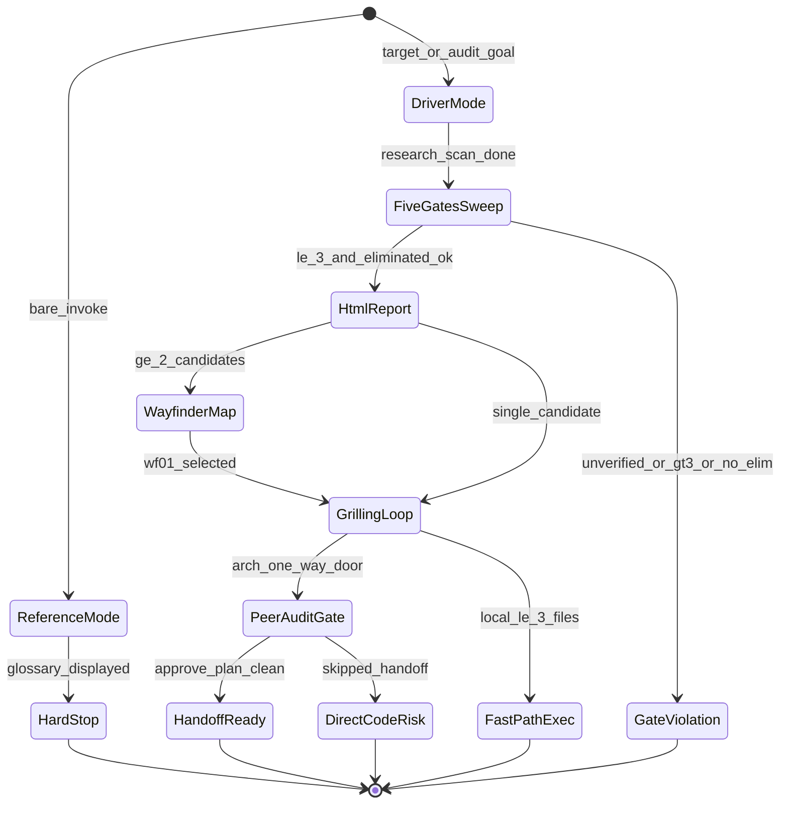

# Biên Bản Phỏng Vấn Grilling & Kế Hoạch Triển Khai v1.1: Nâng Cấp `/ccba-codebase-design` `v1.5.0` & Bộ Kiểm Định `verify-ccba-codebase-design`

> **Ngày chốt Grilling:** `2026-11-26` | **Phiên bản Kế hoạch:** `v1.1` *(Pass 1 `39058d39` `REVISE_PLAN` $\to$ Pass 2 `d426e9a2-5579-45ad-b3d7-a042b1ddfe19` **`APPROVE_PLAN`**, `risk_score: 2`, `blocking_conditions: 0`)*  
> **Trạng thái Thực thi:** `COMPLETED` *(Đã hợp nhất trọn bộ `PR #914` @ `a338d14e` & `PR #915` @ `ef14e517` lên `main`; tổng kết Mục 78)*  
> **Biên lai Đối soát Seam (`ADR-0061`):** `harness_verify.v1` $\to$ `ccba_harness:auto_apply_and_verify_patch` (`--in verify_preset --out verification_report`, `MATCH`) | `index_sha256`: `29d4ee1aa2efb369ce154585cd65e1c44ec31efed8ec4096a8f603b8944b6c49`

---

## 0. Bảng Giải Trình Điều Kiện Từ Grok Pass 1 (`39058d39`) & Pass 2 (`d426e9a2`)

| Mã | Phân loại | Dẫn chứng mã nguồn (`file:line`) | Biện pháp khắc phục triệt để trong Kế hoạch `v1.1` |
| :--- | :--- | :--- | :--- |
| **`COND-01`** (`blocking: true`) | **`[ADOPT_AS_IS]`** | [test_statechart_anti_lie.py](../../../tests/governance/test_statechart_anti_lie.py#L184-L185), [statechart_verification_guide.md](../../../.agents/skills/ccba-mermaid-diagram/references/statechart_verification_guide.md#L32-L34) | Cắt gọn sơ đồ §4 từ `22` cạnh xuống **`18` cạnh** (`<= 20` ngưỡng cứng `verify_statechart_anti_lie`): gộp 3 lỗi quét thành `GateViolation` (`FiveGatesSweep --> GateViolation`) và giữ `DirectCodeRisk` (`PeerAuditGate --> DirectCodeRisk`), giữ `2` `bug_path` JSON khớp cạnh thật, `0` unreachable, `0` deadlock. (Parser chỉ yêu cầu `[A-Za-z0-9_]+`, không giới hạn 20 ký tự cho tên state). |
| **`COND-02`** (`blocking: true`) | **`[ADOPT_AS_IS]`** | [codebase_refactor_guide.md](../../../.agents/skills/ccba-codebase-design/references/codebase_refactor_guide.md#L102-L112) | Gộp hợp đồng `/ccba-wayfinder` và cổng `/ccba-handoff` **thay thế trực tiếp tại chỗ** vào đúng 1 đoạn Bước 4 hiện có (`L102-112`): giữ nguyên **trần Pass 3** (`blocking_conditions == 0` hoặc chạm trần Pass 3 để Kỹ sư phán quyết), xác nhận `proceed` từ Kỹ sư trước khi sửa mã, nhánh Kiến trúc (`> 3` tệp, `> 200` LOC, `Strong`, hoặc `ONE_WAY_DOOR`) mặc định đề xuất `/ccba-handoff` mở phiên sạch `/ccba-implement` (cho phép user ghi đè `"tiếp tục tại đây"`), và Fast-Path (`<= 3` tệp, `<= 200` LOC, không đổi Public Seam) được `Continue` sau Decision Log. |
| **`COND-03`** (`blocking: false`) | **`[ADOPT_AS_IS]`** | [SKILL.md](../../../.agents/skills/ccba-codebase-design/SKILL.md#L1-L51), [coordinator.py](../../../scripts/spoke/sync/coordinator.py#L56), [eval_general_domain.json](../../../.agents/skills/ccba-eval-gate/test_cases/eval_general_domain.json#L1249-L1260) | Giữ nguyên frontmatter `Reference skill`, `disable-model-invocation: true`, `posture: seam-exempt`, `tier: kernel`, GPI `(4.0, 3.0, 1.0, 1.0)`, Hard Stopping Rule + 7 thuật ngữ khi gọi trần; `Driver Mode` chỉ kích hoạt trong thân bài khi có động từ hành động hoặc tên phân vùng/module. Không sửa `coordinator.py` hay `test_general_domain_mined_90`. |
| **`COND-04`** (`blocking: false`) | **`[ADOPT_AS_IS]`** | [test_skill_governance.py](../../../packages/ccba-harness/tests/test_skill_governance.py#L285-L350), [packages/ccba-harness/features/INDEX.md](../../../packages/ccba-harness/features/INDEX.md) | Bổ sung tường minh `bundle: _software` (đồng bộ với `ccba-codebase-design`), `tier: kernel`, `scope: spoke`, `gpi: {s: 4.0, k: 3.0, a: 2.0, p: 1.0}`, `verification_mode: ["scaffold", "sync", "verify"]`, `sync_commit` 40 hex trên `main` (commit merge `--merge` của PR-1) vào frontmatter `verify-ccba-codebase-design/SKILL.md`; chỉ đặt harness dưới `packages/ccba-harness/.agents/skills/` (`0` thư mục trùng tại `.agents/skills/ccba-codebase-design/harness`); không sửa `coordinator.py` trong PR-2. |
| **`COND-05`** (`blocking: false`) | **`[ADOPT_AS_IS]`** | [economy.py](../../../packages/ccba-harness/src/ccba_harness/economy.py#L503), [_skill_content_checks.py](../../../packages/ccba-harness/src/ccba_harness/_skill_content_checks.py#L52) | Đo cứng `count_skill_tokens_lf` trên LF (`<= 3,850` mục tiêu headroom / trần CI `4,000`); mọi slash command mới trong `references/*.md` đều là lệnh catalog hợp lệ (`/ccba-wayfinder`, `/ccba-handoff`, `/ccba-implement`, `/ccba-grilling`) và đặt tách khỏi khối dính backtick với đường dẫn `references/*.md`. |
| **`COND-06`** (`blocking: false`) | **`[ADOPT_AS_IS]`** | [codebase_refactor_guide.md](../../../.agents/skills/ccba-codebase-design/references/codebase_refactor_guide.md#L102-L112) | Khi viết Bước 4 trong `PR-1`, khóa thứ tự xét tiêu chí rẽ nhánh: đếm **số ứng viên trước** (`>= 2` ứng viên hoặc đa module $\to$ `/ccba-wayfinder` rồi `/ccba-grilling` trong `WF-01`; `1` ứng viên $\to$ `/ccba-grilling`), còn điều kiện `<= 3` tệp chỉ áp dụng tại tầng phân loại Fast-Path sau Decision Log (nhánh kiến trúc vẫn chờ `blocking_conditions == 0` hoặc trần Pass 3 $\to$ `proceed` $\to$ `/ccba-handoff`). |

---

## 1. Bằng Chứng Thực Nghiệm & Động Lực Nâng Cấp

Khảo sát định lượng toàn bộ **`553` conversation chính** trong nhật ký Antigravity (`2026-10-07` $\to$ `2026-11-26`), **`16` báo cáo HTML** trên đĩa, lịch sử Git Hub (`36` commit từ `2026-07-04` $\to$ `2026-11-18`), và các bản đồ Wayfinder ghi nhận:

1. **Hiệu quả thực chiến cao:** `/ccba-codebase-design` đứng hạng `#8` theo lượt gọi tường minh (`21` phiên gọi trực tiếp + `12` phiên đọc gián tiếp = `33` phiên) trên `5` kho (`IDOP-CCBA-WAY` `9`, `dgx-spark-toolkit` `5`, `ccba-agent-platform` `4`, `IBST_UNIFIED_ERP` `1`, `VvC_Notes` `1`), tạo `21` báo cáo HTML, `95` `gh pr create`, `79` `gh pr merge`, `168` `git commit`, `274` lượt `verify-patch`, và `110` lượt `peer-dispatch`; **`68.4%`** (`13/19` phiên chuyên biệt) được Kỹ sư duyệt triển khai cả `3/3` ứng viên.
2. **Mâu thuẫn danh tính & Hard Stop (`SKILL.md`):** [SKILL.md](../../../.agents/skills/ccba-codebase-design/SKILL.md#L50-L51) (dựa trên [ADR-0035](../../../docs/adr/0035-polyglot-deep-modules-and-subagent-guardrails.md#L18-L20)) yêu cầu dừng cứng khi không nêu module mục tiêu và chỉ còn `61` tokens headroom (`3,939 / 4,000` tokens đo bằng `count_skill_tokens_lf`). Trong thực tế, `16/20` phiên gọi kèm ý định tổng quát (`"nghiên cứu / rà soát / cải tiến kiến trúc codebase"`) và nạp thẳng [codebase_refactor_guide.md](../../../.agents/skills/ccba-codebase-design/references/codebase_refactor_guide.md) (`20/21 = 95.2%`).
3. **Đứt gãy nối mạch `/ccba-wayfinder` & phình phiên nguyên khối:** Chuyển tiếp thực tế số 1 là `/ccba-codebase-design` $\to$ `/ccba-wayfinder` (`8` lần, cao hơn `-> /ccba-grilling` `5` lần), nhưng tài liệu kỹ năng chưa nhắc `/ccba-wayfinder` và chưa có cổng cắt pha `/ccba-handoff` sau Grok `APPROVE_PLAN`, làm phiên kéo dài trung bình `1,272` steps (`575.5k` output tokens, đỉnh `3,005` steps / `1.36M` tokens).
4. **Lệch host/OS & tài liệu Level 3 ít dùng:** [codebase_refactor_guide.md](../../../.agents/skills/ccba-codebase-design/references/codebase_refactor_guide.md#L22) còn gọi subagent `"Explore"` và lệnh PowerShell `Start-Process` ([L71-L78](../../../.agents/skills/ccba-codebase-design/references/codebase_refactor_guide.md#L71-L78)) dù máy trạm chạy Linux; [design_it_twice.md](../../../.agents/skills/ccba-codebase-design/references/design_it_twice.md) chỉ chạy thật `2/20` lần (`0` lần sau `2026-11-06`) bằng subagent `self` ghi đĩa thay vì `research`; [software_factory.md](../../../.agents/skills/ccba-codebase-design/references/software_factory.md) đạt `0/553` lượt đọc và đang bị lặp link tại 2 mục trong `SKILL.md`.
5. **Điểm mù kiểm định Profile-B:** `packages/ccba-harness/.agents/skills/` đã có `19` bộ `verify-ccba-*`, nhưng chưa có `verify-ccba-codebase-design`; bộ [eval_codebase_engineering.json](../../../.agents/skills/ccba-eval-gate/test_cases/eval_codebase_engineering.json) chưa có test case kiểm định 2 chế độ và 5 Cổng Phản Biện.

---

## 2. Chi Tiết `4` Quyết Định Đã Khóa (`Q1`–`Q4`)

### `Q1` (`P1`) — Phân Tách 2 Chế Độ Đầu Vào, Ngân Sách Token `<= 3,850` & Sửa Lệch Host/OS
- **Phân tách 2 chế độ tường minh ngay đầu [SKILL.md](../../../.agents/skills/ccba-codebase-design/SKILL.md) (giữ nguyên frontmatter Reference Skill):**
  - **Reference Mode:** Kích hoạt khi gọi trần `/ccba-codebase-design` (không kèm mục tiêu hoặc động từ hành động). Giữ nguyên **Hard Stopping Rule** ([ADR-0035](../../../docs/adr/0035-polyglot-deep-modules-and-subagent-guardrails.md#L18-L20)): hiển thị 7 thuật ngữ cốt lõi + gợi ý nhanh 2 hướng rồi dừng.
  - **Driver Mode:** Kích hoạt trong thân bài khi gọi kèm động từ *nghiên cứu / rà soát / cải tiến / tối ưu* hoặc chỉ định phân vùng/module mục tiêu. Nạp thẳng `references/codebase_refactor_guide.md` và thực thi trọn vẹn Bước 1 $\to$ Bước 3 (5 Cổng Phản Biện + Báo cáo HTML `<= 3` ứng viên) mà không dừng hỏi thừa 1 lượt.
- **Giải phóng headroom token (`3,939` $\to$ `<= 3,850` tokens theo `RULE-4.16`):** Bảo toàn toàn bộ 7 thuật ngữ, nguyên lý và ví dụ Python PEP 562 + TypeScript; bỏ 2 khung ASCII box trùng ý ở mục `Deep vs shallow`, nén nhẹ comment thừa trong ví dụ code, và gộp mục `Going deeper` vào duy nhất bảng `Progressive Disclosure & Reference Index (Level 3)`.
- **Sửa lệch host/OS trong [codebase_refactor_guide.md](../../../.agents/skills/ccba-codebase-design/references/codebase_refactor_guide.md):**
  - Đổi subagent kiểu `"Explore"` ([L22](../../../.agents/skills/ccba-codebase-design/references/codebase_refactor_guide.md#L22)) sang subagent chỉ đọc `research` (`workspace="inherit"`, tối đa 3 subagents quét song song theo phân vùng).
  - Bổ sung cơ chế mở HTML đa nền tảng tại Bước 3 ([L71-L78](../../../.agents/skills/ccba-codebase-design/references/codebase_refactor_guide.md#L71-L78)): `xdg-open` trên Linux/WSL, `open` trên macOS, `Start-Process` trên Windows, và fallback in đường dẫn tệp nếu môi trường headless.

### `Q2` (`P2`) — Hợp Nhất Cổng `/ccba-wayfinder` & Phase Boundary Handoff Tại Bước 4 (`COND-02`)
Cập nhật **thay thế tại chỗ** ngay trong mục `### Bước 4: Vòng lặp Chất vấn (Grilling loop)` ([L102-L112](../../../.agents/skills/ccba-codebase-design/references/codebase_refactor_guide.md#L102-L112)) thành 1 hợp đồng thống nhất gồm 2 tầng:
1. **Cổng rẽ nhánh sau Bước 3 (Báo cáo HTML):**
   - Chọn `1` ứng viên (hoặc phạm vi cục bộ `<= 3` tệp): kích hoạt thẳng `/ccba-grilling` để chốt thiết kế.
   - Chọn `>= 2` ứng viên (hoặc chiến dịch đa module / nhiều Micro-PR): đề xuất lập bản đồ & đồ thị ticket qua `/ccba-wayfinder` trước (`WF-01 Grilling [HITL]` $\to$ `WF-02 Peer Plan Audit` $\to$ `WF-03..N Task`), rồi thực hiện `/ccba-grilling` trong `WF-01`.
2. **Cổng Phân Nhánh Bàn Giao Theo Tác Động Kiến Trúc (`Impact-Based Handoff Gate`, đồng bộ `ADR-0067` & `ADR-0010`):** Cấm tự động nhảy sang sửa mã sản xuất ngay trong lượt chốt câu hỏi cuối của `/ccba-grilling`:
   - *Nhánh Kiến trúc / Đa module* (`> 3` tệp mã nguồn, ước lượng diff `> 200` LOC, ứng viên hạng `Strong`, hoặc chạm danh mục `ONE_WAY_DOOR` như Public Seam `__init__.py`, Schema, AuthZ, Hub Constitution): xuất bản Kế hoạch triển khai, thực thi cổng Peer Plan Audit (`audit_plan` $\to$ `signoff_diff` đạt `blocking_conditions == 0` hoặc chạm **trần Pass 3** để báo cáo điểm bất đồng kèm dẫn chứng `[REBUT_WITH_EVIDENCE]` cho Kỹ sư phán quyết), chờ Kỹ sư xác nhận `proceed`, và **mặc định đề xuất đóng gói `/ccba-handoff` để mở phiên sạch thực thi `/ccba-implement`** (người dùng có quyền ghi đè bằng lệnh `"tiếp tục tại đây"`).
   - *Nhánh Cục bộ Fast-Path* (`<= 3` tệp mã nguồn, `<= 200` LOC, housekeeping nội bộ không đổi Public Seam): xuất tóm tắt Decision Log ngắn gọn, chờ Kỹ sư xác nhận thực thi, và cho phép `Continue` ngay trong phiên hiện tại.

### `Q3` (`P4`) — Thu Hẹp `design_it_twice.md` (Read-Only `research`) & Xử Lý `software_factory.md`
- **Cập nhật [design_it_twice.md](../../../.agents/skills/ccba-codebase-design/references/design_it_twice.md):**
  - Khóa điều kiện kích hoạt: chỉ dùng khi `1` ứng viên `ONE_WAY_DOOR` / Public Seam có `>= 2` hình thái interface cạnh tranh thực sự (không chạy nhân bản 3×3 subagents cho toàn bộ đợt quét).
  - Chuyển sang subagent chỉ đọc `type_name="research"` (`workspace="inherit"`, tối đa 3 song song, giữ câu cấm spawn subagent con): mỗi subagent trả trực tiếp bản thiết kế phương án trong phản hồi về Coordinator thay vì ghi tệp ra `.system_generated/scratch/design_variants/` (tuân thủ Single-Writer Protocol, không cần dùng `self`).
- **Xử lý [software_factory.md](../../../.agents/skills/ccba-codebase-design/references/software_factory.md):** Giữ nguyên tệp trên đĩa để bảo toàn nguồn port MIT (`mattpocock/skills@4ae2317d` & `port_recommendations.md:21`), xóa mục `Going deeper` trùng lặp trong `SKILL.md` và ghi chú rõ trong bảng Level 3 chỉ nạp khi người dùng chủ đích thiết kế pipeline CI/Runner (*Software Factory*).

### `Q4` (`P3`) — Bổ Sung Profile-B `verify-ccba-codebase-design` & Chia `2` Atomic Micro-PRs
- **Tách `2` Micro-PR tuần tự** để bảo đảm `sync_commit` của bộ verifier neo vào commit thật đã lên `main` (`RULE-2.21`) và giữ phạm vi diff gọn gàng (`ADR-0067`):
  - **PR-1 (`feat(skills): upgrade ccba-codebase-design to v1.5.0`):** Nâng cấp kỹ năng + 2 file references + 2 eval cases trong `eval_codebase_engineering.json` (giữ nguyên `eval_general_domain.json:1249-1260` làm regression cho bí danh `/ccba-improve-codebase-architecture` và không sửa `coordinator.py`) + đồng bộ 3 SSOT writers.
  - **PR-2 (`test(harness): add Profile-B verify-ccba-codebase-design suite`):** Tạo ngay sau khi PR-1 merge lên `main`, bổ sung bộ kiểm định 5 khối `verify-ccba-codebase-design` dưới `packages/ccba-harness/.agents/skills/`, đăng ký vào `packages/ccba-harness/features/INDEX.md` và `test_skill_governance.py`, neo `sync_commit` = commit merge PR-1 trên `main`, kiểm chứng `Semantic Mutation Proof` + `test_statechart_anti_lie.py` + `test_verification_harness_dogfood.py`, và merge bằng `gh pr merge --merge`.

---

## 3. Kế Hoạch Triển Khai Chi Tiết (`PR-1` & `PR-2`)

### 3.1. Micro-PR 1 — Nâng Cấp `/ccba-codebase-design` `v1.5.0` & Eval Cases
- **Danh sách tệp thay đổi (sẽ kèm `TradeoffCard` $\le 30$ dòng nếu vượt 200 LOC):**
  1. [SKILL.md](../../../.agents/skills/ccba-codebase-design/SKILL.md): Giữ nguyên frontmatter (`description`, `disable-model-invocation: true`, `posture: seam-exempt`, `tier: kernel`, `gpi: 4.0/3.0/1.0/1.0`), nâng `metadata.version` `"1.4.1" -> "1.5.0"`, thêm bảng phân tách 2 chế độ (`Reference Mode` vs `Driver Mode`), giữ 7 thuật ngữ + ví dụ Python PEP 562/TypeScript, nén 2 ASCII box thừa + gộp `Going deeper` vào bảng Level 3; đo `count_skill_tokens_lf <= 3,850` tokens (`RULE-4.16`) và tuân thủ `RULE-4.2`.
  2. [codebase_refactor_guide.md](../../../.agents/skills/ccba-codebase-design/references/codebase_refactor_guide.md): Thay `"Explore"` $\to$ `research`, bổ sung lệnh mở HTML Linux/macOS/Windows/headless ở Bước 3, và cập nhật thay thế tại chỗ Bước 4 (`L102-112`) với hợp đồng `/ccba-wayfinder` + `Impact-Based Handoff Gate` (giữ trần Pass 3 + `/ccba-handoff` cho nhánh Kiến trúc vs `Continue` cho Fast-Path).
  3. [design_it_twice.md](../../../.agents/skills/ccba-codebase-design/references/design_it_twice.md): Thu hẹp trigger cho `1` ứng viên `ONE_WAY_DOOR` có `>= 2` interface cạnh tranh; đổi subagent sang `type_name="research"` trả phản hồi trực tiếp cho Coordinator.
  4. [eval_codebase_engineering.json](../../../.agents/skills/ccba-eval-gate/test_cases/eval_codebase_engineering.json): Bổ sung `2` ca kiểm thử mới: (a) gọi trần `/ccba-codebase-design` kích hoạt `Reference Mode` (Hard Stop + 7 thuật ngữ); (b) gọi kèm mục tiêu tối ưu codebase kích hoạt `Driver Mode` (5 Cổng Phản Biện + `<= 3` ứng viên + Eliminated Candidates + rẽ nhánh `/ccba-wayfinder`). Giữ nguyên `test_general_domain_mined_90` tại [eval_general_domain.json](../../../.agents/skills/ccba-eval-gate/test_cases/eval_general_domain.json#L1249-L1260).
  5. Chạy SSOT writers (`compile_catalog.py --write` nếu có, `compile_skills_docs.py --write`, `sync_hub_adr_matrix.py`) và kiểm định trước khi mở PR-1:
     - `.venv/bin/python scripts/validate_skills.py --file .agents/skills/ccba-codebase-design/SKILL.md --enforce-gpi`
     - `.venv/bin/python -m ccba_harness verify-patch --preset skill`
     - Đo `count_skill_tokens_lf` trên bản LF $\le 3,850$ tokens.

### 3.2. Micro-PR 2 — Bộ Kiểm Định Profile-B `verify-ccba-codebase-design` (Sau Khi PR-1 Merge)
- **Thư mục đích:** `packages/ccba-harness/.agents/skills/verify-ccba-codebase-design/` *(tuyệt đối không tạo `.agents/skills/ccba-codebase-design/harness` theo `COND-02` `test_skill_governance.py:348-350`)*:
  1. `SKILL.md`: Frontmatter chuẩn theo mẫu họ verifier (`name: verify-ccba-codebase-design`, `command: /verify-ccba-codebase-design`, `bundle: _software`, `tier: kernel`, `scope: spoke`, `disable-model-invocation: true`, `gpi: {s: 4.0, k: 3.0, a: 2.0, p: 1.0}`, `verification_mode: ["scaffold", "sync", "verify"]`, `sync_commit` neo vào 40-hex SHA merge PR-1 trên `main`, `covered_paths` & `covered_sha256` LF phủ 4 tệp: `.agents/skills/ccba-codebase-design/SKILL.md`, `.agents/skills/ccba-codebase-design/references/codebase_refactor_guide.md`, `.agents/skills/ccba-codebase-design/references/design_it_twice.md`, `scripts/spoke/sync/coordinator.py`). Thân tài liệu gồm kiến trúc 5 khối + sơ đồ `stateDiagram-v2` 18 cạnh & `2` `bug_path` ở §4. *(Không sửa `coordinator.py` trong PR-2)*.
  2. `features/INDEX.md`: Liệt kê `FEAT-CBD-001`..`FEAT-CBD-007`.
  3. `harness/run_verify_codebase_design.py`: Tuân thủ 5 khối (Clean-Slate Pre-flight $\to$ Dual-Mode Server Lifecycle POSIX `setsid` / Windows `CREATE_NEW_PROCESS_GROUP` $\to$ HTTP `/healthz` Barrier $\to$ Pytest Suite $\to$ Graceful Cleanup); mọi hàm `<= 50` LOC (`RULE-2.20`) và `mypy` strict sạch (`RULE-2.1`).
  4. `harness/test_codebase_design_suite.py`: Kiểm chứng cả 7 features `FEAT-CBD-001..007` (Frontmatter/GPI/Token ceiling `<= 4,000`, 2 chế độ Reference vs Driver & 7 thuật ngữ, 5 Cổng & `<= 3` ứng viên + Eliminated record + `research`/Linux, cổng `/ccba-wayfinder` & `/ccba-handoff`, alias `SKILL_DEPRECATION_ALIASES` trong [coordinator.py](../../../scripts/spoke/sync/coordinator.py#L56) & `#L132-L133`, 5-block + statechart `bug_path` replay, provenance SHA-256).
  5. Cập nhật [packages/ccba-harness/features/INDEX.md](../../../packages/ccba-harness/features/INDEX.md) (thêm `FEAT-CBD-001..007`) và [test_skill_governance.py](../../../packages/ccba-harness/tests/test_skill_governance.py#L285-L329) (thêm `"FEAT-CBD-"` và tuple `("verify-ccba-codebase-design", "ccba-codebase-design", "codebase_design")`).
  6. **Cổng nghiệm thu PR-2:** Chạy `run_verify_codebase_design.py`, **Semantic Mutation Proof** (đột biến 1 quy tắc trên `covered_paths` làm harness exit $\ne 0$, rồi `git checkout --` và chạy lại exit `0`), `test_statechart_anti_lie.py`, `test_verification_harness_dogfood.py`, `test_skill_governance.py`, `run_harness_evals.py --all`, `verify-patch --preset ci`, và merge bằng **`gh pr merge --merge`** (`RULE-2.21`).

---

## 4. Statechart `18` Cạnh & `bug_path` Đã Chỉnh Sửa Cho `verify-ccba-codebase-design` (`COND-01`)

- `bug_path`: `[{"from": "FiveGatesSweep", "to": "GateViolation", "when": "unverified_or_gt3_or_no_elim"}]` và `[{"from": "PeerAuditGate", "to": "DirectCodeRisk", "when": "skipped_handoff"}]`.

---

## 5. Điểm Neo Mã Nguồn (`file:line`)

- [SKILL.md](../../../.agents/skills/ccba-codebase-design/SKILL.md#L1-L233) (`L25` version, `L50-51` Hard Stopping Rule, `L75-98` Deep vs shallow ASCII, `L211-229` Going deeper + Level 3)
- [codebase_refactor_guide.md](../../../.agents/skills/ccba-codebase-design/references/codebase_refactor_guide.md#L20-L133) (`L22` Explore, `L71-78` Start-Process, `L102-112` Bước 4 Grilling & Impact Handoff)
- [design_it_twice.md](../../../.agents/skills/ccba-codebase-design/references/design_it_twice.md#L7-L53) & [software_factory.md](../../../.agents/skills/ccba-codebase-design/references/software_factory.md#L1-L91)
- [eval_codebase_engineering.json](../../../.agents/skills/ccba-eval-gate/test_cases/eval_codebase_engineering.json#L1-L57) & [eval_general_domain.json](../../../.agents/skills/ccba-eval-gate/test_cases/eval_general_domain.json#L1249-L1261)
- [test_skill_governance.py](../../../packages/ccba-harness/tests/test_skill_governance.py#L272-L351) & [packages/ccba-harness/features/INDEX.md](../../../packages/ccba-harness/features/INDEX.md)
- [verify-ccba-wayfinder/SKILL.md](../../../packages/ccba-harness/.agents/skills/verify-ccba-wayfinder/SKILL.md#L1-L119)
- [coordinator.py](../../../scripts/spoke/sync/coordinator.py#L56) & [L132-L133](../../../scripts/spoke/sync/coordinator.py#L132-L133)
- [run_harness_evals.py](../../../scripts/eval/run_harness_evals.py#L140-L201)
- [test_statechart_anti_lie.py](../../../tests/governance/test_statechart_anti_lie.py#L180-L210) & [test_verification_harness_dogfood.py](../../../tests/governance/test_verification_harness_dogfood.py#L183-L220)
