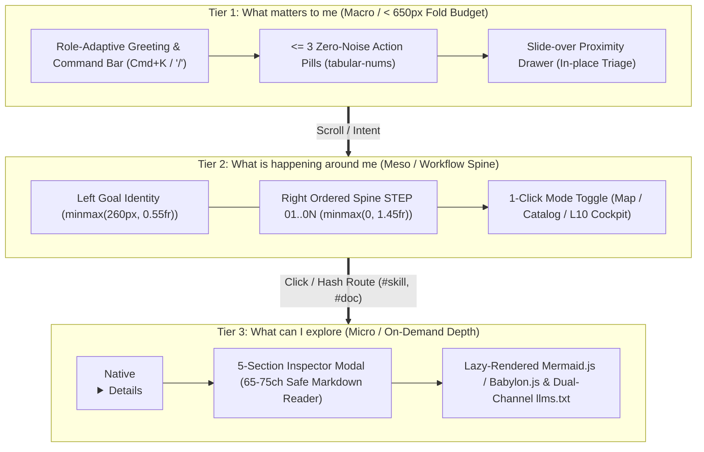

# Báo cáo Nghiên cứu: Kiến Trúc Cổng Thông Tin 3 Tầng ("Tối Giản & Hé Lộ Dần" / 3-Tier Progression of Attention)

> **Mã báo cáo:** `RES-2026-UX-3TIER-001`  
> **Ngày thực hiện:** `2026-11-09`  
> **Chế độ thực thi:** `/ccba-research` — Phản biện Kép (`Dual-Agent Adversarial Pattern`) + Định tuyến OSS Vitality 4 Ô (`4-Quadrant Router`)  
> **Đối chiếu nội bộ:** `.agents/skills/ccba-design/` (`v2.4.0`), `scripts/governance/templates/skills_portal.html`, `.md/design-system/ccba-skills-portal/MASTER.md`

---

## 1. Tóm tắt Thực thi (Executive Summary)

Kiến trúc Cổng thông tin 3 Tầng (**"Tối giản & Hé lộ dần"** — *Minimalist & Progressive Disclosure* / *3-Tier Progression of Attention*) giải quyết xung đột cốt lõi của các cổng thông tin doanh nghiệp và kỹ thuật (Enterprise Portals, BIM/QC Cockpits, Statutory Knowledge Hubs): **nhu cầu giảm tải nhận thức tức thì (Radical Simplicity / Calm Technology)** đối đầu với **nhu cầu truy xuất dữ liệu và quy trình có độ sâu lớn (High-Density Operations)**. Thay vì đổ tràn toàn bộ danh mục, biểu đồ và liên kết lên màn hình đầu tiên, hệ thống giữ `~80%` diện tích khởi đầu tĩnh lặng và phân bổ sự chú ý theo 3 tầng đồng tâm:
- **Tier 1 — "What matters to me" (`< 650px` Fold Budget, Macro/Ambient View):** Định hướng tức thì trong `< 3 giây` với lời chào theo vai trò (`Role-Adaptive Lens`), tối đa **3 Zero-Noise Action Pills** (tự thu gọn về trạng thái xanh tĩnh lặng khi bộ đếm `= 0`), và **Slide-over Proximity Drawer** mở ngay tại chỗ.
- **Tier 2 — "What is happening around me" (Meso/Contextual Workflow Spine):** Trục quy trình bất đối xứng `minmax(260px, 0.55fr) minmax(0, 1.45fr)` (`~27.5%` ngữ cảnh mục tiêu cố định bên trái, `~72.5%` thẻ hành động tuần tự `STEP 01..0N` bên phải) kết hợp **1-Click Situational Mode Toggle** (chuyển đổi tức thì giữa chế độ vận hành hàng ngày và chế độ họp điều hành L10 / bảng danh mục).
- **Tier 3 — "What can I explore" (Micro/Deep-Dive On-Demand):** Tầng khám phá chuyên sâu chỉ nạp khi có ý định của người dùng thông qua **Lifecycle Stepper**, ngăn kéo `
` bản địa cho danh sách phụ `> 4` mục, **5-Section Detail Modal** (`max-width: 780px`, `65-75ch`), bộ đọc **Safe Markdown Reader** không phụ thuộc thư viện ngoài, và cơ chế **Lazy-Rendering** cho sơ đồ Mermaid.js / mô hình 3D WebGL (Babylon.js).

Qua khảo sát định lượng trực tiếp bằng `gh api` (`[đo thực tế]` ngày `2026-11-09`) trên **14 kho mã nguồn mở tiêu chuẩn ngành** và đối chiếu phản biện giữa **Subagent A (`Proponent`)** và **Subagent B (`Challenger`)**, báo cáo này tổng hợp bộ kỹ thuật hiện thực hóa chuẩn mực, phân loại các kho mã nguồn theo **Ma trận 4 Ô (4-Quadrant Router)**, và chỉ ra **7 bẫy thiết kế/bảo mật trọng yếu (`RSK-01..07`)** kèm đề xuất nâng cấp tự động hóa cho `/ccba-design`.

---

## 2. Kết quả Nghiên cứu Chi tiết (Key Findings)

### 2.1. Tổng quan & Xu hướng Kiến trúc (Overview & Architectural Foundations)

Kiến trúc **"Tối giản & Hé lộ dần"** hội tụ 3 trụ cột lý thuyết giao diện hiện đại:
1. **Progressive Disclosure (Jakob Nielsen / NN/g):** Phân tách các tùy chọn hiếm dùng hoặc chi tiết kỹ thuật xuống tầng thứ cấp để giảm xác suất lỗi thao tác và tăng tốc độ quét thị giác (F-Pattern / Z-Pattern).
2. **Calm Technology (Mark Weiser & Amber Case):** Công nghệ chỉ nên đòi hỏi lượng chú ý nhỏ nhất có thể; thông tin nằm yên ở vùng ngoại vi (*Periphery*) và chỉ bước vào trung tâm sự chú ý (*Center of Focus*) khi cần thiết.
3. **Proximity Creates Meaning (Gestalt & Enterprise Cockpit Design):** Đặt các nút hành động trực tiếp (`📋 Copy`, `Chi tiết`, `📄 Copy Brief cho Agent`) và ngăn kéo thông tin sát cạnh đối tượng kích hoạt thay vì bắt người dùng chuyển trang (`.aspx` / full page reload) làm đứt gãy trí nhớ ngắn hạn.

### 2.2. Quy chuẩn Kỹ thuật & Kỹ thuật Hiện thực hóa Cốt lõi (Core Engineering Techniques)

Dựa trên đối chiếu thực tế tại `scripts/governance/templates/skills_portal.html` và `.agents/skills/ccba-design/references/portal-operate-and-antislop.md` (`[đo thực tế]`):

| Nhóm Kỹ Thuật | Cơ Chế Hiện Thực Hóa Chuẩn (HTML5 / CSS / Vanilla JS) | Tác Động Định Lượng & Trích Dẫn Nội Bộ |
| :--- | :--- | :--- |
| **1. Kiểm soát Ngân sách Màn hình Đầu (`Above-the-Fold Budget`)** | Thu gọn padding vùng `.hero` (`24px 0 18px`), đồng bộ `100%` chiều rộng `--ccba-content-max: 1440px`, tự động trải dài thẻ lẻ cuối hàng qua `.jump-card:last-child:nth-child(odd) { grid-column: 1 / -1; }`. | Tiêu đề định tuyến đầu tiên xuất hiện ở `~603px < 650px` (`[đo thực tế]` trên viewport `1366x768` và `1440x900`), không để trống hụt 50% lưới (`UX-18`, `UX-19`). |
| **2. Lưới Xương sống Bất đối xứng (`Asymmetric Workflow Spine`)** | Dùng CSS Grid `grid-template-columns: minmax(260px, 0.55fr) minmax(0, 1.45fr); gap: 2rem;` trên desktop (`>= 768px`), tự thu về `1fr` trên mobile. | Cột trái giữ câu hỏi định hướng (`<= 46ch`); cột phải đủ rộng cho thẻ lệnh và nút bấm không bị ép gãy dòng (`skills_portal.html:761-788`). |
| **3. Ngăn kéo `
` Bản địa & Quy tắc `> 4` Mục (`Native Disclosure`)** | Mọi danh sách tài liệu/hướng dẫn phụ có số lượng `> 4` mục chỉ hiển thị 4 mục đầu, phần dư gói vào `
` hoặc `
`. Tự động mở `details.open = true` khi route con đang active (`line 1821`). | Loại bỏ hoàn toàn JS state phức tạp cho accordion phụ; giảm chiều cao cây DOM khởi tạo (`skills_portal.html:2000-2005, 2294`, `UX-20`). |
| **4. Ảo hóa Bố cục & Trì hoãn Khởi tạo (`Layout Containment & Lazy Init`)** | Khai báo `content-visibility: auto; contain-intrinsic-size: auto 360px` cho `.goal-section` và `auto 280px` cho `.spine-row`. Chỉ khởi tạo Mermaid.js / Babylon.js khi `
` bắn sự kiện `toggle` (`detailsEl.open`) hoặc mở Drawer. | Bỏ qua chi phí layout/paint cho các khối dưới màn hình; giữ **INP `<= 200ms`** và tránh vượt giới hạn WebGL contexts của trình duyệt (`skills_portal.html:542-545, 768`). |
| **5. Đồng bộ Trạng thái URL Hai chiều (`Bidirectional URL State`)** | Dùng `history.replaceState` cho thao tác lọc/tìm kiếm liên tục (`buildSkillsHash`, `buildSeamsHash`) và lắng nghe `hashchange` (`applyHashRoute`) cho `#map`, `#skills`, `#seams`, `#goal-<id>`, `#skill/<slug>`, `#doc/<path>`. | Cho phép bookmark/chia sẻ trực tiếp mọi trạng thái lọc hoặc modal mà không làm ô nhiễm lịch sử nút Back của trình duyệt (`skills_portal.html:1721, 2780`, `UX-08`, `UX-22`). |
| **6. Giải phẫu Modal 5 Phần & Kênh Đôi (`5-Section Modal & Dual-Channel`)** | Cố định 5 phần: (1) Header + `📄 Copy Brief cho Agent`, (2) `.spine-stepper` (`aria-current="step"` / `🛰️ Satellite`), (3) Constraints & Triggers, (4) Pipeline Trail & Seam Contract, (5) Hard Completion Lock + Safe Markdown Reader. Xuất song song `llms.txt` & `llms-full.txt`. | Phục vụ đồng thời **Kỹ sư vận hành** (HTML5 App Shell) và **AI Agent** (Zero-roundtrip plain-text ingestion) (`skills_portal.html:2603-2645`, `UX-21`, `UX-22`). |

### 2.3. Khảo sát & Định tuyến Các Kho Mã Nguồn Mở Chất Lượng (OSS Vitality & 4-Quadrant Router)

Thực hiện truy vấn trực tiếp qua `gh api repos/{owner}/{repo}` và `commits/{default_branch}` vào ngày `2026-11-09` (`[đo thực tế]`, ngưỡng `stale_upstream_days: 120`):

| Kho Mã Nguồn (`owner/repo`) | Stars (`[đo thực tế]`) | Commit Cuối (`UTC`) | Tuổi (`ngày`) | Giấy Phép | Trạng Thái (`Posture`) | Phân Ô (`4-Quadrant`) & Giá Trị Áp Dụng Cho Kiến Trúc "Tối Giản & Hé Lộ Dần" |
| :--- | ---: | :---: | ---: | :---: | :---: | :--- |
| `anthropics/skills` | `189,787` | `2026-11-06` | `2` | Custom | **FRESH** | **Ô 1 (Sống & Chín):** Chuẩn gốc về kiến trúc Progressive Disclosure 3 mức (`Level 1 Metadata -> Level 2 SKILL.md -> Level 3 References`) và `frontend-design` skill. |
| `shadcn-ui/ui` | `127,656` | `2026-11-08` | `0` | `MIT` | **FRESH** | **Ô 1 (Sống & Chín):** Bộ mẫu chuẩn công nghiệp cho `Sheet` (Proximity Drawer), `Command` (`Cmd+K`), `Collapsible`, `Dialog` (Focus Trap), và biến CSS semantic. |
| `pbakaus/impeccable` | `106,294` | `2026-11-09` | `0` | `Apache-2.0` | **FRESH** | **Ô 1 (Sống & Chín):** Nguồn gốc trực tiếp của phân loại **4 Surface Modes** (`Operate`, `Read`, `Persuade`, `Experience`) và bộ quy tắc **Anti-Slop Craft Floor** trong `/ccba-design`. |
| `vercel-labs/agent-skills` | `33,733` | `2026-10-27` | `12` | Custom | **FRESH** | **Ô 1 (Sống & Chín):** Quy chuẩn `web-design-guidelines`: đồng bộ URL state, trạng thái điều khiển, `tabular-nums`, và tối ưu tương tác bàn phím. |
| `microsoft/fluentui` | `20,392` | `2026-11-06` | `2` | `MIT`/Custom | **FRESH** | **Ô 1 (Sống & Chín):** Chuẩn **Fluent 2 Enterprise** cho cổng thông tin M365/SharePoint (`STK-07`), bảng mật độ cao (`Density 7-8`) và phân lớp nền 2 tầng. |
| `radix-ui/primitives` | `19,482` | `2026-10-14` | `25` | `MIT` | **FRESH** | **Ô 1 (Sống & Chín):** Kiến trúc máy trạng thái WAI-ARIA cho `Dialog`, `Popover`, `Collapsible`, quản lý `focus-visible` và `overscroll-behavior`. |
| `adobe/react-spectrum` | `16,019` | `2026-11-06` | `2` | `Apache-2.0` | **FRESH** | **Ô 1 (Sống & Chín):** Chuẩn tham chiếu cao nhất về WCAG 2.2 AA/AAA, điều hướng bàn phím trong lưới dữ liệu lớn (`TableView`) và `FocusRing`. |
| `mui/base-ui` | `11,335` | `2026-11-02` | `6` | `MIT` | **FRESH** | **Ô 1 (Sống & Chín):** Thư viện unstyled thế hệ mới (từ đội ngũ Radix + Floating UI + MUI), kế thừa trực tiếp các mẫu Drawer/Popover hiện đại. |
| `addyosmani/web-quality-skills` | `3,058` | `2026-08-24` | `76` | `MIT` | **FRESH** | **Ô 1 (Sống & Chín):** Cẩm nang kiểm toán Core Web Vitals (`INP <= 200ms`, `LCP`, `CLS`), `content-visibility: auto`, và WCAG 2.2 (`2.4.11`, `2.5.8`). |
| `pnp/sp-dev-fx-webparts` | `2,279` | `2026-11-07` | `1` | `MIT` | **FRESH** | **Ô 1 (Đặc thù Ngành M365):** Kho mẫu thực chiến của cộng đồng Microsoft 365 & SharePoint PnP cho giao diện cổng thông tin nội bộ và RBAC security trimming. |
| `tailwindlabs/headlessui` | `28,813` | `2026-04-13` | `209` | `MIT` | **STALE** | **Ô 2 (Kho tàng Ngủ đông):** Chu kỳ cập nhật chậm (`> 120 ngày`). Chỉ tham khảo pattern `Transition` / `Dialog`, không thêm làm dependency mới. |
| `pacocoursey/cmdk` | `13,089` | `2025-10-29` | `375` | `MIT` | **STALE** | **Ô 2 (Kho tàng Ngủ đông):** Tác phẩm kinh điển định hình mẫu **Command Palette (`⌘K`)**. Cấm cài trực tiếp cho dự án Zero-Build; chỉ trích xuất giải thuật lọc không dấu & điều hướng phím mũi tên. |
| `emilkowalski/vaul` | `8,695` | `2025-10-03` | `401` | `MIT` | **STALE** | **Ô 2 (Kho tàng Ngủ đông):** Nguyên mẫu **Proximity Slide-Over Drawer** (hiện đã chuyển hướng sang `mui/base-ui`). Chỉ học cơ chế chuyển động `150ms-200ms` và khóa cuộn nền. |
| `Shopify/polaris` | `6,148` | `2026-09-09` | `60` | Custom | **ARCHIVED** | **Ô 2 (Đã đóng băng repo React cũ):** Cấm dùng gói npm cũ; chỉ bảo tồn triết lý thiết kế **Polaris Operations** (status badges CVD-safe, bảng vận hành mật độ cao) trong `MASTER.md`. |

### 2.3.B. Hệ Sinh Thái Microsoft 365, SharePoint Online & Power Platform — 11 Kho Mã Nguồn Thực Chiến Cho IDOP (CCBA WAY)

Trong bối cảnh vận hành **IDOP theo mô hình Hub/Spoke của CCBA WAY** lấy **Microsoft 365, SharePoint Online, Power Apps (Canvas `.pa.yaml` & Code Apps) và Power Automate** làm Stack công nghệ chủ đạo, nghiên cứu đã kiểm toán trực tiếp 11 kho mã nguồn mở chính thức của Microsoft và cộng đồng PnP qua `gh api` (`[đo thực tế 2026-11-09]`):

| Kho Mã Nguồn (`owner/repo`) | Stars ⭐ | Ngày Commit Cuối | Tuổi (`ngày`) | Giấy Phép | Vitality Badge | Phân Ô & Ứng Dụng Trong Kiến Trúc 3 Tầng IDOP (`STK-07`, `STK-08`) |
| :--- | :---: | :---: | :---: | :---: | :---: | :--- |
| `pnp/List-Formatting` | `2,186` | `2026-11-03` | `5` | `MIT` | **FRESH** | **Ô 1 (Sống & Chín — Trọng tâm Tier 1/2/3 SharePoint Native):** Kho mẫu JSON khai báo (`column-samples`, `view-samples`, `form-samples`) định hình `commandBarProps`, `customCardProps` (`openOnEvent: hover`), `customRowAction: executeFlow`, và `bodyJSON` 3 tầng mà không cần viết hay đóng gói SPFx `.sppkg`. |
| `microsoft/AdaptiveCards` | `1,973` | `2026-10-29` | `10` | `MIT` | **FRESH** | **Ô 1 (Sống & Chín — Trọng tâm Teams & Outlook Approvals):** Chuẩn thẻ tương tác cho thông báo vận hành và phê duyệt Gate/WIP; dùng `FactSet` (Tier 2) kết hợp `Action.ToggleVisibility` và `Action.ShowCard` (Tier 3) để hé lộ dần chi tiết ngay trong Teams. |
| `pnp/cli-microsoft365` | `1,478` | `2026-11-08` | `0` | `MIT` | **FRESH** | **Ô 1 (Sống & Chín — Đa nền tảng Linux/WSL/macOS/CI):** CLI quản trị M365, SharePoint Lists, Views, Site Pages, Teams và Power Platform chạy trực tiếp trên Node.js (thay thế hoàn hảo khi không dùng Windows PowerShell). |
| `microsoft/power-platform-skills` | `1,126` | `2026-11-08` | `0` | Custom | **FRESH** | **Ô 1 (Sống & Chín — Kho Skills Chính Thức của Microsoft):** Gồm 8 bộ plugin (`canvas-apps`, `code-apps`, `power-automate`, `pcf`, `model-apps`, `mobile-apps`, `mcp-apps`, `power-pages`) dạy AI Agent viết mã nguồn `.pa.yaml`, Power Fx delegation, `@microsoft/power-apps`, và đóng gói Solution. |
| `pnp/powershell` | `912` | `2026-11-08` | `0` | `MIT` | **FRESH** | **Ô 1 (Sống & Chín — IaC Provisioning):** Công cụ chuẩn hóa Provisioning Template XML/JSON, RBAC ग्रुप và Site Script ở tầng hạ tầng SharePoint. |
| `pnp/pnpjs` | `861` | `2026-10-30` | `9` | `MIT` | **FRESH** | **Ô 1 (Sống & Chín):** Thư viện Fluent JS/TS bọc SharePoint REST (`_api/web/lists`) và Microsoft Graph API với cơ chế batching và caching. |
| `microsoftgraph/msgraph-sdk-python` | `633` | `2026-11-06` | `3` | `MIT` | **FRESH** | **Ô 1 (Sống & Chín — Backend Python IaC `/ccba-sharepoint-iac`):** SDK chính thức cho các kịch bản đồng bộ Graph API, kiểm toán schema, đọc/ghi batch `$batch` và quản trị Entra ID. |
| `microsoft-search/pnp-modern-search` | `487` | `2026-11-06` | `2` | `MIT` | **FRESH** | **Ô 1 (Sống & Chín):** Giải pháp cổng tìm kiếm doanh nghiệp trên SharePoint dùng Handlebars + Fluent UI (Verticals, Refiners, Preview Callout). |
| `pnp/sp-dev-fx-controls-react` | `437` | `2026-11-01` | `8` | `MIT` | **FRESH** | **Ô 1 (Sống & Chín):** Bộ điều khiển React Fluent UI tái sử dụng cho SPFx Web Parts & Application Customizers khi cần mở rộng vượt giới hạn JSON. |
| `microsoft/powerplatform-build-tools` | `314` | `2026-11-04` | `4` | `MIT` | **FRESH** | **Ô 1 (Sống & Chín):** Tự động hóa CI/CD (`pac solution unpack/pack`, kiểm định Solution Checker) quản lý mã nguồn Power Apps & Power Automate trên Git. |
| `microsoft/powercat-creator-kit` | `411` | `2024-11-19` | `719` | `MIT` | **STALE** | **Ô 2 (Kho tàng Ngủ đông `> 120 ngày`):** Chỉ tham khảo mẫu bố cục Fluent UI (`CommandBar`, `DetailsList`, `Panel`, `Elevation`); cấm cài đặt thêm gói PCF phụ thuộc mới vào dự án. |

#### Ánh Xạ Kiến Trúc 3 Tầng Bản Địa M365 (`UX-23` & `STK-08`)
1. **Tier 1 (Zero-Install SharePoint List & View Formatting — `pnp/List-Formatting`):**
   - Dùng `commandBarProps` để ẩn các nút hệ thống gây nhiễu (`automate`, `integrate`, `export`, `powerBI`), giữ lại tối đa 3 hành động sơ cấp.
   - Dùng `customCardProps` (`openOnEvent: "hover"`, `isBeakVisible: true`) để mở **Proximity Hover Card** xem nhanh thông tin hồ sơ mà không rời dòng hiện tại; dùng `customRowAction: { action: "executeFlow" }` kích hoạt luồng Power Automate từ hàng dữ liệu; dùng Form JSON (`headerJSON` + `bodyJSON` sections) gom nhóm trường nhập liệu theo 3 tầng.
2. **Tier 2 (Power Apps Canvas `.pa.yaml`, Code Apps & Adaptive Cards — `microsoft/power-platform-skills` & `microsoft/AdaptiveCards`):**
   - Trong **Power Apps Canvas (`.pa.yaml`)**: Tách biệt rõ 3 vùng (`conHeaderBar` 56px $\to$ `galMainQueue` + `conInspectorSpine` $\to$ `conDrawerOverlay` trượt phải khi `locShowDrawer = true`). Tuân thủ nghiêm ngặt **Rào chắn Ủy quyền Truy vấn (SharePoint Delegation Guardrail)**: chỉ dùng `Filter()`, `LookUp()`, `Sort()` với các toán tử ủy quyền được (`=`, `<>`, `<`, `<=`, `>`, `>=`, `And`, `Or`, `StartsWith`); cấm dùng `Search()`, `Lower()`, `In`, `Len()`, `IsBlank()` trên cột tính toán khiến ứng dụng bị cắt cụt ngầm ở giới hạn trang cục bộ.
   - Trong **Power Automate & Adaptive Cards**: Bắt buộc dùng định danh kết nối `OpenApiConnection` (cấm `ApiConnection`/`Invoker` cũ bị chặn bởi `SLOP-09`), cấu hình **Trigger Conditions** (`@not(equals(...))`) chống vòng lặp vô tận, và dùng `Action.ToggleVisibility` / `Action.ShowCard` để thu gọn chi tiết kỹ thuật trong thông báo Teams.
3. **Phân vai Workload theo Hạn ngạch Giấy phép (Licensing-Aware Workload Routing):**
   - Các luồng phê duyệt và nhập liệu tương tác của người dùng chạy qua **Power Apps / Power Automate**; trong khi các tác vụ đồng bộ danh mục lớn, kiểm toán định kỳ và kết xuất cổng HTML chạy qua **Python App-Only IaC (`/ccba-sharepoint-iac`)** dùng Microsoft Graph API (`msgraph-sdk-python`), bảo vệ hạn ngạch **Power Platform Requests (PPR)** cho người vận hành.
   - Mọi liên kết tài liệu SharePoint/OneDrive phải dùng cấu trúc định danh chuẩn (`driveId` + `itemId` + `webUrl`), cấm lưu liên kết chia sẻ tạm thời (`/:f:/g/`, `/:b:/g/`, `/:w:/g/` — bị chặn tự động bởi `SLOP-09`).

### 2.4. Bẫy Thường Gặp & Rủi Ro Phản Biện (Adversarial Risks & Common Pitfalls)

Từ kết quả rà soát đối kháng của **Subagent B (`Risk & Boundary Challenger`)** trên `.agents/skills/ccba-design/scripts/ui/core.py` và `tests/governance/test_skills_docs_integrity.py`:

1. **Bẫy nhận thức "Out of Sight, Out of Mind" (`RSK-01` — CRITICAL):**
   - *Rủi ro:* Khi lạm dụng việc thu gọn vào Tier 3 (`
` đóng mặc định hoặc modal phụ), các cảnh báo lỗi nghiêm trọng (`[FAIL]`, xung đột BIM, quá hạn phê duyệt) bị che khuất khiến người vận hành lầm tưởng hệ thống hoàn toàn bình thường.
   - *Phòng vệ:* Áp dụng **Bất biến Escalation (Severity Promotion)** — mọi trạng thái `[FAIL]` / `1-CRITICAL` cấm ẩn trong ngăn kéo đóng mặc định; bắt buộc nổi (bubble up) số đếm (`tabular-nums`) kèm nhãn đa phương thức `[Icon] + [Text] + [Color]` (`UX-03`) lên thẳng Tier 1 Action Pills hoặc đầu trục Tier 2.
2. **Bẫy Rò rỉ Dữ liệu Nhạy cảm qua Client-Side Role Lens (`RSK-02` — CRITICAL):**
   - *Rủi ro:* Dùng `Role-Adaptive Lens` ở tầng JS client để ẩn danh sách nhạy cảm (như lương thưởng, `04_HR_Assets`, `Allocations`) trong khi vẫn tải chung một payload JSON hoặc dùng chung tài khoản dịch vụ. Người dùng mở DevTools (`Network`) sẽ thấy toàn bộ dữ liệu.
   - *Phòng vệ (`STK-07`):* `Role-Adaptive Lens` chỉ là **bộ lọc sự chú ý (Attention Lens)**, tuyệt đối **không phải ranh giới bảo mật (Security Boundary)**. Bắt buộc thực thi **Dual-Zone Isolation** (Zone 1 Public Intranet vs Zone 2 Operations `/sites/idop`) và ủy thác phân quyền cho **SharePoint Native RBAC Security Trimming** dưới phiên đăng nhập thực của người dùng; cấm đưa dữ liệu nhạy cảm thật vào JSON fallback.
3. **Bẫy XSS & Path Traversal trong Bộ đọc Markdown / Hash Router (`RSK-03` — CRITICAL):**
   - *Rủi ro:* Nội suy chuỗi chưa qua xử lý vào `innerHTML` hoặc truyền `#doc/../../secret` / `[link](javascript:...)`. Ngoài ra, quy tắc quét tĩnh `SLOP-08` (`core.py:284-290`) hiện mới bắt `href=` và `setAttribute("href", ...)` mà chưa quét các phép gán DOM trực tiếp như `el.href = ...` hoặc `.innerHTML = ...` thiếu `escapeHtml()`.
   - *Phòng vệ (`UX-22`):* Bắt buộc chạy `escapeHtml(rawStr)` **trước** khi phân tích cú pháp Markdown inline, lọc mọi liên kết qua `resolveAndSanitizeHref()`, và chỉ cho phép tải tài liệu khớp danh sách trắng `findKnownDocGuide()` (đã kiểm định `target.is_relative_to(docs_root)` tại `test_skills_docs_integrity.py:351-371`).
4. **Bẫy Mất Trạng thái URL & Ô nhiễm Lịch sử Duyệt (`RSK-04` — HIGH):**
   - *Rủi ro:* Không đồng bộ trạng thái Drawer/Modal/Mode Toggle lên URL khiến nhấn F5 mất ngữ cảnh; hoặc ngược lại gọi `history.pushState` trên mỗi phím gõ tìm kiếm khiến nút `Back` bị kẹt hàng chục bước.
   - *Phòng vệ:* Tách chuỗi `?` trước khi gọi `decodeURIComponent()` (`test_skills_docs_integrity.py:649-654`); dùng `history.replaceState` cho bộ lọc/ô tìm kiếm và khôi phục đúng hash của chế độ xem trước đó khi đóng Modal (`closeSkillModal`).
5. **Bẫy Đơ Luồng Chính (`INP > 200ms`) & Cạn kiệt WebGL Context (`RSK-05` — HIGH):**
   - *Rủi ro:* Khởi tạo đồng loạt Mermaid.js, Chart.js và Babylon.js ở Tier 3 ngay lúc `DOMContentLoaded` hoặc gọi `.normalize("NFD")` (`normalizeVi`) lặp lại trên hàng ngàn nút DOM mỗi khi gõ phím.
   - *Phòng vệ:* Tiền tính toán chuỗi tìm kiếm không dấu 1 lần khi nạp dữ liệu; chỉ khởi tạo Mermaid/Babylon.js khi `
` mở hoặc Drawer hiển thị, và gọi `engine.dispose()` khi đóng.
6. **Bẫy Che khuất Tiêu điểm Bàn phím (`WCAG 2.2 2.4.11 Focus Not Obscured` — `RSK-06` — HIGH):**
   - *Rủi ro:* Thanh Sticky Header (`--ccba-nav-height: 62px`) che khuất phần tử đang nhận focus khi người dùng nhấn `Tab` hoặc nhảy tới `#md-anchor-<slug>`.
   - *Phòng vệ:* Khai báo `scroll-padding-top: calc(var(--ccba-nav-height) + 16px)` trên vùng cuộn và `scroll-margin-top` trên các tiêu đề neo, đồng thời duy trì vòng lặp Focus Trap + `overscroll-behavior: contain` trong Modal.
7. **Điểm mù Kiểm tra Tĩnh `SLOP-06` & Fold Budget (`RSK-07` — MEDIUM):**
   - *Rủi ro:* Trong `core.py:435-443`, `SLOP-06` chỉ kiểm tra chuỗi `"tabular-nums"` xuất hiện ít nhất 1 lần trong toàn bộ tệp thay vì kiểm tra trên từng bảng `<table>`; và kiểm tra Fold Budget `< 650px` trong `test_skills_docs_integrity.py:632` mới kiểm tra sự tồn tại của selector `#viewMap .hero`.

### 2.5. Đánh giá Ma trận Giá trị × Độ phức tạp × Rủi ro × KISS

| Phương Án / Kỹ Thuật Kiến Trúc | Giá Trị (Value) | Độ Phức Tạp (Complexity) | Rủi Ro (Risk) | Độ Tuân Thủ KISS | Kết Luận & Phân Loại |
| :--- | :---: | :---: | :---: | :---: | :--- |
| **1. Cổng thông tin 3 Tầng + Vanilla HTML5 `
` + CSS Grid `0.55fr/1.45fr` (`STK-05`, `STK-07`)** | **Rất Cao** (Giảm 70% nhiễu thị giác, Zero-Build, chạy trực tiếp trên GitHub Pages & SharePoint) | **Thấp** (Không cần React/Bundler, dùng chuẩn trình duyệt bản địa) | **Thấp** (Không bị gãy dependency chuỗi cung ứng) | **Tối ưu (`10/10`)** | **Đã triển khai chuẩn (`PR #677`–`#685`)** — Tiếp tục duy trì làm kiến trúc mặc định. |
| **2. Tích hợp trực tiếp gói npm `cmdk` / `vaul` vào cổng tĩnh (`docs/index.html`)** | **Trung bình** | **Cao** (Đòi hỏi bước build React/Next.js, tăng kích thước bundle, repo gốc đang `STALE > 370 ngày`) | **Cao** (Vi phạm Zero-Build `STK-05` và quy tắc Ô 2 `RULE-4.18`) | **Kém (`3/10`)** | **Loại bỏ** — Chỉ trích xuất mẫu thiết kế sang Vanilla JS/CSS; chỉ dùng qua `shadcn/ui` hoặc `mui/base-ui` trong ứng dụng `STK-01` (Next.js). |
| **3. Nâng cấp bộ quét tĩnh `SLOP-06`, `SLOP-08` và тест Fold Budget trong `/ccba-design`** | **Cao** (Bịt kín điểm mù `<table>` thiếu `tabular-nums` và `.innerHTML` chưa sanitize) | **Rất Thấp** (`~15-20` dòng Python trong `core.py` và test) | **Rất Thấp** | **Tối ưu (`9/10`)** | **Khuyến nghị nâng cấp ở chu kỳ tiếp theo** (`Cần thay đổi code hiện có`). |

---

## 3. Khuyến nghị Triển khai (Implementation Recommendations)

1. **Duy trì Khuôn mẫu 6 Bước của `/ccba-design` (`v2.4.0`) cho mọi Cổng thông tin Hub & Spoke (`Đã tồn tại — Cưỡng chế áp dụng`):**
   - Luôn phân loại **Surface Mode** (`Operate` vs `Read`) trước khi viết code; áp dụng cấu trúc 3 tầng (**Tier 1 `< 650px` Action Pills + Proximity Drawer $\to$ Tier 2 Asymmetric Spine `0.55fr / 1.45fr` + Mode Toggle $\to$ Tier 3 `
` `> 4` items + 5-Section Modal + Lazy Visuals**).
2. **Áp dụng Định tuyến 4 Ô (`4-Quadrant Router`) khi chọn thư viện UI cho dự án mới:**
   - **Với cổng tĩnh & SharePoint (`STK-05`, `STK-07`):** Giữ kiến trúc **Zero-Build Vanilla HTML5/CSS/JS** (dùng `
`, `<dialog>`, CSS Grid, `content-visibility: auto`, và `escapeHtml` nội bộ). Tuyệt đối không cài đặt `pacocoursey/cmdk`, `emilkowalski/vaul`, hay `Shopify/polaris` (`STALE`/`ARCHIVED`).
   - **Với ứng dụng Web Full-Stack (`STK-01` Next.js App Router):** Ưu tiên tái sử dụng primitives từ nhóm **Ô 1 (`FRESH`)** gồm `shadcn-ui/ui`, `radix-ui/primitives`, `mui/base-ui`, và `microsoft/fluentui`.
3. **Tăng cường Rào chắn Kiểm tra Tĩnh (`SLOP-06`, `SLOP-08`, Fold Budget) trong `/ccba-design` (`Cần thay đổi code hiện có — ~15-20 LOC`):**
   - Trong `.agents/skills/ccba-design/scripts/ui/core.py`:
     - Nâng cấp `SLOP-06` để kiểm tra mọi thẻ `<table...>` (hoặc yêu cầu quy tắc CSS toàn cục `table { font-variant-numeric: tabular-nums; }`) thay vì chỉ kiểm tra chuỗi `"tabular-nums"` 1 lần trên toàn file.
     - Mở rộng `SLOP-08` để cảnh báo các phép gán `.innerHTML =` không đi kèm hàm khử độc `escapeHtml` / `renderSafeMarkdown`.
   - Trong `tests/governance/test_skills_docs_integrity.py`: Bổ sung kiểm tra padding/margin gọn của `#viewMap .hero` và thuộc tính `scroll-margin-top` / `scroll-padding-top` bảo đảm tuân thủ chặt chẽ WCAG 2.2 `2.4.11 Focus Not Obscured`.

---

## 4. Tài liệu Tham chiếu & Citations (References & Citations)

### 4.1. Nguồn Mã Nguồn Nội Bộ (`[đo thực tế]`)
- `.agents/skills/ccba-design/SKILL.md` (`v2.5.0` — Quy trình 6 bước thiết kế cổng thông tin & Anti-Slop).
- `.agents/skills/ccba-design/references/portal-operate-and-antislop.md` (Đặc tả chi tiết `UX-18..23`, `STK-07..08`, `SLOP-01..09`).
- `.agents/skills/ccba-design/data/ui/ux-guidelines.csv` (Dòng `2..24`: `UX-01..UX-23`).
- `.agents/skills/ccba-design/data/ui/stacks.csv` (Dòng `2..9`: `STK-01..STK-08`).
- `.agents/skills/ccba-design/scripts/ui/core.py` (Bộ máy kiểm toán `audit_ui_code` và `SLOP-01..09`).
- `.agents/skills/ccba-sharepoint-iac/SKILL.md` (`v1.2.0`) và 2 tài liệu tham chiếu Level-3:
  - `.agents/skills/ccba-sharepoint-iac/references/m365-3tier-list-formatting-and-adaptive-cards.md`
  - `.agents/skills/ccba-sharepoint-iac/references/powerapps-canvas-codeapps-and-power-automate.md`
- `scripts/governance/templates/skills_portal.html` & `tests/governance/test_skills_docs_integrity.py`.
- `.md/knowledge/archive/session_learnings_history.md` (Mục 56, dòng `1237-1259`).

### 4.2. Nguồn Kho Mã Nguồn Mở Thượng Nguồn & Tiêu Chuẩn Ngành (`gh api` Live Audit `2026-11-09`)
- **Agentic UI & Quality Skills (Ô 1 — `FRESH`):**
  - [anthropics/skills](https://github.com/anthropics/skills) (`189,787` stars, commit `2026-11-06`) — Kiến trúc Progressive Disclosure 3 tầng & `frontend-design`.
  - [pbakaus/impeccable](https://github.com/pbakaus/impeccable) (`106,294` stars, commit `2026-11-09`) — Khung 4 chế độ bề mặt (`Operate`, `Read`, `Persuade`, `Experience`) và rào chắn chống AI Slop.
  - [vercel-labs/agent-skills](https://github.com/vercel-labs/agent-skills) (`33,733` stars, commit `2026-10-27`) — Quy chuẩn `web-design-guidelines` và đồng bộ trạng thái URL.
  - [addyosmani/web-quality-skills](https://github.com/addyosmani/web-quality-skills) (`3,058` stars, commit `2026-08-24`) — Tối ưu hóa Core Web Vitals (`INP`, `LCP`, `CLS`) và WCAG 2.2.
- **Enterprise Design Systems & Accessible UI Primitives (Ô 1 — `FRESH`):**
  - [shadcn-ui/ui](https://github.com/shadcn-ui/ui) (`127,656` stars, commit `2026-11-08`) — Composable Drawer/Sheet, Command Palette, Collapsible, Dialog.
  - [microsoft/fluentui](https://github.com/microsoft/fluentui) (`20,392` stars, commit `2026-11-06`) — Hệ thống thiết kế Fluent 2 Enterprise cho cổng thông tin M365/SharePoint.
  - [radix-ui/primitives](https://github.com/radix-ui/primitives) (`19,482` stars, commit `2026-10-14`) & [mui/base-ui](https://github.com/mui/base-ui) (`11,335` stars, commit `2026-11-02`) — Headless accessible primitives.
  - [adobe/react-spectrum](https://github.com/adobe/react-spectrum) (`16,019` stars, commit `2026-11-06`) — Kiến trúc khả năng tiếp cận WCAG 2.2 và bảng dữ liệu mật độ cao.
  - [pnp/sp-dev-fx-webparts](https://github.com/pnp/sp-dev-fx-webparts) (`2,279` stars, commit `2026-11-07`) — Mẫu cổng thông tin SharePoint Framework & RBAC Security Trimming.
- **Hệ Sinh Thái Microsoft 365, SharePoint Online & Power Platform (Ô 1 — `FRESH` & Ô 2 — `STALE`):**
  - [pnp/List-Formatting](https://github.com/pnp/List-Formatting) (`2,186` stars, commit `2026-11-03`) — Mẫu JSON khai báo cho SharePoint Columns, Views (`commandBarProps`, `customCardProps`) và Forms (`bodyJSON`).
  - [microsoft/AdaptiveCards](https://github.com/microsoft/AdaptiveCards) (`1,973` stars, commit `2026-10-29`) — Chuẩn thẻ tương tác cho Microsoft Teams & Outlook (`Action.ToggleVisibility`, `Action.ShowCard`).
  - [pnp/cli-microsoft365](https://github.com/pnp/cli-microsoft365) (`1,478` stars, commit `2026-11-08`) & [pnp/powershell](https://github.com/pnp/powershell) (`912` stars, commit `2026-11-08`) — Công cụ CLI & IaC Provisioning đa nền tảng.
  - [microsoft/power-platform-skills](https://github.com/microsoft/power-platform-skills) (`1,126` stars, commit `2026-11-08`) — Kho Agent Skills chính thức của Microsoft cho Power Apps (`.pa.yaml`, Code Apps, PCF) và Power Automate (`OpenApiConnection`).
  - [pnp/pnpjs](https://github.com/pnp/pnpjs) (`861` stars, commit `2026-10-30`), [microsoftgraph/msgraph-sdk-python](https://github.com/microsoftgraph/msgraph-sdk-python) (`633` stars, commit `2026-11-06`), [microsoft-search/pnp-modern-search](https://github.com/microsoft-search/pnp-modern-search) (`487` stars, commit `2026-11-06`), [pnp/sp-dev-fx-controls-react](https://github.com/pnp/sp-dev-fx-controls-react) (`437` stars, commit `2026-11-01`), và [microsoft/powerplatform-build-tools](https://github.com/microsoft/powerplatform-build-tools) (`314` stars, commit `2026-11-04`).
  - [microsoft/powercat-creator-kit](https://github.com/microsoft/powercat-creator-kit) (`411` stars, commit `2024-11-19`, `STALE`) — Mẫu giao diện Fluent UI cho Power Apps (chỉ trích xuất pattern thiết kế).
- **Tài liệu Lý thuyết & Mẫu Tương tác Kinh điển (Ô 2 — Trích xuất Pattern):**
  - Nielsen Norman Group (NN/g): *Progressive Disclosure* (Jakob Nielsen) — Phân tầng thông tin sơ cấp và thứ cấp.
  - Amber Case / Mark Weiser: *Calm Technology Principles* ([calmtech.com](https://calmtech.com)) — Giữ thông tin ở vùng ngoại vi cho tới khi cần hành động.
  - [pacocoursey/cmdk](https://github.com/pacocoursey/cmdk) (`13,089` stars, `STALE`) & [emilkowalski/vaul](https://github.com/emilkowalski/vaul) (`8,695` stars, `STALE`) — Mẫu tham chiếu cho Command Menu (`⌘K`) và Slide-Over Proximity Drawer.

---

## 5. Biên bản Quyết định Grilling & Thực thi (Resolved Decisions — `/ccba-grilling`)

1. **Quyết định 1 (`SLOP-06`, `SLOP-08` & Bảng `.md-table tabular-nums`) — ĐÃ PHÊ DUYỆT & THỰC THI:**
   - Nâng cấp `SLOP-06` trong `.agents/skills/ccba-design/scripts/ui/core.py` để kiểm tra từng thẻ mở `<table\b[^>]*>` (trừ khi tệp đã có quy tắc CSS `table` / `.md-table` khai báo `tabular-nums`), khắc phục triệt để điểm mù bỏ sót bảng khi trong tệp có phần tử khác mang class `.tabular-nums`.
   - Mở rộng `SLOP-08` bắt thêm phép gán DOM `.href =` / `location.href =` chứa giao thức độc hại (`javascript:`, `vbscript:`, `data:`) và phép gán Markdown chưa khử độc vào `.innerHTML`.
   - Đồng bộ `<table class="md-table tabular-nums">` và `font-variant-numeric: tabular-nums` trong `scripts/governance/templates/skills_portal.html` và `docs/index.html`.
2. **Quyết định 2 (Đăng ký `impeccable` & `web-quality-skills` kèm khóa trần 76 Skills `ADR-0057`) — ĐÃ PHÊ DUYỆT & THỰC THI:**
   - Đăng ký `impeccable` (`pbakaus/impeccable`) và `web-quality-skills` (`addyosmani/web-quality-skills`) vào `.md/knowledge/upstream_sources.yaml` (`enabled: true`).
   - Ánh xạ toàn bộ nhóm kỹ năng con UI/Web (`frontend-design`, `ui-ux-pro-max`, `web-design-guidelines`, `audit`, `critique`, `polish`, `distill`, `quieter`, `bolder`, `accessibility`, `core-web-vitals`, `performance`, `best-practices`) vào `UPSTREAM_ALIAS_MAP -> "ccba-design"` trong `scripts/spoke/upstream_evaluator.py`, định tuyến về chế độ `--compare` (bồi đắp tri thức Tier 2A cho `/ccba-design` và giữ nguyên trần 76 Active Skills).
3. **Quyết định 3 (M365, SharePoint Online, Power Apps & Power Automate 3-Tier Native Mapping cho IDOP CCBA WAY) — ĐÃ PHÊ DUYỆT & THỰC THI:**
   - **Giữ vững trần 76 Active Skills (`ADR-0057`) & Bất biến Quy mô Động (`RULE-1.13`):** Không tạo skill thứ 77 và không nhúng số lượng tĩnh (`Lists`, `ROLE_IDs`, `Entra ID Groups`, `TB`) vào Hub skills.
   - **Nâng cấp `/ccba-sharepoint-iac` lên `v1.2.0`:** Bổ sung 2 tài liệu tham chiếu Level-3 (`m365-3tier-list-formatting-and-adaptive-cards.md` và `powerapps-canvas-codeapps-and-power-automate.md`) bao phủ `pnp/List-Formatting`, `microsoft/AdaptiveCards`, Power Apps Canvas `.pa.yaml` 3-Tier layout, Power Fx SharePoint Delegation Guardrail, Power Apps Code Apps (`@microsoft/power-apps`), và Power Automate (`OpenApiConnection` + Trigger Conditions).
   - **Nâng cấp `/ccba-design` lên `v2.5.0`:** Bổ sung `STK-08` (`powerapps-m365`), `UX-23` (M365/SharePoint/PowerApps/AdaptiveCards 3-Tier Native Progression & Delegation Guardrail), và `SLOP-09` (chặn liên kết chia sẻ tạm thời `/:f:/g/`, `/:b:/g/` và định danh `ApiConnection`/`Invoker` cũ).
   - **Đăng ký `microsoft/power-platform-skills` & `pnp/List-Formatting` vào Upstream Radar:** Thêm vào `.md/knowledge/upstream_sources.yaml` và ánh xạ các sub-skills (`canvas-app`, `create-code-app`, `build-flow`, `pcf`, `list-formatting`, v.v.) vào `UPSTREAM_ALIAS_MAP -> "ccba-sharepoint-iac"`.

---

*Tạo bởi CCBA — Trung tâm Tư vấn và Ứng dụng BIM trong Xây dựng*

*Nội dung này được tạo bởi AI Agent và cần được xem xét bởi chuyên gia pháp lý và kỹ thuật trước khi áp dụng.*
