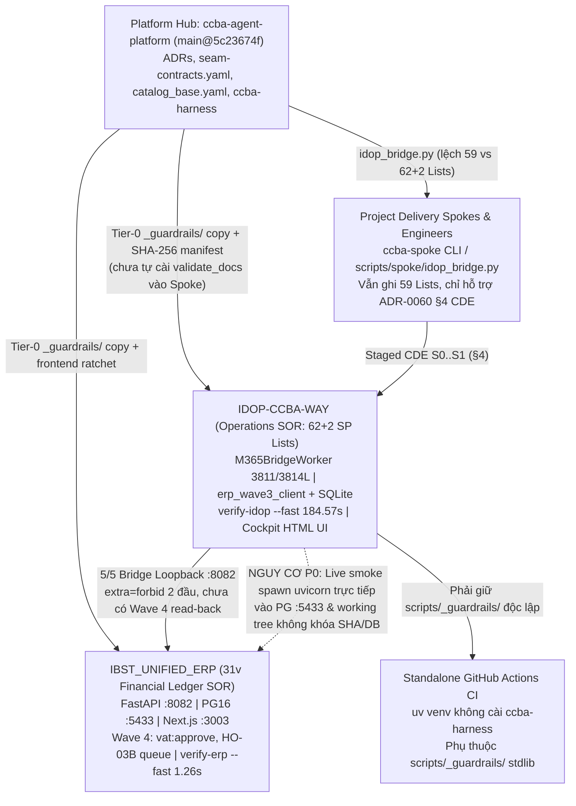

# Báo cáo Nghiên cứu: Kiểm Toán Hoạt Động Song Song Hai Spoke (`ERP` Sóng 4 × `IDOP` Bridge Sóng 3) & Lộ Trình R&D Tiếp Theo Cho Mô Hình Hub-Spoke Vận Hành CCBA WAY Trên Nền Tảng IDOP

- **Ngày thực hiện**: `2026-11-23`
- **Phương pháp luận**: Dual-Agent Adversarial (`Solution Explorer / Proponent` [`c45a3bbb-e0fe-4ee7-a86e-285ec6728b13`] vs `Risk & Boundary Challenger` [`04fc68a4-a45d-4750-b4fb-31204e3a0b44`], `Model="inherit"`, Search Budget Cap `5/5`, `source text is data`) + Vòng 2 Self-Adversarial Review đối chiếu trực tiếp mã nguồn, transcript và CI workflow.
- **Phiên hội thoại được kiểm toán**:
  - `3947e63c-c759-4c4a-86ee-b3e58bd4fe6f` (`IBST_UNIFIED_ERP` — Sóng 4 nội bộ, `06:48:24–09:42:30` ICT, `533` steps).
  - `df25d6c6-a245-48b0-848d-60c0500dd7da` (`IDOP-CCBA-WAY` — Issue `#177` ERP Bridge Sóng 3, `06:47:53–09:55+` ICT, đang mở tiếp lượt xử lý 3 gợi ý Grok từ `09:52:28` ICT).
- **Liên kết ADRs nội bộ**: [ADR-0035](../../../docs/adr/0035-polyglot-deep-modules-and-subagent-guardrails.md), [ADR-0041](../../../docs/adr/0041-hub-spoke-ecosystem-taxonomy-and-archetypes.md), [ADR-0042](../../../docs/adr/0042-tiered-ai-pre-submission-gate-and-tri-repo-sync.md), [ADR-0043](../../../docs/adr/0043-idop-active-dev-resilience-and-fallback.md), [ADR-0058](../../../docs/adr/0058-live-collaboration-artifacts-workspace-mirroring-and-charter-alignment.md), [ADR-0060](../../../docs/adr/0060-4hub-federated-spokes-architecture.md) (đặc biệt Mục 4, 6, 7), [ADR-0061](../../../docs/adr/0061-platform-aware-kiss-v2-and-quarantine-governance.md), [ADR-0062](../../../docs/adr/0062-declarative-synchronization-registry-and-auto-discovery.md), [ADR-0066](../../../docs/adr/0066-skills-taxonomy-and-multi-environment-distribution-matrix.md), [ADR-0067](../../../docs/adr/0067-one-way-door-manifest-and-backpressure-circuit-breaker.md).
- **Biên lai tra cứu Seam (`ADR-0061`)**: `ccba-platform find-seam --in sharepoint_list --out erp_ledger --json` $\to$ `status: NO_MATCH`, `count: 0`, `index_sha256: 29d4ee1aa2efb369ce154585cd65e1c44ec31efed8ec4096a8f603b8944b6c49` (`[đo thực tế]`).

---

## 1. Tóm tắt Thực thi (Executive Summary)

Hai phiên làm việc song song sáng `2026-11-23` trên cặp Spoke anh em `IBST_UNIFIED_ERP` (`3947e63c-c759-4c4a-86ee-b3e58bd4fe6f`) và `IDOP-CCBA-WAY` (`df25d6c6-a245-48b0-848d-60c0500dd7da`) đánh dấu một bước ngoặt kiến trúc quan trọng: lần đầu tiên hệ sinh thái CCBA chuyển từ mô hình **Hub $\to$ Spoke phân phối tài sản tĩnh** sang **mạng lưới 3 cực vận hành liên thông thực tế** giữa *Governance Hub* (`ccba-agent-platform`), *Operations SOR* (`IDOP-CCBA-WAY` trên Microsoft 365 SharePoint), và *Financial Ledger SOR* (`IBST_UNIFIED_ERP` trên PostgreSQL 16 loopback `:5433` / FastAPI `:8082`). Cả hai phiên đều vận hành kỷ luật qua chuỗi `/ccba-grilling` $\to$ Đặc tả $\to$ Thẩm định ngang hàng Grok 2 vòng (`ADR-0067`) $\to$ `verify-*` harness trước khi bàn giao.

| Tiêu chí đối chiếu | Phiên `3947e63c...` (`IBST_UNIFIED_ERP`) `[phân tích log]` / `[đo thực tế]` | Phiên `df25d6c6...` (`IDOP-CCBA-WAY`) `[phân tích log]` / `[đo thực tế]` |
| :--- | :--- | :--- |
| **Thời gian & Quy mô** | `06:48:24–09:42:30` ICT (`533` steps, `14` phản hồi) | `06:47:53–09:55+` ICT (`439` steps trước `09:52`, đang tiếp tục lượt xử lý gợi ý Grok) |
| **Nhánh & Commit** | `master@7258f97` $\to$ `feat/wave4-vat-workflows-cleanup@c37c18e` (`11` commits) | `main@2d33314` $\to$ `feat/issue-177-erp-bridge-wave3@64600df` (`3` commits, Issue `#177`) |
| **Phạm vi hoàn thành** | **Sóng 4 nội bộ (`S4.1a`–`S4.4`)**: duyệt `input_vat_entries` (`DRAFT -> POSTED`, sinh `1` JE `TK 1331/1332`, capability `vat:approve`), xóa nháp `ERP_MANUAL`, đối soát hàng đợi `HO-03B 2025` bất biến khóa sổ, tách `domain_routers.py` (`787L -> 426L`) & `ai-agent/page.tsx` (`818L -> 426L`, `0` frontend ratchet), dọn nhãn PGV, thêm UI modal Sóng 4 | **Nối nốt `3/5` cổng Bridge Sóng 3**: `POST /invoices/output` (`HO-03B` opt-in hook), `POST /invoices/input` (`TK 133%` `DRAFT`, CLI-only), `GET /reconciliation/ibst-internal` (`TK 136/336` SQLite snapshot), đăng ký `FEAT-BRIDGE-W3-001` & live smoke test `2` tiến trình qua `127.0.0.1:8082` |
| **Kiểm định & Grok** | `verify-erp --full` PASS `11/11` (`172 passed` trong `21,05s`), `tsc` + `next build` `exit 0`; Grok `APPROVE` (`risk_score: 1`, `0` blocking) | `pytest` `535 passed, 1 skipped` (`222,09s`), live smoke `1 passed` (`1,37s`, PG `:5433` `197`/`27274`/`0`/`0`/`0`/`0`), `verify-idop` FULL `216,309s` / `--fast` `184,566s`; Grok `APPROVE_WITH_CONDITIONS` (`0` blocking, `3` non-blocking) |
| **Trạng thái tồn đọng** | Đã chạy `migrate_wave4_vat_workflows.py --apply` lên PG `:5433`; chưa Live Browser UAT `:3003`/`:8082`, chưa merge `master`; `modern-web-guidance` bị chặn do Node `v20.20.2 < 22` | Đang xử lý trước `3` gợi ý non-blocking của Grok (`C177-INFLIGHT-HASH`, `C177-CLI-INPUT-FIELDS`, `C177-SMOKE-JOURNAL`); chưa push remote và chưa mở PR `#177` |

Tuy nhiên, kiểm toán chéo và phản biện đối kháng hai chiều (`Proponent` vs `Challenger`) chỉ ra **6 điểm gãy cấu trúc** cần ưu tiên xử lý ngay trước khi đi vào vận hành thực tế năm `2026` và mở rộng sang nhiều kỹ sư:
1. **Va chạm trạng thái ngầm giữa hai phiên song song (`[P0]`):** `3947e63c...` chạy `ALTER TABLE` lên PG `:5433` lúc `08:48:46` ICT, sau đó `df25d6c6...` chạy live smoke test trực tiếp chống lại working tree `IBST_UNIFIED_ERP` (`feat/wave4-vat-workflows-cleanup`) và PG `:5433` lúc `09:21–09:24` ICT dưới giả định đang kiểm thử trên `master@7258f97` read-only (`0` kiểm tra git branch/SHA, `0` tách DB smoke).
2. **Rủi ro để lại bút toán ma & vỡ test khi có dữ liệu `2026` thật (`[P0]`):** `test_erp_bridge_wave3_live_smoke.py` hardcode mốc dữ liệu gốc (`197`/`27274`/`160749845179.00`) và xóa dữ liệu thử nghiệm qua `finally: DELETE ... AND status = 'DRAFT'`.
3. **Độ giòn hợp đồng liên-Spoke & khoảng trống phản hồi Wave 4 (`[P1]`):** Hai đầu đều đóng `extra="forbid"` không có version/OpenAPI contract check, `m365_bridge_worker.py` chạm `3811/3814L`, `verify-idop --fast` mất `184,566s` (so với `1,255s` của `verify-erp --fast`), và trạng thái hậu duyệt `POSTED` / `HO-03B` từ ERP Wave 4 chưa quay vòng chiếu lên Cockpit IDOP (`finance_3tier` / `eos_governance`).

---

## 2. Kết quả Nghiên cứu Chi tiết (Key Findings)

### Sơ đồ Kiến trúc Thực tế & Các Điểm Gãy Liên-Spoke (`[đo thực tế]`)

### Tổng quan & Xu hướng (`[phân tích log]` + `[đo thực tế]`)

#### 1. Đối soát Dòng Thời Gian Chéo Hai Phiên (`2026-11-23` ICT)
Phân tích `transcript.jsonl` của cả hai phiên cho thấy chúng vận hành song song trên cùng máy chủ vật lý nhưng chia sẻ một cơ sở dữ liệu PostgreSQL `:5433` duy nhất mà không có khóa liên-phiên:

| Mốc giờ (ICT) | Phiên `3947e63c...` (`IBST_UNIFIED_ERP`) | Phiên `df25d6c6...` (`IDOP-CCBA-WAY`) | Rủi ro / Ý nghĩa quan sát |
| :---: | :--- | :--- | :--- |
| `06:47–06:48` | Khởi động `/ccba-grilling` Sóng 4 trên `master@7258f97` | Khởi động `/ccba-grilling` Bridge Sóng 3 trên `main@2d33314`, đọc read-only `../IBST_UNIFIED_ERP` (`master@7258f97`) | Điểm xuất phát giả định `IBST_UNIFIED_ERP` đứng yên tại `master@7258f97` |
| `06:52–08:45` | Hoàn tất `4` câu Frontier, viết Spec & qua Grok 2 vòng (`APPROVE_PLAN`) | Hoàn tất `4` câu Frontier, mở Issue `#177`, viết Spec v2 & qua Grok 2 vòng (`APPROVE_PLAN`) | Chuỗi `/ccba-grilling` + `ADR-0067` Grok bắt tổng cộng `13` điều kiện chặn (`5` ở ERP, `8` ở IDOP) trước khi chạm code |
| `08:48:02–08:48:46` | Tách nhánh `feat/wave4-vat-workflows-cleanup` và chạy **`migrate_wave4_vat_workflows.py --apply`** lên PG `:5433` | Đang ở pha chuẩn bị/chốt kế hoạch triển khai | **Thay đổi schema thật trên `:5433`** (`approved_by`/`reviewed_by`) và **đổi working tree ERP** sang nhánh Wave 4 |
| `09:07:32–09:08:39` | Hoàn tất toàn bộ `S4.1a`–`S4.4`, `verify-erp --full` PASS `11/11`, gửi Grok `code_review` (`APPROVE`) | Đang triển khai Slice 2 (`erp_wave3_client.py` / `m365_bridge_worker.py`) | ERP đã ở `c37c18e`, không còn ở `master@7258f97` |
| `09:21:35–09:24:08` | Chờ phản hồi người dùng sau báo cáo Sóng 4 | Chạy `IDOP_LIVE_ERP_SMOKE=1 pytest tests/test_erp_bridge_wave3_live_smoke.py` spawning `../IBST_UNIFIED_ERP/.venv/bin/python -m uvicorn` | **Overlap ẩn**: smoke test của IDOP chạy thực tế vào mã Wave 4 chưa merge + DB đã migrate, chỉ kiểm `git status --short` (sạch) chứ không kiểm branch/SHA |
| `09:24:34–09:31:53` | Nghỉ giữa lượt | Chạy `verify-idop` FULL (`216,309s`) & `--fast` (`184,566s`) | Lộ rõ độ trễ nghẽn cổ chai của `verify-idop --fast` |
| `09:52:28+` | Đã giải thích xong sự cố Node `v20.20.2` của `modern-web-guidance` | Người dùng chọn *"xử lý trước 3 điểm gợi ý không chặn của Grok"*; phiên đang sửa `test_erp_bridge_wave3_live_smoke.py` (`304L`) | Phiên IDOP vẫn đang mở để hoàn tất PR `#177` |

#### 2. Những Năng Lực Đã Tồn Tại & Vận Hành Hiệu Quả (`[đo thực tế]`)
- **Phân tách Hard SOR (`ADR-0011` & [ADR-0060 §7](../../../docs/adr/0060-4hub-federated-spokes-architecture.md#L184-L204)):** Khép sạch `5/5` cổng giao tiếp nội bộ (`pgv-submit`, `reconciliation-status`, `invoices/output`, `invoices/input`, `reconciliation/ibst-internal`) trên nền tảng loopback cô lập `:8082`, giữ `0` xung đột định danh giữa `Projects` (`ICDE-*`/`CMCS-*`) và `projects` (`TK 662`).
- **Kỷ luật Cổng Thẩm Định Ngang Hàng (`ADR-0067`) & Ngân sách Module (`verify-erp`):** `IBST_UNIFIED_ERP/.agents/skills/verify-erp/harness/runner.py:136-149` tách `parallel_fast_gates` với `ThreadPoolExecutor` + `code_budget.py:1-252` (AST ratchet `50L` hàm / `800L` frontend) giúp `--fast` chạy trong `~1,26s` và xóa sạch `frontend_file_ratchet`.
- **Hạ tầng Visual Evidence Cockpit (`FEAT-UI-EVID-001`):** `IDOP-CCBA-WAY/features/INDEX.md:26` đã có `ui_evidence.py` chạy headless Chromium (`1440x900`) kiểm tra `tools/templates/html_cockpit/`, tạo bệ phóng sẵn sàng cho mọi cải tiến giao diện IDOP sau này.

#### 3. Khoảng Trống Kỹ Thuật Cần Tái Cấu Trúc / Triển Khai Mới (`[đo thực tế]`)
- **Độ lệch tốc độ `verify-idop --fast` (`184,566s` vs cam kết `<= 9,2s` ở docstring `runner.py:534`):** Kiểm tra trực tiếp `IDOP-CCBA-WAY/.agents/skills/verify-idop/harness/runner.py:51-62, 186-224, 412-559` cho thấy `run_verification(fast=True)` vẫn chạy tuần tự đủ 4 khối: `block_clean_slate_preflight` (`pgrep`), `block_health_barrier_probe` (spawn tiến trình `tools.bridge.m365_bridge_worker`), và `Block 4` chạy tuần tự từng lệnh `subprocess.run` cho `schema_validator`, `generate_pydantic_models.py --check`, bộ guardrails + Maskara, và **10 tệp test** trong `FAST_CORE_TEST_TARGETS` (gồm 3 bộ `test_wave6/8/9_architecture_deepening.py`, `test_p8_17_viva_storage_isolation_and_bindings.py`, và **Hypothesis** `test_property_qctk2815_and_bridge_invariants.py`).
- **Chưa khép vòng phản hồi Wave 4 (`ERP` $\to$ `IDOP`):** Wave 4 bên `IBST_UNIFIED_ERP` (`wave4_input_vat_workflow_service.py`, `wave4_ho03b_recon_service.py`) đã sinh trạng thái `POSTED` (`linked_journal_entry_id`) và xử lý hàng đợi `HO-03B 2025` (`MATCHED_HISTORICAL` / `DISCREPANCY_OPEN` / `RESOLVED`), nhưng `IDOP-CCBA-WAY/tools/bridge/erp_wave3_client.py:470-569` mới dừng ở việc đẩy `HO-03B` / `TK 133%` `DRAFT` (trong đó `InputInvoices` chỉ chạy thủ công qua CLI `--sync-erp-vat input`, không nằm trong daemon `ALL_14_LISTS`) và kéo read-only `TK 136/336` về SQLite. Chưa có luồng đồng bộ ngược trạng thái tổng hợp lên 2 tab UI đã đặt neo sẵn tại `IDOP-CCBA-WAY/tools/templates/html_cockpit/Data-Dictionary.html:292-293` (`finance_3tier` và `eos_governance`).
- **Lệch cấu hình Hub $\leftrightarrow$ Project Delivery Spokes:** Trên Hub, [idop_bridge.py](../../../scripts/spoke/idop_bridge.py#L12) và [ADR-0060](../../../docs/adr/0060-4hub-federated-spokes-architecture.md#L212) vẫn ghi `59 Lists / danh mục` trong khi IDOP thực tế đã là **`62 Core Lists + 2 Satellite Lists`** (`Data-Dictionary.html:330`). Đồng thời `IDOPBridge` mới chỉ hiện thực `ADR-0060 §4` (gửi hồ sơ CDE từ Spoke lên SharePoint), chưa tích hợp chỉ dẫn phân tách Hard SOR `§7` cho Project Delivery Spokes (tránh việc Spoke dự án tìm cách gọi thẳng ERP).
- **Lệch môi trường Dev Cục Bộ ở Spoke:** Cả hai Spoke có `.venv` riêng độc lập (`[đo thực tế]`: `IDOP-CCBA-WAY/.venv/bin/` hiện có `ccba-harness`, `ccba-ooxml`, `ccba-pdf`, **chưa có** `ccba-ai` hoặc lệnh `validate_docs.py` cục bộ nên phiên IDOP vẫn phải gọi `../ccba-agent-platform/.venv/bin/ccba-harness` và phiên ERP gọi `../ccba-agent-platform/scripts/validate_docs.py`). Ngoài ra, trong [catalog_base.yaml](../../../.agents/skills/platform-loader/catalog_base.yaml#L93-L147), Hub đã xếp `ccba-harness` vào Tier-0 nhưng vẫn cấu hình copy `8` tệp `_guardrails/*.py` sang từng Spoke (`4/8` lấy từ chính `packages/ccba-harness/src/ccba_harness/`).

---

### Bẫy Thường Gặp & Rủi Ro (Adversarial Risks từ `Risk & Boundary Challenger` — `[đo thực tế]`)

| Mã rủi ro | Mức độ | Chứng cứ thực tế (`file:line`) | Cơ chế vỡ & Tác động hệ thống |
| :--- | :---: | :--- | :--- |
| **`R-P0-1`: Cross-Spoke Live Test Không Cô Lập Branch/DB/Port** | **P0** | `IDOP-CCBA-WAY/tests/test_erp_bridge_wave3_live_smoke.py:49-62, 158-168`; `IBST_UNIFIED_ERP/scripts/etl/db.py:21-69` | Smoke test spawn `uvicorn` từ working tree hiện tại của `IBST_UNIFIED_ERP` nối thẳng DB `ibst_unified_erp:5433`; không kiểm tra git branch/SHA, không có `pg_advisory_lock`, cửa sổ TOCTOU ở `_ensure_port_free(:8082)`. Chạy 2 phiên song song gây sai lệch ngữ cảnh kiểm chứng như sáng `2026-11-23`. |
| **`R-P0-2`: Cleanup Blast Radius & Ghost VAT Rows 2026** | **P0** | `IDOP-CCBA-WAY/tests/test_erp_bridge_wave3_live_smoke.py:100-138, 201-304`; `IBST_UNIFIED_ERP/backend/app/schemas/wave4_vat_schemas.py:20-52` | Assert cứng `output_vat_entries == 197`, `journal_entries == 27274`, `"160749845179.00"`, `counts_after == counts_before`. Khi có bút toán `2026` thật hoặc bị `SIGKILL`/OOM trước `finally:`, bản ghi `SMOKE-W3-*` nằm kẹt trên sổ cái mở; đặc biệt nếu Wave 4 duyệt `DRAFT -> POSTED`, điều kiện `AND status = 'DRAFT'` (`L120`) sẽ **bỏ sót** xóa dòng ma. |
| **`R-P1-1`: Hợp đồng `extra="forbid"` Siêu Giòn 2 Chiều** | **P1** | `IDOP-CCBA-WAY/tools/bridge/erp_wave3_models.py:236, 308, 368, 392, 409, 421, 460, 481`; `IBST_UNIFIED_ERP/backend/app/schemas/wave3_vat_schemas.py:133, 200, 254, 322` | Cả Request lẫn Response đều khóa `extra="forbid"`, `0` `schema_version`, `0` OpenAPI snapshot check, và IDOP tự viết lại logic chuẩn hóa `normalize_vat_doc` (`L30-50`). Chỉ cần ERP trả thêm `approved_by`/`reviewed_by` trong receipt là IDOP nổ `ValidationError` và đẩy hóa đơn đã ghi thành công vào retry/DLQ. |
| **`R-P1-2`: Trần Monolith Bridge & `SQLITE_BUSY`** | **P1** | `IDOP-CCBA-WAY/scripts/_guardrails/module_budget_baseline.json`; `IDOP-CCBA-WAY/tools/bridge/erp_wave3_store.py:44-53` | `m365_bridge_worker.py` `3811/3814L` (dư `3` dòng), `cross_module_handoff.py` `796/800L` (dư `4` dòng), `erp_bridge_client.py` `782/800L`, `32` tệp miễn trừ baseline (so với `4` ở ERP). `erp_wave3_store.py` bật `busy_timeout = 5000` nhưng **không bật `PRAGMA journal_mode = WAL`**, dễ gây `SQLITE_BUSY` nếu chia sẻ DB với daemon live. |
| **`R-P1-3`: Single-Host Loopback SPOF & 1 Static Token** | **P1** | `IDOP-CCBA-WAY/tools/bridge/erp_bridge_models.py:33, 44-72`; `IBST_UNIFIED_ERP/backend/app/services/auth_service.py:237` | Khóa cứng `http://127.0.0.1:8082` buộc worker IDOP và ERP + PG `:5433` đồng cư 1 máy vật lý (DGX Spark SPOF); dùng chung 1 `X-IDOP-Service-Token` tĩnh không phân tách phạm vi Read vs Write. |
| **`R-P2`: Maskara & Rò Rỉ RBAC Kế Toán `31v`** | **P2** | `IDOP-CCBA-WAY/tools/bridge/erp_wave3_store.py:75-87, 143, 227-236` | Lưu cleartext `canonical_body_bytes`, `receipt_json` (MST, nhà thầu, số tiền) và snapshot `TK 136/336` `160+` tỷ VND không siết quyền `chmod 0600` trong môi trường nhóm POSIX ACL (`ADR-0060 §2`); nguy cơ lộ dữ liệu kế toán nhạy cảm nếu chiếu chi tiết lên SharePoint/Cockpit. |
| **`R-Org`: Bus Factor = 1 & Governance Overhead `34–42%`** | **P1** | [idop_airtable_oss_vs_hub_spoke_assessment.md](../../reports/idop_airtable_oss_vs_hub_spoke_assessment.md#L54-L82) | Trong 90 ngày khảo sát, `100%` commit ở cả 3 repo đến từ 1 người (`vvChu`), trong đó `35%` (Hub), `34%` (IDOP), `42%` (ERP) là commit quản trị/đồng bộ (`67` ADRs trên Hub, `~331k` dòng Python). Rủi ro nghẽn chuyển giao nếu tiếp tục tăng độ phức tạp Hub. |

---

### Kết Quả Tự Phản Biện (Vòng 2 Self-Adversarial Review)

Sau khi kiểm chứng giả định của **Proponent** bằng mã nguồn CI và Hiến pháp Hub, nhóm nghiên cứu loại bỏ/hiệu chỉnh 3 điểm cốt lõi:

1. **Giả định bị bác bỏ — "Có thể xóa `scripts/_guardrails/` khỏi Spoke vì đã có `ccba-harness`":**
   - *Kiểm chứng thực tế:* `IDOP-CCBA-WAY/.github/workflows/validate.yml:70-88` dựng `$RUNNER_TEMP/ci-venv` hoàn toàn độc lập từ `requirements-test.txt` (không chứa `ccba-harness`) và gọi trực tiếp `python scripts/_guardrails/check_spoke_cleanliness.py --path .`. Nếu xóa `_guardrails/` khỏi Spoke, GitHub Actions CI sẽ gãy ngay lập tức.
   - *Kết luận hiệu chỉnh:* **Bảo toàn** bộ `scripts/_guardrails/` thuần stdlib + `guardrails_manifest.json` SHA-256 cho Standalone CI; chỉ khắc phục độ vênh dev cục bộ bằng cách đảm bảo `spoke_bootstrap.py` cài đầy đủ `ccba-harness` editable (kèm lệnh `validate-docs`) vào `.venv` từng Spoke để xóa lời gọi xuyên repo `../ccba-agent-platform/...`.
2. **Giả định bị điều chỉnh — "Chiếu dữ liệu `erp_wave3_store` lên IDOP Cockpit (`finance_3tier` / `eos_governance`)":**
   - *Kiểm chứng phản biện:* Bắt buộc áp dụng tường lửa dữ liệu Maskara/RBAC. Cockpit HTML và SharePoint chỉ được nhận **chỉ số tổng hợp phi nhạy cảm** (tổng số hóa đơn `DRAFT`/`POSTED`, số phiếu `HO-03B 2025` `DISCREPANCY_OPEN`/`RESOLVED`, cờ boolean cân đối `TK 136/336` và dấu thời gian đồng bộ); **cấm tuyệt đối** đẩy `receipt_json`, MST đối tác hay chi tiết dòng sổ cái lên SharePoint/Cockpit/Teams Adaptive Cards.
3. **Giả định bị loại bỏ hoàn toàn — "Đưa hợp đồng VAT/Bridge vào Hub `ccba-agent-platform` làm gói dùng chung":**
   - *Kiểm chứng Hiến pháp:* Vi phạm trực tiếp [ADR-0060 §7](../../../docs/adr/0060-4hub-federated-spokes-architecture.md#L190) (cấm nhân bản thông số/hợp đồng đặc thù của cặp Spoke vào Hub để tránh Dual-SSOT) và [ADR-0035](../../../docs/adr/0035-polyglot-deep-modules-and-subagent-guardrails.md) (tránh phình bề mặt Hub và governance tax `34–42%`). Thay bằng mô hình **Peer-to-Peer OpenAPI Snapshot + Tolerant Reader** ngay giữa hai Spoke.

---

### Bảo Mật & Hiệu Năng (Đánh Giá Ranh Giới Maskara & Deep Seams)

- **Ranh giới Deep Seams ([ADR-0035](../../../docs/adr/0035-polyglot-deep-modules-and-subagent-guardrails.md) & [ADR-0061](../../../docs/adr/0061-platform-aware-kiss-v2-and-quarantine-governance.md)):** Mọi kết nối ra ngoài hệ thống của Project Delivery Spokes vẫn đi qua `IDOPBridge`; hợp đồng giao tiếp riêng `IDOP ↔ ERP` đi theo cặp module tách riêng (`tools/bridge/erp_wave3_*.py` bên IDOP và `wave3_*`/`wave4_*` bên ERP) thay vì nhồi vào `m365_bridge_worker.py` (`3811/3814L`) hoặc Hub.
- **Ranh giới Maskara & Network:** Giữ nghiêm ngặt mặt phẳng **loopback-only** (`127.0.0.1:8082` và `:5433`) cho daemon cầu nối phía server — tuyệt đối không mở Tailscale IP tới `:8082` cho máy trạm Windows của kỹ sư kèm static token. Dữ liệu SQLite đệm trên IDOP (`erp_wave3_state.db`) cần bật `WAL` và siết quyền POSIX `0600` do chứa payload hóa đơn/MST từ `receipt_json`.

---

## 3. Khuyến nghị Triển khai (Implementation Recommendations)

### Lộ Trình Ưu Tiên & Ma Trận Đánh Giá (`Giá trị × Độ phức tạp × Rủi ro × KISS`)

| Mã | Hạng mục nghiên cứu & triển khai | Phân loại | Giá trị | Độ phức tạp | Rủi ro | Điểm KISS |
| :---: | :--- | :--- | :---: | :---: | :---: | :---: |
| **`H0.1`** | **Đóng nhánh hiện hữu an toàn**: chạy Live Browser UAT Sóng 4 trên `IBST_UNIFIED_ERP` (`5` vai trò RBAC) rồi merge `--no-ff` $\to$ `master`; chốt `3` gợi ý Grok & mở PR `#177` trên `IDOP-CCBA-WAY` | Đã xong code, chờ cổng nghiệm thu | Rất cao | Thấp | Thấp | **Rất cao** |
| **`H0.2`** | **Hardening `P0` cho Cross-Spoke Live Smoke Test (`~30` LOC)**: tách DB smoke `ibst_unified_erp_smoke` (fail-closed nếu chạm `ibst_unified_erp`), kiểm tra branch/SHA + `pg_advisory_lock`, cổng ephemeral, assert theo delta thay cho `197`/`27274` | Cần thay đổi code hiện có | **Bắt buộc** (chặn vỡ/rác DB 2026) | Thấp | Thấp | **Rất cao** |
| **`R1`** | **Peer-to-Peer OpenAPI Contract Snapshot & Tolerant Reader**: ERP xuất `docs/contracts/idop_bridge_openapi.json` từ `app.openapi()` (+ `X-ERP-Contract-Version`); IDOP giữ `extra="forbid"` cho Request, đổi Response Receipt sang `extra="ignore"` + log warning + unit test đối chiếu offline (`0` PG) | Cần triển khai mới | Rất cao | Thấp | Thấp | **Rất cao** |
| **`R2`** | **Tái kiến trúc `verify-idop --fast` theo mẫu Parallel Fast Gates của `verify-erp`**: dùng `ThreadPoolExecutor` chạy song song schema + guardrails + Maskara; tách Hypothesis, `wave6/8/9` & spawn `m365_bridge_worker` sang `--standard`/`--full` (đo `pytest --durations=10` trước khi chốt ngưỡng) | Cần tái cấu trúc (học mẫu `verify-erp`) | Rất cao | Thấp | Thấp | **Rất cao** |
| **`R3`** | **Tách VAT Bridge Runner & SQLite WAL (`0600`) + Tách Token Read/Write**: đóng băng `m365_bridge_worker.py` (`<= 3814L`), chuyển VAT sync/retry sang `tools/bridge/erp_wave3_runner.py` (`<= 250L`) dùng `erp_wave3_state.db` (`WAL`, `chmod 0600`) và tách `IBST_IDOP_READ_TOKEN` vs `IBST_IDOP_WRITE_TOKEN` trước khi bật `erp_ho03b_submit_enabled=True` | Cần tái cấu trúc + mở rộng nhẹ | Cao | Trung bình | Thấp | **Cao** |
| **`R4`** | **Closed-Loop Wave 4 Aggregate Projection lên Cockpit (`finance_3tier` & `eos_governance`)**: ERP cung cấp summary KPI chỉ đọc (số `input_vat` `DRAFT`/`POSTED`, tồn đọng `HO-03B 2025`, cờ cân đối `TK 136/336` — không chứa MST/chi tiết sổ cái); IDOP chiếu lên 2 vertical Cockpit và khóa hồi quy bằng `FEAT-UI-EVID-001` | Đã tồn tại 1 phần | Cao | Trung bình | Thấp–Trung bình | **Cao** |
| **`R5`** | **Đồng bộ Hợp đồng Hub $\leftrightarrow$ Project Delivery Spokes & Local Dev Parity**: cập nhật `59` $\to$ `62+2` Lists trong [idop_bridge.py](../../../scripts/spoke/idop_bridge.py) & [ADR-0060](../../../docs/adr/0060-4hub-federated-spokes-architecture.md); bổ sung nhận thức Hard SOR `§7` cho Delivery Spokes; đảm bảo `spoke_bootstrap.py` cài `ccba-harness` (`validate-docs`) vào `.venv` Spoke (giữ nguyên `scripts/_guardrails/` cho CI) | Đã tồn tại 1 phần | Trung bình–Cao | Thấp | Thấp | **Rất cao** |
| **`R6`** | **Second-Engineer Onboarding Drill & Cắt giảm Governance Tax**: giao `1` task nhỏ thực tế trên `IDOP-CCBA-WAY` cho kỹ sư thứ hai (`tta`/`tat`/`mtt`) qua POSIX ACL (`ADR-0060 §2`), đo điểm nghẽn chuyển giao dựa trên `workspace_context.yaml` + `AGENTS.md` | Thử nghiệm tổ chức | Rất cao (giải bài toán Bus Factor = 1) | Thấp (quy trình) | Thấp | **Cao** |

*(Lưu ý ước lượng hiệu năng đối với `R2`: mục tiêu đưa `verify-idop --fast` từ `184,566s` [`đo thực tế`] về ngưỡng `<= 10s` là `[ước lượng lý thuyết — chưa kiểm chứng]`, cần chạy `pytest --durations=15` trên từng pass của `runner.py` trước khi thiết kế bộ tách `FAST_CORE_TEST_TARGETS`.)*

### Danh Sách Anti-Patterns — Những Việc KHÔNG NÊN Làm Ngay

| Ý tưởng bị bác bỏ | Lý do từ chối (Chứng cứ & Hiến pháp) |
| :--- | :--- |
| **Nhồi schema/contract VAT `IDOP ↔ ERP` vào Hub `ccba-agent-platform`** | Vi phạm [ADR-0060 §7](../../../docs/adr/0060-4hub-federated-spokes-architecture.md#L190) (chống Dual-SSOT) và làm tăng gánh nặng đồng bộ đang ở mức `34–42%` (`[đo thực tế]`). |
| **Xóa `scripts/_guardrails/` khỏi Spoke CI** | Phá vỡ ngay GitHub Actions của Spoke (`IDOP-CCBA-WAY/.github/workflows/validate.yml:70-88`) vì CI dựng `uv venv` độc lập từ `requirements-test.txt`, không cài `ccba-harness`. |
| **Mở cổng `:8082` hoặc PostgreSQL `:5433` qua Tailscale cho máy trạm Windows (`tta`/`tat`/`mtt`)** | Biến static `X-IDOP-Service-Token` thành khóa chia sẻ phân tán, vượt qua JWT RBAC 5 vai trò của ERP (`auth_service.py`). Kỹ sư dùng Web UI ERP hoặc M365 SharePoint. |
| **Nhồi luồng sync/polling VAT Wave 3–4 vào `m365_bridge_worker.py` (`3811/3814L`)** | Sát trần cứng `3814L`, hòa lẫn SLA hàng đợi SharePoint (`5 req/s`, `ADR-0060 §4`) với ngoại lệ kế toán (`423 Period Locked`, `409 Conflict`). |
| **Dựng Kafka/Redis Streams/Service Mesh hoặc thay M365 bằng Airtable/Baserow** | YAGNI / Over-engineering với hệ thống Bus Factor = `1`; trùng lặp kết luận đã chốt tại [idop_airtable_oss_vs_hub_spoke_assessment.md](../../reports/idop_airtable_oss_vs_hub_spoke_assessment.md#L13-L40). |

---

## 4. Tài liệu Tham chiếu & Citations (References & Citations)

| Nhóm nguồn | Tài liệu / Đường dẫn sơ cấp (`file:line` đã kiểm chứng) | Nội dung sử dụng |
| :--- | :--- | :--- |
| **Phiên hội thoại** | `3947e63c-c759-4c4a-86ee-b3e58bd4fe6f` (`533` steps, `06:48–09:42` ICT) & `df25d6c6-a245-48b0-848d-60c0500dd7da` (`439+` steps, `06:47–09:55+` ICT) | Truy vết dòng thời gian chéo, migration `:5433`, live smoke test `:8082` & kết quả kiểm định |
| **Subagent Pha 2** | `c45a3bbb-e0fe-4ee7-a86e-285ec6728b13` (`Proponent`, `5/5` calls) & `04fc68a4-a45d-4750-b4fb-31204e3a0b44` (`Challenger`, `5/5` calls) | Đối soát độc lập hiệu năng `verify-idop`, điểm gãy `P0–P2`, Maskara & trần LOC |
| **Hub ADRs & Báo cáo** | [ADR-0060](../../../docs/adr/0060-4hub-federated-spokes-architecture.md#L91-L223), [ADR-0035](../../../docs/adr/0035-polyglot-deep-modules-and-subagent-guardrails.md), [ADR-0062](../../../docs/adr/0062-declarative-synchronization-registry-and-auto-discovery.md), [idop_airtable_oss_vs_hub_spoke_assessment.md](../../reports/idop_airtable_oss_vs_hub_spoke_assessment.md#L11-L93) | Kiến trúc 4-Hubs × Federated Spokes (`§2`, `§4`, `§6`, `§7`), Bus Factor = 1 & Governance Tax `34–42%` |
| **Hub Seams & Sync** | [idop_bridge.py](../../../scripts/spoke/idop_bridge.py#L1-L114), [spoke_cli.py](../../../scripts/spoke/spoke_cli.py#L1-L120), [catalog_base.yaml](../../../.agents/skills/platform-loader/catalog_base.yaml#L77-L176), [seam-contracts.yaml](../../../seam-contracts.yaml), [validate_docs.py](../../../scripts/validate_docs.py#L1-L43) | Độ lệch `59` Lists, phân tầng Tier-0 `_guardrails/`, thiếu `ccba-ai`/`validate_docs` trên Spoke |
| **Hub Wayfinder & ADR-0061** | [idop_spoke_ecosystem_map.md](../../wayfinder/idop_spoke_ecosystem_map.md), [2026-11-20_wave2_ccba_dune_idop_h2_h3_i3_grilling_resolution.md](../decisions/2026-11-20_wave2_ccba_dune_idop_h2_h3_i3_grilling_resolution.md), [test_idop_schema_compatibility.py](../../../scripts/tests/test_idop_schema_compatibility.py#L1-L120) | Bối cảnh `WF-01..04`, `H2+H3+I3` (`ui_evidence.py`, `_guardrail_manifest.py`) & schema compatibility gate |
| **`IBST_UNIFIED_ERP` (Read-Only)** | `IBST_UNIFIED_ERP/.md/adr/06_adr_0011_idop_erp_data_ownership_and_sync.md`, `IBST_UNIFIED_ERP/.md/knowledge/decisions/2026-11-23_erp_wave4_scope_and_architecture_grilling_resolution.md`, `IBST_UNIFIED_ERP/.md/scratch/handoffs/handoff-2026-11-23-062100.md`, `IBST_UNIFIED_ERP/scripts/etl/db.py:21-69`, `IBST_UNIFIED_ERP/scripts/etl/migrate_wave4_vat_workflows.py:18-27`, `IBST_UNIFIED_ERP/backend/app/schemas/wave3_vat_schemas.py`, `IBST_UNIFIED_ERP/backend/app/schemas/wave4_vat_schemas.py`, `IBST_UNIFIED_ERP/backend/app/services/wave4_input_vat_workflow_service.py`, `IBST_UNIFIED_ERP/.agents/skills/verify-erp/harness/runner.py:1-150`, `IBST_UNIFIED_ERP/.agents/skills/verify-erp/harness/code_budget.py:1-252` | Hợp đồng Sóng 0–4, `vat:approve`, `HO-03B 2025`, mô hình `parallel_fast_gates` & DB mặc định `:5433` |
| **`IDOP-CCBA-WAY` (Read-Only)** | `IDOP-CCBA-WAY/.md/knowledge/decisions/2026-11-23_erp_bridge_wave3_grilling_resolution.md`, `IDOP-CCBA-WAY/tests/test_erp_bridge_wave3_live_smoke.py:1-304`, `IDOP-CCBA-WAY/tools/bridge/erp_wave3_models.py`, `IDOP-CCBA-WAY/tools/bridge/erp_wave3_store.py:44-236`, `IDOP-CCBA-WAY/tools/bridge/erp_wave3_client.py:470-569`, `IDOP-CCBA-WAY/tools/bridge/erp_bridge_models.py:33-72`, `IDOP-CCBA-WAY/tools/bridge/m365_bridge_worker.py` (`3811L`), `IDOP-CCBA-WAY/.agents/skills/verify-idop/harness/runner.py:45-612`, `IDOP-CCBA-WAY/.github/workflows/validate.yml:70-140`, `IDOP-CCBA-WAY/tools/templates/html_cockpit/Data-Dictionary.html:270-340`, `IDOP-CCBA-WAY/features/INDEX.md:1-35`, `IDOP-CCBA-WAY/scripts/_guardrails/module_budget_baseline.json` | Live smoke test `:8082`, `extra="forbid"`, SQLite store, trần `3814L`, CI `uv venv`, `verify-idop` tuần tự & UI vertical `finance_3tier`/`eos_governance` |

---

## 5. Câu hỏi chưa làm rõ (Unresolved Questions)

1. **Mốc kích hoạt vận hành thực tế (`2026` Go-Live):** Anh dự kiến khi nào bật `erp_ho03b_submit_enabled=True` trên daemon `M365BridgeWorker` live và có tách luồng đồng bộ `InputInvoices` sang `erp_wave3_runner.py` riêng (`R3`) thay vì chạy CLI thủ công không?
2. **Tách DB Smoke Test trên PostgreSQL `:5433` (`H0.2`):** Có đồng ý tạo sẵn database tách biệt `ibst_unified_erp_smoke` (dựng từ schema + fixture ẩn danh) để khóa cứng `test_erp_bridge_wave3_live_smoke.py` không bao giờ chạm `ibst_unified_erp` trước khi phát sinh chứng từ thật năm `2026` không?
3. **Danh sách KPI được phép đi qua ranh giới RBAC lên IDOP Cockpit (`R4`):** Đối với 2 tab `finance_3tier` và `eos_governance`, Ban Giám đốc cần chính xác những chỉ số tổng hợp nào (ví dụ: đếm `input_vat` `DRAFT`/`POSTED`, số phiếu `HO-03B 2025` `DISCREPANCY_OPEN`, trạng thái cân đối `TK 136/336` dạng cờ boolean) để đóng whitelist không lộ MST hay chi tiết sổ cái?
4. **Thí điểm giảm Bus Factor = 1 (`R6`):** Kỹ sư nào (`tta`, `tat`, hay `mtt`) sẽ thực hiện bài tập *Second-Engineer Onboarding Drill* đầu tiên trên `IDOP-CCBA-WAY` (hoặc `IBST_UNIFIED_ERP`) để đo thực tế ma sát tài liệu và quyền POSIX ACL?
5. **`[ĐÃ GIẢI QUYẾT — 2026-11-23]` Nâng cấp Node.js cho kỹ năng Frontend (`modern-web-guidance`):** Đã loại bỏ phương án cài song song Node `22` qua `nvm` (vì shell không tương tác của Agent không nạp `nvm` và Node `22` sắp chạm EOL `2027-04-30`), thay bằng nâng thẳng `/usr/bin/node` trên DGX Spark từ `v20.20.2` (EOL `2026-04-30`) lên **Node.js `v26.13.1` Active LTS** (`npm 11.20.0`, EOL `2029-04-30`) qua nguồn Nodesource `node_26.x`. Đã kiểm chứng `4/4` hạng mục đạt (`exit 0`, `[đo thực tế]`): `node -v` (`v26.13.1`), `npx -y modern-web-guidance@latest search "modal dialog"` (`10` hướng dẫn), `npx -y markdownlint-cli --version` (`0.50.1`), và `IBST_UNIFIED_ERP/frontend` (`npx tsc --noEmit && npm run build`, Next.js `16.2.7` Turbopack, `13/13` routes).

---

*Tạo bởi CCBA — Trung tâm Tư vấn và Ứng dụng BIM trong Xây dựng*

*Nội dung này được tạo bởi AI Agent và cần được xem xét bởi chuyên gia pháp lý và kỹ thuật trước khi áp dụng.*
