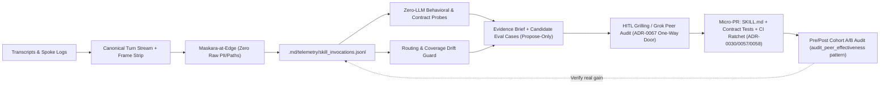

# Báo cáo Nghiên cứu: Bài Học Từ Kiểm Toán `/ccba-ask` Cho Hệ Thống Tự Thu Thập Dữ Liệu & Cơ Chế Tự Cải Tiến

> **Ngày nghiên cứu:** `2026-11-26` · **Phương thức:** `/ccba-research` Chế độ Phản Biện Kép (*Dual-Agent Adversarial*: `Solution Explorer` × `Risk & Boundary Challenger`, mỗi nhánh giới hạn 5 lượt đọc mã nguồn gốc) + đối soát trực tiếp hiện trạng hạm đội.  
> **Bối cảnh thực chứng đầu vào:** Đợt kiểm toán `543` transcripts (`3,093` lượt `USER_INPUT`, `6` workspaces) và phát hành đợt kép `PR #909` (`ce2a424e`), `PR #911` (`d731dfbd`), Issue `#910`, `PR #912` (`8c11ac1d`), `PR #913` (`9725b5e7`, `Mục 77`).  
> **Biên lai Reuse-First Gate (`ADR-0061`):** `compile_catalog.py --in telemetry --out json` & `--in transcript --out json` $\to$ `NO_MATCH` (`index_sha256: 29d4ee1aa2efb369ce154585cd65e1c44ec31efed8ec4096a8f603b8944b6c49`); mọi đề xuất dưới đây ưu tiên nối dây vào các Deep Seams đã tồn tại trong `ccba-harness`.

---

## 1. Tóm tắt Thực thi (Executive Summary)

Cuộc kiểm toán thực chứng skill `/ccba-ask` trên `543` hội thoại thực tế và đối soát sâu `10` module mã nguồn của `ccba-harness` phơi bày một **nghịch lý kiến trúc cốt lõi** của hệ thống tự thu thập dữ liệu và tự cải tiến hiện tại: CCBA Platform đã đầu tư một bộ máy tối ưu hóa ban đêm (*Nightly Auto-Tuner*) khá đồ sộ, nhưng hệ thống đó **mù hoàn toàn trước các lỗi thực chiến nghiêm trọng nhất** — `0/4` khiếm khuyết thật của `/ccba-ask` (rò rỉ `write_file` `3/3` khi nhắc `/plan`, trôi ý định sang *State-Aware Next-Step*, bản đồ `Idea -> Ship` bỏ sót Top `#1/#5` skills, rò rỉ Spoke `vvc-notes`) được phát hiện bởi telemetry hay eval tự động `[đo thực tế]`. Ngược lại, chính cơ chế tự tối ưu đó lại tự khóa tê liệt **`61/77` (`79.2%`) skills** vào trạng thái `RED_QUARANTINE_LOCKED`, sinh **`74` hồ sơ `*_plateau.md`** đóng băng từ `10/2026`, để `tuner_heartbeat.json` và `doc_health_report.json` lạc hậu `2` tháng (từ `2026-09-24`), buộc cron ban đêm (`nightly_cron.log`, `2026-11-26`) phải tắt mặc định Auto-Tuner toàn cục `[đo thực tế]`.

Đợt nâng cấp `/ccba-ask` thành công (`PR #909` + `PR #911`) lại chứng minh một mô hình đối lập nhưng cực kỳ hiệu quả, đồng điệu với kiến trúc `v2.7` trong `audit_peer_effectiveness.py`: **Thu thập Tín hiệu Hành vi Cấu trúc (Low-Volume, High-Signal, Zero-LLM)** $\to$ **Chẩn đoán & Phản biện có Người duyệt (Evidence-Gated HITL)** $\to$ **Khóa Hợp đồng Tất định (Contract Tests + CI Ratchet)** $\to$ **Đo lường Pre/Post A/B trên Dữ liệu Thực**.

Hai quyết định đảo chiều chiến lược rút ra từ nghiên cứu này:
1. **Cho hệ thống tự thu thập dữ liệu:** Dừng thu thập kiểu *crash-only mining* và *vanity metrics*; hợp nhất parser `transcript.jsonl` về một **Canonical Turn Stream** duy nhất (tái sử dụng `telemetry.py` + `_miner_catalog.py`), bổ sung bộ đo **hành vi đa lượt/xuyên phiên** & **vi phạm hợp đồng không cần LLM**, và áp dụng **Maskara-at-Edge** tại biên Spoke trước khi tổng hợp.
2. **Cho cơ chế tự cải tiến:** Khai tử vĩnh viễn vai trò chấm điểm tự cải tiến của **Mock Simulator** (`platform_tooling.py`), cắt bỏ **silent fallback** về dataset sai domain (`UNCONFIGURED` fail-closed), đảo `stability_zone` sang **opt-in `locked` by default** (`ADR-0067`), buộc mọi auto-tuner chỉ chạy chế độ **Propose-Only** có ràng buộc cứng với **CI Ratchet thật** (`skill_token_budget_baseline.json`, `validate_skills.py`, `verify-patch`, `check_spoke_cleanliness.py`) và **Hard Holdout Rollback**.

---

## 2. Kết quả Nghiên cứu Chi tiết (Key Findings)

### 2.1 Tổng quan Hiện trạng & Bản đồ Deep Seams Sẵn có (`[đo thực tế]` + `[phân tích log]`)

#### A. Đo đạc thực trạng vận hành toàn hạm đội (`2026-11-26`)
| Chỉ số hiện trạng | Giá trị đo thực tế | Nguồn | Ý nghĩa chẩn đoán |
| :--- | :--- | :---: | :--- |
| **Tệp `velocity_state.json` toàn hạm đội** | `70 / 77` skills (`61` `RED_QUARANTINE_LOCKED`, `9` `GREEN`, `7` chưa có) | `[đo thực tế]` | **`79.2%` hạm đội bị khóa chết** (`305` fails = `61 × 5`); cả `9/9` skill `GREEN` đều có đúng `45` keeps / `0` fails trên mock simulator |
| **Hồ sơ leo thang `*_plateau.md`** | **`74` tệp** tại `.md/knowledge/escalations/` (tất cả từ `2026-10-16..19`) | `[đo thực tế]` | Báo động tràn lan (*Alarm Fatigue*); riêng `ccba-ask_plateau.md` đốt `82,363` tokens với `0.0%` baseline và `Holdout Size: 0` |
| **Độ tươi của `.md/telemetry/`** | `tuner_heartbeat.json` & `doc_health_report.json`: **`2026-09-24`** · `spoke_heartbeats.yaml`: `2026-11-25` | `[đo thực tế]` | Telemetry của Tuner & Doc Health đã ngừng cập nhật `2` tháng; `.md/telemetry/` có **`0` chỉ số skill invocation** |
| **Chế độ chạy thực tế của Nightly Cron** | `nightly_cron.log` (`2026-11-26 00:00:28`): Legal Parity (`113/114`), Doc Audit-Only, `verify-patch --preset skill` (`4/4 PASS`), **tắt Auto-Tuner toàn cục** | `[phân tích log]` | Hạ tầng vận hành thực tế đã tự xoay sang **kiểm định tất định** và bỏ qua LLM Auto-Tuner để khỏi đốt token |

#### B. Các Deep Seams ĐÃ TỒN TẠI (Tuyệt đối tái sử dụng — không xây lại)
- **Streaming Transcript & Tool/Token Telemetry:** `stream_transcript_steps()`, `analyze_subagent_transcript()`, `TokenEstimator`, `resolve_model_token_rates_detailed()` trong [`telemetry.py`](../../../packages/ccba-harness/src/ccba_harness/telemetry.py) (`L37-69, L303-399`) đã parse đầy đủ `created_at`, `tool_calls` (`name`, `args`), thời lượng `GENERIC`, `TurnRecord` và ước tính chi phí USD.
- **Transcript Discovery, XML Cleaning & Maskara Redaction:** `find_transcript_files()` ([`miner.py`](../../../packages/ccba-harness/src/ccba_harness/evals/miner.py), `L153-178`), `extract_clean_user_prompt()` và `redact_sensitive_info()` ([`_miner_catalog.py`](../../../packages/ccba-harness/src/ccba_harness/evals/_miner_catalog.py), `L14-67, L319-342`) đã cắt `<USER_REQUEST>`, loại bỏ `<ADDITIONAL_METADATA>`/`<SYSTEM_MESSAGE>` và redact PII qua `ccba-maskara`.
- **Catalog SSOT & Tier-1 Dataset Hook:** `load_catalog()` (`_miner_catalog.py:L386-410`) và `resolve_domain_dataset()` ([`archetypes.py`](../../../packages/ccba-harness/src/ccba_harness/evals/archetypes.py), `L206-248`) đã có cơ chế ưu tiên `eval_{clean_skill}.json`.
- **Chuẩn Vàng Đo Hiệu Quả Khép Kín (`v2.7`):** [`audit_peer_effectiveness.py`](../../../scripts/governance/audit_peer_effectiveness.py) (`L49-64, L183-248, L288-384`) đã triển khai hoàn chỉnh mô hình **Pre/Post Cutoff Cohort**, nối chuỗi multi-pass (`sid_to_parent`), đối chiếu đa nguồn (`verdict -> prompt -> events.jsonl -> git log`), tách bạch `confirmed_tagged` vs `candidate_untagged`, và cổng kiểm tra `_has_regression_test_or_guard()`.

---

### 2.2 Quy chuẩn Tốt nhất — 6 Bài Học Cho Hệ Thống Tự Thu Thập Dữ Liệu (Telemetry & Mining)

1. **Hợp nhất "Split-Brain Parsers" về 1 Canonical Turn Stream:**
   - Hiện tại `telemetry.py:L330-397` đọc đủ `tool_calls` và `created_at` nhưng không nhận diện skill; còn `miner.py:L248-289` tự parse JSONL riêng và mắc **4 lỗi mất tín hiệu chí mạng** `[đo thực tế]`:
     - *(a)* Vứt bỏ toàn bộ `tool_calls` thành công (`_classify_jsonl_step_response`, `miner.py:L234-245` chỉ giữ `PLANNER_RESPONSE` text và step `status == "ERROR"`/traceback).
     - *(b)* Vứt bỏ `created_at` và workspace context $\to$ không thể đo follow-through xuyên phiên (`<= 2h`).
     - *(c)* Xóa ngay lúc parse mọi `USER_INPUT` có `len < 5` hoặc thuộc `IGNORABLE_CONTROL_COMMANDS` (`"1"`, `"2"`, `"ok"`, `"yes"`, `miner.py:L268`), rồi lọc tiếp `len < 10` (`miner.py:L364`) — **vô tình xóa sạch lệnh trần `"/ccba-ask"` (`9` ký tự)** và toàn bộ câu chốt phương án (`30.6%` hiệu quả hành vi của `/ccba-ask` `[phân tích log]`).
     - *(d)* Reset `pending_planner_prompt = None` ngay sau `PLANNER_RESPONSE` đầu tiên (`miner.py:L288-289`), làm rơi câu trả lời cuối của lượt đa bước.
   - **Bài học:** Mọi bộ thu thập/khai phá đều phải dùng chung 1 `UserTurn` stream (tái sử dụng `telemetry.stream_transcript_steps`) giữ nguyên `tool_calls`, `created_at`, `workspace`, và mọi lượt ngắn.

2. **Tách bạch Tuyệt đối `Invoked Skill` vs `Mentioned Skill` & Bảo toàn Metadata:**
   - `_miner_catalog.py:L328-342` cắt đúng `<USER_REQUEST>` (tránh đếm trùng `<ADDITIONAL_METADATA>`) nhưng xóa trắng metadata thay vì bóc `workspace`/active command thành trường cấu trúc.
   - `_miner_catalog.py:L446-449, L561` cộng `+50.0` cho mọi lệnh slash xuất hiện ở *bất kỳ đâu* trong câu và phá hòa theo thứ tự `catalog.yaml` — không phân biệt được `/ccba-ask tôi dùng /plan được không?` (invoked: `ccba-ask`, mentioned: `/plan`).
   - **Bài học:** Phân tách 2 trường cứng: `invoked_skill` (khớp leading slash `^\s*/[a-z0-9-]+`) và `mentioned_commands[]`. Đây chính là điều kiện tiền đề để bắt lỗi `Mention ≠ Invoke`.

3. **Chuyển từ Crash-Only Mining sang Behavioral & Contract Probes (Zero-LLM):**
   - Trong phiên kiểm toán `/ccba-ask`, lỗi runtime nghiêm trọng nhất (`3/3` tự gọi `write_file` khi người dùng chỉ hỏi về `/plan`) kết thúc với `exit_code = 0` nên `log_eval_miner.py` bị **100% âm tính giả**; ngược lại, miner lại bắt `1` case nhiễu ở `step_index: 339` (`TypeError` từ inline smoke test) và trước đó từng dính dương tính giả từ `<SYSTEM_MESSAGE>` `[phân tích log]`.
   - **Bài học:** Phân tầng tín hiệu theo độ tin cậy (theo mẫu `audit_peer_effectiveness.py:L329-337`):
     - *Tầng `confirmed` (Zero-LLM, độ chính xác ~100%):* `SIDE_EFFECT_VIOLATION` (skill `read_only` gọi tool ghi/sửa), `ROUTING_CONTRACT_DRIFT` (đề xuất slash ngoài `catalog.yaml` / `ALLOWED_HOST_COMMANDS`), `UNEXPECTED_TOOL_ERROR` (đã strip `<SYSTEM_MESSAGE>` và inline test).
     - *Tầng `candidate_heuristic` (có nhãn cảnh báo attribution):* `next_turn_adoption`, `choice_confirmation`, `cross_session_follow_through <= 2h`, `user_correction_rework`.

4. **Loại bỏ Vanity Metrics & Trạng thái Giả `"Compliant"`:**
   - `_fleet_scanner.py:L118` đề xuất `"Candidate for Hub Ingestion"` chỉ vì `total_calls >= 5` hoặc xuất hiện ở `>= 2` Spokes — **biến tool lỗi chạy retry 5 lần thành "đổi mới sáng tạo"** `[đo thực tế]`. `STANDARD_BUILTIN_TOOLS` (`_fleet_scanner.py:L14-39`) đã lỗi thời (thiếu `read_file`, `edit_file`...).
   - Khi thiếu file telemetry hoặc JSON/HTML hỏng, `_fleet_scanner.py:L371-380` trả về `is_online=True, budget_status="Compliant"` — **che giấu mù hoàn toàn** `[đo thực tế]`.
   - **Bài học:** Thiếu dữ liệu phải báo **`NO_DATA` / `PARSE_ERROR`** (Fail-Closed `ADR-0058`), tuyệt đối không gán `"Compliant"` hay điểm `0.0%` giả (`daemon.py:L603-608`).

5. **Bác bỏ Ngụy biện "Gom Càng Nhiều Raw Transcript Càng Tốt" — Áp dụng Maskara-at-Edge:**
   - `_fleet_scanner.py:L1` ghi docstring *"sanitized"* nhưng code (`L263-334`) **không hề gọi `ccba-maskara`**, đồng thời xuất nguyên `project_path` tuyệt đối (`L48, L67, L339`) và `project_name` nội bộ Spoke (`L91, L99, L175`) vào báo cáo Hub `[đo thực tế]`.
   - **Bài học:** **CẤM** hút raw transcript từ Spoke về Hub (nguy cơ rò rỉ API key, tài liệu khách hàng, đường dẫn máy và đầu độc bộ Eval). Chỉ ghi **structured behavioral events** ít dung lượng, giàu tín hiệu, đã qua Frame Stripping + `ccba-maskara` ngay tại biên Spoke vào một append-only ledger (`.md/telemetry/skill_invocations.jsonl`, idempotent theo `conv_id + turn_idx`).

6. **Đóng vòng Telemetry Sử Dụng $\leftrightarrow$ Routing Map & Coverage Debt:**
   - Vì `.md/telemetry/` không có tần suất gọi skill, bản đồ `Idea -> Ship` trong `ccba-ask` v1.3.0 bỏ sót đúng Top `#1` (`/ccba-release-feature`, `88T/67C`) và Top `#5` (`/ccba-update-spoke`, `46T/35C`) trong khi dành diện tích cho 7 skill `0` lượt gọi `[phân tích log]`.
   - **Bài học:** Dùng 1 kiểm tra tĩnh siêu nhẹ (~30–40 dòng) đối chiếu Top-N skills thực chiến 30 ngày với các router skill (`ccba-ask`, `platform-loader`) và độ phủ Tier-1 contract tests để phát hiện sớm **Routing Drift** & **Coverage Debt**.

---

### 2.3 Bẫy Thường Gặp & Rủi Ro — 6 Bài Học Cho Cơ Chế Tự Cải Tiến (Adversarial Challenger Findings)

1. **Synthetic Eval Mirage (Ảo ảnh Mock Simulator) & Dead Code tự khóa hạm đội:**
   - [`platform_tooling.py`](../../../packages/ccba-harness/src/ccba_harness/evals/simulators/platform_tooling.py) (`L13-43, L76-195`) nhét `27` skills khác hẳn nhau (`ccba-ask`, `ccba-research`, `ccba-create-pr`, `ccba-youtube-learn`...) vào chung một bucket và trả **văn bản boilerplate hardcode mà không hề đọc `SKILL.md`** `[đo thực tế]`.
   - [`daemon.py`](../../../packages/ccba-harness/src/ccba_harness/evals/daemon.py) (`L328, L330, L524-547`) mặc định `use_real_llm=False`, khai báo `max_iterations_perfect=1` nhưng **bỏ quên hoàn toàn biến này** trong `_build_skill_ratchet_config()` (luôn ép `max_iterations = 30`, `target_score = 100.0`). Kết quả: Simulator chấm `100.0%` baseline vs `100.0%` candidate $\to$ không cải thiện chặt $\to$ `5` lần revert $\to$ tự khóa `RED_QUARANTINE_LOCKED` `[đo thực tế]`.
   - Ngược lại, khi bật Real LLM, `daemon.py:L434-440` fallback im lặng về `eval_general_domain.json`, còn [`tuner.py`](../../../packages/ccba-harness/src/ccba_harness/evals/tuner.py) (`L240-252`) thậm chí fallback cứng về **Nghị định 30/2020/NĐ-CP và QCVN 06:2022/BXD** khi dataset rỗng $\to$ `ccba-ask` đạt `0.0%`, đốt `82,363` tokens vô ích và sinh báo động giả `ccba-ask_plateau.md` `[đo thực tế]`.
   - **Khắc phục:** Cấm dùng Mock Simulator để chấm điểm tự cải tiến/quarantine (chỉ dùng cho unit test plumbing); hợp nhất dataset resolver (`_miner_catalog.py:L572-602` gọi thẳng `archetypes.py`); thêm trạng thái **`UNCONFIGURED`** (Fail-Closed) và **Baseline Sanity Gate** (baseline `0.0%` toàn tập hoặc `100.0%` sẵn $\to$ **HALT ở `0` mutation tokens**).

2. **Self-Locking Velocity Circuit Breaker không phân biệt nguyên nhân:**
   - [`skill_governance.py`](../../../packages/ccba-harness/src/ccba_harness/evals/skill_governance.py) (`L36, L72-87, L356-375`) gom chung mọi thất bại (`SIMULATOR_SATURATED`, `DATASET_MISMATCH`, `INFRA_TIMEOUT`, `MUTATION_REGRESSION`) vào cùng bộ đếm `consecutive_failure_patches >= 5` và **không lưu `content_sha256` / `dataset_sha256`** — nên dù kỹ sư đã nâng cấp `ccba-ask` lên `v1.4.0`, trạng thái `RED_QUARANTINE_LOCKED` vẫn đóng băng vĩnh viễn `[đo thực tế]`.
   - **Khắc phục:** Phân loại nguyên nhân thất bại tường minh (`ORACLE_INVALID` / `ALREADY_OPTIMAL` không được cộng vào quarantine) và gắn `(content_sha256, dataset_sha256)` để tự mở khóa sạch khi người sửa skill hoặc thay bộ đề.

3. **Proxy Metric Collapse & Disconnected Ratchet (Bộ kiểm định nội bộ lệch pha hoàn toàn với CI):**
   - `tuner.py:L255-266` chỉ đánh giá **single-turn text completion**, không có tool-call sandbox $\to$ mù `100%` trước side-effect ghi file.
   - Tier 1 Static Lint trong `skill_governance.py:L47-53, L426` chỉ đếm tần suất `5` cụm từ (`MUST`, `MUST NOT`, `BẮT BUỘC`, `TUYỆT ĐỐI KHÔNG`, `NGHIÊM CẤM`): vừa **lọt lỗ hổng** (xóa `"CẤM ghi file"` / `"READ-ONLY"` vẫn pass), vừa **trừng phạt việc nén prompt** (`mut_counts < base_counts` chặn rút gọn câu rườm rà) `[đo thực tế]`.
   - `skill_governance.py:L395-411, L536-537` đo tỷ lệ chữ tương đối (`+15%`, thậm chí đệm sàn `1500 words / 8000 chars`) mà **hoàn toàn không kiểm tra**: `skill_token_budget_baseline.json` (`ccba-ask` chỉ còn `10` tokens headroom!), `validate_skills.py --enforce-gpi`, `verify-patch --preset skill`, hay `check_spoke_cleanliness.py` (để lọt `vvc-notes`) `[đo thực tế]`.
   - **Khắc phục:** Xóa bộ kiểm định song song yếu ớt; nối trực tiếp post-mutation gate của Tuner vào đúng bộ kiểm định CI thật (tokenizer LF + `skill_token_budget_baseline.json`, `validate_skills.py --enforce-gpi`, `check_spoke_cleanliness.py`, `verify-patch`).

4. **Holdout trang trí & Failure Ledger bị giam trong mảng Legal:**
   - `tuner.py:L586-600` tính `final_holdout_score` **SAU KHI** `_finalize_disk_state()` đã commit patch lên Git, chỉ ghi log nếu tụt điểm và nuốt exception trả `None` (`L408-410`) `[đo thực tế]`.
   - `daemon.py:L406` chỉ nạp `load_failure_ledger()` khi `arch_name in {"legal", "legal_tooling"}`, ngắt kết nối toàn bộ các miền còn lại khỏi tín hiệu lỗi thực tế `[đo thực tế]`.
   - `daemon.py:L426` duyệt `self.skills_dir.glob("*/SKILL.md")` không `sorted()` (vi phạm Inode Ordering Invariance), và `tuner.py:L205-209` vẫn ghi `.skill_versions` vào thư mục skill khi `dry_run_git=True` `[đo thực tế]`.
   - **Khắc phục:** Biến `holdout_score` thành **hard rollback gate trước commit**; mở failure ledger cho mọi domain khi có structured behavioral schema.

5. **Phản biện "Zero-Human Auto-Mutate & Auto-Merge" — Khóa Cửa Một Chiều (`ADR-0067`):**
   - `SKILL.md` là **Execution Contract** lan truyền tới toàn bộ Spokes qua `sync_spoke.py`, không phải hyperparameter vô hại. Khi `skill_governance.py:L144-163` mặc định trả về `"evolvable"` (opt-out, chỉ khóa đúng `2` skills là `platform-loader` và `ccba-maskara`), còn `daemon.py:L634-649, L700-716` tự tạo branch/PR và bắn nút `/boost` trên oracle hỏng, rủi ro hồi quy là cực lớn `[đo thực tế]`.
   - **Khắc phục:** Đảo mặc định `stability_zone` sang **opt-in (`locked` by default)**; Nightly Tuner chỉ được chạy **Propose-Only** (sinh Evidence Brief hoặc Draft PR kèm bằng chứng replay, **cấm auto-merge**).

6. **Đích đến của Tự Cải Tiến là "Contract Tests & Deterministic Guardrails", không phải "Prompt Patching vô tận":**
   - Bài học đắt giá nhất của chính chuỗi `PR #909` $\to$ `PR #911` $\to$ `Mục 77`: các khiếm khuyết thực chiến chỉ thực sự chấm dứt khi được khóa bằng **kiểm định tất định** (`test_ccba_ask_contracts.py`, `ALLOWED_HOST_COMMANDS`, `validate_skills.py`, `test_verification_harness_dogfood.py`, `test_upstream_evaluator.py`) và đo hiệu quả **Pre/Post Cutoff A/B** (mẫu `audit_peer_effectiveness.py`) sau phát hành.

---

### 2.4 Bảo mật, Hiệu năng & Kiến trúc Đích (`ADR-0030 / 0057 / 0058 / 0061 / 0067` + `ccba-maskara`)

| Ranh giới / ADR | Hard Guardrail bắt buộc | Điểm khóa trong codebase |
| :--- | :--- | :--- |
| **`ADR-0030`** (Token Budget) | Kiểm ngân sách tuyệt đối `skill_token_budget_baseline.json` bằng LF tokenizer; cho phép nén prompt không phạt đếm từ khóa | `skill_governance.py:L47-53, L395-452, L536-537` |
| **`ADR-0057`** (Skills GPI) | Mọi candidate mutation phải pass `validate_skills.py --file <path> --enforce-gpi` | Post-mutation gate trong `tuner.py` & `skill_governance.py` |
| **`ADR-0058`** (Fail-Closed Lock) | Cấm fallback `eval_general_domain.json`/NĐ 30; thiếu dữ liệu trả `UNCONFIGURED`/`NO_DATA`; bắt buộc `verify-patch` exit `0` | `archetypes.py:L206-287`, `daemon.py:L434-440, L603-608`, `tuner.py:L240-252`, `_fleet_scanner.py:L371-380` |
| **`ADR-0061`** (Cleanliness & Decoupling) | Cấm xuất `project_path`/tên Spoke ra báo cáo Hub; `sorted(glob)`; chạy `check_spoke_cleanliness.py` trước khi giữ mutation | `_fleet_scanner.py:L48, L67, L91, L263-334`, `daemon.py:L426`, `tuner.py:L205-209` |
| **`ADR-0067`** (One-Way Door) | Đảo `stability_zone` sang `locked` mặc định; Propose-Only (cấm auto-merge); `holdout_score` là hard rollback gate; Velocity tách nguyên nhân + SHA-256 | `skill_governance.py:L72-87, L144-163, L356-375`, `tuner.py:L586-600`, `daemon.py:L524-547` |
| **`ccba-maskara`** (Privacy) | Zero Raw Transcript về Hub; Frame Stripping (`<SYSTEM_MESSAGE>`, test harness) + Maskara redaction tại biên Spoke | `_fleet_scanner.py:L263-334`, `miner.py:L248-289`, `telemetry.py` |

---

## 3. Khuyến nghị Triển khai (Implementation Recommendations)

Ma trận ưu tiên theo 3 sóng triển khai (gắn trực tiếp với backlog Issue `#910` đang `OPEN`), đánh giá theo **Giá trị × Độ phức tạp × Rủi ro × KISS**:

| Sóng | Hạng mục triển khai | Phân loại hiện trạng | Giá trị | Độ phức tạp | Rủi ro | Điểm KISS | Hành động kỹ thuật cụ thể |
| :---: | :--- | :--- | :---: | :---: | :---: | :---: | :--- |
| **W0** | **1. Cắt Silent Fallback & Vá Oracle Mirage (`#910`)** | Cần thay đổi code hiện có | **Rất cao** | Thấp | Thấp–TB *(giữ wrapper tương thích callers)* | **Xuất sắc** | Cấm Simulator chạy trong Nightly Tuner (`daemon.py:L330`), vá dead code `max_iterations_perfect` (`L524-547`), xóa fallback NĐ 30/QCVN 06 (`tuner.py:L240-252`), thêm trạng thái `UNCONFIGURED` (`archetypes.py`) + **Baseline Sanity Gate** (`0%`/`100%` $\to$ HALT `0` tokens), tách nguyên nhân & thêm `(content_sha256, dataset_sha256)` vào `VelocitySignalState` (`skill_governance.py:L72-87, L356-375`), và đảo `stability_zone` sang `locked` mặc định (`L163`). |
| **W0** | **2. Hợp nhất Tuner Gate với CI Ratchet & Hard Holdout** | Cần thay đổi code hiện có | **Rất cao** | Thấp | Thấp | **Tốt** | Chuyển `final_holdout_score` lên trước `_finalize_disk_state()` làm hard rollback gate (`tuner.py:L586-600`); nối `skill_token_budget_baseline.json`, `validate_skills.py --enforce-gpi`, `check_spoke_cleanliness.py` vào `skill_governance.py`; bỏ đếm 5 từ khóa chống nén prompt; sửa `sorted(glob)` (`daemon.py:L426`) và dọn `.skill_versions` khi dry-run (`tuner.py:L205-209`). |
| **W1** | **3. Hợp nhất Canonical Turn Stream & Tách `invoked` vs `mentioned`** | Cần thay đổi code hiện có | **Rất cao** | Trung bình | Thấp | **Tốt** | Cho `miner.py:L248-289` tái sử dụng `telemetry.stream_transcript_steps`; tách `invoked_skill` (`^/\S+`) vs `mentioned_commands` (`_miner_catalog.py:L446-449`); bảo toàn lượt ngắn (`"/ccba-ask"`, `"1"`, `"ok"`) và mọi `PLANNER_RESPONSE` trong cùng turn; lọc khung `<SYSTEM_MESSAGE>`/inline test. |
| **W1** | **4. Bổ sung Zero-LLM Behavioral Probes & Maskara-at-Edge Telemetry** | Cần triển khai mới *(nối seam có sẵn)* | **Rất cao** | Thấp–TB | Thấp | **Xuất sắc** | Thêm 2 detector tất định vào `miner.py` (`SIDE_EFFECT_VIOLATION`, `ROUTING_CONTRACT_DRIFT`); vá `_fleet_scanner.py` (chèn `ccba-maskara`, ẩn danh `project_path`/`project_name`, trả `NO_DATA`/`PARSE_ERROR` thay `"Compliant"`, cập nhật `STANDARD_BUILTIN_TOOLS`); xuất append-only `.md/telemetry/skill_invocations.jsonl` (gitignored cục bộ) dùng chung `telemetry.py`. |
| **W2** | **5. Đóng vòng Pre/Post Cohort A/B & Top-N Routing Drift Guard** | Đã tồn tại mẫu chuẩn (`audit_peer_effectiveness.py`) / mở rộng nhẹ | **Cao** | Thấp | Rất thấp | **Xuất sắc** | Nhân rộng mẫu `audit_peer_effectiveness.py` thành `audit_skill_effectiveness.py` đo Pre/Post cutoff sau PR sửa skill (tách `confirmed` vs `candidate_heuristic` `<= 2h`, kiểm `_has_regression_test_or_guard`); bổ sung script ~35 dòng cảnh báo Top-10 skills thực chiến vắng mặt trong router map hoặc chưa có Tier-1 contract test. |
| **W2** | **6. Tạo `eval_ccba_ask.json` (Tier-1 Behavioral Suite) (`#910`)** | Đã có seam (`archetypes.py` Tier 1) + tạo dataset mới | **Trung bình–Cao** | Thấp | Rất thấp | **Tốt** | Xây `6–8` ca test behavioral thực chiến rút từ `62` lượt `/ccba-ask` (Read-Only `/plan` mention `write_calls == 0`, bare next-step, Built-in vs CCBA, Mode B intake, Explain Skill) + archetype `router_advisor` để làm hình mẫu Tier-1 chuẩn cho Top-10 skills. |

---

## 4. Tài liệu Tham chiếu & Citations (References & Citations)

| Nguồn sơ cấp | Vị trí cụ thể | Bằng chứng cốt lõi đã kiểm chứng |
| :--- | :--- | :--- |
| [`miner.py`](../../../packages/ccba-harness/src/ccba_harness/evals/miner.py) | `L84-103`, `L153-178`, `L234-289`, `L323-368`, `L416-433`, `L492-496` | Split-brain JSONL parser bỏ `tool_calls`/`created_at`, drop `len < 5` & `len < 10` (mất `"/ccba-ask"`), reset sớm `pending_planner_prompt`, taxonomy 3 lỗi 1-lượt, `golden_answer: None` |
| [`_miner_catalog.py`](../../../packages/ccba-harness/src/ccba_harness/evals/_miner_catalog.py) | `L14-67`, `L99-113`, `L233-281`, `L319-342`, `L441-467`, `L561-602` | `extract_clean_user_prompt`, `redact_sensitive_info`, `IGNORABLE_CONTROL_COMMANDS`, `LEGACY_SKILL_FILE_MAP`, chấm đồng hạng `+50.0` giữa invoked và mentioned slash |
| [`telemetry.py`](../../../packages/ccba-harness/src/ccba_harness/telemetry.py) | `L4`, `L37-69`, `L303-399` | `stream_transcript_steps()` đã đọc đủ `created_at`, `tool_calls`, `TurnRecord`, `TokenEstimator` — sẵn sàng tái sử dụng làm Canonical Turn Stream |
| [`archetypes.py`](../../../packages/ccba-harness/src/ccba_harness/evals/archetypes.py) | `L43-123`, `L163-300` | Tier-1 `eval_{clean_skill}.json` hook + greedy substring match (`L201`) + silent fallback sang `eval_platform_tooling.json` / `eval_general_domain.json` |
| [`platform_tooling.py`](../../../packages/ccba-harness/src/ccba_harness/evals/simulators/platform_tooling.py) | `L13-43`, `L70-195` | 27 skills gom chung 1 bucket (`ccba-ask` tại `L15`); `simulate()` trả boilerplate hardcode không đọc `SKILL.md` |
| [`daemon.py`](../../../packages/ccba-harness/src/ccba_harness/evals/daemon.py) | `L328-355`, `L401-440`, `L524-547`, `L592-608`, `L626-649`, `L700-716` | Mặc định `use_real_llm=False`, dead code `max_iterations_perfect`, `glob()` không `sorted()`, failure ledger chỉ mở cho `legal*`, fallback `eval_general_domain.json`, nuốt exception thành `0.0%` |
| [`tuner.py`](../../../packages/ccba-harness/src/ccba_harness/evals/tuner.py) | `L205-209`, `L240-266`, `L397-465`, `L585-605`, `L624-638` | Fallback cứng sang NĐ 30/QCVN 06 khi dataset rỗng, eval chỉ single-turn text, `final_holdout_score` tính sau `_finalize_disk_state()`, ghi `.skill_versions` khi dry-run |
| [`skill_governance.py`](../../../packages/ccba-harness/src/ccba_harness/evals/skill_governance.py) | `L36-53`, `L72-87`, `L144-163`, `L316-383`, `L386-452`, `L524-559` | Quarantine `>= 5` không phân loại nguyên nhân, không lưu content/dataset SHA-256, opt-out `evolvable` mặc định, Tier 1 đếm 5 từ khóa chống nén prompt, tách rời `skill_token_budget_baseline.json` |
| [`_fleet_scanner.py`](../../../packages/ccba-harness/src/ccba_harness/_fleet_scanner.py) | `L1`, `L14-67`, `L91-139`, `L175-221`, `L263-384` | Không gọi `ccba-maskara`, lộ `project_path`/`project_name`, `total_calls >= 5` gắn nhãn innovation, fallback thiếu dữ liệu thành `"Compliant"` |
| [`audit_peer_effectiveness.py`](../../../scripts/governance/audit_peer_effectiveness.py) | `L49-64`, `L183-248`, `L288-384` | Chuẩn vàng `v2.7`: Pre/Post UTC cohort, nối chuỗi multi-pass, tách `confirmed_tagged` vs `candidate_untagged`, `_has_regression_test_or_guard()` |
| [`ccba-ask_plateau.md`](../escalations/ccba-ask_plateau.md) & [`nightly_tuner_daemon.py`](../../../scripts/eval/nightly_tuner_daemon.py) | Toàn tệp (`L1-49`, `L1-140`) | Bằng chứng đốt `82,363` tokens trên `eval_platform_tooling.json` (`0.0%` baseline, `Holdout Size: 0`, hardcode `gemini-3.8-flash-high`) |
| [`walkthrough.md`](../reports/walkthrough.md) & [`session_learnings_history.md`](../archive/session_learnings_history.md) | `PR #909/#911/#912`, `Mục 76–77` | Số liệu kiểm toán `543` transcripts (`62T/46C`, `85.5%`, `3/3` leak), `PR #909`/`#911`/`#912`/`#913` và Issue `#910` |

---

## 5. Câu hỏi chưa làm rõ (Unresolved Questions)

Trước khi chuyển hóa khuyến nghị Wave 0–2 thành kế hoạch triển khai (ví dụ qua `/ccba-grilling` cho Issue `#910`), còn `4` quyết định kiến trúc cần Kỹ sư trưởng chốt:

1. **Số phận của LLM Auto-Tuner ban đêm (`daemon.py` / `tuner.py`):** Sau khi Nightly Cron đã tự tắt Auto-Tuner toàn cục (`2026-11-26`), ta nên **(A) Giữ lại ở chế độ Opt-In `Propose-Only`** (chỉ chạy khi chỉ định `--skill <name>` trên skill đã có Tier-1 behavioral eval + `stability_zone: evolvable`) hay **(B) Khai tử hẳn vòng LLM auto-mutation**, chỉ giữ `eval-gate` làm bộ đo chất lượng + `audit_skill_effectiveness.py` sinh báo cáo cho con người sửa?
2. **Nơi lưu trữ & ranh giới đồng bộ của `.md/telemetry/skill_invocations.jsonl`:** Chỉ lưu cục bộ tại từng máy/Spoke (gitignored, đọc khi chạy audit/retrospective) hay tổng hợp chỉ số ẩn danh (`skill_name`, `count`, `violation_count`, `adoption_rate` — 0 prompt text, 0 path) về Hub theo lịch đồng bộ?
3. **Phạm vi xử lý `74` tệp `*_plateau.md` và `70` tệp `velocity_state.json` lịch sử:** Dọn/lưu trữ toàn bộ trạng thái khóa cũ từ `10/2026` trong cùng Wave 0 của Issue `#910` hay đặt phiên bản schema `v2` cho `velocity_state.json` (tự bỏ qua bản ghi `v1` không có `content_sha256`/`dataset_sha256`)?
4. **Ngưỡng độ phủ Tier-1 Behavioral Eval:** Chỉ yêu cầu Tier-1 eval (`eval_<skill>.json` + contract test) cho **Top-10 / `_core` skills được gọi nhiều nhất** (ví dụ `/ccba-release-feature`, `/ccba-grilling`, `/ccba-ask`, `/ccba-update-spoke`, `/ccba-session-retrospective`, `/ccba-create-pr`), để các skill còn lại ở trạng thái `UNCONFIGURED` minh bạch thay vì ép viết 77 bộ đề cùng lúc?

---
*Tạo bởi CCBA — Trung tâm Tư vấn và Ứng dụng BIM trong Xây dựng*

*Nội dung này được tạo bởi AI Agent và cần được xem xét bởi chuyên gia pháp lý và kỹ thuật trước khi áp dụng.*
