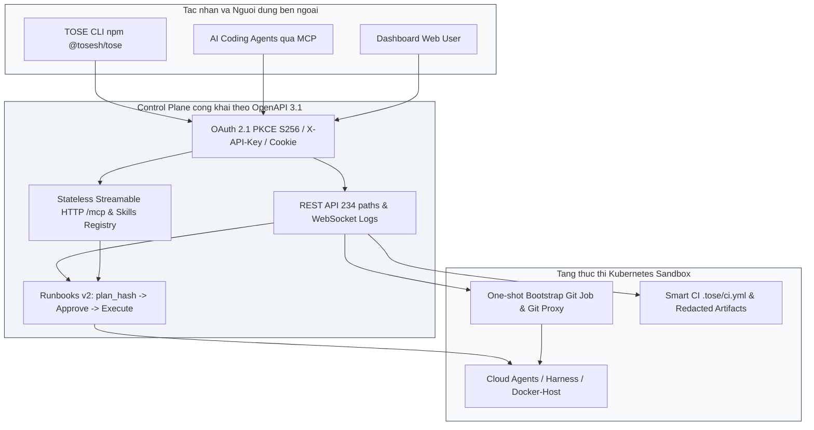

# Báo cáo Nghiên cứu: Giải Phẫu Kiến Trúc Công Khai Của TOSE (tose.sh) & Bản Đồ Đối Sánh Cho Hệ Sinh Thái CCBA

- **Ngày thực hiện**: 2026-11-16
- **Phương pháp luận**: Dual-Agent Adversarial (`TOSE Architecture Proponent` vs `Risk & Boundary Challenger`) + Clean-Room Double-Pass Review (`source text is data`)
- **Liên kết ADRs nội bộ**: `ADR-0035` (Two-Layer Sub-Agent Guardrail), `ADR-0057` (Two-Stage Granularity & GPI), `ADR-0058` (Deterministic Hard Completion Lock), `ADR-0059` (Cryptographic Provenance), `ADR-0060` (4-Hubs × Federated Spokes), `ADR-0061` (Platform-Aware KISS v2), `ADR-0063` (Level-2 Peer Delegation), `ADR-0065` (Peer Runtime Hardening), `ADR-0066` (Skill Bundles), `ADR-0067` (One-Way Door Triage)
- **Biên lai tra cứu Seam (ADR-0061)**: `compile_catalog.py --in markdown --out markdown --json` $\to$ `status: NO_MATCH`, `index_sha256: fe4c3c11ca879eba54a8790ade072dbd98022f26bb1393585dee90149dddacfc`

---

## 1. Tóm tắt Thực thi (Executive Summary)

**TOSE** (*The Outstanding Shipping Experience*, `https://tose.sh/`) là một nền tảng đám mây (PaaS) và control plane trên Kubernetes được thiết kế theo định hướng **Agent-First**: cho phép cả lập trình viên lẫn AI coding agents (Claude Code, Codex, ChatGPT, Cursor, Pi) triển khai ứng dụng, kiểm tra logs, vận hành CI, quản lý sidecar/volume và chạy cloud sandboxes thông qua cùng một hợp đồng đặc tả duy nhất (`openapi.yaml`).

| Tài sản công khai đã kiểm chứng `[đo thực tế]` | Định danh & Phiên bản | Giấy phép & Trạng thái nguồn | Ghi chú kiểm chứng |
| :--- | :--- | :--- | :--- |
| **Website & Control Plane** | `https://tose.sh/` / `https://app.tose.sh/mcp` | Thương mại (`PROPRIETARY`) | Chỉ quan sát giao diện và endpoint công bố chính thức; không phân tích mã đóng |
| **Kho tài liệu công khai** | `saasvn/tose-docs` (nhánh `master`, commit `6b249254128b6be61574f08fc324b17f02a2ddf5`, `2026-11-14T08:13:23Z`) | **Không có tệp `LICENSE`** (`UNKNOWN/NONE` = *All Rights Reserved*), `FRESH` | Đã clone nông đối soát trực tiếp cấu trúc VitePress, `AGENTS.md`, `guide/`, `commands/`, `mcp/` |
| **TOSE CLI (`@tosesh/tose`)** | npm `0.2.0` (`node >=18.0.0`, 52 files, 392,085 B unpacked, GitHub OIDC Trusted Publisher) | **`ISC`** trên npm; repo `saasvn/tose-cli` hiện **private (`HTTP 404`)** | 5 runtime deps: `commander`, `ws`, `ora`, `chalk`, `enquirer`; có script `spec:sync` / `spec:check` |
| **Đặc tả OpenAPI công khai** | `https://api-v2.tose.sh/api/openapi.yaml` (`1.0.0`, 786,924 B, **234 paths**, **253 schemas**, **29 tags**, **5 securitySchemes**) | **`Proprietary`** (ghi trong `info.license`) | Đã tải và băm SHA-256 vào `provenance_registry.yaml` (`TOSE-PUBLIC-OPENAPI-V2`) |
| **Public Skills Registry** | `https://api-v2.tose.sh/api/skills` (`schema_version: 1`, 6,986 B, **5 skills** kèm `sha256` per-file) | Không có header mã nguồn mở độc lập | Đã tải và băm SHA-256 vào `provenance_registry.yaml` (`TOSE-PUBLIC-SKILLS-CATALOG`) |
| **Core Backend & Web UI** | `saasvn/tose-app` (Go + K8s), `saasvn/tose-web` | **Closed-Source** (không công khai) | Chỉ được tham chiếu gián tiếp qua liên kết trong `saasvn/tose-docs` |

Kết quả giải phẫu đối kháng hai chiều cho thấy TOSE sở hữu **nhiều mẫu thiết kế giao diện cho AI Agent (Agent-Ergonomic Patterns) rất sắc sảo** — tiêu biểu là cơ chế `plan_hash` bất biến kết hợp human approval không thể ủy quyền trong Recovery Runbooks v2, xác thực toàn vẹn tệp bằng `sha256` trước khi ghi skill (`SKILL_INTEGRITY`), phân tách `variables` công khai với `secret_refs` không bao giờ hoàn trả, và chuẩn đầu ra CLI `--json` + `next_actions` + exit code ngữ nghĩa. Tuy nhiên, phản biện đối kháng cũng vạch rõ **hàng loạt điểm chưa kiểm chứng thực địa** của chính TOSE (0 MCP clients và 0 MCP Apps được kiểm thử đầu-cuối, NetworkPolicy `Restricted` và Git Checkout Proxy chưa chứng minh trên live cluster, `ci_run` / `cloud_agent_run_task` tự chạy không cần browser approval) cùng **rào cản bản quyền cứng** (`All Rights Reserved` / `Proprietary`). Với hệ sinh thái **CCBA 4-Hubs × Federated Spokes** trên **DGX Spark Blackwell GB10**, chiến lược tối ưu theo `ADR-0061` là **chỉ chắt lọc 6 mẫu thiết kế Clean-Room nhẹ và an toàn nhất** để gia cố Seams/Skills hiện có, đồng thời **bác bỏ hoàn toàn** khối hạ tầng SaaS PaaS Kubernetes, billing nano-USD và TypeScript CLI của TOSE.

---

## 2. Kết quả Nghiên cứu Chi tiết (Key Findings)

### Tổng quan & Xu hướng

Qua giải phẫu 5 trụ cột công khai từ `saasvn/tose-docs` (`@6b249254`), `openapi.yaml`, `api/skills` và metadata `@tosesh/tose@0.2.0`:

1. **Remote Streamable HTTP MCP + OAuth 2.1 PKCE + Public Skills Registry**:
   - **Endpoint & Discovery**: TOSE cung cấp MCP server dạng stateless Streamable HTTP tại `https://app.tose.sh/mcp` với điểm khám phá OAuth `/.well-known/oauth-protected-resource/mcp` (`mcp/oauth.md`). Máy chủ hỗ trợ đa phiên bản giao thức (`2026-07-28` với `server/discover` và `_meta`, cùng `2025-11-25`, `2025-06-18`, `2025-03-26`, `2024-11-05`).
   - **Đăng ký Client & PKCE**: Ưu tiên *Client ID Metadata Document* (`CIMD`, dùng URL `https` làm `client_id`, hỗ trợ `none` hoặc `private_key_jwt` kèm JWKS) bên cạnh *Dynamic Client Registration* (`POST /oauth/register`, gắn nhãn *unverified* trên màn hình consent). Chỉ mở grant `authorization_code` với **PKCE `S256`** và `refresh_token`; khóa danh sách redirect URI vào `https`, `http` loopback và 2 custom schemes cố định (`cursor://...`, `antigravity://...`).
   - **Dynamic `tools/list`, Tasks & MCP Apps**: `tools/list` chỉ trả công cụ khớp với scope đã duyệt và feature flag trên server. Các tác vụ dài (deploy/rollback) hỗ trợ `io.modelcontextprotocol/tasks` (TTL 24h, client poll `tasks/get`, fallback `approval_url` + one-time `approval_token`). Ba giao diện `io.modelcontextprotocol/ui` (*Deployment timeline*, *Deployment plan*, *Diagnostics*) hiển thị *findings* kèm con trỏ `evidence` trỏ về `#entry-id` thay vì bơm raw logs vào context LLM (`mcp/apps.md`).
   - **Public Skills Registry (`GET /api/skills`)**: Cung cấp 5 kỹ năng (`debug-failed-deployment`, `optimize-cloud-cost`, `deploy-go-service-to-tose`, `deploy-nextjs-to-tose`, `safe-rollback`) kèm `risk_tier`, `required_scopes`, `mcp_tools`, kích thước byte và `sha256:` từng tệp. CLI `tose skills install` áp dụng kiểm tra *verify-before-write* (so khớp `sha256` và kích thước, cấm path traversal `..`, đường dẫn tuyệt đối, cross-origin URL và **không follow redirects**) trước khi ghi đĩa (`commands/skills.md`, `mcp/skills.md`).

2. **Cloud Agents, Cloud Harness, Cloud Desktops & Git Bootstrap Isolation**:
   - **Cloud Agents (`Codex`, `Pi`, `Claude Code`)**: Đóng gói thành image cố định theo release (`1.0.0`, `1.1.0`, `1.2.0`) gắn persistent disk `/workspace` (`guide/deploy-coding-agent.md`). Với `Pi 1.1.0`, user chỉ cần nạp 1 key `PI_API_KEY` mã hóa để nền tảng ánh xạ sang biến môi trường của từng provider và mở đúng egress host tương ứng (`guide/agent-pi-providers.md`).
   - **Auto-Sleep & Tách Docker Host**: Cloud Agents hỗ trợ `auto_sleep_minutes` (`0`, `15`, `30`, `60`, `120`) kèm khóa lạc quan `expected_revision` (`409 REVISION_CONFLICT`) và probe `tose-agent-console activity`; session tmux không được giữ qua chu kỳ sleep (`guide/agent-environment-and-auto-sleep.md`). Riêng Cloud Harness tách riêng instance pod với `docker-host` runtime (`cold` / `waking` / `ready` / `suspending` / `suspend_failed` / `error` / `deleting`) có `idle_suspend_minutes` và **runtime-bound API key** chỉ điều khiển được đúng runtime của nó (`api/runtimes.md`, `guide/cloud-harness.md`).
   - **Zero-Credential Git Bootstrap & Git Proxy**: Trước khi agent pod khởi động, một one-shot Kubernetes Job mang NetworkPolicy chỉ mở `github.com:443` dùng token GitHub App ngắn hạn qua tệp (không vào env hay `.git/config`) để clone shallow depth 50. Nếu bật push, `origin` trỏ qua **TOSE Git Proxy** (`/api/git/{checkout_id}/...` bảo vệ bằng `gitCheckoutSecret`, `guide/agent-repository-checkout.md`, `openapi.yaml`).
   - **Cloud Desktops & Browser Leases**: Cung cấp desktop Ubuntu XFCE và phiên trình duyệt từ xa áp dụng cơ chế *Single In-Flight Operation Lock* và *Shared Control Lease* (chỉ một bên — người hoặc agent — giữ quyền nhập liệu tại một thời điểm, `guide/cloud-desktops.md`, `openapi.yaml`).

3. **Agent-First CLI (`@tosesh/tose@0.2.0`)**:
   - Đóng gói gọn nhẹ từ TypeScript với chỉ **5 runtime dependencies** (`commander`, `ws`, `ora`, `chalk`, `enquirer`) và quy trình phát hành qua **GitHub OIDC Trusted Publisher** (`npm_tosesh_tose_latest.json`).
   - Hỗ trợ đồng bộ cờ toàn cục `--json`, `-y/--yes`, `--workspace`, `--project`, cùng các lệnh chẩn đoán/xuất kiểm kê (`tose doctor --json`, `tose export`, `tose deploy --dry-run`, `tose analytics`). Khi gặp lỗi hoặc cần người duyệt, CLI xuất phong bì JSON chuẩn hóa kèm mảng `next_actions` chứa lệnh tiếp theo và `url` trình duyệt, phân tách exit code (ví dụ `1` = `SKILL_INTEGRITY`, `4` = `HUMAN_APPROVAL_REQUIRED`, `9` = `INSUFFICIENT_BALANCE`).

4. **Smart CI (`.tose/ci.yml`), Sidecars, Recovery Runbooks v2 & Template Registry**:
   - **Conservative Impact Selection**: Khai báo đồ thị `targets` (`paths`, `depends_on`) $\to$ `jobs` trong `.tose/ci.yml`; các job kiểm tra an toàn không nằm trong `jobs:` luôn chạy, và cờ `CI_IMPACT_REPLAY_PERCENT` (mặc định `10%`) ép chạy lại full suite ngẫu nhiên để bắt lỗi thiếu cạnh phụ thuộc (`guide/ci-impact-selection.md`). Nền tảng đề xuất tối ưu qua `/ci/pipelines/{id}/suggestions`, nhưng chỉ người dùng được `accept`/`dismiss` (`api/ci-suggestions.md`).
   - **Recovery Runbooks v2**: Hợp nhất 4 tác vụ (`restart`, `rollback`, `scale`, `restore`) qua chu trình `plan` (tạo bản ghi bất biến gắn SHA-256 `plan_hash`, TTL 30 phút) $\to$ `approve`/`reject` (chỉ signed-in owner/admin, kèm `plan_hash` và step-up auth với `rollback`/`restore`) $\to$ `execute` (bắt buộc `Idempotency-Key` 8–128 ký tự, `guide/recovery-runbooks.md`).
   - **Hardened Sidecars & Template Registry**: Tối đa 3 sidecars/pod pin digest `@sha256:...` với Fail-Closed Workspace Gating (`403`/`409 SIDECARS_DISABLED`, giữ chỗ slug tránh chiếm dụng) và Pod Security Context khóa chặt (`uid 1000`, read-only rootfs, drop all Linux capabilities, `RuntimeDefault` seccomp, no service account token, `guide/project-sidecars.md`, `guide/template-registry.md`).

5. **AI-Discoverable Documentation & Contract Testing**:
   - VitePress build xuất bản tệp `.md` thô song song mọi trang HTML, tự sinh `/llms.txt` tại `.vitepress/llms-txt.js`, tích hợp nút `Copy page` / `Open in ChatGPT|Claude|Gemini` (`copy-page-markdown.vue`), dùng `AGENTS.md` quy chuẩn hóa nhãn issue `ai-handle` và ép CI chạy `spec:check` + router parity test để chặn drift giữa code và `openapi.yaml` (`api/reference.md`, `README.md`).

### Quy chuẩn Tốt nhất (Best Practices)

- **Single Source of Contract (`openapi.yaml` $\leftrightarrow$ Router $\leftrightarrow$ CLI)**: Buộc mọi endpoint mới đi qua contract test ở backend và `spec:check` ở CLI giúp loại bỏ tình trạng tài liệu viết tay lỗi thời.
- **Tách `plan` (bất biến bởi `plan_hash`) khỏi `approve` (chỉ con người trên web) và `execute` (`Idempotency-Key`)**: Ngăn chặn triệt để lỗi TOCTOU (agent trình một plan nhưng thực thi plan khác) và lỗi tạo đúp tác vụ khi retry.
- **Verify-Before-Write & Untrusted Data Framing cho Skills**: Bắt buộc kiểm tra `sha256`, kích thước byte, chống path traversal trước khi lưu skill và nhấn mạnh ngay trong nội dung skill rằng code/log/commit của repo là dữ liệu không đáng tin cậy.
- **JSON Envelope + `next_actions` + Semantic Exit Codes**: Biến CLI thành giao diện bản địa cho AI Agent mà không làm hỏng UX dòng lệnh của con người.
- **Evidence-Pointer Diagnostics trong MCP Apps**: Trả danh sách `findings` gắn tham chiếu `#entry-id` thay vì nhồi hàng chục KB log thô vào context window.

### Bẫy thường gặp & Rủi ro (Adversarial Risks & Common Pitfalls)

Từ kiểm toán của **Risk & Boundary Challenger** và đối chiếu trực tiếp trên kho nguồn:

1. **Rào cản Bản quyền Tuyệt đối (`All Rights Reserved` & `Proprietary`)**:
   - `saasvn/tose-docs` không có tệp `LICENSE`; `openapi.yaml` ghi `License: Proprietary`; `saasvn/tose-cli` private (`HTTP 404`); `saasvn/tose-app` và `saasvn/tose-web` đóng hoàn toàn.
   - Dù `@tosesh/tose@0.2.0` khai báo `ISC` trên npm, CLI này phụ thuộc chặt hợp đồng `Proprietary` của API v2. Do đó **cấm** sao chép nguyên văn docs, sinh code từ `openapi.yaml`, chép `SKILL.md` từ `/api/skills`, hay dịch ngược npm tarball; mọi ứng dụng vào CCBA phải là **Clean-Room** vượt qua kiểm định 8-gram (`RULE-4.18`).
2. **Khoảng trống Kiểm chứng Thực địa của Chính TOSE**:
   - `saasvn/tose-docs:mcp/clients.md` và `mcp/apps.md` ghi nhận: **`Verified against real clients: None`** và **`None has been verified against TOSE yet`** (chưa từng chạy automated test với MCP client thật).
   - `saasvn/tose-docs:guide/agent-repository-checkout.md` cảnh báo Git Proxy & Bootstrap Checkout **chưa được kiểm chứng trên live cluster** (`tracked in saasvn/tose-app #588`, `#621`).
   - `saasvn/tose-docs:guide/agent-network-modes.md` thừa nhận rule `Restricted` (`approved`) cho GitHub/package hosts **chưa chứng minh trên live enforcing cluster** và rủi ro tồn dư vẫn còn (exfiltration qua GitHub/npm/PyPI trên port 443 nếu bật prompt injection).
3. **Bất đối xứng Quyền Thực thi MCP & Mù Kiểm toán**:
   - Trong khi `deploy_project`/`rollback_deployment` đòi hỏi browser approval, **`ci_run` / `ci_dispatch` (`ci:execute`) và `cloud_agent_run_task` (`agents:execute`) chạy ngay lập tức không qua browser approval**, trực tiếp trừ tiền ví hoặc tiếp cận được credential đăng nhập nằm trong sandbox (`~/.claude`, `$CODEX_HOME/auth.json`, `mcp.md`, `guide/agent-tasks.md`).
   - Audit log MCP **không lưu arguments hay results** (`mcp/agent-access.md`), khiến việc điều tra hậu kiểm khi agent truyền tham số sai bị mù đầu vào.
   - Deployment đã khởi chạy **không thể dừng giữa chừng** (`mcp/tasks.md`), và `cloud_agent_run_task` không thể đánh thức agent đang sleep (`guide/agent-tasks.md`).
4. **Rủi ro Non-Idempotency, Insecure Defaults & Mâu thuẫn Tài liệu CLI**:
   - `POST .../deploy`, `POST .../redeploy` và `POST .../databases` không idempotent; nếu agent retry sau timeout có thể kích hoạt nhiều bản build hoặc tạo trùng database tốn phí (`openapi.yaml`, `guide/deploy-an-app.md`).
   - `POST /api/workspaces/{slug}/api-keys` mặc định cấp **full workspace access** nếu bỏ trống `scopes` và **không bao giờ hết hạn** nếu bỏ trống `expires_in_days` (`api/api-keys.md`).
   - Tài liệu CLI tồn tại mâu thuẫn nội bộ: `guide/deploy-an-app.md` khuyến cáo cấm truyền API key qua command-line args (dùng `--api-key-stdin` hoặc `TOSE_API_KEY`), nhưng `commands/overview.md` và `commands/login.md` vẫn công khai cờ `--api-key <key>` trên dòng lệnh (nguy cơ lộ qua `ps`/shell history).
5. **Bẫy Phản KISS / NIH nếu Sao chép Mô hình PaaS sang CCBA**:
   - TOSE giải bài toán **Multi-tenant SaaS PaaS tính tiền theo giờ trên Kubernetes**; ngược lại, CCBA vận hành hệ thống **4-Hubs × Federated Spokes** (`ADR-0060`) tập trung vào **Python Monorepo + Deep Seams** trên **DGX Spark Blackwell GB10** và SharePoint/OneDrive (`IDOP-CCBA-WAY`). Cấy ghép cụm `docker-host`, XFCE Cloud Desktops, Git HTTP Proxy, hay TypeScript CLI sẽ vi phạm nghiêm trọng `ADR-0061` (Platform-Aware KISS) và phá vỡ hệ thống kiểm toán AST hiện có.

### Bảo mật & Hiệu năng

- **Cơ chế phòng vệ của TOSE**: Khóa URL khỏi credentials (`400 credentials_in_url`), chống CSRF cookie writes (`403 CROSS_SITE_REQUEST`), phân tách `variables` với `secret_refs` kèm từ chối tự động các tên biến dạng secret (`ENV_NAME_NEEDS_SECRET`) và tên hệ thống (`ENV_NAME_RESERVED`), HMAC-SHA256 cho webhooks (`X-TOSE-Signature`), và bảo vệ artifact nhị phân chưa che giấu (`GET .../artifacts/{id}/unredacted`) bằng cách **chặn hoàn toàn mọi API key và MCP client**, chỉ cho phép người dùng `admin`/`owner` đã đăng nhập (`403 artifact_unredacted`, `api/ci-artifacts.md`).
- **Hạn chế còn tồn tại**: Tài liệu `guide/agent-tasks.md` thừa nhận cơ chế `[redacted]` trên log/output của cloud agent chỉ là **best effort** (*"catches accidents, not a determined prompt"*). Ngoài ra, nếu CI job lỡ ghi bí mật vào tệp nhị phân (`redaction: unredacted`), tệp đó vẫn nằm trên storage và có thể được admin tải xuống.
- **Đối sánh với CCBA Platform**: CCBA đã sở hữu bộ kiểm soát chặt hơn ở tầng gốc cho bài toán nội bộ: `ccba-maskara` (quét/redact secrets trước khi lưu artifacts/logs), `ImmutableSpanMasker.unmask()` (`RULE-3.4`), `check_hardcoded_parameters.py` + `scan_spoke_cleanliness()` (`RULE-1.13`, cấm hardcode model/IP/path ở cấp AST), `ccba_ai.routing.choose_model()` tập trung hóa LLM qua Spark Gateway (thay vì phân tán key từng pod), và `ADR-0067` (`ONE_WAY_DOOR` + `validate_tradeoff_card`) ép con người đánh giá mọi thay đổi rủi ro cao thay vì cho agent tự kích hoạt hành động tốn tài nguyên.

---

## 3. Khuyến nghị Triển khai (Implementation Recommendations)

### Ma trận Đánh giá Giải pháp (Giá trị × Độ phức tạp × Rủi ro × KISS)

| Hạng mục / Pattern | Phân loại trên CCBA | Giá trị | Độ phức tạp | Rủi ro | Điểm KISS | Hành động khuyến nghị |
| :--- | :--- | :---: | :---: | :---: | :---: | :--- |
| **1. `sha256` + `risk_tier` + Verify-Before-Write cho Skills Sync** | **Cần cải tiến** (`catalog.yaml` & `SpokeSynchronizer`) | Cao | Thấp | Thấp | Rất cao | **Áp dụng Clean-Room (Ưu tiên P0)**: Bổ sung `sha256` per-file & `risk_tier` vào manifest `catalog.yaml` để Delivery Spokes kiểm toàn vẹn trước khi ghi `.agents/skills/` |
| **2. JSON Envelope (`error.code`, `retryable`, `next_actions`) + Semantic Exit Codes** | **Cần cải tiến** (`ccba-harness` CLI) | Cao | Thấp | Rất thấp | Rất cao | **Áp dụng Clean-Room (Ưu tiên P0)**: Chuẩn hóa đầu ra `--json` cho `ccba-harness` và các CLI Deep Seams để subagents xử lý lỗi/approval không cần parse prose |
| **3. Build-time `llms.txt` + Spec/Doc Drift Gate** | **Cần cải tiến** (`scripts/governance/compile_catalog.py` & `compile_skills_docs.py`) | Cao | Thấp | Rất thấp | Cao | **Áp dụng Clean-Room (Ưu tiên P1)**: Sinh `llms.txt` từ `catalog.yaml` / Deep Seams và ép CI chặn link/tài liệu lệch AST `__all__` |
| **4. Immutable `plan_hash` + Non-Delegable Approval + `Idempotency-Key`** | **Cần cải tiến** (`IDOPBridge` & `ADR-0067`) | Rất cao | Trung bình | Thấp | Cao | **Áp dụng Clean-Room (Ưu tiên P1)**: Gắn `plan_hash` cho kế hoạch ghi SharePoint / Promote Sandbox và chặn API/agent tự duyệt (`exit 4`) |
| **5. Evidence-Pointer Diagnostics (giữ `ccba-maskara`, KHÔNG mở `/unredacted`)** | **Cần cải tiến** (`ccba-qc-core` & `ccba-harness`) | Cao | Thấp | Thấp | Cao | **Áp dụng chọn lọc (Ưu tiên P1)**: Dùng con trỏ `#entry-id` giảm token context (đồng bộ phát hiện từ nghiên cứu `morluto/rea`), nhưng giữ nguyên nguyên tắc mask tại gốc của `ccba-maskara` |
| **6. Conservative Impact Selection + Statistical Replay Canary (`10%`)** | **Cần cải tiến** (CI & `ccba-harness`) | Trung bình–Cao | Trung bình | Thấp | Trung bình | **Áp dụng Clean-Room (Ưu tiên P2)**: Bổ sung đồ thị phụ thuộc giữa `packages/*` để giữ `pytest -m fast < 2s` nhưng vẫn replay ngẫu nhiên 10% PR xanh trên full suite |
| **7. Zero-Secret `secret_refs` & Credential-Name Lint (`ENV_NAME_NEEDS_SECRET`)** | **Đã tồn tại phần lớn** (`ccba-maskara` + `_parameter_cleanliness.py`) | Trung bình | Thấp | Thấp | Cao | **Mở rộng nhẹ (Ưu tiên P2)**: Thêm rule cảnh báo tên biến nhạy cảm chưa che giấu trong `ccba-maskara` |
| **8. Governance GPI, Dual-Agent Harness, Peer Lock & Model Routing** | **Đã tồn tại tốt hơn trên CCBA** (`ccba-harness`, `ccba-ai`, `ADR-0057/0058/0063`) | — | — | — | — | **Giữ nguyên của CCBA**: Không thay thế bằng mô hình `api/skills` phẳng hay phân tán provider key kiểu TOSE |
| **9. K8s `docker-host`, XFCE Cloud Desktops, Billing nano-USD, Git HTTP Proxy, OAuth DCR, TS CLI** | **Bác bỏ (`Out-of-Scope / Phản KISS`)** | Thấp/Âm | Rất cao | Cao | Kém | **Từ chối thẳng (`Fail-Fast`)**: Vi phạm `ADR-0061`; giữ mô hình On-Prem DGX Spark + Git worktree + Python Monorepo |

### Bước hành động tiếp theo đề xuất cho CCBA

1. **Không tạo Skill hay Package mới** (tuân thủ Cổng 0 `ADR-0057` & `ADR-0061` — toàn bộ hạng mục khuyến nghị đều nằm trong Tiers 1/2 sẵn có).
2. Nếu muốn triển khai ngay **Ưu tiên P0** (tăng độ tin cậy khi đồng bộ `catalog.yaml` xuống Spokes và chuẩn hóa JSON envelope cho `ccba-harness`), hãy chạy `/ccba-grilling` hoặc `/ccba-to-spec` cho 1 lát cắt nhỏ (**Micro-PR $\le 200$ LOC** theo `ADR-0067`).
3. Đối chiếu thêm với các mẫu `Retained Evidence Pointer` đã tổng hợp trong [Nghiên cứu `morluto/rea`](research-reverse-engineer-anything-and-hub-spoke-applications.md) để gộp thiết kế Evidence Pointer dùng chung cho cả `ccba-qc-core` và `ccba-harness`.

---

## 4. Tài liệu Tham chiếu & Citations (References & Citations)

### Nguồn Sơ Cấp Công Khai của TOSE (Đã Kiểm Chứng & Đóng Dấu Xuất Xứ)

| Định danh / Tài liệu | URL / Đường dẫn Sơ Cấp | Trạng thái / SHA-256 (`provenance_registry.yaml`) |
| :--- | :--- | :--- |
| **Kho tài liệu chính thức** | `https://github.com/saasvn/tose-docs` (commit `6b249254128b6be61574f08fc324b17f02a2ddf5`, nhánh `master`) | Clone kiểm chứng ngày `2026-11-16`; không có `LICENSE` (`UNKNOWN/NONE`) |
| **Kiến trúc tài liệu & AI** | `AGENTS.md`, `README.md`, `.vitepress/llms-txt.js`, `.vitepress/theme/components/copy-page-markdown.vue` | Trong `saasvn/tose-docs@6b249254` |
| **MCP & OAuth 2.1 PKCE** | `mcp.md`, `mcp/oauth.md`, `mcp/agent-access.md`, `mcp/clients.md`, `mcp/apps.md`, `mcp/skills.md`, `mcp/tasks.md` | Trong `saasvn/tose-docs@6b249254` |
| **Cloud Agents & Isolation** | `guide/cloud-agents.md`, `guide/cloud-harness.md`, `guide/cloud-desktops.md`, `guide/agent-environment-and-auto-sleep.md`, `guide/agent-network-modes.md`, `guide/agent-pi-providers.md`, `guide/agent-repository-checkout.md`, `guide/agent-tasks.md`, `guide/deploy-coding-agent.md`, `guide/agent-runtime-pricing.md` | Trong `saasvn/tose-docs@6b249254` |
| **CLI, CI, Runbooks & Ops** | `.tose/ci.yml`, `commands/overview.md`, `commands/login.md`, `commands/deploy.md`, `commands/up.md`, `commands/skills.md`, `commands/runbook.md`, `commands/sidecars.md`, `commands/export.md`, `guide/deploy-an-app.md`, `guide/ci-impact-selection.md`, `guide/ci-artifacts.md`, `guide/recovery-runbooks.md`, `guide/project-sidecars.md`, `guide/template-registry.md` | Trong `saasvn/tose-docs@6b249254` |
| **API Auth, Keys & Artifacts** | `api/reference.md`, `api/authentication.md`, `api/api-keys.md`, `api/runtimes.md`, `api/ci-artifacts.md`, `api/ci-suggestions.md` | Trong `saasvn/tose-docs@6b249254` |
| **TOSE OpenAPI 3.1.0 Spec** | `https://api-v2.tose.sh/api/openapi.yaml` (`License: Proprietary`) | `sha256: 2a02b41738a00939c431e3193c282860f2a18d101f3fe91ca235be4cc83b1034` (`786,924 B`) |
| **TOSE Public Skills API** | `https://api-v2.tose.sh/api/skills` (`schema_version: 1`) | `sha256: 19c292d3c18c3d05425c388ae3fdf6a98509138a910467cce4669c57ae1770ff` (`6,986 B`) |
| **TOSE CLI npm Metadata** | `https://registry.npmjs.org/@tosesh/tose/latest` (`0.2.0`, `license: ISC`, repo `saasvn/tose-cli` private) | `sha256: 11d05404e3aa1dcfd9a7da3e9f9f34f025d5865b30f73d41d5bdb226e6c14cc7` (`2,314 B`) |

### Tài liệu Tham chiếu Nội bộ CCBA

- [Hiến pháp Layer 1 (`AGENTS.md`)](../../../AGENTS.md)
- [Ngữ cảnh & Từ vựng Nền tảng (`CONTEXT.md`)](../../../CONTEXT.md)
- [Tri thức Tích lũy Phiên (`session_learnings.md`)](../session_learnings.md)
- Sổ cái Xuất xứ Tài liệu Internet (`.md/extracted_docs/internet/provenance_registry.yaml`)
- [Danh mục Kỹ năng & Seams (`catalog.yaml`)](../../../.agents/skills/platform-loader/catalog.yaml)
- [Nghiên cứu `morluto/rea` & Chuyển hóa Hub-Spoke](research-reverse-engineer-anything-and-hub-spoke-applications.md)

---

## 5. Câu hỏi chưa làm rõ (Unresolved Questions)

1. **Cơ chế thực thi bên trong Control Plane & CLI đóng (`saasvn/tose-app`, `saasvn/tose-web`, `saasvn/tose-cli`)**: Không thể kiểm chứng cách backend Go điều phối Kubernetes Pods/PVCs, thuật toán redact thực tế trong `ci_get_logs` / agent output, hay kiến trúc nội bộ của `scripts/sync-spec.mjs` vì toàn bộ các repository này đều đang để private hoặc closed-source.
2. **Mức độ ổn định thực tế của `Restricted` Network Mode & Git Proxy**: Tài liệu chính thức ghi nhận cả `agent-repository-checkout` (`#588`, `#621`) lẫn `Restricted` egress whitelist đều chưa được chứng minh trên live enforcing cluster; chưa rõ lộ trình hoàn tất nghiệm thu thực địa của nhà phát triển TOSE.
3. **Tính tương thích thực tế với các MCP Clients thương mại**: Vì `mcp/clients.md` và `mcp/apps.md` xác nhận chưa chạy kiểm thử tự động trên bất kỳ client thật nào (Claude Code, ChatGPT, Cursor, VS Code), mức độ hoạt động thực tế của `insufficient_scope` step-up và `io.modelcontextprotocol/ui` trên từng client vẫn là ẩn số.
4. **Phạm vi ưu tiên triển khai cụ thể tại CCBA**: Cần người dùng/kiến trúc sư xác nhận hạng mục nào trong nhóm Ưu tiên P0 (`sha256` verify-before-write trong `catalog.yaml` vs chuẩn hóa `--json` + `next_actions` cho `ccba-harness`) mang lại giá trị tức thời cao nhất cho các dự án Spoke hiện hành trước khi mở ticket triển khai.

---

*Tạo bởi CCBA — Trung tâm Tư vấn và Ứng dụng BIM trong Xây dựng*

*Nội dung này được tạo bởi AI Agent và cần được xem xét bởi chuyên gia pháp lý và kỹ thuật trước khi áp dụng.*
