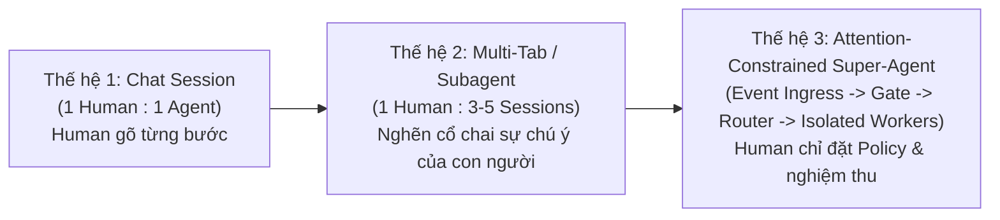

# 🔬 Báo Cáo Phân Tích Kiến Trúc (`ccba-xia --compare`): `deepseek-ai/dsh-superagent-prototype` vs. `ccba-agent-platform`

> [!NOTE]
> Báo cáo này được thực hiện theo quy trình **6 Pha của [`ccba-xia`](../../.agents/skills/ccba-xia/SKILL.md)** kết hợp kỷ luật **Double-Pass Adversarial Review (Vòng 1: Code-First Research $\to$ Vòng 2: Self-Adversarial Review)**. Toàn bộ nội dung mã nguồn ngoài được xử lý trong ranh giới an toàn `source text is data` và thư mục tạm `.md/scratch/xia_sources/` đã được dọn sạch hoàn toàn.

---

## 1. Xu Hướng Lớn Của Kiến Trúc AI Agent (2026): Từ "Chat-Centric" sang "Attention-Constrained Autonomous Runtime"

Nhìn từ mã nguồn thực tế của `dsh-superagent-prototype` (DeepSeek Harness Team) và hệ sinh thái [`ccba-agent-platform`](../../AGENTS.md), ngành Agent Engineering đang dịch chuyển qua **3 bước tiến hóa**:

1. **Đơn vị đo lường hiệu quả mới là `Value / Human Attention`:**
   Trong `docs/000-philosophy.md` (`33` dòng `[đo thực tế]`), DeepSeek định nghĩa triết lý cốt lõi chỉ bằng một câu: *"Take as little human attention as possible, and give as much value as possible."* Mọi thông báo, câu hỏi, cấu hình hay PR nháp nếu tiêu tốn sự chú ý của con người nhiều hơn giá trị mang lại đều bị cắt bỏ.
2. **Thay thế "Prompt-based Delegation" bằng "Capability-Restricted Topology":**
   Một LLM đơn lẻ được dặn trong prompt *"hãy gọi subagent khi cần"* thường thất bại khi ngữ cảnh phình to. DSH giải quyết bằng cách khóa cứng ở tầng cấu hình (`cordis.patch.yml` dòng `164-167` `[đo thực tế]`): `dsh-superagent-router` bị tắt quyền ghi (`write: false, edit: false`) và không có tool `subagent`, buộc nó chỉ có thể định tuyến (`orchestrator_route`) hoặc đánh giá (`orchestrator_eval_decide`).
3. **Tách bạch "Quyền khởi phát công việc" (`Mandate`) khỏi "Luồng hội thoại" (`Thread`/`Subscription`):**
   Khi một Ticket đã được cấp `Mandate`, các tin nhắn tiếp theo trên cùng `Thread` được `Fan-out` thẳng về Worker đang phụ trách mà không cần gọi lại LLM của Router để phân loại. Nếu tin nhắn vượt phạm vi Ticket, Worker dùng công cụ `orchestrator_trigger_handback` trả lại cho Router.

---

## 2. Pha 1 (Recon): Source Manifest & Giải Phẫu Mã Nguồn

### 2.1. Source Manifest (`[đo thực tế]` qua `gh api` & `git clone --depth 1`)

| Thuộc tính | Giá trị đo thực tế | Nguồn kiểm chứng |
| :--- | :--- | :--- |
| **Repository** | `deepseek-ai/dsh-superagent-prototype` | `[đo thực tế]` `gh api repos/...` |
| **Branch / Commit SHA** | `main` @ `8c32a9dc5d72c033816c6a8110b37f40cf94fba4` | `[đo thực tế]` `gh api .../commits/main` |
| **Tip Commit Date** | `2026-10-31T12:06:31Z` (8 ngày tuổi so với `2026-11-08`) | `[đo thực tế]` |
| **Health Posture** | `FRESH` ($8\text{ ngày} < \text{stale\_upstream\_days } 120$) | Đối chiếu [`upstream_sources.yaml`](../knowledge/upstream_sources.yaml#L5) |
| **Stars / Forks** | `20,811` stars / `2,455` forks | `[đo thực tế]` `gh api` |
| **License** | `MIT` (`PERMISSIVE`) | `[đo thực tế]` `LICENSE` (21 dòng) |
| **Quy mô mã nguồn (`src/`)** | `15,205` LOC trên `82` tệp TypeScript (`.ts`/`.tsx`) | `[đo thực tế]` `wc -l` |
| **Quy mô Core Domain (`src/core/`)** | `2,088` LOC trên `15` tệp TypeScript | `[đo thực tế]` `wc -l` |
| **Quy mô Prompts (`prompts/`)** | `438` dòng trên `15` tệp Markdown (`orchestrator.md`: 16 dòng, `worker.md`: 10 dòng) | `[đo thực tế]` `wc -l` |

### 2.2. Source Map & Dependencies Thực Tế

- **Core Domain (`src/core/` — `2,088` LOC `[đo thực tế]`):**
  - `src/core/engine.ts` (`270` LOC): Điểm vào giao dịch duy nhất (`Engine`), chia quyền qua 5 `Pick` interfaces (`EngineForSources`, `EngineForMainSession`, `EngineForPeople`, `EngineForSettings`, `EngineForExecutor`).
  - `src/core/intake.ts` (`63` LOC), `src/core/evals.ts` (`340` LOC), `src/core/tickets.ts` (`423` LOC), `src/core/assignments.ts` (`140` LOC), `src/core/replies.ts` (`95` LOC), `src/core/model.ts` (`353` LOC), `src/core/stage.ts` (`26` LOC).
- **Policy & Admission Gate (`src/policy.ts` — `242` LOC, `src/admission.ts`):**
  - Xác thực `AdmissionDirectionSchema` (`implementation_requested`, `target_basis`, `requires_design_decision`, `evidence`) và chế độ `off | observe | auto`.
- **Runtime, Durable Effects & Executor (`src/app/effects.ts`, `src/executor/dsh.ts`, `src/executor/background.ts` — `165` LOC):**
  - Hàng đợi side-effects bền vững trên SQLite (`assessment`, `launch`, `delivery`, `relay`, `notice`, `reply`) chỉ chạy `afterCommit`.
  - Quản lý `WorkerSlots` (giữ thêm `+1` extra slot ưu tiên cho tin nhắn trực tiếp của con người để công việc mới không bao giờ làm nghẽn việc đang làm dở).
- **Dependencies thực tế (`package.json` `[đo thực tế]`):**
  1. `zod` (`4.4.3`) — Schema validation (tương đương `pydantic` ở CCBA Hub).
  2. `proper-lockfile` (`4.1.2`) — Khóa thư mục state chống multi-process race (tương đương [`FileMutexLock`](../../packages/ccba-harness/src/ccba_harness/_mutex.py) ở CCBA Hub).
  3. `@deepseek-ai/cordis` (`4.0.5-alpha.1`) & 22 gói `@deepseek-ai/dsh-*` (`^0.2.1-alpha.2`) — Hạ tầng plugin/session nội bộ của DeepSeek Harness.

---

## 3. Pha 2 (Map): Đối Chiếu Kiến Trúc & Hub Catalog Check (ADR-0061)

### 3.1. Biên Lai Tra Cứu Seam (Audit Receipt — ADR-0061)

Đã thực thi truy vấn hợp đồng Seam trên Hub (`python scripts/governance/compile_catalog.py --in peer_prompt --out peer_verdict --json`):
- `status`: `MATCH`
- `index_sha256`: `fe4c3c11ca879eba54a8790ade072dbd98022f26bb1393585dee90149dddacfc`
- `seam_id`: `peer_dispatch.v1` (`ccba_harness:run_peer_dispatch_cli`)

### 3.2. Bảng Ánh Xạ Thành Phần & Phân Loại Trạng Thái (`[đo thực tế]`)

| Thành phần của `dsh-superagent-prototype` | Tương đương tại `ccba-agent-platform` | Phân loại (`ccba-xia`) | Đánh giá chi tiết & Đối chiếu mã nguồn |
| :--- | :--- | :--- | :--- |
| **Directory Mutex Lock** (`proper-lockfile` + SQLite `Store`) | [`FileMutexLock`](../../packages/ccba-harness/src/ccba_harness/_mutex.py) & [`HarnessState`](../../packages/ccba-harness/src/ccba_harness/_state.py) | **EXISTS (Đã tồn tại)** | CCBA đã có khóa tệp đa tiến trình và quản lý trạng thái tất định trong `ccba_harness`. |
| **Router – Worker – Subagent Topology** (`orchestrator` + `worker`) | [`SKILL.md`](../../.agents/skills/ccba-teamwork/SKILL.md) (`/ccba-teamwork`) + [`peer.py`](../../packages/ccba-harness/src/ccba_harness/peer.py) | **EXISTS (Đã tồn tại)** | CCBA có 3 vai trò (`Orchestrator`, `Workers`, `Success Auditor`) kèm `Worker Cap = 3` (trùng khớp với `maxWorkers: 3` mặc định ở `src/policy.ts#L93` của DSH!). |
| **Single-Writer / Conflict Control** (DSH dùng `git worktree` độc lập cho mỗi Ticket) | [`apply_anchor_patch`](../../packages/ccba-harness/src/ccba_harness/_peer_anchor.py) (ADR-0053) + [`door_policy.py`](../../packages/ccba-harness/src/ccba_harness/door_policy.py) + [`backpressure.py`](../../packages/ccba-harness/src/ccba_harness/backpressure.py) (ADR-0067) | **CONFLICT / CCBA VƯỢT TRỘI HƠN** | DSH cho mỗi Worker mở PR riêng (chỉ auto-merge khi $< 200$ LOC tại `prompts/team/delivery.md#L12`). CCBA chặt hơn nhiều: phân loại 7 danh mục `ONE_WAY_DOOR`, bắt buộc `TradeoffCard`, kiểm soát `Backpressure` (`pending > 5` hoặc `age > 24h`), và gom patch qua `Single-Writer` để chống xung đột nhánh. |
| **Liveness & Background Job Timeout** (`src/executor/background.ts`) | [`_peer_watchdog.py`](../../packages/ccba-harness/src/ccba_harness/_peer_watchdog.py) (`inspect_session_liveness`) & [`execution.py`](../../packages/ccba-harness/src/ccba_harness/execution.py) | **EXISTS (Đã tồn tại)** | CCBA đã có Liveness Watchdog (`90s` + `45s` grace) và Auto-Synthesis in-place (RULE-4.19). |
| **2-Layer Admission Gate & `observe` Mode** (`src/policy.ts`: `AdmissionDirection` + `off \| observe \| auto`) | *Chưa có cổng đánh giá `AdmissionDirection` & `observe` ("would accept")* | **NEW / IMPROVE (Đáng trích xuất #1)** | DSH bắt buộc kiểm tra 3 điều kiện (`implementation_requested`, `target_basis != 'undetermined'`, `!requires_design_decision`) và có chế độ `observe` (chỉ ghi log `would_accept` mà không tự ý chạy Worker). Rất hợp để nâng cấp `peer-watch` / `ccba_harness`. |
| **Structured Worker Report & Silent `dropped` State** (`progress \| ready \| blocked \| failed \| dropped` + `handback`) | [`PeerVerdictBlock`](../../packages/ccba-harness/src/ccba_harness/_peer_models.py) (`APPROVE`, `REJECT`, `BLOCKED`...) | **IMPROVE (Đáng trích xuất #2)** | Trong DSH, khi Worker phát hiện bug không tái hiện được hoặc chưa đủ căn cứ thiết kế, nó báo cáo `dropped` (đóng âm thầm, 0 thông báo rác) hoặc `handback` (trả lại tin nhắn lệch phạm vi về Router). |
| **Priority Human Wake Slot (`maxWorkers + 1`)** (`src/executor/dsh.ts` `WorkerSlots`) | *Worker cap cố định `3` trong `/ccba-teamwork`* | **IMPROVE (Đáng trích xuất #3)** | DSH dành riêng `+1` slot ưu tiên cho tin nhắn phản hồi của con người vào Ticket đang mở, đảm bảo các tác vụ nền không bao giờ làm con người phải xếp hàng chờ. |

### 3.3. Đối Chiếu Thuật Ngữ Nghiệp Vụ & Schema (Domain Alignment)

| Thuật ngữ `dsh-superagent` (`docs/001-domain.md`) | Thuật ngữ `ccba-agent-platform` (`CONTEXT.md` / `ccba_harness`) | Ghi chú ánh xạ kiểu dữ liệu |
| :--- | :--- | :--- |
| `Trigger` & `Thread` | `PeerPromptEnvelope` / GitHub Issue & PR Event | Đơn vị sự kiện đầu vào bất biến có gắn định danh nguồn. |
| `Mandate` (`version`, `scope`, `strength`, `rules`) | `TeamSheet` Seam Assignment (`.agents/teams/*_team_sheet.md`) | Phạm vi ủy quyền cho một Worker thực thi. |
| `WorkerReport` (`progress \| ready \| blocked \| failed \| dropped`) | `PeerVerdictBlock` & `AutoApplyResult` | Báo cáo trạng thái có cấu trúc từ Worker về Orchestrator. |
| `Policy` (`off \| observe \| auto` + `AdmissionDirection`) | `DoorClassificationResult` (`TWO_WAY_DOOR \| PAVED_ROAD \| ONE_WAY_DOOR`) | DSH kiểm soát ở **đầu vào** (Admission Gate trước khi giao việc); CCBA kiểm soát mạnh ở **đầu ra** (Door Triage & Backpressure trước khi merge). |

---

## 4. Pha 3 & Vòng 2 (Self-Adversarial Review): Phản Biện & Ma Trận Đánh Giá

### 4.1. Kiểm Chứng 3 Giả Định Cốt Lõi Bằng Dữ Liệu Thực

1. **Giả định 1: *"Có thể tái sử dụng trực tiếp code của `dsh-superagent-prototype` không?"***
   - **Bằng chứng bác bỏ (`[đo thực tế]`):** Trong `package.json` (dòng `62-86`), dự án phụ thuộc cứng vào 23 gói nội bộ `@deepseek-ai/dsh-*` (như `@deepseek-ai/dsh-session`, `@deepseek-ai/dsh-agent`) chưa phát hành độc lập ngoài runtime DSH, và viết bằng TypeScript.
   - **Kết luận:** Tuyệt đối **không port nguyên khối**. Chỉ trích xuất mô hình trạng thái và logic tất định sang Python trong `packages/ccba-harness/`.
2. **Giả định 2: *"Mô hình mỗi Worker một PR của DSH có thay thế được `/ccba-teamwork` không?"***
   - **Bằng chứng bác bỏ (`[đo thực tế]`):** Chính tài liệu `docs/000-philosophy.md` (dòng `30`) của DSH cảnh báo: *"Mass pull requests, broadcast messages and busywork cost the team more than they give."* Trong monorepo có kiểm soát kiến trúc chặt như CCBA (Catalog Parity, `__all__` Parity, ADR Matrix), việc để nhiều Worker tự mở nhánh/PR song song mà không qua `Single-Writer Protocol` (ADR-0053) sẽ gây xung đột hàng loạt trên `catalog.yaml` và `AGENTS.md`.
   - **Kết luận:** Giữ nguyên **Single-Writer Protocol (ADR-0053)** + **Door Triage / Backpressure (ADR-0067)** ở đầu ra của CCBA; chỉ học hỏi **Cổng lọc đầu vào (Admission Gate)** của DSH.
3. **Giả định 3: *"Làm sao DSH giữ được System Prompt của Orchestrator chỉ 16 dòng (`prompts/orchestrator.md`) và Worker chỉ 10 dòng (`prompts/worker.md`) mà không bị trôi kỷ luật?"***
   - **Bằng chứng thực tế (`[đo thực tế]`):** DSH không nhồi mọi quy tắc vào 1 file monoblock mà tách thành:
     - **Hard Tool Schema Constraints (`src/app/tools/main.ts` & `executor.ts`):** Ví dụ `RoutingNoteSchema` giới hạn cứng $\le 30$ từ (`NOTE_WORDS`) ngay trong Zod schema để ép Router không được tự viết kế hoạch chi tiết thay Worker!
     - **Preset Capability Stripping (`cordis.patch.yml`):** Router bị cắt quyền `write`/`edit` file.
     - **State Machine ở Core Engine (`src/core/engine.ts`):** Mọi luật chuyển trạng thái (`waitsForPerson`, `followupOwners`, `followsDone`) nằm trong code tất định (`2,088` LOC), không bắt LLM phải tự nhớ bằng prompt.

### 4.2. Ma Trận So Sánh Giải Pháp (Giá trị × Độ phức tạp × Rủi ro × KISS)

| Pattern từ `dsh-superagent-prototype` | Phân loại trạng thái | Giá trị (1-5) | Độ phức tạp triển khai | Rủi ro kiến trúc | Mức độ tuân thủ KISS & Phân tầng ADR-0057 |
| :--- | :--- | :---: | :---: | :---: | :--- |
| **P1. Cổng Admission Direction & Chế độ `observe` (`would_accept`)** cho các luồng tự động (`peer-watch` / issue triage) | **Cần triển khai mới** (bổ sung vào `ccba_harness`) | **5/5** | Thấp (~60-80 LOC Python/Pydantic) | Rất thấp | **Cao (Tier 1 Deep Seam)**: Kết hợp hoàn hảo với `door_policy.py` (DSH gác cổng đầu vào, CCBA gác cổng đầu ra). |
| **P2. Ràng buộc độ dài Routing Note ($\le 30$ từ) & Cấm Router viết hộ Implementation Plan khi dispatch Worker** | **Cần thay đổi nhẹ** (`ccba-teamwork` / `peer.py`) | **4/5** | Rất thấp (~15-20 LOC validation) | Thấp | **Rất cao**: Ngăn chặn tình trạng Orchestrator tốn hàng nghìn token viết lại prompt dài dòng làm ô nhiễm ngữ cảnh của Worker. |
| **P3. Trạng thái `DROPPED` (Silent Drop khi không tái hiện được lỗi) & `HANDBACK` (Trả việc lệch scope)** | **Cần thay đổi code hiện có** (`_peer_models.py`) | **4/5** | Thấp (~30-40 LOC) | Thấp | **Cao (Tier 1 Deep Seam)**: Giúp Worker trong `ccba-teamwork` / `peer-dispatch` thoát sạch khi gặp task vô hiệu mà không tạo nhiễu. |
| **P4. Port toàn bộ SQLite Event Loop (`Engine` + `Effects` + `Outbox`) của DSH** | **Loại bỏ (Không triển khai)** | **2/5** | Rất cao (>2,000 LOC) | Cao (Trùng lặp hạ tầng) | **Vi phạm KISS**: Chồng chéo với Antigravity Reactive Wakeup và `ccba_harness`. |

---

## 5. Pha 4 (Challenge — Hard Gate): 5 Câu Hỏi Phản Biện Kiến Trúc

Theo quy định Cổng kiểm soát cứng của [`ccba-xia`](../../.agents/skills/ccba-xia/SKILL.md#L122-L140), dưới đây là 5 câu hỏi phản biện cốt lõi trước khi quyết định có lập kế hoạch trích xuất (`Pha 5`) hay dừng ở mức tham khảo (`--compare`):

1. **[Câu hỏi bắt buộc #1 — Cổng 0 Determinism Gate (ADR-0057)]:** *"Các pattern đáng học hỏi nhất từ `dsh-superagent-prototype` (như `AdmissionDirection` validator, chế độ `observe` ghi nhận `would_accept`, trạng thái `DROPPED`/`HANDBACK`, và kiểm tra trần từ `RoutingNote`) có phải là 100% thuật toán/schema tất định cần đưa thẳng vào `packages/ccba-harness/src/ccba_harness/` không?"*
   - **Phân tích sơ bộ:** **Đúng 100%.** Đây là các Pydantic schemas và hàm kiểm tra trạng thái tất định, thuộc **Tier 1 (Package Deep Seam)** trong `ccba_harness`, tuyệt đối không tạo thêm Standalone Skill mới.
2. **[Câu hỏi bắt buộc #2 — Cổng 1 & Điểm GPI (ADR-0057)]:** *"Nếu bổ sung quy tắc điều phối (như `handback` khi lệch scope hoặc cấm Orchestrator tự bịa thiết kế khi `requires_design_decision = True`) vào kỹ năng nhận thức, điểm GPI có đủ tạo Skill mới ($\ge 12.0$) hay phải tích hợp vào [`ccba-teamwork`](../../.agents/skills/ccba-teamwork/SKILL.md) hiện có?"*
   - **Phân tích sơ bộ:** Với $S=2.0, K=1.5, A=1.0, P=4.0 \Rightarrow \mathbf{GPI} = 2.5(2.0) + 2.0(1.5) + 2.0(1.0) - 1.5(4.0) = \mathbf{4.0} < 12.0$. Do phụ thuộc chặt vào `ccba-teamwork` ($P=4.0$), mọi hướng dẫn điều phối chỉ được phép cập nhật trực tiếp vào [`ccba-teamwork/SKILL.md`](../../.agents/skills/ccba-teamwork/SKILL.md) hoặc `references/` (Tier 2A), không tạo skill mới.
3. **[Đầu vào vs. Đầu ra]:** Hiện tại [`door_policy.py`](../../packages/ccba-harness/src/ccba_harness/door_policy.py) của CCBA đang gác cổng rất tốt ở **đầu ra** (PR Triage). Chúng ta có thực sự cần thêm **Admission Direction Gate** (`implementation_requested`, `target_basis != 'undetermined'`, `!requires_design_decision`) ở **đầu vào** trước khi chạy `/ccba-teamwork` hoặc `peer-dispatch` không?
4. **[Silent Drop vs. Auditability]:** Triết lý của DSH là nếu một tác vụ chủ động (proactive) không tái hiện được lỗi hoặc chưa rõ thiết kế thì báo `dropped` và im lặng hoàn toàn. Trong môi trường tư vấn xây dựng & phần mềm của CCBA, bạn muốn giữ hành vi **"Im lặng hoàn toàn (chỉ ghi log nội bộ)"** như DSH hay vẫn cần một dòng tổng hợp ngắn trong dashboard/report?
5. **[Giới hạn chiều dài lệnh điều phối (`RoutingNote` $\le 30$ từ)]:** DSH cấm Router viết kế hoạch chi tiết cho Worker mà bắt Worker tự đọc yêu cầu gốc để tránh "tam sao thất bản". Ngược lại, `/ccba-teamwork` hiện tại của chúng ta dùng `team_sheet.md` khá chi tiết. Bạn muốn giữ nguyên cách giao việc chi tiết qua `team_sheet.md` hay áp dụng nguyên tắc **"Original Trigger Reference + Short Routing Note"** của DSH?
