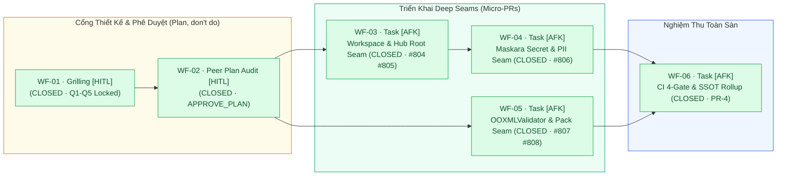

# 🗺️ Bản đồ Định hướng: Làm sâu Seam Workspace/Hub, Maskara & OOXML

> **Mã định danh:** `WAYFINDER-WORKSPACE-MASKARA-OOXML-20261118`  
> **Trạng thái:** `COMPLETED` *(Hoàn tất `6/6` Tickets `WF-01..WF-06` qua PRs `#804`, `#805`, `#806` `--merge`, `#807`, `#808` `--merge` & Rollup PR-4)*  
> **Khởi tạo:** `2026-11-18` | **Chế độ dự án:** `hybrid` (`ccba-agent-platform` Hub Monorepo, neo `HEAD` `2e0923e9` hậu M69)  
> **Phạm vi áp dụng:** 5 Packages (`ccba-harness`, `ccba-legal-intel`, `ccba-maskara`, `mdconverter`, `ccba-ooxml`) + `scripts/spoke`  
> **ADR-0061 Audit Receipt:** `maskara_scanner.v1` $\to$ `ccba_maskara:MaskaraScanner` (`MATCH`), `ooxml_processor.v1` $\to$ `ccba_ooxml:DocxDocument` (`MATCH`), `statutory_currency.v1` $\to$ `ccba_legal:DynamicStatutoryResolver` (`MATCH`) | `index_sha256`: `84408980fb63f7f7f2d4a5f493411abf42c8e35217a36c491de454ee4ea4bc9b`

---

## 🎯 1. Điểm Đích (Destination)

Triển khai đồng bộ **cả 3 Ứng viên Kiến trúc hạng `Strong`** từ báo cáo kiểm định `.md/scratch/architecture-review/architecture-review-20261118-0605.html` theo quy trình phân tách rủi ro một chiều (`ADR-0067`) và khóa nghiệm thu tự động (`ADR-0058`), đảm bảo:

1. **Ứng viên #1 — Làm sâu Seam Phân giải Workspace & Hub Root (`resolve_workspace_and_hub_roots` / `WorkspaceHubContext`):**
   - Hợp nhất `10` hàm tự dò workspace và `CCBA_HUB_PATH` phân kỳ trên `ccba_legal` ([registry.py](../../../packages/ccba-legal-intel/src/ccba_legal/registry.py#L27-L145), [engine.py](../../../packages/ccba-legal-intel/src/ccba_legal/sync/engine.py#L188-L285)), `ccba_harness` ([_daemon_reporting.py](../../../packages/ccba-harness/src/ccba_harness/evals/_daemon_reporting.py#L57-L67), [daemon.py](../../../packages/ccba-harness/src/ccba_harness/evals/daemon.py#L88-L121), [_miner_catalog.py](../../../packages/ccba-harness/src/ccba_harness/evals/_miner_catalog.py#L359-L379), [runner.py](../../../packages/ccba-harness/src/ccba_harness/evals/runner.py#L360-L368), [tuner.py](../../../packages/ccba-harness/src/ccba_harness/evals/tuner.py#L129-L139), [peer.py](../../../packages/ccba-harness/src/ccba_harness/cli/commands/peer.py#L17-L29)) và `scripts/spoke` ([spoke_bootstrap.py](../../../scripts/spoke/spoke_bootstrap.py#L354-L404), [check_hub_import_depth.py](../../../scripts/spoke/check_hub_import_depth.py#L45-L105)) về `1` deep module thuần stdlib (nạp `yaml` tùy chọn, đồng bộ sang `scripts/_guardrails/_workspace_roots.py` cho Spoke Tier-0) đặt tại `ccba_harness` (PEP 562 lazy import tốn `8.22 ms` `[đo thực tế]`); giữ **byte-y nguyên** `_discover_currency_card_path()` tại [currency_resolver.py](../../../packages/ccba-legal-intel/src/ccba_legal/currency_resolver.py#L251-L277).
   - Khôi phục hoàn toàn nhánh Tier-3 đọc `.md/workspace_context.yaml` (`include_agents_md=False`, bỏ `parents[5]`, đọc `os.environ` động, `wslpath` fail-soft) và sửa dứt điểm lỗi `resolve_project_root()` kẹt tại `packages/ccba-legal-intel` cũng như lỗi `find_project_root()` trượt khỏi Delivery Spoke không có `.git` về Hub root `[đo thực tế]`, giữ `100%` interface cũ làm thin adapters và bảo toàn `RULE-2.9`.

2. **Ứng viên #2 — Làm sâu Seam `ccba_maskara` (`maskara_scanner.v1`) & Hợp nhất 3 Bộ Che Giấu Secret/PII:**
   - Mở rộng `ccba_maskara` ([__init__.py](../../../packages/ccba-maskara/src/ccba_maskara/__init__.py#L30-L62), [_scanner.py](../../../packages/ccba-maskara/src/ccba_maskara/_scanner.py#L127-L337), [_rules.py](../../../packages/ccba-maskara/src/ccba_maskara/_rules.py#L9-L90)) bằng `PII_REGEX_PATTERNS` (Email, SĐT `0x`/`+84` kèm `\b` hai đầu, Tailscale/Private IP, CCCD 12 số `(?<![-\w.])\d{12}(?![-\w.])`, CMND 9 số `(?<![-\w.])\d{9}(?![-\w.])`) thông qua `redact_secrets_and_pii(..., dialect=...)` (`maskara` / `bracket_suffix` / `bracket_prefix`) kèm helper nội bộ `_get_default_scanner()` (giữ `REGEX_PATTERNS` + `scan_text(include_pii=False)` cho pre-commit).
   - Chuyển [style.py](../../../packages/mdconverter/src/mdconverter/style.py#L15-L52) (`mdconverter.style.redact_sensitive_info`) và [_miner_catalog.py](../../../packages/ccba-harness/src/ccba_harness/evals/_miner_catalog.py#L14-L78) (`redact_sensitive_info`, giữ nhánh `ImportError` fallback) thành thin adapters ủy quyền về `ccba_maskara`, đóng `100%` lỗ hổng rò rỉ `sk-proj-*`, `sk-ant-*`, `github_pat_*` và CCCD 12 số `[đo thực tế]`, xóa ~`95 LOC` regex trùng lặp cùng hằng chết `SENSITIVE_PATTERNS`, và đồng bộ `ccba-maskara` trong [mdconverter/pyproject.toml](../../../packages/mdconverter/pyproject.toml#L17-L32).

3. **Ứng viên #3 — Làm sâu `OOXMLValidator` (`ParsedOOXMLPackage`) & Seam Đóng Gói ZIP Tất Định (`ooxml_processor.v1`):**
   - Tái cấu trúc [validator.py](../../../packages/ccba-ooxml/src/ccba_ooxml/validation/validator.py#L28-L89) và [base.py](../../../packages/ccba-ooxml/src/ccba_ooxml/validation/base.py#L44-L265) quanh bộ đệm nội bộ `ParsedOOXMLPackage` nạp mỗi tệp XML unpacked đúng `1` lần theo thứ tự sắp xếp bằng factory `_make_secure_xml_parser()` (`resolve_entities=False, no_network=True`), đạt &le; `16` lượt parse trên `DOCXSchemaValidator` + `RedliningValidator` (`pptx.py` giữ backlog riêng; `original_file` ở `base.py:903`, `docx.py:197`, `redlining.py:84` parse mới qua factory).
   - Cô lập `5` điểm đột biến DOM (`base.py:247,822,830,778/919-921`, `redlining.py:91-92`) bằng `clone_root()` (`copy.deepcopy`), thu thập đủ `list[ValidationIssue]` (`file_path`, `line_number`), gated mọi `print()` (kể cả `compare_paragraph_counts` tại [docx.py](../../../packages/ccba-ooxml/src/ccba_ooxml/validation/docx.py#L68)) sau `self.verbose`, tách `validation/base.py` thành các module &le; `350 LOC` để gỡ khỏi [module_budget_baseline.json](../../../packages/ccba-harness/src/ccba_harness/module_budget_baseline.json#L10) (`PR-3a`), dời gỡ `ccba_ai/client.py` sang `PR-4`, sắp xếp `8` điểm `rglob()`, và cố định `ZipInfo.date_time=(1980, 1, 1, 0, 0, 0)` ở [pack.py](../../../packages/ccba-ooxml/src/ccba_ooxml/pack.py#L41-L51).

4. **Khóa cứng Kiểm định Toàn sàn (`ADR-0058` & `RULE-2.21`):**
   - Chỉ cập nhật `covered_sha256` / `sync_commit` cho `2` Profile-B verifiers có `covered_paths` thay đổi (`verify-ccba-maskara` tại `PR-2` và `verify-ccba-ooxml` tại `PR-3b`), vượt qua `Semantic Mutation Proof` và merge bằng `gh pr merge --merge`.
   - `python -m ccba_harness verify-patch --preset ci`, `check_dependency_contracts.py` (`0` vi phạm) và `3` SSOT writers (`compile_catalog.py`, `compile_skills_docs.py --write`, `sync_hub_adr_matrix.py`) thoát mã `0`.

---

## 📝 2. Ghi Chú (Notes)

- **Nguyên tắc vận hành (`Plan, don't do` + Chế độ Lập Map Bước 1):** Tại lượt khởi lập bản đồ này, tuyệt đối không sửa bất kỳ tệp mã production nào (`packages/*`, `scripts/*`, `.agents/*`, `docs/*`) và không tự gán Assignee cho ticket. Việc triển khai mã nguồn ở `WF-03..WF-05` chỉ được mở khóa sau khi [WF-01: Phản biện & Chốt Thiết kế Chi tiết cho 3 Ứng viên Kiến trúc (Workspace/Hub Root Seam, Maskara Redaction Seam, OOXMLValidator Seam)](tickets/wf_01_grilling_architecture_design_lock.md) chốt thiết kế và [WF-02: Thẩm định Kế hoạch Ngang hàng qua Peer Plan Audit (ADR-0067 One-Way Door Gate)](tickets/wf_02_peer_plan_audit_gate.md) thông qua `APPROVE_PLAN` + Kỹ sư xác nhận `proceed`.
- **Kiểm tra Parallel Research Dispatch:** Toàn bộ khảo sát nền tảng và thực nghiệm đã hoàn tất trực tiếp trên codebase nội bộ tại `DECISION-001` & `DECISION-002` (không có API hay hệ thống bên ngoài chưa rõ cần nghiên cứu nền), nên không tạo ticket `Research [AFK]` hình thức trên Biên giới.
- **Kỹ năng tham chiếu:** `/ccba-wayfinder`, `/ccba-codebase-design`, `/ccba-grilling`, `/ccba-implement`, `/ccba-tdd`.
- **Hiến pháp & ADR đối chiếu:**
  - [ADR-0057: Two-Stage Granularity Decision Framework & GPI](../../../docs/adr/0057-two-stage-granularity-decision-framework-and-gpi.md)
  - [ADR-0058: Verification Lock & Alignment](../../../docs/adr/0058-live-collaboration-artifacts-workspace-mirroring-and-charter-alignment.md)
  - [ADR-0061: Platform-Aware KISS v2.0 & Quarantine Governance](../../../docs/adr/0061-platform-aware-kiss-v2-and-quarantine-governance.md)
  - [ADR-0067: One-Way Door Manifest & Backpressure Circuit-Breaker](../../../docs/adr/0067-one-way-door-manifest-and-backpressure-circuit-breaker.md)
  - [session_learnings.md](../../knowledge/session_learnings.md)
  - [CONTEXT.md](../../../CONTEXT.md)

---

## ✅ 3. Quyết Định Đã Chốt (Decisions So Far)

- `[DECISION-001]` **Khảo sát & Phản biện Kép 5 Cổng (`.md/scratch/architecture-review/architecture-review-20261118-0605.html`):** Quét AST toàn sàn (`592` tệp non-test Python trong `791.24 ms`) và `check_dependency_contracts.py` (`518` tệp nguồn, `1,626 ms`, `0` vi phạm); chốt đúng `3` ứng viên hạng `Strong` (`in-process`) và loại/hoãn `6` mục không đạt cổng.
- `[DECISION-002]` **Bất biến Kỹ thuật Tiền-Grilling Đã Xác Minh Trên Mã Thực:**
  1. **Ràng buộc Dependency & Spoke Tier-0 (Ứng viên #1):** `packages/ccba-legal-intel/pyproject.toml` đã khai báo phụ thuộc `ccba-harness` và `import ccba_harness` qua PEP 562 chỉ mất `8.22 ms` (`+24` modules) `[đo thực tế]`. Tuy nhiên, [spoke_bootstrap.py](../../../scripts/spoke/spoke_bootstrap.py#L354-L404) chạy tại Spoke Tier-0 trước khi cài đặt package, nên module lõi `resolve_workspace_and_hub_roots` phải thuần stdlib (nạp `yaml` tùy chọn) và giữ nhánh fallback đọc cấu hình tại `scripts/spoke`.
  2. **Ba Phương Ngữ Placeholder trong Bộ Kiểm Thử Hiện Hữu (Ứng viên #2):** Đối chiếu mã kiểm thử xác nhận tồn tại 3 định dạng placeholder khác nhau đang được assert: [test_scanner.py](../../../packages/ccba-maskara/tests/test_scanner.py#L59) kiểm tra `[MASKARA_REDACTED:<rule_id>]`; [test_miner.py](../../../packages/ccba-harness/tests/test_miner.py#L23-L30) và [test_log_eval_miner.py](../../../scripts/tests/test_log_eval_miner.py#L46-L57) kiểm tra `[API_KEY_REDACTED]` / `[EMAIL_REDACTED]` / `[PHONE_REDACTED]` / `[IP_REDACTED]`; [test_phase1_mdconverter_seams.py](../../../packages/mdconverter/tests/test_phase1_mdconverter_seams.py#L164-L173) kiểm tra `[REDACTED_API_KEY]` / `[REDACTED_EMAIL]` / `[REDACTED_PHONE]` / `[REDACTED_CCCD]`. Vì vậy, cần chốt chiến lược tương thích phương ngữ trong [WF-01: Phản biện & Chốt Thiết kế Chi tiết cho 3 Ứng viên Kiến trúc (Workspace/Hub Root Seam, Maskara Redaction Seam, OOXMLValidator Seam)](tickets/wf_01_grilling_architecture_design_lock.md) trước khi hợp nhất mã nguồn.
  3. **An toàn Đột biến DOM & Khóa SHA-256 Profile-B (Ứng viên #1–#3):** `base.py:247` (`elem.getparent().remove(elem)`) và [redlining.py](../../../packages/ccba-ooxml/src/ccba_ooxml/validation/redlining.py#L91-L92) đột biến trực tiếp cây XML nên bộ đệm `ParsedOOXMLPackage` bắt buộc cấp bản sao `copy.deepcopy` cho các bước đột biến. Ngoài ra, bất kỳ chỉnh sửa nào chạm `currency_resolver.py`, `ccba_maskara/*`, `mdconverter/__init__.py`, `pack.py`, `unpack.py`, `workspace.py` đều kích hoạt kiểm định `covered_sha256` của các Profile-B verifiers (`RULE-2.21`).
- `[DECISION-003]` **Kết Quả Khóa Thiết Kế Sau Phỏng Vấn Grilling (`Q1`–`Q5`, [Biên bản Phỏng vấn Grilling & Kế hoạch Triển khai v1.1](../../knowledge/decisions/2026-11-18_workspace_maskara_ooxml_grilling_resolution.md)):**
  - `Q1` (`[FOG-001]` Resolved): `1` vòng thẩm định `WF-02` phủ chuỗi `5` Micro-PR thực thi (`PR-1a`, `PR-1b`, `PR-2`, `PR-3a`, `PR-3b`) + `PR-4` Rollup, kèm `5` `TradeoffCard` và `--merge` cho `PR-2` & `PR-3b` (`covered_sha256`).
  - `Q2`: Dựng `_workspace_roots.py` thuần stdlib tại `ccba_harness` (`include_agents_md=False`, bỏ qua `packages/<pkg>/pyproject.toml` nội bộ, không cache env lúc import, `wslpath` fail-soft), giữ `start_dir=Path(__file__)` cho `resolve_project_root()`, giữ nguyên `_discover_currency_card_path()`, và đồng bộ sang `scripts/_guardrails/_workspace_roots.py`.
  - `Q3` (`[FOG-002]` Resolved): Tách `PII_REGEX_PATTERNS` khỏi pre-commit hook, `\b` hai đầu SĐT + guard `(?<![-\w.])` hạ dương tính giả UUID xuống `0/527` `[đo thực tế]`, map chi tiết `rule_id -> token` cho `3` `dialect` (`maskara`, `bracket_suffix` giữ fallback `ImportError`, `bracket_prefix`), dùng `_get_default_scanner()` nội bộ.
  - `Q4`: Phân rã `validation/base.py` (`949 LOC`) thành facade + `_parsed_package.py` + `_relationship_checks.py` + `_xsd_engine.py`, `_make_secure_xml_parser()` per parse, `clone_root()` ở cả `5` điểm đột biến DOM, trả `list[ValidationIssue]`, gated `print()` sau `self.verbose`, sắp xếp `8` `rglob()`, cố định `ZipInfo.date_time` (để `pptx.py` sang đợt sau).
  - `Q5`: `PR-3a` gỡ riêng `validation/base.py` và `PR-4` gỡ `ccba_ai/client.py` (`753 LOC`) khỏi [module_budget_baseline.json](../../../packages/ccba-harness/src/ccba_harness/module_budget_baseline.json#L1-L11); chỉ re-anchor `verify-ccba-maskara` (`PR-2`) và `verify-ccba-ooxml` (`PR-3b`).

- `[DECISION-004]` **Số Đo Đối Chứng & Nghiệm Thu Hoàn Tất `[đo thực tế]` (`WF-03..WF-06`, `2026-11-18`):**

| Ứng viên & Thước đo | Trước Cải tiến (`Baseline`) | Sau Cải tiến (`[đo thực tế]`) |
| :--- | :--- | :--- |
| **#1 `import ccba_harness` / `ccba_legal`** | `resolve_project_root()` kẹt nội bộ; `find_project_root()` trượt `parents[5]` | `ccba_harness` `min 6.17 ms` (`+42` mods), `ccba_legal` `min 4.11 ms` (`+30` mods), Delivery Spoke resolve đúng |
| **#2 `ccba_maskara` PII & `3` Dialects** | `mdconverter.style` lọt `sk-proj-*`, `sk-ant-*`, `github_pat_*`, CCCD; singleton tạo lúc import | `_default_scanner is None` lúc import (`min 9.07 ms`); `0` rò rỉ trên cả `3` phương ngữ; `verify-ccba-maskara` `6/6` |
| **#3 `OOXMLValidator` & `pack_document`** | `86` `etree.parse()` (`105.54 ms`), `71/86` `parser=None`, `line_number=None`, `base.py` `949 LOC`, ZIP mtime động | `16` unpacked `etree.parse()` (`<= 16`), `0%` `parser=None`, `5.65 ms`, `line_number != None`, `base.py` `337 LOC`, `zip_match=True` |

---

## ⚡ 4. Biên Giới & Danh Mục Ticket (The Frontier & Ticket DAG)

> *Lưu ý xếp lịch:* Toàn bộ `6/6` tickets `WF-01..WF-06` đã hoàn tất hợp nhất và đóng bản đồ `COMPLETED`.

### Biên giới Hiện tại (Active Frontier — Unblocked)

*(Không còn ticket mở — toàn bộ `6/6` tickets đã đóng `CLOSED`)*

### Đường ống Hạ nguồn (Downstream Tickets — Blocked chờ Frontier)

*(Không còn ticket bị chặn)*

### Đã Hoàn Thành (Closed)

| Ticket | Loại | Trạng thái | Assignee | Kết quả |
| :--- | :--- | :--- | :--- | :--- |
| [WF-01: Phản biện & Chốt Thiết kế Chi tiết cho 3 Ứng viên Kiến trúc (Workspace/Hub Root Seam, Maskara Redaction Seam, OOXMLValidator Seam)](tickets/wf_01_grilling_architecture_design_lock.md) | `Grilling [HITL]` | `CLOSED` | `AI Platform Architect & Kỹ sư Trưởng` | Khóa `5/5` câu `Q1`–`Q5`, xuất [Biên bản Phỏng vấn Grilling & Kế hoạch Triển khai v1.1](../../knowledge/decisions/2026-11-18_workspace_maskara_ooxml_grilling_resolution.md) |
| [WF-02: Thẩm định Kế hoạch Ngang hàng qua Peer Plan Audit (ADR-0067 One-Way Door Gate)](tickets/wf_02_peer_plan_audit_gate.md) | `Task [HITL]` | `CLOSED` | `AI Platform Architect & Grok 4.7 Auditor` | Pass 2 `f044627a-7a05-410f-afff-6fd52351166d` **`APPROVE_PLAN`** (`risk_score: 2`, `blocking_conditions: 0`, `.md/peer_exchange/grok_workspace_maskara_ooxml_plan_signoff_p2.md`) & Kỹ sư xác nhận `Proceed` |
| [WF-03: Làm sâu Seam Phân giải Workspace & Hub Root (resolve_workspace_and_hub_roots) cho ccba_legal, ccba_harness và scripts/spoke](tickets/wf_03_deepen_workspace_and_hub_root_seam.md) | `Task [AFK]` | `CLOSED` | `AI Platform Architect` | PR `#804` (`PR-1a`: `_workspace_roots.py` `246 LOC`, `import ccba_harness` `6.10 ms`) + PR `#805` (`PR-1b`: nối `10` adapters, giữ nguyên `currency_resolver.py`, `verify-ccba-legal-intel` `6/6` pass) |
| [WF-04: Làm sâu Seam Che giấu Secret & PII Việt Nam (ccba_maskara) và Hợp nhất 3 Bộ Quét Phân kỳ](tickets/wf_04_unify_maskara_secret_and_pii_seam.md) | `Task [AFK]` | `CLOSED` | `AI Platform Architect` | PR `#806` (`PR-2`, merge `--merge` `6b033325`, Commit 1 `646cf2d7`): thêm `PII_REGEX_PATTERNS`, `redact_secrets_and_pii` (`3` dialects), `_get_default_scanner()`, nối `mdconverter.style` + `_miner_catalog` (`ImportError` fallback), `verify-ccba-maskara` `6/6` pass |
| [WF-05: Làm sâu Seam OOXMLValidator (ParsedOOXMLPackage) & Đóng gói ZIP Tất định cho ccba_ooxml](tickets/wf_05_deepen_ooxml_validator_and_pack_seam.md) | `Task [AFK]` | `CLOSED` | `Antigravity` | PR `#807` (`PR-3a` `144ee313`: tách `base.py` `949 -> 337 LOC`) + PR `#808` (`PR-3b` `--merge` `552066eb`, Commit 1 `7259350d`: `16` unpacked parses, `0% parser=None`, `5.65 ms`, `line_number`, `zip_match=True`, `verify-ccba-ooxml` `6/6` pass) |
| [WF-06: Kiểm định Liên thông 4 Cổng ADR-0058, Đồng bộ Catalog/Docs SSOT & Đóng Bản đồ Wayfinder](tickets/wf_06_ci_verification_and_wayfinder_rollup.md) | `Task [AFK]` | `CLOSED` | `Antigravity` | Rollup `PR-4`: gỡ `ccba_ai/client.py` (`753 LOC`) khỏi `module_budget_baseline.json`, cập nhật `CONTEXT.md`, `index.md`, `log.md`, `verify-patch --preset ci` + `WikiHealthLinter` + `verify-ccba-wayfinder` sạch `0` lỗi, disposition `[FOG-003]` |

---

## 🌫️ 5. Sương Mù Chiến Trận / Chưa Xác Định Rõ (Not Yet Specified)

Áp dụng *Quy tắc Kiểm thử Sương mù (`Fog vs. Ticket Test`)* — các vùng mờ chưa thể phát biểu thành ticket sắc nét cho đến khi các quyết định tiền nhiệm mở ra:

- `[FOG-001]` `[RESOLVED in WF-01 — Q1]` Chốt cấu trúc `1` vòng thẩm định `WF-02` phủ chuỗi `5` Micro-PR (`PR-1a`, `PR-1b`, `PR-2`, `PR-3a`, `PR-3b`) + `PR-4` Rollup, kèm `5` `TradeoffCard` (`<= 30` dòng); `compute_cumulative_streak` dừng ngay trên `ONE_WAY_DOOR` và chỉ dùng `--merge` cho `PR-2` (`verify-ccba-maskara`) & `PR-3b` (`verify-ccba-ooxml`).
- `[FOG-002]` `[RESOLVED in WF-01 — Q3]` Kiểm đo thực địa trên `527` tệp `docs/`, `.agents/skills/`, `evals/` cho thấy guard chống khớp đuôi UUID `(?<![-\w.])` trên CCCD `12` số & CMND `9` số hạ dương tính giả xuống **`0/527`** `[đo thực tế]`.
- `[FOG-003]` `[DISPOSITIONED in WF-06]` Sau khi hợp nhất `WF-03`, `packages/ccba-legal-intel/src/ccba_legal/registry.py` đo thực tế còn **`1,242 LOC`** (`LegalRegistryManager` domain parser & CRUD ngoài phạm vi Workspace/Hub root seam). Chốt giữ nguyên ngưỡng ratchet trong [module_budget_baseline.json](../../../packages/ccba-harness/src/ccba_harness/module_budget_baseline.json#L6) và tách riêng thành ứng viên refactor độc lập cho chiến dịch kế tiếp thay vì gộp vào đợt này.

---

## 🚫 6. Ngoài Phạm Vi (Out of Scope)

- **Chiến dịch trước (`2026-11-15`, PRs `#751..#761`):** Đã hoàn tất tại [Bản đồ Làm sâu Seam Lõi & Hợp nhất Quản trị (2026-11-15)](../core-seams-and-governance-deepening/map.md) (`COMPLETED`).
- **6 hướng đã bị loại hoặc xếp sau Top 3 trong Vòng Bắn Hạ 5 Cổng (`.md/scratch/architecture-review/architecture-review-20261118-0605.html`):**
  1. `QCAuditPipeline` (`ccba_ai/pipeline.py:63` vs `ccba_qc_core/pipeline.py:159`) — Cổng 2 (False Positive: `ccba_qc_core` đã kế thừa `_BaseQCAuditPipeline`).
  2. `HarnessGuard._extract_and_check_base64` (`_process_monitor.py:726` vs `_file_monitor.py:355`) — Cổng 2 & Cổng 5 (0 caller thực tế; việc tách `_process_monitor.py` `1,185 LOC` & `_file_monitor.py` `1,127 LOC` xếp Backlog `#4` ngoài đợt này).
  3. PEP 562 Lazy Seams cho `ccba_notebooklm` (`133.32 ms`), `ccba_diagram` (`85.23 ms`), `ccba_pdf_prep` (`49.99 ms`) — Cổng 2 (`ROI #5`: `0` hoặc `1` caller thực sự cần runtime nặng).
  4. Telemetry HTML/SVG Renderers (`fleet.py` `1,024 LOC` & `dashboard.py` `645 LOC`) — Cổng 2 (single CLI caller tại `cli/commands/telemetry.py:108,148`; lỗi thoát `</script>` thuộc Fast-Path bugfix riêng).
  5. `ccba_legal/cli.py` (`1,455 LOC`) & `ccba_maskara/cli.py` (`run_cli` `416 LOC`) — Cổng 1 (`Rule P6.20`: `>= 75%` là `argparse` CLI glue).
  6. Cross-Package Private Submodule Imports (`518` tệp nguồn) — Cổng 5 (`check_dependency_contracts.py` xác nhận `0` vi phạm).

---
*Tạo bởi CCBA — Trung tâm Tư vấn và Ứng dụng BIM trong Xây dựng*
