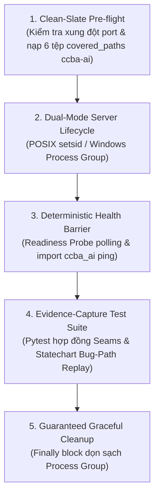
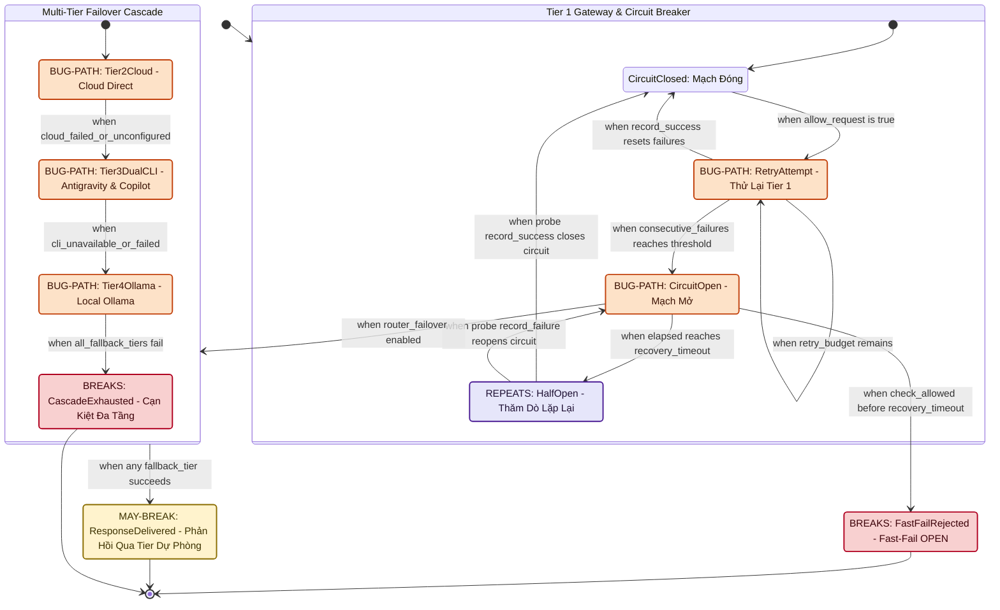

# Kỹ Năng Kiểm Định Tự Động `verify-ccba-ai`

Bộ kỹ năng kiểm định tự động chuyên biệt cho package `ccba-ai` (AI Gateway SDK, `CircuitBreaker`, `TieredFallbackRouter`, và `ModelArchetype` virtual routing), được khởi tạo theo chuẩn **Pstack `statechart` `v0.15.42` & ADR-0009 / ADR-0044 / ADR-0058**. Toàn bộ kịch bản thực thi và bài kiểm thử được cô lập hoàn toàn trong `packages/ccba-harness/.agents/skills/verify-ccba-ai/harness/`.

## 🏛️ Platform-Aware Architecture Posture

- **Seam Capability Posture**: `package-bound`. Kỹ năng kiểm định trực tiếp các Public Deep Seams của `ccba_ai` (`ai`, `AIClient`, `AsyncAIClient`, `choose_model`, `resolve_max_tokens`, `CircuitBreaker`, `CircuitState`, `CircuitBreakerOpenError`, `TieredFallbackRouter`, `map_model_for_tier`) cùng tài liệu kỹ năng `/ccba-ai-gateway-sdk`.
- **Version Anchor (`sync_commit` & `covered_sha256`)**: Neo tại commit trên `main` `778c25d5e9d30f28c3ec1049b3d531bb5e12b9c2` kèm bảng băm SHA-256 chuẩn hóa LF (`covered_sha256`) bảo vệ toàn bộ `6` tệp `covered_paths` (chống xanh giả trên shallow clone hoặc squash-merge).

---

## Kiến Trúc 5 Khối Chức Năng Cốt Lõi



### 1. Clean-Slate Pre-flight (Tiền Kiểm Sạch Sẽ)
- Kiểm tra cổng TCP cục bộ trước khi khởi chạy readiness probe server.
- Xác nhận toàn bộ `6` tệp trong `covered_paths` tồn tại và package `ccba_ai` nạp sạch bằng cơ chế PEP 562 lazy exports.

### 2. Dual-Mode Server Lifecycle (Quản Trị Tiến Trình Đa Nền Tảng)
- Khởi chạy tiến trình probe trong Process Group cô lập:
  - **Windows (`sys.platform == "win32"`)**: `creationflags=subprocess.CREATE_NEW_PROCESS_GROUP`
  - **POSIX (`Linux / macOS`)**: `preexec_fn=os.setsid`

### 3. Deterministic Health Barrier (Rào Chắn Sẵn Sàng Xác Định)
- CẤM dùng `time.sleep(N)` tùy tiện để chờ tiến trình khởi động.
- BẮT BUỘC dùng vòng lặp thăm dò HTTP readiness endpoint (`healthz`) với timeout xác định (`10.0s`, chu kỳ `50ms`).

### 4. Evidence-Capture Test Suite & Statechart `v0.15.42` (`Bug-Path Replay`)
- Thực thi bộ kiểm thử hợp đồng `test_ai_suite.py` đối chiếu toàn bộ `6` tính năng trong `features/INDEX.md`.
- Mô hình hóa máy trạng thái kết hợp `CircuitBreaker` + `TieredFallbackRouter` bằng `stateDiagram-v2` tuân thủ chuẩn **Pstack `statechart` `v0.15.42`** (`Single-Way-In Parent Entry`, `Composite Exit Lifting`, $19 \le 20$ cạnh, đủ 4 lớp kiểm định):



**Danh sách đường dẫn phản chứng (`bug_path`) & bước ẩn bàn giao kèm sơ đồ:**
- `bug_path_1` (Circuit Breaker Fast-Fail): `[{"from": "CircuitClosed", "to": "RetryAttempt", "when": "allow_request is true"}, {"from": "RetryAttempt", "to": "CircuitOpen", "when": "consecutive_failures reaches threshold"}, {"from": "CircuitOpen", "to": "FastFailRejected", "when": "check_allowed before recovery_timeout"}]`
- `bug_path_2` (Multi-Tier Cascade Exhaustion): `[{"from": "CircuitOpen", "to": "Tier2Cloud", "when": "router_failover enabled"}, {"from": "Tier2Cloud", "to": "Tier3DualCLI", "when": "cloud_failed_or_unconfigured"}, {"from": "Tier3DualCLI", "to": "Tier4Ollama", "when": "cli_unavailable_or_failed"}, {"from": "Tier4Ollama", "to": "CascadeExhausted", "when": "all_fallback_tiers fail"}]`
- `hidden_steps` (lược bỏ để giữ ngân sách $\le 20$ cạnh):
  - `Tier1Gateway -> ResponseDelivered` (thành công ngay tại Tier 1 qua `RetryAttempt -> CircuitClosed`).
  - `Tier4Ollama -> Tier5Mock -> ResponseDelivered` (khi bật `enable_mock_fallback=True` hoặc `CCBA_AI_MOCK=1`).
  - `AnyState -> CircuitClosed` (đặt lại thủ công qua `CircuitBreaker.reset()`).
- Cả 2 chuỗi `bug_path` được replay trực tiếp trên `CircuitBreaker` và `TieredFallbackRouter` thật tại `test_ai_suite.py::test_feat_ai_005_statechart_bug_path_replay_and_anti_lie`.

### 5. Guaranteed Graceful Cleanup (Dọn Dẹp Đảm Bảo Tuyệt Đối)
- Luôn giải phóng nhóm tiến trình con trong khối `finally:` (`taskkill /F /T /PID` trên Windows hoặc `os.killpg(pgid, signal.SIGTERM)` trên POSIX) và xác nhận cổng TCP đã được giải phóng hoàn toàn.

---

## Quy Trình Vận Hành & Bảo Trì

### Bước 1: Thực Thi Bộ Kiểm Định 5 Khối Cho `ccba-ai`
- Chạy kịch bản điều phối kiểm định tự động từ thư mục gốc của dự án:
  ```bash
  .venv/bin/python packages/ccba-harness/.agents/skills/verify-ccba-ai/harness/run_verify_ai.py
  ```
- **Tiêu chí hoàn thành:** Kịch bản thực thi trọn vẹn cả 5 khối, toàn bộ 6 bài kiểm thử trong `test_ai_suite.py` vượt qua 100%, tiến trình con được dọn sạch và lệnh thoát với `exit code 0`.

### Bước 2: Kiểm Tra Nguồn Gốc Thay Đổi Khi Phát Sinh Lỗi (`Pre-Remediation Provenance Check`)
- Đối chiếu `git diff <sync_commit>..HEAD` trên các tệp thuộc `covered_paths`.
- Phân loại kết quả vào đúng 1 trong 4 trạng thái chuẩn (`in_sync`, `updated`, `bug`, `blocked`).
- **Tiêu chí hoàn thành:** Xác định rõ trạng thái thuộc 1 trong 4 phân loại (`in_sync`, `updated`, `bug`, `blocked`) trước khi can thiệp mã; tuyệt đối cấm sửa `harness/` nếu phát hiện lỗi hồi quy (`bug`).

### Bước 3: Phép Thử Đột Biến Ngữ Nghĩa (`Semantic Mutation Proof`)
- Xác nhận cây làm việc sạch (`git diff --quiet && git diff --cached --quiet`).
- Thực hiện 1 đột biến ngữ nghĩa tạm thời trên `covered_paths` (ví dụ: đổi `if self.failure_count >= self.failure_threshold:` thành `if self.failure_count > self.failure_threshold:` trong `circuit_breaker.py`).
- Chạy lại `run_verify_ai.py` để xác nhận bộ kiểm định bắt trúng lỗi (exit code $\ne 0$).
- Hoàn nguyên tức thì (`git checkout -- <mutated_files>`), xác nhận `git diff` sạch và chạy lại `run_verify_ai.py` đạt `exit code 0`.
- **Tiêu chí hoàn thành:** Phép thử đột biến ngữ nghĩa bắt được lỗi, mã nguồn được hoàn nguyên 100% và lượt chạy nghiệm thu thoát sạch với `exit code 0`.
