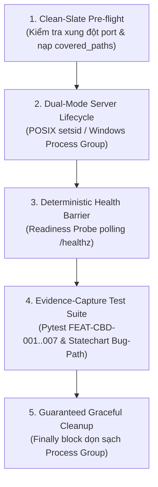
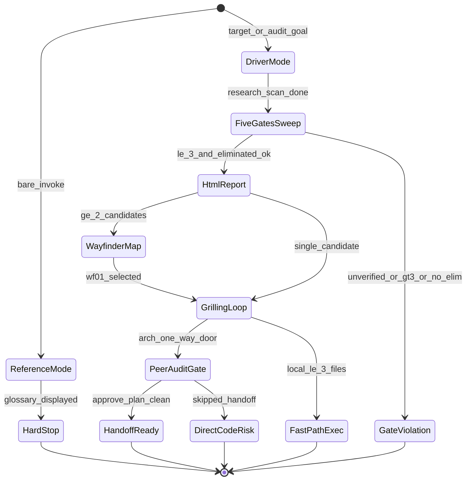

# Kỹ Năng Kiểm Định Tự Động `verify-ccba-codebase-design`

Bộ kỹ năng kiểm định tự động chuyên biệt cho kỹ năng `/ccba-codebase-design` (từ vựng Deep Modules, 2 chế độ Reference vs Driver, 5 Cổng Phản Biện, rẽ nhánh `/ccba-wayfinder`, và `Impact-Based Handoff Gate`), tuân thủ chuẩn **Pstack Upstream Disciplines (ADR-0009, ADR-0035, ADR-0044, ADR-0057, ADR-0058)**.

## 🏛️ Platform-Aware Architecture Posture

- **Seam Capability Posture**: `package-bound`. Kiểm định hợp đồng cấu trúc của `.agents/skills/ccba-codebase-design/SKILL.md` (Reference Mode Hard Stop vs Driver Mode, 7 thuật ngữ, PEP 562, ngân sách `<= 4,000` tokens DMI), `codebase_refactor_guide.md` (5 Cổng, `<= 3` ứng viên, Eliminated Candidates, `research` subagent, mở HTML đa nền tảng, Bước 4 `/ccba-wayfinder` + `/ccba-handoff`), `design_it_twice.md` (`ONE_WAY_DOOR`, `research` read-only), cùng `SKILL_DEPRECATION_ALIASES` và `eval_codebase_engineering.json`.
- **Version Anchor (`sync_commit` & `covered_sha256`)**: Neo tại commit merge PR #914 trên `main` `a338d14eeb94d5539386e6c56622277f70dc2340` kèm bảng băm SHA-256 chuẩn hóa LF (`covered_sha256`) bảo vệ toàn bộ `covered_paths`.

---

## Kiến Trúc 5 Khối Chức Năng Cốt Lõi



### 1. Clean-Slate Pre-flight (Tiền Kiểm Sạch Sẽ)
- Kiểm tra cổng TCP cục bộ trước khi khởi chạy readiness probe server.
- Kiểm tra sự tồn tại nguyên vẹn của 4 tệp trong `covered_paths` (`.agents/skills/ccba-codebase-design/SKILL.md`, `references/codebase_refactor_guide.md`, `references/design_it_twice.md`, `scripts/spoke/sync/coordinator.py`).

### 2. Dual-Mode Server Lifecycle (Quản Trị Tiến Trình Đa Nền Tảng)
- Khởi chạy tiến trình probe trong Process Group cô lập:
  - **Windows (`sys.platform == "win32"`)**: `creationflags=subprocess.CREATE_NEW_PROCESS_GROUP`
  - **POSIX (`Linux / macOS`)**: `preexec_fn=os.setsid`

### 3. Deterministic Health Barrier (Rào Chắn Sẵn Sàng Xác Định)
- CẤM dùng `time.sleep(N)` tùy tiện để chờ tiến trình khởi động.
- BẮT BUỘC dùng vòng lặp thăm dò HTTP readiness endpoint (`/healthz`) với timeout xác định (`10.0s`, chu kỳ `50ms`).

### 4. Evidence-Capture Test Suite (Thực Thi Kiểm Thử & Thu Thập Bằng Chứng)
- Thực thi bộ kiểm thử hợp đồng `test_codebase_design_suite.py` đối chiếu toàn bộ 7 tính năng trong `features/INDEX.md`.
- Đối chứng đường lỗi Statechart (`Statechart Bug-Path Replay`) cho luồng vận hành của `/ccba-codebase-design` (`18` cạnh <= 20):



- `bug_path`: `[{"from": "FiveGatesSweep", "to": "GateViolation", "when": "unverified_or_gt3_or_no_elim"}]` và `[{"from": "PeerAuditGate", "to": "DirectCodeRisk", "when": "skipped_handoff"}]` — được replay trực tiếp trên hàm kiểm chứng thực tại `test_codebase_design_suite.py::test_feat_cbd_006_statechart_bug_path_and_drift_provenance`.

### 5. Guaranteed Graceful Cleanup (Dọn Dẹp Đảm Bảo Tuyệt Đối)
- Luôn giải phóng nhóm tiến trình con trong khối `finally:` (`taskkill /F /T /PID` trên Windows hoặc `os.killpg(pgid, signal.SIGTERM)` trên POSIX) và xác nhận cổng TCP đã được giải phóng hoàn toàn.

---

## Quy Trình Vận Hành & Bảo Trì

### Bước 1: Thực Thi Bộ Kiểm Định 5 Khối Cho `/ccba-codebase-design`
- Chạy kịch bản điều phối kiểm định tự động từ thư mục gốc của dự án:
  ```bash
  .venv/bin/python packages/ccba-harness/.agents/skills/verify-ccba-codebase-design/harness/run_verify_codebase_design.py
  ```
- **Tiêu chí hoàn thành:** Kịch bản thực thi trọn vẹn cả 5 khối, toàn bộ 7 bài kiểm thử trong `test_codebase_design_suite.py` vượt qua 100%, tiến trình con được dọn sạch và lệnh thoát với `exit code 0`.

### Bước 2: Kiểm Tra Nguồn Gốc Thay Đổi Khi Phát Sinh Lỗi (`Pre-Remediation Provenance Check`)
- Đối chiếu `git diff <sync_commit>..HEAD` trên các tệp thuộc `covered_paths` (`.agents/skills/ccba-codebase-design/SKILL.md`, `references/codebase_refactor_guide.md`, `references/design_it_twice.md`, `scripts/spoke/sync/coordinator.py`).
- Phân loại kết quả vào đúng 1 trong 4 trạng thái chuẩn (`in_sync`, `updated`, `bug`, `blocked`).
- **Tiêu chí hoàn thành:** Xác định rõ trạng thái thuộc 1 trong 4 phân loại trước khi can thiệp mã; tuyệt đối cấm sửa `harness/` nếu phát hiện lỗi hồi quy (`bug`).

### Bước 3: Phép Thử Đột Biến Ngữ Nghĩa (`Semantic Mutation Proof`)
- Xác nhận cây làm việc sạch (`git diff --quiet && git diff --cached --quiet`).
- Thực hiện 1 đột biến ngữ nghĩa tạm thời trên `covered_paths` (ví dụ: đổi `"Reference Mode"` trong `.agents/skills/ccba-codebase-design/SKILL.md`).
- Chạy lại `run_verify_codebase_design.py` để xác nhận bộ kiểm định bắt trúng lỗi (`exit code != 0`).
- Hoàn nguyên tức thì (`git checkout -- <mutated_files>`), xác nhận `git diff` sạch và chạy lại `run_verify_codebase_design.py` đạt `exit code 0`.
- **Tiêu chí hoàn thành:** Phép thử đột biến ngữ nghĩa bắt được lỗi, mã nguồn được hoàn nguyên 100% và lượt chạy nghiệm thu thoát sạch với `exit code 0`.
