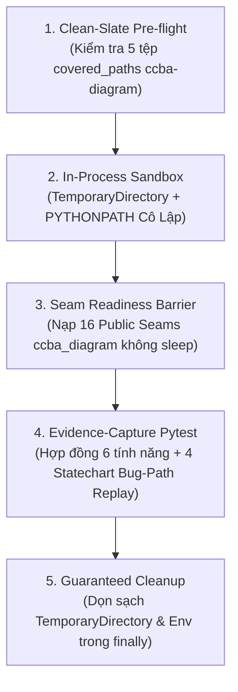
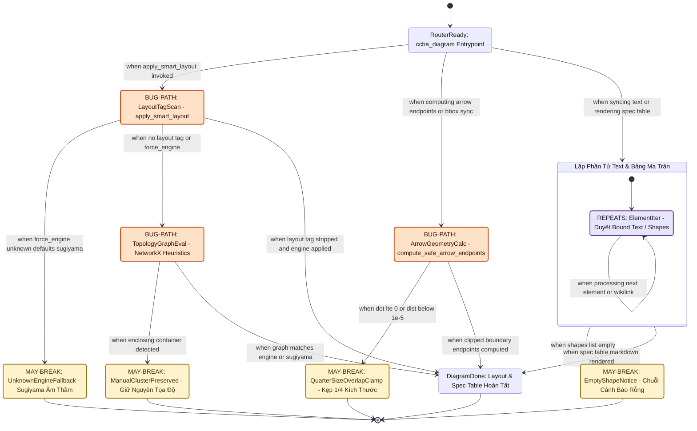

# Kỹ Năng Kiểm Định Tự Động `verify-ccba-diagram`

Bộ kỹ năng kiểm định tự động chuyên biệt cho package `ccba-diagram` (`apply_smart_layout`, `compute_safe_arrow_endpoints`, `get_shape_boundary_point`, `normalize_canvas_bounding_box`, `sync_bound_text_translation`, `generate_markdown_spec_table`, `DiagramTheme`), được khởi tạo theo **Profile B (In-Process Library)** của `ccba-create-verification-skill` `v1.4.0` và chuẩn **Pstack `statechart` `v0.15.42`**. Toàn bộ mã kiểm định cô lập trong `packages/ccba-harness/.agents/skills/verify-ccba-diagram/harness/`.

## 🏛️ Platform-Aware Architecture Posture

- **Seam Capability Posture**: `package-bound`. Bảo vệ trực tiếp `16` Public Deep Seams trong `ccba_diagram.__all__` tương ứng với kỹ năng `ccba-excalidraw-diagram`.
- **Version Anchor (`sync_commit` & `covered_sha256`)**: Neo tại commit `f4d6196d0d2fc7fb2459692df132693e15217d42` kèm mã băm SHA-256 chuẩn hóa LF bảo vệ toàn bộ `5` tệp lõi (`__init__.py`, `geometry.py`, `matrix_table.py`, `router.py`, `theme.py`).
- **Giới Hạn Phạm Vi (`Scope & Limitations`)**:
  - `router.py` sử dụng chiến lược fallback phòng vệ không ném ngoại lệ: khung bao đóng trả về `"manual_cluster_preserved"` (`router.py:228-229`) và `force_engine` không hợp lệ tự rơi âm thầm về `"sugiyama"` (`router.py:247-249`).
  - `geometry.py` xử lý suy biến khoảng cách bằng cách trả tâm hình (`dist < 1e-5`) hoặc kẹp `1/4` kích thước khi hai hình chồng lấn (`dot <= 0`, `geometry.py:90-97`).

---

## Kiến Trúc 5 Khối Kiểm Định In-Process (`Profile B`)



### 1. Clean-Slate Pre-flight
- Xác nhận đủ `5` tệp trong `covered_paths` tồn tại trên đĩa và `ccba_diagram.__init__.py` sẵn sàng nạp sạch.

### 2. In-Process Sandbox Isolation
- Khởi tạo vùng làm việc tạm `TemporaryDirectory(prefix="verify_ccba_diagram_")`, thiết lập `PYTHONPATH` và biến `CCBA_DIAGRAM_SANDBOX` trong process thuần **không mở cổng TCP hay dựng HTTP server**.

### 3. Deterministic Seam Readiness Barrier
- Kiểm tra nạp thẳng toàn bộ `16` Public Deep Seams trong `ccba_diagram.__all__` (`apply_smart_layout`, `compute_safe_arrow_endpoints`, `get_shape_boundary_point`, `normalize_canvas_bounding_box`, `sync_bound_text_translation`, `generate_markdown_spec_table`, `DiagramTheme`, `DEFAULT_THEME`, cùng `8` layout engines) bằng tiến trình con Python sạch; cấm dùng `time.sleep(N)`.

### 4. Evidence-Capture Pytest & Statechart `v0.15.42` (`Bug-Path Replay`)
- Thực thi `test_diagram_suite.py` đối chiếu toàn bộ `6` tính năng trong `features/INDEX.md` và mô hình hóa luồng chuyển trạng thái bằng `stateDiagram-v2` ($20 \le 20$ cạnh, vượt qua 5 Anti-Lie invariants):



**Danh sách đường dẫn phản chứng (`bug_path`) & bước ẩn bàn giao kèm sơ đồ:**
- `bug_path_1` (Enclosing Container Skips Auto Layout — `manual_cluster_preserved`): `[{"from": "RouterReady", "to": "LayoutTagScan", "when": "apply_smart_layout invoked"}, {"from": "LayoutTagScan", "to": "TopologyGraphEval", "when": "no layout tag or force_engine"}, {"from": "TopologyGraphEval", "to": "ManualClusterPreserved", "when": "enclosing container detected"}]`
- `bug_path_2` (Unknown `force_engine` Silent Sugiyama Fallback): `[{"from": "RouterReady", "to": "LayoutTagScan", "when": "apply_smart_layout invoked"}, {"from": "LayoutTagScan", "to": "UnknownEngineFallback", "when": "force_engine unknown defaults sugiyama"}]`
- `bug_path_3` (Overlapping Shapes Quarter-Size Clamp / Coincident Center Fallback): `[{"from": "RouterReady", "to": "ArrowGeometryCalc", "when": "computing arrow endpoints or bbox sync"}, {"from": "ArrowGeometryCalc", "to": "QuarterSizeOverlapClamp", "when": "dot lte 0 or dist below 1e-5"}]`
- `bug_path_4` (Empty Geometric Shapes Fallback Notice in Spec Table): `[{"from": "RouterReady", "to": "BoundTextAndTableLoop", "when": "syncing text or rendering spec table"}, {"from": "BoundTextAndTableLoop", "to": "EmptyShapeNotice", "when": "shapes list empty"}]`
- `hidden_steps` (lược bỏ để giữ ngân sách $\le 20$ cạnh):
  - `TopologyGraphEval -> DiagramDone` (phân loại chi tiết giữa `wheel`, `radial`, `cycle`, `tree`, `value_chain`, `sugiyama`, đã kiểm định đủ nhánh trong `test_feat_dia_002`).
  - `BoundTextAndTableLoop -> DiagramDone` (gộp cả chuẩn hóa `normalize_canvas_bounding_box`, dịch chuyển `sync_bound_text_translation` và thoát pipe `[[slug\|alias]]`).
- Cả 4 chuỗi `bug_path` được replay trực tiếp trên mã nguồn thật tại `test_diagram_suite.py`.

### 5. Guaranteed Cleanup
- Xóa toàn bộ thư mục tạm và khôi phục trạng thái môi trường trong khối `finally:`.

---

## Quy Trình Vận Hành & Bảo Trì

### Bước 1: Chạy Bộ Kiểm Định 5 Khối Cho `ccba-diagram`
```bash
.venv/bin/python packages/ccba-harness/.agents/skills/verify-ccba-diagram/harness/run_verify_diagram.py
```
- **Tiêu chí hoàn thành:** Toàn bộ `6` ca kiểm thử trong `test_diagram_suite.py` vượt qua 100%, thư mục tạm được giải phóng và lệnh thoát với `exit code 0`.

### Bước 2: Phép Thử Đột Biến Ngữ Nghĩa (`Semantic Mutation Proof`)
- Xác nhận `git diff --quiet` trên `packages/ccba-diagram`.
- Thực hiện 1 đột biến ngữ nghĩa tạm thời trên `packages/ccba-diagram/src/ccba_diagram/router.py` (ví dụ đổi giá trị trả về `"manual_cluster_preserved"` tại dòng `229` thành `"sugiyama"`), chạy lại `run_verify_diagram.py` để xác nhận bắt được lỗi (`exit code != 0`), hoàn nguyên sạch với `git checkout --`, và chạy lại xác nhận `exit code 0`.
- **Tiêu chí hoàn thành:** Bộ kiểm định bắt được đột biến ngữ nghĩa, mã nguồn hoàn nguyên 100% sạch sẽ và lần chạy nghiệm thu đạt `exit code 0`.
