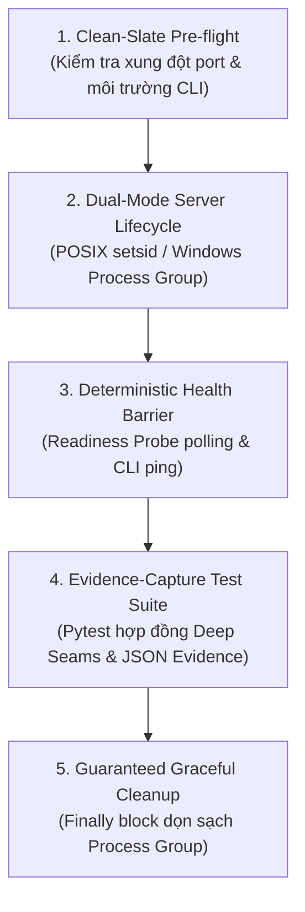
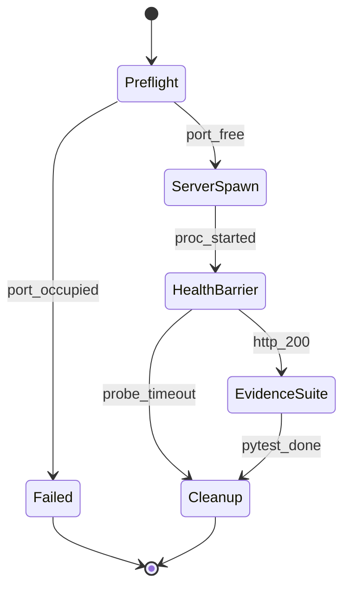

# Kỹ Năng Kiểm Định Tự Động `verify-ccba-harness`

Bộ kỹ năng kiểm định tự động chuyên biệt cho package `ccba-harness` (CLI & Deterministic Evaluation Framework), được khởi tạo theo chuẩn **Pstack Upstream Disciplines (ADR-0009, ADR-0044, ADR-0058)**. Toàn bộ kịch bản thực thi và bài kiểm thử được cô lập hoàn toàn trong `packages/ccba-harness/.agents/skills/verify-ccba-harness/harness/`.

## 🏛️ Platform-Aware Architecture Posture

- **Seam Capability Posture**: `package-bound`. Kỹ năng kiểm định trực tiếp các Public Deep Seams của `ccba_harness` (`calculate_gpi`, `evaluate_two_stage_decision`, `verify_patch_execution`, `verify_document_artifact`, `classify_pr_door`, `SkillValidator`) và bộ định tuyến CLI `ccba_harness.cli.core.main`.
- **Version Anchor (`sync_commit`)**: Neo tại commit `27101e016788ec36713826486aa9e29e678dd857` bảo vệ danh mục `covered_paths` khai báo tại frontmatter.

---

## Kiến Trúc 5 Khối Chức Năng Cốt Lõi



### 1. Clean-Slate Pre-flight (Tiền Kiểm Sạch Sẽ)
- Kiểm tra cổng TCP cục bộ trước khi khởi chạy readiness probe server.
- Xác nhận module `ccba_harness` có thể nạp sạch từ môi trường thực thi hiện hành.

### 2. Dual-Mode Server Lifecycle (Quản Trị Tiến Trình Đa Nền Tảng)
- Khởi chạy tiến trình probe trong Process Group cô lập:
  - **Windows (`sys.platform == "win32"`)**: `creationflags=subprocess.CREATE_NEW_PROCESS_GROUP`
  - **POSIX (`Linux / macOS`)**: `preexec_fn=os.setsid`

### 3. Deterministic Health Barrier (Rào Chắn Sẵn Sàng Xác Định)
- CẤM dùng `time.sleep(N)` tùy tiện để chờ tiến trình khởi động.
- BẮT BUỘC dùng vòng lặp thăm dò HTTP readiness endpoint (`/healthz`) kèm CLI ping `python -m ccba_harness --help` với timeout xác định (`10.0s`, chu kỳ `100ms`).

### 4. Evidence-Capture Test Suite (Thực Thi Kiểm Thử & Thu Thập Bằng Chứng)
- Thực thi bộ kiểm thử hợp đồng `test_harness_suite.py` đối chiếu toàn bộ tính năng trong `packages/ccba-harness/features/INDEX.md`.
- Hỗ trợ đối chứng đường lỗi Statechart (`Statechart Bug-Path Replay`) và xuất báo cáo bằng chứng định dạng JSON:



- `bug_path`: `[{"from": "Preflight", "to": "ServerSpawn", "when": "port_free"}, {"from": "ServerSpawn", "to": "HealthBarrier", "when": "proc_started"}, {"from": "HealthBarrier", "to": "Cleanup", "when": "probe_timeout"}]` — được replay trực tiếp trong `test_harness_suite.py::test_feat_006_statechart_bug_path_replay_and_drift_modes`.

### 5. Guaranteed Graceful Cleanup (Dọn Dẹp Đảm Bảo Tuyệt Đối)
- Luôn giải phóng nhóm tiến trình con trong khối `finally:` (`taskkill /F /T /PID` trên Windows hoặc `os.killpg(pgid, signal.SIGTERM)` trên POSIX) và xác nhận cổng TCP đã được giải phóng hoàn toàn.

---

## Quy Trình Vận Hành & Bảo Trì

### Bước 1: Thực Thi Bộ Kiểm Định 5 Khối
- Chạy kịch bản điều phối kiểm định tự động từ thư mục gốc của dự án:
  ```bash
  .venv/bin/python packages/ccba-harness/.agents/skills/verify-ccba-harness/harness/run_verify_harness.py
  ```
- **Tiêu chí hoàn thành:** Kịch bản thực thi trọn vẹn cả 5 khối, toàn bộ bài kiểm thử trong `test_harness_suite.py` vượt qua 100%, tiến trình con được dọn sạch và lệnh thoát với `exit code 0`.

### Bước 2: Kiểm Tra Nguồn Gốc Thay Đổi Khi Phát Sinh Lỗi (`Pre-Remediation Provenance Check`)
- Đối chiếu `git diff <sync_commit>..HEAD` trên các tệp thuộc `covered_paths`.
- Phân loại kết quả vào đúng 1 trong 4 trạng thái chuẩn:
  - `in_sync`: Không có thay đổi hợp đồng từ `sync_commit` đến commit hiện tại và bài kiểm định vượt qua.
  - `updated`: Thay đổi hợp đồng có chủ đích, đã cập nhật `harness/` và `features/INDEX.md`, vượt qua phép thử đột biến ngữ nghĩa.
  - `bug`: Mã nguồn vi phạm hợp đồng hiện hành (regression) — **CẤM sửa `harness/` hoặc nâng `sync_commit`**, báo cáo counterexample và sửa mã nguồn ứng dụng.
  - `blocked`: Tắc nghẽn do môi trường/hạ tầng — **CẤM dịch chuyển `sync_commit`**.
- **Tiêu chí hoàn thành:** Xác định rõ trạng thái thuộc 1 trong 4 phân loại (`in_sync`, `updated`, `bug`, `blocked`) trước khi can thiệp mã.

### Bước 3: Phép Thử Đột Biến Ngữ Nghĩa (`Semantic Mutation Proof`)
- Xác nhận cây làm việc sạch (`git diff --quiet && git diff --cached --quiet`).
- Thực hiện 1 đột biến ngữ nghĩa tạm thời trên mã nguồn thuộc `covered_paths` (ví dụ: đảo toán tử so sánh ngưỡng GPI `gpi_score < GPI_STANDALONE_THRESHOLD` thành `gpi_score > GPI_STANDALONE_THRESHOLD` trong `gpi.py`).
- Chạy lại `run_verify_harness.py` để xác nhận bộ kiểm định bắt trúng lỗi (exit code $\ne 0$) và thu thập nhật ký lỗi phản chứng (*counterexample failure log*).
- Hoàn nguyên tức thì (`git checkout -- <mutated_files>`), xác nhận `git status --porcelain` sạch và chạy lại `run_verify_harness.py` đạt `exit code 0`.
- **Tiêu chí hoàn thành:** Phép thử đột biến ngữ nghĩa bắt được lỗi, mã nguồn được hoàn nguyên 100% và lượt chạy nghiệm thu thoát sạch với `exit code 0`.
