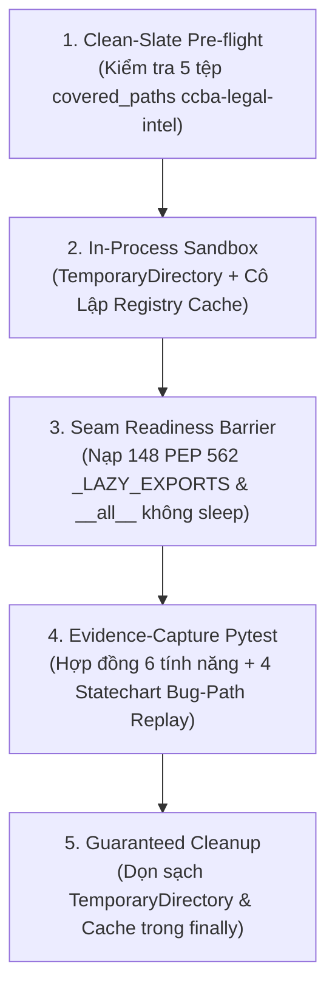
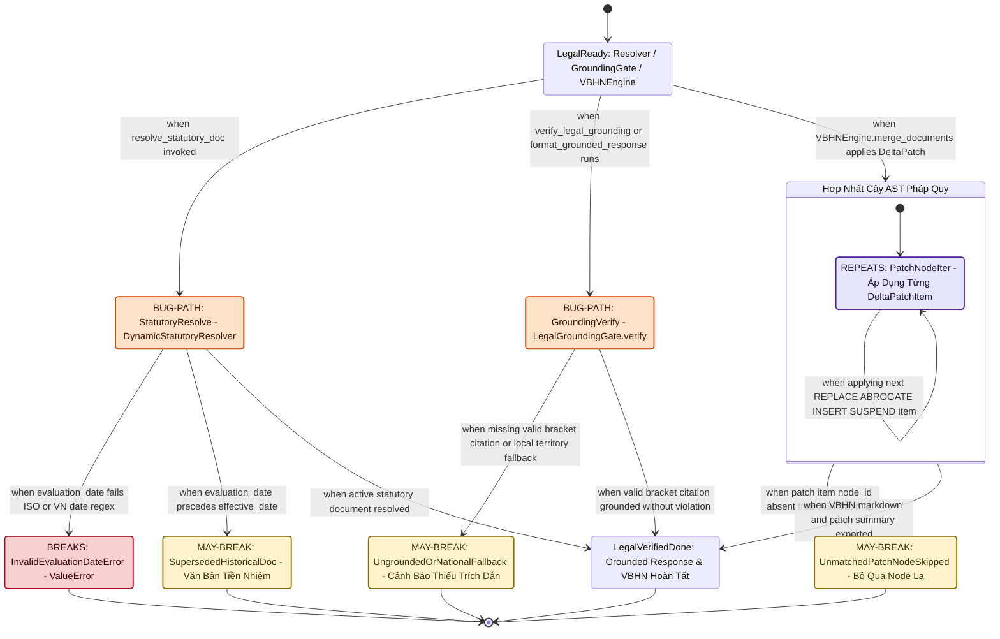

# Kỹ Năng Kiểm Định Tự Động `verify-ccba-legal-intel`

Bộ kỹ năng kiểm định tự động chuyên biệt cho package `ccba-legal-intel` (`LegalGroundingGate`, `verify_legal_grounding`, `format_grounded_response`, `DynamicStatutoryResolver`, `resolve_statutory_doc`, `ASTParser`, `DeltaPatch`, `VBHNEngine`, `MergedLegalDocument`), được khởi tạo theo **Profile B (In-Process Library)** của `ccba-create-verification-skill` `v1.4.0` và chuẩn **Pstack `statechart` `v0.15.42`**. Toàn bộ mã kiểm định cô lập trong `packages/ccba-harness/.agents/skills/verify-ccba-legal-intel/harness/`.

## 🏛️ Platform-Aware Architecture Posture

- **Seam Capability Posture**: `package-bound`. Bảo vệ trực tiếp `148` lazy-loaded Public Deep Seams trong `ccba_legal.__all__` / `_LAZY_EXPORTS` cùng `5` module logic pháp lý lõi In-Process tương ứng với kỹ năng `ccba-legal-intel`.
- **Version Anchor (`sync_commit` & `covered_sha256`)**: Neo tại commit `d165d946abdead603944dc40af03c5c30673b4b4` kèm mã băm SHA-256 chuẩn hóa LF bảo vệ toàn bộ `5` tệp `covered_paths`.
- **Giới Hạn Phạm Vi (`Scope & Limitations`)**:
  - Khóa `5` tệp lõi In-Process (`__init__.py`, `ast_parser.py`, `currency_resolver.py`, `grounding.py`, `vbhn_engine.py`) chạy `< 0.3s` hoàn toàn trong bộ nhớ, tách biệt khỏi các module phụ thuộc trình duyệt Chrome CDP (`cdp.py`, `crawler/`) hoặc Google Drive (`gdrive_vault.py`, `sync/`).
  - Tuân thủ `ADR-0059`: chỉ sử dụng các số hiệu văn bản công báo thực trong `ROLE_SPEC_TABLE` (`135/2025/QH15`, `50/2014/QH13`, `55/2024/QH15`, `105/2025/NĐ-CP`) và truyền `DeltaPatch` in-memory vào `VBHNEngine.merge_documents()` để kiểm định deterministic không gọi LLM hay sinh mock công báo.

---

## Kiến Trúc 5 Khối Kiểm Định In-Process (`Profile B`)



### 1. Clean-Slate Pre-flight
- Xác nhận đủ `5` tệp trong `covered_paths` tồn tại trên đĩa và `ccba_legal.__init__.py` sẵn sàng phân giải `_LAZY_EXPORTS`.

### 2. In-Process Sandbox Isolation
- Khởi tạo vùng làm việc tạm `TemporaryDirectory(prefix="verify_ccba_legal_intel_")`, thiết lập `PYTHONPATH` và biến `CCBA_LEGAL_INTEL_SANDBOX` trong process thuần **không kết nối TVPL, Google Drive hay AI Gateway**.

### 3. Deterministic Seam Readiness Barrier
- Kiểm tra nạp thẳng bảng `148` Public Deep Seams trong `ccba_legal.__all__` khớp 1:1 với `_LAZY_EXPORTS`, cùng khả năng phân giải `LegalGroundingGate`, `DynamicStatutoryResolver`, `ASTParser`, `DeltaPatch`, `VBHNEngine` bằng lệnh con Python sạch; cấm dùng `time.sleep(N)`.

### 4. Evidence-Capture Pytest & Statechart `v0.15.42` (`Bug-Path Replay`)
- Thực thi `test_legal_intel_suite.py` đối chiếu toàn bộ `6` tính năng trong `features/INDEX.md` và mô hình hóa luồng chuyển trạng thái bằng `stateDiagram-v2` ($18 \le 20$ cạnh, vượt qua 5 Anti-Lie invariants):



**Danh sách đường dẫn phản chứng (`bug_path`) & bước ẩn bàn giao kèm sơ đồ:**
- `bug_path_1` (Invalid `evaluation_date` Format Raises `ValueError`): `[{"from": "LegalReady", "to": "StatutoryResolve", "when": "resolve_statutory_doc invoked"}, {"from": "StatutoryResolve", "to": "InvalidEvaluationDateError", "when": "evaluation_date fails ISO or VN date regex"}]`
- `bug_path_2` (Historical `evaluation_date` Resolves Superseded Predecessor): `[{"from": "LegalReady", "to": "StatutoryResolve", "when": "resolve_statutory_doc invoked"}, {"from": "StatutoryResolve", "to": "SupersededHistoricalDoc", "when": "evaluation_date precedes effective_date"}]`
- `bug_path_3` (Ungrounded Citation / Markdown Link Exclusion / National Fallback Banner): `[{"from": "LegalReady", "to": "GroundingVerify", "when": "verify_legal_grounding or format_grounded_response runs"}, {"from": "GroundingVerify", "to": "UngroundedOrNationalFallback", "when": "missing valid bracket citation or local territory fallback"}]`
- `bug_path_4` (VBHN Merge Skips Unknown `node_id` While Applying Valid Patches): `[{"from": "LegalReady", "to": "VBHNPatchLoop", "when": "VBHNEngine.merge_documents applies DeltaPatch"}, {"from": "VBHNPatchLoop", "to": "UnmatchedPatchNodeSkipped", "when": "patch item node_id absent from AST flat map"}]`
- `hidden_steps` (lược bỏ để giữ ngân sách $\le 20$ cạnh):
  - `GroundingVerify -> UngroundedOrNationalFallback` khi `validate_authority_naming` phát hiện danh xưng cơ quan đã giải thể dù có trích dẫn `[...]` hợp lệ (`grounding.py:86-102`).
  - `DynamicStatutoryResolver` phân tầng Tier 1 (`master_registry` / `local_registry`) $\to$ Tier 2 (`legal_currency_card.json`) $\to$ Tier 3 (`ROLE_SPEC_TABLE` fallback), đã kiểm định đầy đủ tại `test_feat_leg_002`.
- Cả 4 chuỗi `bug_path` được replay trực tiếp trên mã nguồn thật tại `test_legal_intel_suite.py`.

### 5. Guaranteed Cleanup
- Xóa toàn bộ thư mục tạm và làm sạch cache `_load_cached_registry` trong khối `finally:`.

---

## Quy Trình Vận Hành & Bảo Trì

### Bước 1: Chạy Bộ Kiểm Định 5 Khối Cho `ccba-legal-intel`
```bash
.venv/bin/python packages/ccba-harness/.agents/skills/verify-ccba-legal-intel/harness/run_verify_legal_intel.py
```
- **Tiêu chí hoàn thành:** Toàn bộ `6` ca kiểm thử trong `test_legal_intel_suite.py` vượt qua 100%, thư mục tạm được giải phóng và lệnh thoát với `exit code 0`.

### Bước 2: Phép Thử Đột Biến Ngữ Nghĩa (`Semantic Mutation Proof`)
- Xác nhận `git diff --quiet` trên `packages/ccba-legal-intel`.
- Thực hiện 1 đột biến ngữ nghĩa tạm thời trên `packages/ccba-legal-intel/src/ccba_legal/grounding.py` (ví dụ đổi `"is_grounded": False` tại dòng `115` thành `"is_grounded": True`), chạy lại `run_verify_legal_intel.py` để xác nhận bắt được lỗi (`exit code != 0`), hoàn nguyên sạch với `git checkout --`, và chạy lại xác nhận `exit code 0`.
- **Tiêu chí hoàn thành:** Bộ kiểm định bắt được đột biến ngữ nghĩa, mã nguồn hoàn nguyên 100% sạch sẽ và lần chạy nghiệm thu đạt `exit code 0`.
