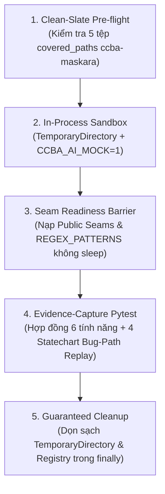
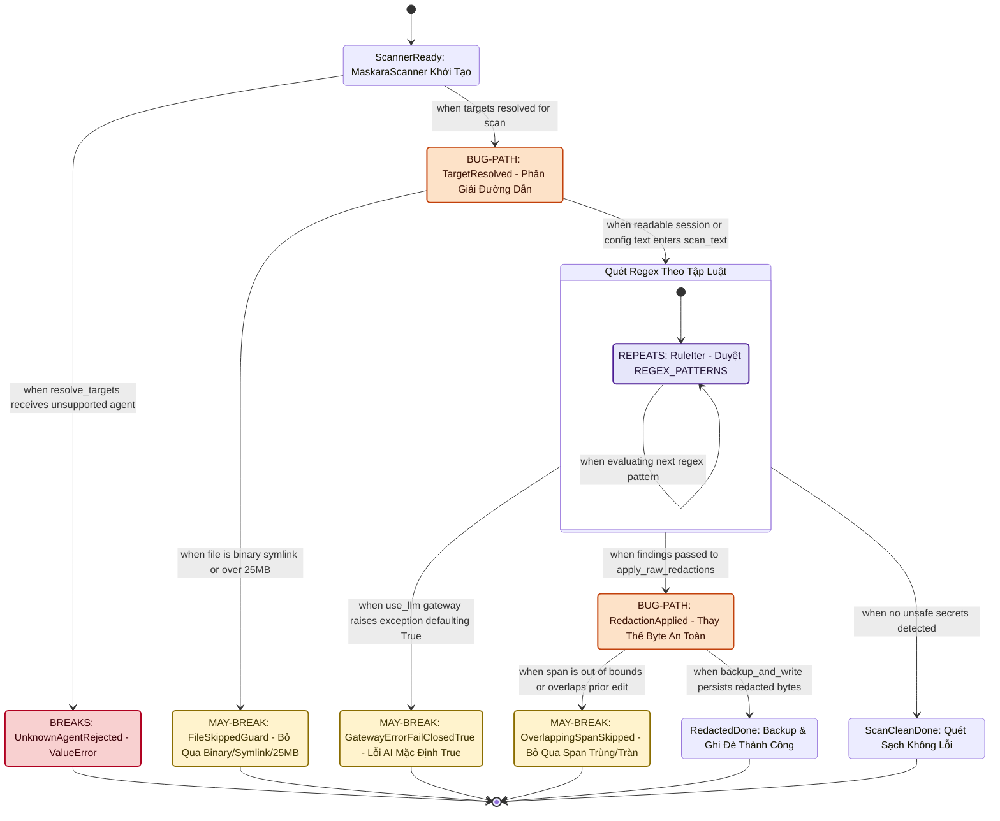

# Kỹ Năng Kiểm Định Tự Động `verify-ccba-maskara`

Bộ kỹ năng kiểm định tự động chuyên biệt cho package `ccba-maskara` (`MaskaraScanner`, `detect_secrets_in_text`, `redact_secrets_in_text`, `apply_raw_redactions`, `backup_and_write`, `is_binary`), được khởi tạo theo **Profile B (In-Process Library)** của `ccba-create-verification-skill` `v1.4.0` và chuẩn **Pstack `statechart` `v0.15.42`**. Toàn bộ mã kiểm định cô lập trong `packages/ccba-harness/.agents/skills/verify-ccba-maskara/harness/`.

## 🏛️ Platform-Aware Architecture Posture

- **Seam Capability Posture**: `package-bound`. Bảo vệ trực tiếp các Public Deep Seams của `ccba_maskara` (`MaskaraScanner`, `detect_secrets_in_text`, `redact_secrets_in_text`, `redact_secrets_and_pii`, `apply_raw_redactions`, `backup_and_write`, `is_binary`, `REGEX_PATTERNS`, `PII_REGEX_PATTERNS`) tương ứng với kỹ năng `ccba-maskara`.
- **Version Anchor (`sync_commit` & `covered_sha256`)**: Neo tại commit PR-2 `646cf2d79b382ba8e33bb2540676c272bfc99435` kèm mã băm SHA-256 chuẩn hóa LF bảo vệ toàn bộ `5` tệp `covered_paths`.
- **Giới Hạn Phạm Vi (`Scope & Limitations`)**:
  - Việc kiểm chứng bằng `use_llm=True` cô lập qua mock `ccba_ai.ai.chat` (`_scanner.py:213-237`), không gọi mạng tới LiteLLM Gateway thực.
  - Khi `scan_file` gặp symlink, thư mục, tệp nhị phân, tệp vượt `25 MB` (`MAX_FILE_SIZE`), hoặc tên tệp không thuộc nhóm session/config text (`_scanner.py:343-348`), hàm trả về `skipped=1` thay vì ném ngoại lệ (`bug_path_2`).

---

## Kiến Trúc 5 Khối Kiểm Định In-Process (`Profile B`)



### 1. Clean-Slate Pre-flight
- Xác nhận đủ `5` tệp trong `covered_paths` tồn tại trên đĩa và `ccba_maskara.__init__.py` không sinh ngoại lệ khi kiểm tra khởi tạo.

### 2. In-Process Sandbox Isolation
- Khởi tạo vùng làm việc tạm `TemporaryDirectory(prefix="verify_ccba_maskara_")`, thiết lập `PYTHONPATH` và `CCBA_AI_MOCK=1` mà **không mở cổng TCP hay dựng HTTP dummy server**.

### 3. Deterministic Seam Readiness Barrier
- Kiểm tra nạp thẳng Public Deep Seams trong `ccba_maskara.__all__` (`MaskaraScanner`, `detect_secrets_in_text`, `redact_secrets_in_text`, `apply_raw_redactions`, `backup_and_write`, `is_binary`, `REGEX_PATTERNS`) bằng lệnh con Python sạch; cấm dùng `time.sleep(N)`.

### 4. Evidence-Capture Pytest & Statechart `v0.15.42` (`Bug-Path Replay`)
- Thực thi `test_maskara_suite.py` đối chiếu toàn bộ `6` tính năng trong `features/INDEX.md` và mô hình hóa luồng chuyển trạng thái bằng `stateDiagram-v2` ($18 \le 20$ cạnh, đủ 4 lớp kiểm định):



**Danh sách đường dẫn phản chứng (`bug_path`) & bước ẩn bàn giao kèm sơ đồ:**
- `bug_path_1` (Unknown Agent Rejected — `ValueError`): `[{"from": "ScannerReady", "to": "UnknownAgentRejected", "when": "resolve_targets receives unsupported agent"}]`
- `bug_path_2` (Binary/Symlink/25MB File Guard Skip): `[{"from": "ScannerReady", "to": "TargetResolved", "when": "targets resolved for scan"}, {"from": "TargetResolved", "to": "FileSkippedGuard", "when": "file is binary symlink or over 25MB"}]`
- `bug_path_3` (Overlapping/Out-of-Bounds Span Skipped): `[{"from": "RegexRuleLoop", "to": "RedactionApplied", "when": "findings passed to apply_raw_redactions"}, {"from": "RedactionApplied", "to": "OverlappingSpanSkipped", "when": "span is out of bounds or overlaps prior edit"}]`
- `bug_path_4` (AI Gateway Exception Defaults `True`): `[{"from": "RegexRuleLoop", "to": "GatewayErrorFailClosedTrue", "when": "use_llm gateway raises exception defaulting True"}]`
- `hidden_steps` (lược bỏ để giữ ngân sách $\le 20$ cạnh):
  - `TargetResolved -> FileSkippedGuard` (khi `perform_scan` gặp thư mục gốc không tồn tại và ghi `warnings`).
  - `RuleIter -> ScanCleanDone` (khi `is_safe_or_template` lọc an toàn `SAFE_STRINGS` hoặc `_KNOWN_TOKEN_METRICS`).
- Cả 4 chuỗi `bug_path` được replay trực tiếp trên mã nguồn thật tại `test_maskara_suite.py`.

### 5. Guaranteed Cleanup
- Xóa toàn bộ thư mục tạm và khôi phục nguyên trạng cấu hình sandbox trong khối `finally:`.

---

## Quy Trình Vận Hành & Bảo Trì

### Bước 1: Chạy Bộ Kiểm Định 5 Khối Cho `ccba-maskara`
```bash
.venv/bin/python packages/ccba-harness/.agents/skills/verify-ccba-maskara/harness/run_verify_maskara.py
```
- **Tiêu chí hoàn thành:** Toàn bộ `6` ca kiểm thử trong `test_maskara_suite.py` vượt qua 100%, thư mục tạm được giải phóng và lệnh thoát với `exit code 0`.

### Bước 2: Phép Thử Đột Biến Ngữ Nghĩa (`Semantic Mutation Proof`)
- Xác nhận `git diff --quiet` trên `packages/ccba-maskara`.
- Thực hiện 1 đột biến ngữ nghĩa tạm thời trên `packages/ccba-maskara/src/ccba_maskara/_scanner.py` (ví dụ đảo điều kiện `is_safe_or_template` hoặc vô hiệu hóa kiểm tra `MAX_FILE_SIZE`), chạy lại `run_verify_maskara.py` để xác nhận bắt được lỗi (`exit code != 0`), hoàn nguyên sạch với `git checkout --`, và chạy lại xác nhận `exit code 0`.
- **Tiêu chí hoàn thành:** Bộ kiểm định bắt được đột biến ngữ nghĩa, mã nguồn hoàn nguyên 100% sạch sẽ và lần chạy nghiệm thu đạt `exit code 0`.
