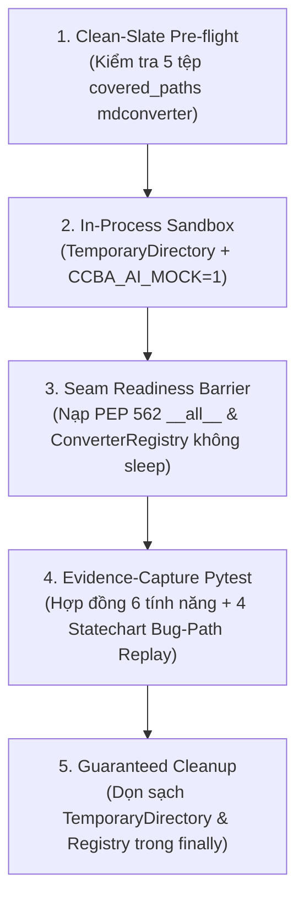
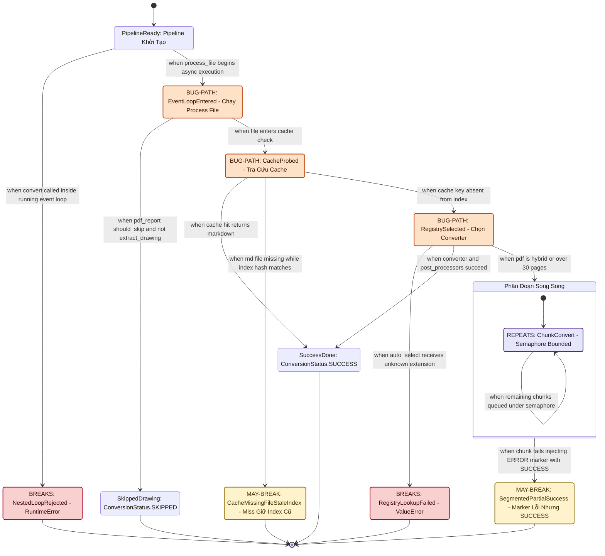

# Kỹ Năng Kiểm Định Tự Động `verify-ccba-mdconverter`

Bộ kỹ năng kiểm định tự động chuyên biệt cho package `mdconverter` (`ConversionPipeline`, `ConverterRegistry`, `ConversionCache`, `PostProcessor` và phân cấp lỗi `MDConvertError`), được khởi tạo theo **Profile B (In-Process Library)** của `ccba-create-verification-skill` `v1.4.0` và chuẩn **Pstack `statechart` `v0.15.42`**. Toàn bộ mã kiểm định cô lập trong `packages/ccba-harness/.agents/skills/verify-ccba-mdconverter/harness/`.

## 🏛️ Platform-Aware Architecture Posture

- **Seam Capability Posture**: `package-bound`. Bảo vệ trực tiếp hợp đồng Seam `legal_markdown.v1` (`mdconverter:ConversionPipeline`, `ConverterRegistry`, `ConversionCache`, `ConversionResult`, `MDConvertError`) tương ứng với kỹ năng `ccba-markdown-document-processing`.
- **Version Anchor (`sync_commit` & `covered_sha256`)**: Neo tại commit trên `main` `fbe8becb1d0ccb63ccdcb312425fd33e27f08553` kèm mã băm SHA-256 chuẩn hóa LF bảo vệ toàn bộ `5` tệp `covered_paths`.
- **Giới Hạn Phạm Vi (`Scope & Limitations`)**:
  - `mdconverter/core/analyzer.py` chỉ re-export `PDFAnalyzer`, `PDFReport`, `Segment` từ `ccba_pdf_prep`. Do đó luật phân loại tài liệu PDF (`drawing`, `hybrid`, `should_skip`) thuộc trách nhiệm kiểm thử của `ccba-pdf-prep`; bộ kiểm định này khóa nhánh rẽ tại `ConversionPipeline.process_file()` (`pdf_report.should_skip` trả `ConversionStatus.SKIPPED`).
  - **Follow-up kỹ thuật ghi nhận từ code thật:** `ConversionCache` hiện không dùng file lock khi ghi đồng thời và `_save_index()` nuốt `OSError` âm thầm (`cache.py:61-62`); hành vi mất tệp `.md` cache nhưng giữ mục index cũ (`cache.py:119-122`) được khóa bằng `bug_path_4` bên dưới.

---

## Kiến Trúc 5 Khối Kiểm Định In-Process (`Profile B`)



### 1. Clean-Slate Pre-flight
- Xác nhận đủ `5` tệp trong `covered_paths` tồn tại trên đĩa và `mdconverter.__init__.py` không sinh ngoại lệ khi kiểm tra khởi tạo.

### 2. In-Process Sandbox Isolation
- Khởi tạo vùng làm việc tạm `TemporaryDirectory(prefix="verify_ccba_mdconverter_")`, thiết lập `PYTHONPATH` và `CCBA_AI_MOCK=1` mà **không mở cổng TCP hay dựng HTTP dummy server**.

### 3. Deterministic Seam Readiness Barrier
- Kiểm tra nạp thẳng Public Deep Seams trong `mdconverter.__all__` (`ConversionPipeline`, `ConverterRegistry`, `ConversionCache`, `MDConvertError`) bằng lệnh con Python sạch; cấm dùng `time.sleep(N)`.

### 4. Evidence-Capture Pytest & Statechart `v0.15.42` (`Bug-Path Replay`)
- Thực thi `test_mdconverter_suite.py` đối chiếu toàn bộ `6` tính năng trong `features/INDEX.md` và mô hình hóa luồng chuyển trạng thái bằng `stateDiagram-v2` ($20 \le 20$ cạnh, đủ 4 lớp kiểm định):



**Danh sách đường dẫn phản chứng (`bug_path`) & bước ẩn bàn giao kèm sơ đồ:**
- `bug_path_1` (Nested Event Loop — `RuntimeError`): `[{"from": "PipelineReady", "to": "NestedLoopRejected", "when": "convert called inside running event loop"}]`
- `bug_path_2` (Unknown Extension Lookup — `ValueError`): `[{"from": "EventLoopEntered", "to": "CacheProbed", "when": "file enters cache check"}, {"from": "CacheProbed", "to": "RegistrySelected", "when": "cache key absent from index"}, {"from": "RegistrySelected", "to": "RegistryLookupFailed", "when": "auto_select receives unknown extension"}]`
- `bug_path_3` (Segmented Chunk Failure Returns `SUCCESS` With `[!ERROR]` Marker): `[{"from": "RegistrySelected", "to": "SegmentedDispatch", "when": "pdf is hybrid or over 30 pages"}, {"from": "ChunkConvert", "to": "SegmentedPartialSuccess", "when": "chunk fails injecting ERROR marker with SUCCESS"}]`
- `bug_path_4` (Missing Cache File Keeps Stale Index Entry): `[{"from": "EventLoopEntered", "to": "CacheProbed", "when": "file enters cache check"}, {"from": "CacheProbed", "to": "CacheMissingFileStaleIndex", "when": "md file missing while index hash matches"}]`
- `hidden_steps` (lược bỏ để giữ ngân sách $\le 20$ cạnh):
  - `PipelineReady -> RegistrySelected` (luồng tạo converter trực tiếp khi `cache is None`).
  - `CacheMissingFileStaleIndex -> RegistrySelected` (sau khi `ConversionCache.get()` trả `None`, pipeline tiếp tục đi vào bước chọn converter).
- Cả 4 chuỗi `bug_path` được replay trực tiếp trên mã nguồn thật tại `test_mdconverter_suite.py`.

### 5. Guaranteed Cleanup
- Xóa toàn bộ thư mục tạm và khôi phục nguyên trạng `ConverterRegistry._converters` / `_priority` trong khối `finally:`.

---

## Quy Trình Vận Hành & Bảo Trì

### Bước 1: Chạy Bộ Kiểm Định 5 Khối Cho `mdconverter`
```bash
.venv/bin/python packages/ccba-harness/.agents/skills/verify-ccba-mdconverter/harness/run_verify_mdconverter.py
```
- **Tiêu chí hoàn thành:** Toàn bộ `6` ca kiểm thử trong `test_mdconverter_suite.py` vượt qua 100%, thư mục tạm được giải phóng và lệnh thoát với `exit code 0`.

### Bước 2: Phép Thử Đột Biến Ngữ Nghĩa (`Semantic Mutation Proof`)
- Xác nhận `git diff --quiet` trên `packages/mdconverter`.
- Thực hiện 1 đột biến ngữ nghĩa tạm thời trên `packages/mdconverter/src/mdconverter/core/pipeline.py` (ví dụ vô hiệu hóa điều kiện `if loop and loop.is_running():`), chạy lại `run_verify_mdconverter.py` để xác nhận bắt được lỗi (`exit code != 0`), hoàn nguyên sạch với `git checkout --`, và chạy lại xác nhận `exit code 0`.
- **Tiêu chí hoàn thành:** Bộ kiểm định bắt được đột biến ngữ nghĩa, mã nguồn hoàn nguyên 100% sạch sẽ và lần chạy nghiệm thu đạt `exit code 0`.
