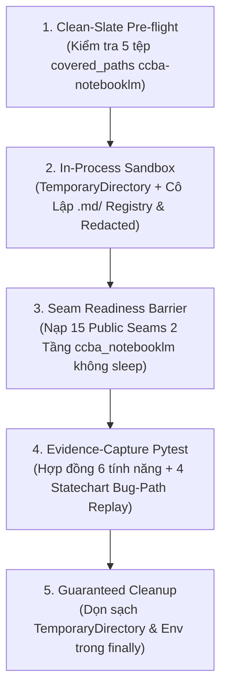
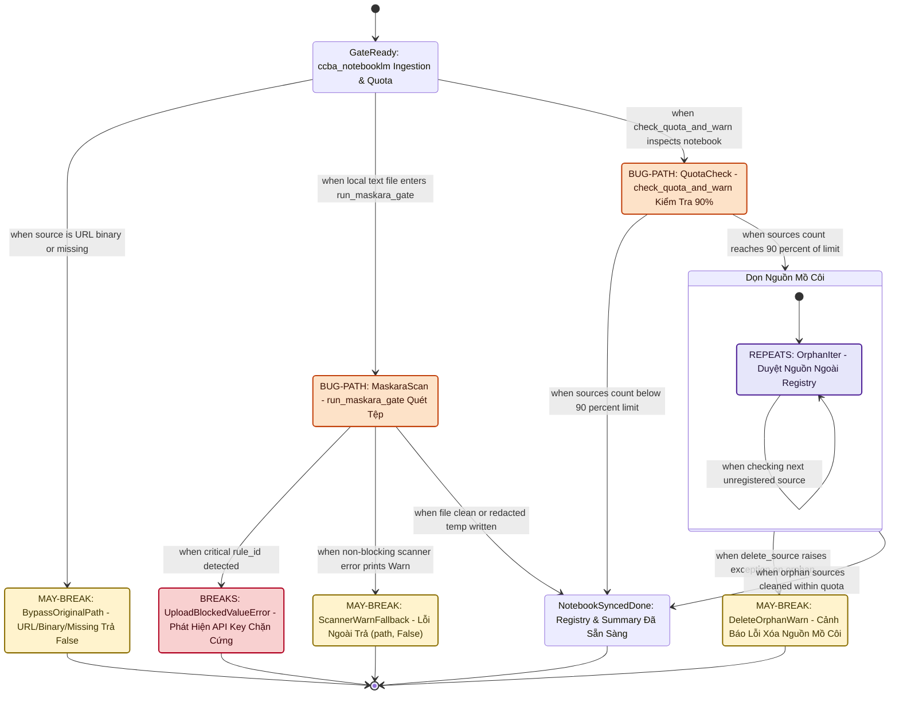

# Kỹ Năng Kiểm Định Tự Động `verify-ccba-notebooklm`

Bộ kỹ năng kiểm định tự động chuyên biệt cho package `ccba-notebooklm` (`CCBANotebookLMClient`, `NotebookLMClient`, `run_maskara_gate`, `sanitize_prompt_for_query`, `update_registry`, `check_quota_and_warn`, `run_garbage_collection`, `post_process_summary`), được khởi tạo theo **Profile B (In-Process Library)** của `ccba-create-verification-skill` `v1.4.0` và chuẩn **Pstack `statechart` `v0.15.42`**. Toàn bộ mã kiểm định cô lập trong `packages/ccba-harness/.agents/skills/verify-ccba-notebooklm/harness/`.

## 🏛️ Platform-Aware Architecture Posture

- **Seam Capability Posture**: `package-bound`. Bảo vệ trực tiếp `15` Public Deep Seams 2 tầng trong `ccba_notebooklm.__all__` (`HAS_NOTEBOOKLM`, `CCBANotebookLMClient`, `NotebookLMClient`, `check_auth`, `get_client` và `10` workflow functions) cùng `4` module điều phối lõi (`_security.py`, `_registry.py`, `_gc.py`, `_artifacts.py`) tương ứng với kỹ năng `ccba-notebooklm-connector`.
- **Version Anchor (`sync_commit` & `covered_sha256`)**: Neo tại commit `704f2ac7941792dfd7f5a0fe150a288f149ee536` kèm mã băm SHA-256 chuẩn hóa LF bảo vệ toàn bộ `5` tệp `covered_paths`.
- **Giới Hạn Phạm Vi (`Scope & Limitations`)**:
  - Toàn bộ thao tác tệp (`.md/scratch/redacted/`, `sources_registry.yaml`, `workspace_context.yaml`, `notebooklm_task_state.yaml`) được cô lập tuyệt đối trong `tmp_path` bằng `monkeypatch.chdir(tmp_path)` và patch đường dẫn module `_registry`, tuyệt đối không ghi ra `.md/` của repo thật.
  - Phản hồi của `detect_secrets_in_text` và client NotebookLM bất đồng bộ được mock in-memory để chạy `< 0.2s` không cần mạng hay cookie xác thực, đồng thời tuân thủ `RULE-5.11` (không nhúng secret literal hay tên biến nhạy cảm vào bộ test).

---

## Kiến Trúc 5 Khối Kiểm Định In-Process (`Profile B`)



### 1. Clean-Slate Pre-flight
- Xác nhận đủ `5` tệp trong `covered_paths` tồn tại trên đĩa và `ccba_notebooklm.__init__.py` nạp sạch không sinh ngoại lệ.

### 2. In-Process Sandbox Isolation
- Khởi tạo vùng làm việc tạm `TemporaryDirectory(prefix="verify_ccba_notebooklm_")`, thiết lập `PYTHONPATH` và biến `CCBA_NOTEBOOKLM_SANDBOX` trong process thuần **không kết nối mạng hay mở tiến trình Chrome**.

### 3. Deterministic Seam Readiness Barrier
- Kiểm tra nạp thẳng toàn bộ `15` Public Deep Seams trong `ccba_notebooklm.__all__` và kiểm chứng `NotebookLMClient is CCBANotebookLMClient` bằng lệnh con Python sạch; cấm dùng `time.sleep(N)`.

### 4. Evidence-Capture Pytest & Statechart `v0.15.42` (`Bug-Path Replay`)
- Thực thi `test_notebooklm_suite.py` đối chiếu toàn bộ `6` tính năng trong `features/INDEX.md` và mô hình hóa luồng chuyển trạng thái bằng `stateDiagram-v2` ($18 \le 20$ cạnh, vượt qua 5 Anti-Lie invariants):



**Danh sách đường dẫn phản chứng (`bug_path`) & bước ẩn bàn giao kèm sơ đồ:**
- `bug_path_1` (Critical Finding Upload Blocked — `ValueError`): `[{"from": "GateReady", "to": "MaskaraScan", "when": "local text file enters run_maskara_gate"}, {"from": "MaskaraScan", "to": "UploadBlockedValueError", "when": "critical rule_id detected"}]`
- `bug_path_2` (URL/Binary/Missing File Bypass Returns `(source_path, False)`): `[{"from": "GateReady", "to": "BypassOriginalPath", "when": "source is URL binary or missing"}]`
- `bug_path_3` (Unexpected Scanner Error Fail-Open Warning in `run_maskara_gate`): `[{"from": "GateReady", "to": "MaskaraScan", "when": "local text file enters run_maskara_gate"}, {"from": "MaskaraScan", "to": "ScannerWarnFallback", "when": "non-blocking scanner error prints Warn"}]`
- `bug_path_4` (Quota $\ge 90\%$ Triggers Orphan GC Loop & Warns on `delete_source` Error): `[{"from": "GateReady", "to": "QuotaCheck", "when": "check_quota_and_warn inspects notebook"}, {"from": "QuotaCheck", "to": "OrphanGcLoop", "when": "sources count reaches 90 percent of limit"}, {"from": "OrphanGcLoop", "to": "DeleteOrphanWarn", "when": "delete_source raises exception on orphan"}]`
- `hidden_steps` (lược bỏ để giữ ngân sách $\le 20$ cạnh):
  - `sanitize_prompt_for_query` ngược lại với `run_maskara_gate` theo cơ chế **Fail-Closed** (`RuntimeError` khi `detect_secrets_in_text` ném lỗi hoặc `ValueError` qua fallback regex), đã kiểm định trực tiếp tại `test_feat_nlm_002`.
  - `_registry.route_session_to_workflow` ưu tiên biến môi trường `NOTEBOOKLM_<BUNDLE>_ID` trước `catalog.yaml` và lưu vào `workspace_context.yaml`.
- Cả 4 chuỗi `bug_path` được replay trực tiếp trên mã nguồn thật tại `test_notebooklm_suite.py`.

### 5. Guaranteed Cleanup
- Xóa toàn bộ thư mục tạm và khôi phục trạng thái môi trường trong khối `finally:`.

---

## Quy Trình Vận Hành & Bảo Trì

### Bước 1: Chạy Bộ Kiểm Định 5 Khối Cho `ccba-notebooklm`
```bash
.venv/bin/python packages/ccba-harness/.agents/skills/verify-ccba-notebooklm/harness/run_verify_notebooklm.py
```
- **Tiêu chí hoàn thành:** Toàn bộ `6` ca kiểm thử trong `test_notebooklm_suite.py` vượt qua 100%, thư mục tạm được giải phóng và lệnh thoát với `exit code 0`.

### Bước 2: Phép Thử Đột Biến Ngữ Nghĩa (`Semantic Mutation Proof`)
- Xác nhận `git diff --quiet` trên `packages/ccba-notebooklm`.
- Thực hiện 1 đột biến ngữ nghĩa tạm thời trên `packages/ccba-notebooklm/src/ccba_notebooklm/_security.py` (ví dụ đổi giá trị trả về nhánh URL tại dòng `45` thành `return source_path, True`), chạy lại `run_verify_notebooklm.py` để xác nhận bắt được lỗi (`exit code != 0`), hoàn nguyên sạch với `git checkout --`, và chạy lại xác nhận `exit code 0`.
- **Tiêu chí hoàn thành:** Bộ kiểm định bắt được đột biến ngữ nghĩa, mã nguồn hoàn nguyên 100% sạch sẽ và lần chạy nghiệm thu đạt `exit code 0`.
