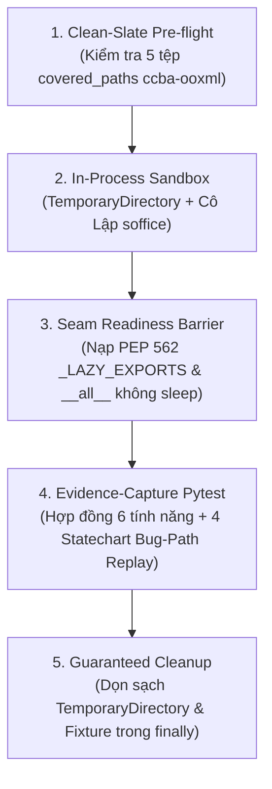
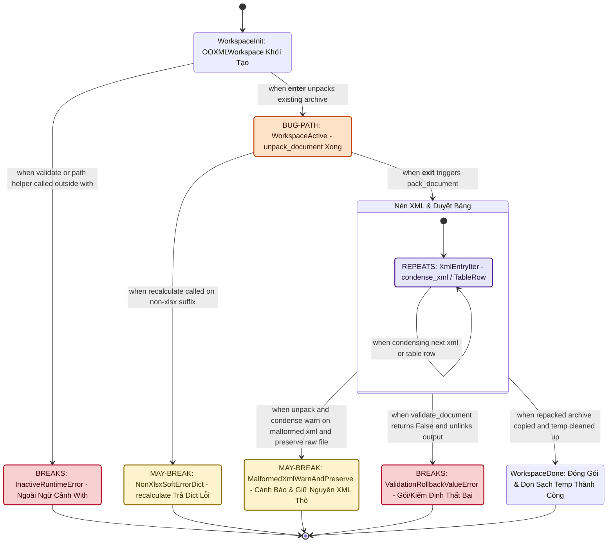

# Kỹ Năng Kiểm Định Tự Động `verify-ccba-ooxml`

Bộ kỹ năng kiểm định tự động chuyên biệt cho package `ccba-ooxml` (`OOXMLWorkspace`, `pack_document`, `unpack_document`, `condense_xml`, `TableReconstructor`, `StructuredTable`, `make_descriptive_table_slug`, `vietnamese_to_ascii`), được khởi tạo theo **Profile B (In-Process Library)** của `ccba-create-verification-skill` `v1.4.0` và chuẩn **Pstack `statechart` `v0.15.42`**. Toàn bộ mã kiểm định cô lập trong `packages/ccba-harness/.agents/skills/verify-ccba-ooxml/harness/`.

## 🏛️ Platform-Aware Architecture Posture

- **Seam Capability Posture**: `package-bound`. Bảo vệ trực tiếp `78` lazy-loaded Public Deep Seams trong `ccba_ooxml.__all__` / `_LAZY_EXPORTS` tương ứng với kỹ năng `ccba-xu-ly-van-phong`.
- **Version Anchor (`sync_commit` & `covered_sha256`)**: Neo tại commit PR-3b `7259350d8020834c52ab88e4c5681e165612cc8b` kèm mã băm SHA-256 chuẩn hóa LF bảo vệ `5` tệp lõi sạch `mypy --strict` (`__init__.py`, `pack.py`, `tables.py`, `unpack.py`, `workspace.py`).
- **Giới Hạn Phạm Vi (`Scope & Limitations`)**:
  - Toàn bộ ca kiểm thử chạy 100% in-process trên fixture `.docx`/ZIP tạo trong `tmp_path` (`< 0.2s`), dùng `monkeypatch` cô lập `validate_document` và `calc.recalc_xlsx` để tuyệt đối không gọi tiến trình LibreOffice (`soffice`).
  - **Symmetric Malformed-XML Handling (`bug_path_4`)**: Cả `unpack_document()` (`unpack.py:31-37`) lẫn `condense_xml()` (`pack.py:62-68`) đều bắt ngoại lệ XML hỏng, in cảnh báo (`Warning: Could not pretty print` / `Warning: Could not condense`) ra `stderr` và bảo toàn nguyên vẹn XML thô trên đĩa để `OOXMLWorkspace` đóng gói an toàn không ném `ExpatError`.

---

## Kiến Trúc 5 Khối Kiểm Định In-Process (`Profile B`)



### 1. Clean-Slate Pre-flight
- Xác nhận đủ `5` tệp trong `covered_paths` tồn tại trên đĩa và `ccba_ooxml.__init__.py` không sinh ngoại lệ khi khởi tạo bảng `_LAZY_EXPORTS`.

### 2. In-Process Sandbox Isolation
- Khởi tạo vùng làm việc tạm `TemporaryDirectory(prefix="verify_ccba_ooxml_")`, thiết lập `PYTHONPATH` và biến `CCBA_OOXML_SANDBOX` trong process thuần **không mở cổng TCP hay khởi chạy tiến trình LibreOffice (`soffice`)**.

### 3. Deterministic Seam Readiness Barrier
- Kiểm tra nạp thẳng `78` Public Deep Seams trong `ccba_ooxml.__all__` khớp 1:1 với `_LAZY_EXPORTS`, cùng khả năng phân giải `OOXMLWorkspace`, `pack_document`, `unpack_document`, `TableReconstructor`, `StructuredTable` bằng lệnh con Python sạch; cấm dùng `time.sleep(N)`.

### 4. Evidence-Capture Pytest & Statechart `v0.15.42` (`Bug-Path Replay`)
- Thực thi `test_ooxml_suite.py` đối chiếu toàn bộ `6` tính năng trong `features/INDEX.md` và mô hình hóa luồng chuyển trạng thái bằng `stateDiagram-v2` ($15 \le 20$ cạnh, đủ 4 lớp kiểm định):



**Danh sách đường dẫn phản chứng (`bug_path`) & bước ẩn bàn giao kèm sơ đồ:**
- `bug_path_1` (Inactive Workspace `RuntimeError` Outside `with`): `[{"from": "WorkspaceInit", "to": "InactiveRuntimeError", "when": "validate or path helper called outside with"}]`
- `bug_path_2` (Non-`.xlsx` `recalculate()` Returns Soft Error Dict): `[{"from": "WorkspaceInit", "to": "WorkspaceActive", "when": "__enter__ unpacks existing archive"}, {"from": "WorkspaceActive", "to": "NonXlsxSoftErrorDict", "when": "recalculate called on non-xlsx suffix"}]`
- `bug_path_3` (Validation Failure Unlinks Temp Output & Raises `ValueError` Preserving Original): `[{"from": "WorkspaceActive", "to": "XmlCondenseLoop", "when": "__exit__ triggers pack_document"}, {"from": "XmlCondenseLoop", "to": "ValidationRollbackValueError", "when": "validate_document returns False and unlinks output"}]`
- `bug_path_4` (Symmetric Malformed XML Warning & Raw Preservation Across Unpack + Condense): `[{"from": "WorkspaceActive", "to": "XmlCondenseLoop", "when": "__exit__ triggers pack_document"}, {"from": "XmlCondenseLoop", "to": "MalformedXmlWarnAndPreserve", "when": "unpack and condense warn on malformed xml and preserve raw file"}]`
- `hidden_steps` (lược bỏ để giữ ngân sách $\le 20$ cạnh):
  - `WorkspaceInit -> FileNotFoundError` (khi `OOXMLWorkspace.__enter__` hoặc `unpack_document` gặp tệp nguồn không tồn tại).
  - `WorkspaceActive -> ValueError` (khi `get_file_path("../...")` phát hiện path traversal, hoặc `pack_document` gặp định dạng ngoài `.docx`/`.pptx`/`.xlsx`).
- Cả 4 chuỗi `bug_path` được replay trực tiếp trên mã nguồn thật tại `test_ooxml_suite.py`.

### 5. Guaranteed Cleanup
- Xóa toàn bộ thư mục tạm và khôi phục nguyên trạng môi trường trong khối `finally:`.

---

## Quy Trình Vận Hành & Bảo Trì

### Bước 1: Chạy Bộ Kiểm Định 5 Khối Cho `ccba-ooxml`
```bash
.venv/bin/python packages/ccba-harness/.agents/skills/verify-ccba-ooxml/harness/run_verify_ooxml.py
```
- **Tiêu chí hoàn thành:** Toàn bộ `6` ca kiểm thử trong `test_ooxml_suite.py` vượt qua 100%, thư mục tạm được giải phóng và lệnh thoát với `exit code 0`.

### Bước 2: Phép Thử Đột Biến Ngữ Nghĩa (`Semantic Mutation Proof`)
- Xác nhận `git diff --quiet` trên `packages/ccba-ooxml`.
- Thực hiện 1 đột biến ngữ nghĩa tạm thời trên `packages/ccba-ooxml/src/ccba_ooxml/workspace.py` (ví dụ đảo điều kiện `if self.file_path.suffix.lower() != ".xlsx":` tại dòng `63`), chạy lại `run_verify_ooxml.py` để xác nhận bắt được lỗi (`exit code != 0`), hoàn nguyên sạch với `git checkout --`, và chạy lại xác nhận `exit code 0`.
- **Tiêu chí hoàn thành:** Bộ kiểm định bắt được đột biến ngữ nghĩa, mã nguồn hoàn nguyên 100% sạch sẽ và lần chạy nghiệm thu đạt `exit code 0`.
