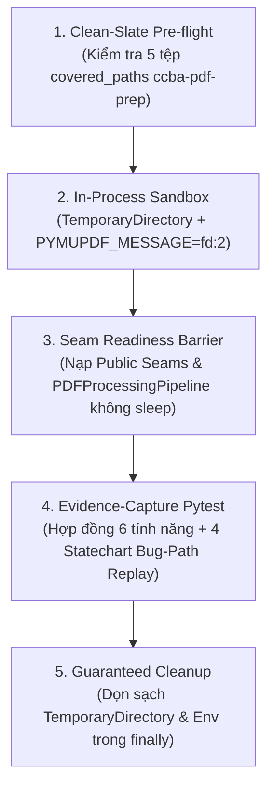
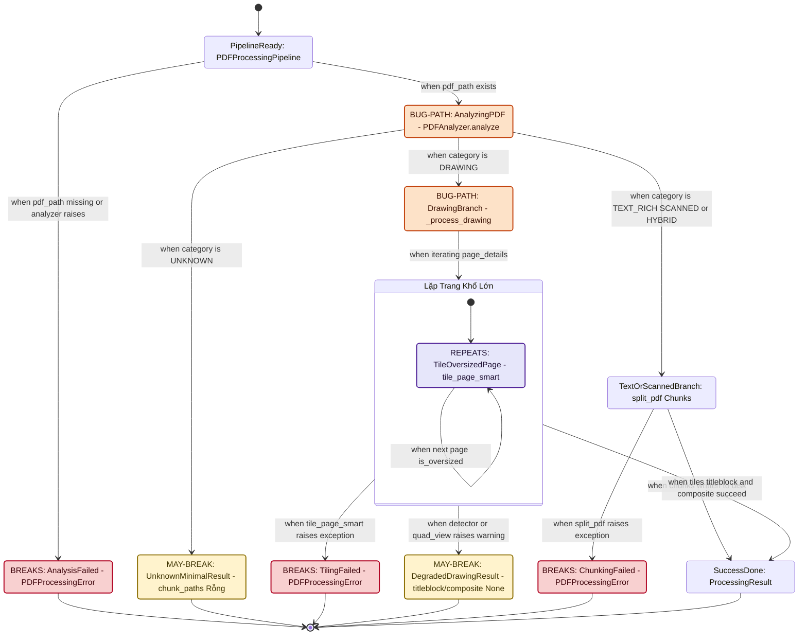

# Kỹ Năng Kiểm Định Tự Động `verify-ccba-pdf-prep`

Bộ kỹ năng kiểm định tự động chuyên biệt cho package `ccba-pdf-prep` (`PDFProcessingPipeline`, `ProcessingResult`, `PDFProcessingError`, `PDFReport`, `PDFCategory`, `VisionOptimizer`, `TitleBlockDetector`), được khởi tạo theo **Profile B (In-Process Library)** của `ccba-create-verification-skill` `v1.4.0` và chuẩn **Pstack `statechart` `v0.15.42`**. Toàn bộ mã kiểm định cô lập trong `packages/ccba-harness/.agents/skills/verify-ccba-pdf-prep/harness/`.

## 🏛️ Platform-Aware Architecture Posture

- **Seam Capability Posture**: `package-bound`. Bảo vệ trực tiếp Public Deep Seam `PDFProcessingPipeline.process()` và các DTOs công khai (`ProcessingResult`, `PDFProcessingError`, `PDFReport`, `PDFCategory`, `Segment`, `PageDetail`) tương ứng với kỹ năng `ccba-ai-pdf-preprocessor`.
- **Version Anchor (`sync_commit` & `covered_sha256`)**: Neo tại commit trên `main` `ac677d467317a7b08453a6cebcdce5964964ad14` kèm mã băm SHA-256 chuẩn hóa LF bảo vệ toàn bộ `5` tệp `covered_paths`.
- **Giới Hạn Phạm Vi (`Scope & Limitations`)**:
  - `PDFProcessingPipeline` hỗ trợ tiêm dependency qua constructor (`analyzer`, `optimizer`, `detector`, `composer`), cho phép kiểm định nhánh chiến lược (`DRAWING`, `TEXT_RICH`, `SCANNED`, `HYBRID`, `UNKNOWN`) hoàn toàn in-process không phụ thuộc GPU hay tệp PDF CAD nặng.
  - Ở nhánh `DRAWING` (`pipeline.py:204-225`), lỗi ở `TitleBlockDetector.extract()` hoặc `CompositeBuilder.quad_view()` chỉ ghi `logger.warning` và trả `ProcessingResult` bị suy giảm (`titleblock_path=None` / `composite_path=None`) được khóa bằng `bug_path_3`.

---

## Kiến Trúc 5 Khối Kiểm Định In-Process (`Profile B`)



### 1. Clean-Slate Pre-flight
- Xác nhận đủ `5` tệp trong `covered_paths` tồn tại trên đĩa và `ccba_pdf_prep.__init__.py` không sinh ngoại lệ khi kiểm tra khởi tạo.

### 2. In-Process Sandbox Isolation
- Khởi tạo vùng làm việc tạm `TemporaryDirectory(prefix="verify_ccba_pdf_prep_")`, thiết lập `PYTHONPATH` và `PYMUPDF_MESSAGE=fd:2` (`RULE-5.13`) mà **không mở cổng TCP hay dựng HTTP dummy server**.

### 3. Deterministic Seam Readiness Barrier
- Kiểm tra nạp thẳng Public Deep Seams trong `ccba_pdf_prep.__all__` (`PDFProcessingPipeline`, `ProcessingResult`, `PDFProcessingError`, `PDFReport`, `PDFCategory`, `Segment`, `PageDetail`, `render_page_to_image`, `get_pdf_page_count`) bằng lệnh con Python sạch; cấm dùng `time.sleep(N)`.

### 4. Evidence-Capture Pytest & Statechart `v0.15.42` (`Bug-Path Replay`)
- Thực thi `test_pdf_prep_suite.py` đối chiếu toàn bộ `6` tính năng trong `features/INDEX.md` và mô hình hóa luồng chuyển trạng thái bằng `stateDiagram-v2` ($20 \le 20$ cạnh, đủ 4 lớp kiểm định):



**Danh sách đường dẫn phản chứng (`bug_path`) & bước ẩn bàn giao kèm sơ đồ:**
- `bug_path_1` (Missing or Corrupt PDF — `PDFProcessingError`): `[{"from": "PipelineReady", "to": "AnalysisFailed", "when": "pdf_path missing or analyzer raises"}]`
- `bug_path_2` (Drawing Tiling Failure — `PDFProcessingError`): `[{"from": "PipelineReady", "to": "AnalyzingPDF", "when": "pdf_path exists"}, {"from": "AnalyzingPDF", "to": "DrawingBranch", "when": "category is DRAWING"}, {"from": "TileOversizedPage", "to": "TilingFailed", "when": "tile_page_smart raises exception"}]`
- `bug_path_3` (Drawing TitleBlock/Composite Failure Degrades Silently): `[{"from": "DrawingBranch", "to": "OversizedLoop", "when": "iterating page_details"}, {"from": "TileOversizedPage", "to": "DegradedDrawingResult", "when": "detector or quad_view raises warning"}]`
- `bug_path_4` (Unknown Category Minimal Empty Result): `[{"from": "PipelineReady", "to": "AnalyzingPDF", "when": "pdf_path exists"}, {"from": "AnalyzingPDF", "to": "UnknownMinimalResult", "when": "category is UNKNOWN"}]`
- `hidden_steps` (lược bỏ để giữ ngân sách $\le 20$ cạnh):
  - `AnalyzingPDF -> TextOrScannedBranch -> ChunkingFailed` (khi `split_pdf` ném ngoại lệ ở tài liệu `TEXT_RICH`/`SCANNED`/`HYBRID`, đã khóa cùng hợp đồng `PDFProcessingError`).
  - `DrawingBranch -> SuccessDone` (khi bản vẽ không có trang `is_oversized`, bỏ qua vòng lặp cắt ô).
- Cả 4 chuỗi `bug_path` được replay trực tiếp trên mã nguồn thật tại `test_pdf_prep_suite.py`.

### 5. Guaranteed Cleanup
- Xóa toàn bộ thư mục tạm và khôi phục trạng thái môi trường trong khối `finally:`.

---

## Quy Trình Vận Hành & Bảo Trì

### Bước 1: Chạy Bộ Kiểm Định 5 Khối Cho `ccba-pdf-prep`
```bash
.venv/bin/python packages/ccba-harness/.agents/skills/verify-ccba-pdf-prep/harness/run_verify_pdf_prep.py
```
- **Tiêu chí hoàn thành:** Toàn bộ `6` ca kiểm thử trong `test_pdf_prep_suite.py` vượt qua 100%, thư mục tạm được giải phóng và lệnh thoát với `exit code 0`.

### Bước 2: Phép Thử Đột Biến Ngữ Nghĩa (`Semantic Mutation Proof`)
- Xác nhận `git diff --quiet` trên `packages/ccba-pdf-prep`.
- Thực hiện 1 đột biến ngữ nghĩa tạm thời trên `packages/ccba-pdf-prep/src/ccba_pdf_prep/pipeline.py` (ví dụ đảo điều kiện `if not pdf_path.exists():`), chạy lại `run_verify_pdf_prep.py` để xác nhận bắt được lỗi (`exit code != 0`), hoàn nguyên sạch với `git checkout --`, và chạy lại xác nhận `exit code 0`.
- **Tiêu chí hoàn thành:** Bộ kiểm định bắt được đột biến ngữ nghĩa, mã nguồn hoàn nguyên 100% sạch sẽ và lần chạy nghiệm thu đạt `exit code 0`.
