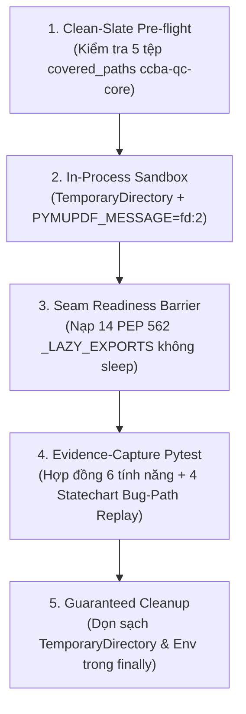
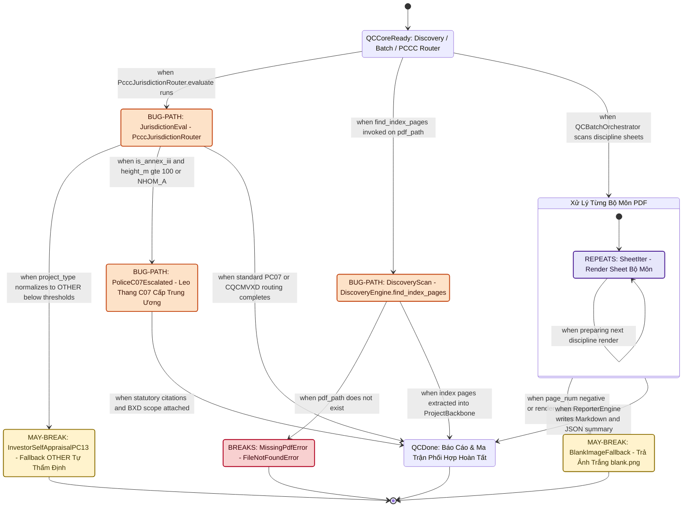

# Kỹ Năng Kiểm Định Tự Động `verify-ccba-qc-core`

Bộ kỹ năng kiểm định tự động chuyên biệt cho package `ccba-qc-core` (`PcccJurisdictionRouter`, `PcccProjectSpec`, `PcccProjectType`, `PcccJurisdictionResult`, `DiscoveryEngine`, `ProjectBackbone`, `SheetEntry`, `QCBatchOrchestrator`, `QCAuditPipeline`, `ReporterEngine`), được khởi tạo theo **Profile B (In-Process Library)** của `ccba-create-verification-skill` `v1.4.0` và chuẩn **Pstack `statechart` `v0.15.42`**. Toàn bộ mã kiểm định cô lập trong `packages/ccba-harness/.agents/skills/verify-ccba-qc-core/harness/`.

## 🏛️ Platform-Aware Architecture Posture

- **Seam Capability Posture**: `package-bound`. Bảo vệ trực tiếp `14` lazy-loaded Public Deep Seams trong `ccba_qc_core.__all__` / `_LAZY_EXPORTS` tương ứng với kỹ năng `ccba-ai-qc` (`QCAuditPipeline`, `QCBatchOrchestrator`, `DiscoveryEngine`, `PcccJurisdictionRouter`, `ReporterEngine`, `QuadViewAuditEngine`, `SemanticAuditEngine`, `PcccMapReduceEngine`).
- **Version Anchor (`sync_commit` & `covered_sha256`)**: Neo tại commit `e24728d8826f49b74a981fe90e740f986c5afe4a` kèm mã băm SHA-256 chuẩn hóa LF bảo vệ toàn bộ `5` tệp `covered_paths`.
- **Giới Hạn Phạm Vi (`Scope & Limitations`)**:
  - Toàn bộ ca kiểm thử tạo dữ liệu PDF tối giản (2 trang text qua `pymupdf`) trong `tmp_path` và cô lập `render_page_to_image` qua `monkeypatch`, tuyệt đối không gọi LLM Gateway thực hay đọc hồ sơ CAD dung lượng lớn.
  - `PcccJurisdictionRouter` sử dụng `resolve_statutory_doc` (Luật `55/2024/QH15`, NĐ `105/2025/NĐ-CP`) để phân luồng `C07`, `PC07`, `CQCMVXD` (`BO_XAY_DUNG` / `SO_XAY_DUNG`), hoặc fallback tự thẩm định `PC13` (`bug_path_3`).

---

## Kiến Trúc 5 Khối Kiểm Định In-Process (`Profile B`)



### 1. Clean-Slate Pre-flight
- Xác nhận đủ `5` tệp trong `covered_paths` tồn tại trên đĩa và `ccba_qc_core.__init__.py` sẵn sàng phân giải `_LAZY_EXPORTS`.

### 2. In-Process Sandbox Isolation
- Khởi tạo vùng làm việc tạm `TemporaryDirectory(prefix="verify_ccba_qc_core_")`, thiết lập `PYTHONPATH` và `PYMUPDF_MESSAGE=fd:2` (`RULE-5.13`) **không mở cổng TCP hay gọi AI Gateway**.

### 3. Deterministic Seam Readiness Barrier
- Kiểm tra nạp thẳng toàn bộ `14` Public Deep Seams trong `ccba_qc_core.__all__` khớp 1:1 với `_LAZY_EXPORTS`, cùng khả năng phân giải `PcccJurisdictionRouter`, `DiscoveryEngine`, `QCBatchOrchestrator`, `QCAuditPipeline`, `ReporterEngine` bằng lệnh con Python sạch; cấm dùng `time.sleep(N)`.

### 4. Evidence-Capture Pytest & Statechart `v0.15.42` (`Bug-Path Replay`)
- Thực thi `test_qc_core_suite.py` đối chiếu toàn bộ `6` tính năng trong `features/INDEX.md` và mô hình hóa luồng chuyển trạng thái bằng `stateDiagram-v2` ($18 \le 20$ cạnh, vượt qua 5 Anti-Lie invariants):



**Danh sách đường dẫn phản chứng (`bug_path`) & bước ẩn bàn giao kèm sơ đồ:**
- `bug_path_1` (Discovery Missing PDF `FileNotFoundError`): `[{"from": "QCCoreReady", "to": "DiscoveryScan", "when": "find_index_pages invoked on pdf_path"}, {"from": "DiscoveryScan", "to": "MissingPdfError", "when": "pdf_path does not exist"}]`
- `bug_path_2` (Batch Orchestrator Negative Page / Render Exception Falls Back to `blank.png`): `[{"from": "QCCoreReady", "to": "BatchSheetLoop", "when": "QCBatchOrchestrator scans discipline sheets"}, {"from": "BatchSheetLoop", "to": "BlankImageFallback", "when": "page_num negative or render_page_to_image raises"}]`
- `bug_path_3` (Unrecognized Occupancy Normalizes to `OTHER` & Investor `PC13` Self-Appraisal): `[{"from": "QCCoreReady", "to": "JurisdictionEval", "when": "PcccJurisdictionRouter.evaluate runs"}, {"from": "JurisdictionEval", "to": "InvestorSelfAppraisalPC13", "when": "project_type normalizes to OTHER below thresholds"}]`
- `bug_path_4` (Annex III High-Rise / Group A Escalates Police Tier to `C07`): `[{"from": "QCCoreReady", "to": "JurisdictionEval", "when": "PcccJurisdictionRouter.evaluate runs"}, {"from": "JurisdictionEval", "to": "PoliceC07Escalated", "when": "is_annex_iii and height_m gte 100 or NHOM_A"}]`
- `hidden_steps` (lược bỏ để giữ ngân sách $\le 20$ cạnh):
  - `QCBatchOrchestrator.run_batch` ném `FileNotFoundError` nếu tệp `matrix_csv` không tồn tại (đã kiểm định trực tiếp tại `test_feat_qcc_004`).
  - `PcccJurisdictionRouter._evaluate_cqcmvxd` miễn trừ thẩm định cơ quan chuyên môn đối với `NHA_O_RIENG_LE` cao `< 28m` và `< 7` tầng.
- Cả 4 chuỗi `bug_path` được replay trực tiếp trên mã nguồn thật tại `test_qc_core_suite.py`.

### 5. Guaranteed Cleanup
- Xóa toàn bộ thư mục tạm và khôi phục trạng thái môi trường trong khối `finally:`.

---

## Quy Trình Vận Hành & Bảo Trì

### Bước 1: Chạy Bộ Kiểm Định 5 Khối Cho `ccba-qc-core`
```bash
.venv/bin/python packages/ccba-harness/.agents/skills/verify-ccba-qc-core/harness/run_verify_qc_core.py
```
- **Tiêu chí hoàn thành:** Toàn bộ `6` ca kiểm thử trong `test_qc_core_suite.py` vượt qua 100%, thư mục tạm được giải phóng và lệnh thoát với `exit code 0`.

### Bước 2: Phép Thử Đột Biến Ngữ Nghĩa (`Semantic Mutation Proof`)
- Xác nhận `git diff --quiet` trên `packages/ccba-qc-core`.
- Thực hiện 1 đột biến ngữ nghĩa tạm thời trên `packages/ccba-qc-core/src/ccba_qc_core/jurisdiction.py` (ví dụ đổi `police_tier = "C07"` tại dòng `277` thành `police_tier = "PC07"`), chạy lại `run_verify_qc_core.py` để xác nhận bắt được lỗi (`exit code != 0`), hoàn nguyên sạch với `git checkout --`, và chạy lại xác nhận `exit code 0`.
- **Tiêu chí hoàn thành:** Bộ kiểm định bắt được đột biến ngữ nghĩa, mã nguồn hoàn nguyên 100% sạch sẽ và lần chạy nghiệm thu đạt `exit code 0`.
